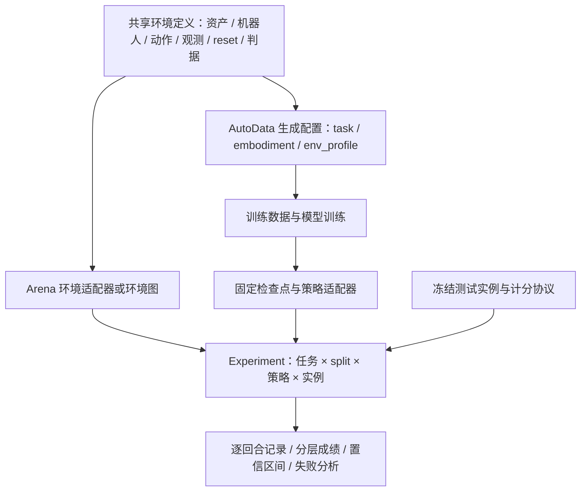

# 从 AutoData 场景与配置搭建 Arena 具身仿真评测基准

创建日期：2026-10-22。本文是针对本仓库锁定版本的设计分析；只做源码与配置核对，没有执行 GPU 仿真、训练或策略评测。文中预算、分层与接口扩展均为建议，不是实测结果。

## 1. 建议采用的方案

把 AutoData 已有的机器人、场景、动作和判据整理成**共享环境定义**，由 AutoData 生成训练数据，由 Arena 执行闭环策略评测。在共享定义上冻结测试实例、成功标准、预算和统计方法，才形成自己的 benchmark。

Arena 能提供环境组合、策略接口、Experiment/Run 编排、过程目标跟踪和指标记录；它不会自动替你确定测试集是否泄漏、初态是否有效、成功判据是否合理，也不会自动把 AutoData YAML 转成评测基准。

针对现有代码，建议分两步：先通过 `workspace-overlays/` 中的外置适配器保留 AutoData 环境语义，建立可复验的单任务基准；接口与判据稳定后，再把适合复用的资产和任务注册到 Arena，使用场景图扩展多场景、多物体任务。OpenArm、Franka、G1 应分别建立具身赛道，不混为同一动作接口或直接比较裸平均分。



## 2. 现有 config 各自负责什么

| 现有来源 | 已表达的语义 | 评测中如何处理 |
| --- | --- | --- |
| AutoData 基础 Gym 环境配置 | 机器人、场景、相机、物理、动作、观测与终止 | 作为共享环境来源，明确实际依赖版本 |
| `autodata_examples/env_profiles/franka_bin_stack.yaml` | 基础环境 ID、刚体增加/覆盖、事件移除/覆盖/增加、规划器 profile | 复用场景与 reset；规划器配置只供相应生成或规划基线使用 |
| `autodata_examples/tasks/*.yaml` | `object_ref`、分段信号、选源、插值、动作噪声、成功轨迹目标数 | 保留在训练数据生成端；可用于设计诊断阶段，但不能直接成为评测计分器 |
| `autodata_examples/embodiments/*.yaml` | TCP 观测键、EEF 偏移、位姿动作到环境动作的映射 | 用于核对策略动作/观测契约；不能照搬成 Arena 的机器人注册配置 |
| `config/openarm/experiment.json:common` | 动作缩放、reset 范围、成功参数与公共环境 ID | 当前工作区已有的共享语义入口 |
| 同文件 `generation` | 三份生成配置引用、生成并行度 | 不进入策略分数的分母或成功定义 |
| 同文件 `evaluation` | 策略、seed、环境数、完成回合预算、模拟时间限制 | 可映射到 Arena 运行配置，但当前 JSON 是工作区启动器格式 |
| Arena 环境图 YAML | `embodiment/background/objects/relations/task` | 描述环境；资产和任务类型须已注册 |
| Arena Experiment YAML | `shared` 与具名 `runs`，每个 Run 选择环境、策略和 rollout 设置 | 组织完整评测矩阵 |

不要因为 JSON 能被 YAML 解析，就认为不同 schema 可以互换。当前 `scripts/shared-config.py` 消费的是工作区格式；Arena `arena_experiment_config_loader.py` 的 JSON 分支走 legacy schema，YAML 分支走 typed Experiment loader。不能将 `config/openarm/experiment.json` 或 `openarm-benchmark/benchmark.json` 原样传给 Arena Experiment Runner。

### 用 Franka bin-stack 说明场景迁移

现有 env_profile 在普通 `Isaac-Stack-Cube-Franka-IK-Rel-v0` 上增加蓝色箱子，将 `cube_1` 固定于箱内，令 `cube_2/cube_3` 在 x=[0.65,0.70] m、y=[-0.18,0.18] m、yaw=[-1,1] rad 范围内采样，并设置 0.1 m 最小分离；三个方块的 solver position iterations 从基础值提高到 40。这里既有几何布局，也有影响接触行为的物理设置，评测迁移必须全部记录。

配套 SkillGen task 按 `grasp_1 → stack_1 → grasp_2 → stack_2` 组织片段，`action_noise=0.0`。这是生成器对箱壁狭窄空间的处理，不能据此认定测试集已经包含控制噪声或障碍泛化。Franka SkillGen embodiment 还使用 0.1034 m EEF 偏移，对齐示教的 `panda_hand` 与环境的指间坐标系；忽略它会让动作映射出错。

另一个容易漏掉的差异是四元数顺序：该 AutoData profile 的旋转字段声明为 xyzw；迁移到机器人状态或 Arena 资产接口时必须逐项核对，不能默认所有位置都用相同顺序。固定箱子的 spawn pose 与 reset pose 也应一致，否则规划器从 USD 读取的碰撞世界可能与物理初态不同。

## 3. 两条 Arena 接入路线

### 路线 A：保留现有环境，通过外置适配器评测

优先用于自有机器人和已有 AutoData Gym 任务。已有 `shared_config/arena_base.py` 将源配置拆成 Embodiment 的机器人/相机/动作/观测，Task 的道具/reset/判据，以及 callback 的 sim/decimation；`shared_config/arena.py` 处理当前 Arena 的 `TaskTerminationCfg`、PhysX 和夹爪索引兼容。

建议抽出公共环境工厂，先构造未被生成器修改的配置，再分别增加 generation 和 evaluation 设置。特别不能把 `setup_env_config()` 返回的生成环境直接当成评测环境：其实现先提取 success term，再将 `env_cfg.terminations = None`，并配置示教 recorder。评测必须明确恢复成功、失败和超时，也必须使用评测专用的观测接口。

现有外部环境通过 `--external_environment_class_path` 接到 `policy_runner`。这个适配器并不因此自动成为 typed Experiment 的注册环境；下一步需要提供 Arena 环境工厂及其配置类型，或者由工作区编排器展开多个独立运行。保留旧入口做回归，确认 typed 工厂生成的有效配置与它一致后再迁移。

目前共享适配器的场景成员是硬编码的，新增物体需要扩展适配器。现有 env_profile 也主动限制了 scene/event 补丁以避免绕过共享工厂。因此“修改一份任意场景 YAML 就能自动评测”尚未实现。

### 路线 B：注册资产与任务，以 Arena 环境图组织基准

适用于要扩展大量物体组合、场景布局和语言任务的阶段。现有 RoboLab `banana_in_bowl.yaml` 用 `external_yaml` 引用 `banana_bowl.yaml`：场景文件声明 Droid、桌面、香蕉、碗与空间关系；任务文件选择 `PickAndPlaceTask` 并设置 70 s 预算。这是“场景复用、任务单独定义”的直接范例。

自有资产先提供 USD、碰撞体、材质、质量、惯量、尺度、可达性与接触传感配置，再注册供图中的 `registry_name` 引用。自有 OpenArm 仍需要实现 Embodiment 和动作/相机配置。Franka 叠放应使用保留叠放语义的自定义 Task 或经验证的组合任务，不能仅把 task kind 换成普通抓放。

场景图负责组合和关系约束。复杂装配、插入、工具接触等任务还需要相应物理与成功判据实现，不能只用对象相对位置代替任务正确性。

## 4. 先冻结任务语义，再冻结测试实例

### OpenArm 可作为第一条自有赛道

当前共享配置给出了明确的起点：

| 项目 | 配置或现有定义 |
| --- | --- |
| 动作 | 左臂 7D 相对 IK：平移、旋转、夹爪 |
| 缩放 | 平移 0.02 m；旋转 0.1 rad；负夹爪动作闭合 |
| reset | x 偏移 ±0.04 m；y 偏移 ±0.06 m；相对原环境参考位姿 |
| 成功参数 | 高度误差 0.008 m、释放位置 0.3 rad、线速度上限 0.03 m/s、角速度上限 0.5 rad/s |
| 几何条件 | 方块完整投影位于扫描鼠标垫内，来自源判据；不是 JSON 四个参数的全部语义 |
| 当前评测默认值 | seed=11、1 环境、100 回合、90 s、zero_action |

这些值定义的是现有任务；`zero_action` 是入口负例，不是学习策略基线。历史固定动作回放只用于固定初态回归，随机初态下不能假设它仍然成功。

**原判据与增强判据需要分版本。** 当前 OpenArm 适配器把源放置判据包装为单个 ProgressObjective，没有加入“曾抓起”历史条件。Arena 原生 `PickAndPlaceTask` 则按物体静置、抬起、目标位置放稳的 predicate sequence 检查；默认线速度阈值为 0.003 m/s，还检查支撑接触。二者的分数不能当成同一任务成绩。

建议先冻结 `openarm-place-v1` 保留原语义；若要加入真实抓取、指定手臂、释放后持续静置、禁止推入目标区等规则，发布新的任务版本并同时保留旧版。语言指令的每项要求都应对应可验证条件；未被判据检查的要求不能宣称已评测。

### 测试集建议

| 层级 | 控制变量 | 回答的问题 |
| --- | --- | --- |
| ID | 训练范围内的新初态和独立实例 | 同分布操作能力 |
| 空间 OOD | 在已验证可达域内改变位姿范围、目标位置、物体朝向 | 几何泛化 |
| 视觉 OOD | 固定几何，改变 HDR、材质、照明、受控相机外参 | 视觉鲁棒性 |
| 物体 OOD | 留出资产身份或类别，并核对尺度和抓取可行性 | 物体泛化 |
| 组合 OOD | 已见物体与目标的新组合、多对象顺序或干扰物 | 组合与长程能力 |
| 物理扰动 | 单独改变摩擦、质量、执行延迟等已实现参数 | 动力学鲁棒性 |

只换随机 seed 不能证明场景、资产或语义没有泄漏。应按资产、场景模板、示教来源和任务组合划分 train/dev/test，再在划分内采样 seed。训练端可筛选成功演示；测试端必须保存所有有效实例的成功和失败，不能使用 `guarantee_success` 或只导出成功回合的方式计分。

初态采样时做穿透、支撑、可达域和目标区检查，按固定且独立于被测策略的规则生成有效实例。把资产 ID、实际 pose、关节状态、相机、物理参数、实例 seed 与文件哈希保存为实例清单；seed 只作为补充。若目前只能依赖 reset RNG，应明确只能达到 seed 级复现。改变并行环境数、重建次数或 RNG 消耗都可能改变实际样本。

建议首版为 3 个任务变体 × 4 个评测层 × 每层 100 个实例，即每个策略 1200 回合；先做各单元 10 回合开发检查，再执行正式预算。这里的三个变体必须各自定义并验收，例如原始放置、目标位置变化、单干扰物；后两者属于待实现能力，不能视为当前共用配置已经支持。100 个独立样本的单格成功率在最不确定区域误差仍约为 ±10 个百分点，正式排名需要按预期差异增加样本。

## 5. 用 Arena Experiment 组织执行

下面示例沿用锁定 Arena 的真实字段与已有 RoboLab 环境，用于说明配置结构；不是 AutoData 环境的自动转换结果，也未在本次执行：

```yaml
shared:
  environment:
    type: isaaclab_arena_environments/robolab/tasks/banana_in_bowl.yaml
  policy:
    type: zero_action
  environment_builder:
    num_envs: 1
    seed: 11
    placement_seed: 11
  rollout_limit:
    num_episodes: 100
runs:
  negative_seed11: {}
  negative_seed22:
    environment_builder:
      seed: 22
      placement_seed: 22
```

在已配置好 GPU 的 Arena 容器内，从 Arena 根目录用该环境的解释器执行 `isaaclab_arena/evaluation/experiment_runner.py --experiment_config <评测YAML>`。使用上述相对环境路径时工作目录必须正确。仿真命令通过工作区 `scripts/task-queue.py` 提交，同主机所有任务使用同一个队列目录；本报告不启动任务或准备容器。

接入自有任务后，将 `environment.type` 换成已实现并注册的环境工厂或自己的图 YAML；将策略替换为兼容该机器人的策略适配器。`num_steps` 与 `num_episodes` 互斥，正式成绩建议按完成回合预算运行。`episode_length_s` 属于任务的模拟时间限制，不能拿墙钟 timeout 替代。

源码中 `rollout_policy` 按一整步中所有结束的环境累加，达到 `>= num_episodes` 后退出；因此并行时实际完成数可能超过预算。首版可用单环境确保实例计分明确；扩展并行后，需要按预先分配的 instance ID 对齐回合，并对超额回合采用事先固定的规则。不能按最快成功的前 N 条样本选取成绩，也不能把未完成回合无声丢弃。

`num_rebuilds` 可重新构建环境，但它不等于测试集实例冻结机制。OSMO、多 GPU 和多节点调度可在单机协议稳定后使用；调度扩容不会自动解决重复样本、策略状态串扰或计分对齐。

## 6. 策略接口、指标与结果交付

### 策略契约

固定图像分辨率、色彩格式、相机内外参、proprio 关节顺序与单位、TCP 坐标系、四元数顺序、归一化、动作类型与缩放、夹爪符号、控制频率、action chunk 长度和执行策略。模型只读取赛道允许的观测；仿真真值可用于评分，但不应混入 RGB 策略输入。

每次单环境结束都必须清空该环境的时序缓存、语言缓存和 action chunk，保留其他环境的策略状态。远程推理要固定超时、重试和延迟规则，记录权重哈希、服务版本与推理配置；不允许策略 A 获得额外重试或更长模拟预算。

建议至少设置 zero-action 负例、固定初态 fixture 回归、AutoData 训练出的策略基线。若另加 SkillGen/cuRobo 规划器基线，单列其可用真值和规划预算，与纯视觉策略分赛道报告。

### 成绩与诊断

| 指标 | 定义与用途 | 现状 |
| --- | --- | --- |
| 成功率 | 预定有效测试实例中完成任务的比例 | 可复用 `SuccessRateMetric` |
| 宏平均 | 先算每个任务/层的成功率，再按冻结权重汇总 | 需要基准汇总层实现 |
| 阶段完成率 | 抓取、搬运、放置或叠放各阶段完成比例 | 用 ProgressObjective/自定义 recorder 增加 |
| 完成时间 | 成功回合的模拟时间；并报超时比例 | 需要记录/汇总，不能只报成功者均值 |
| 失败类型 | 掉落、错目标、夹持未释放、超时、不可恢复状态等 | 需定义优先级与记录规则 |
| 安全/碰撞 | 禁止接触次数、超限力或冲量等 | 需要传感器与阈值校准，不把正常抓取接触当失败 |
| 系统效率 | 推理延迟、墙钟吞吐、显存、实时因子 | 独立于任务能力成绩报告 |

报告每格样本数、成功数和 Wilson 95% 区间；同实例比较策略时使用配对差值与配对 bootstrap 等方法，多模型/多随机训练种子还要报告模型间波动。不可把同源重复回放当成独立证据。

区分任务失败与基础设施失败：掉落/超时应计入任务失败；初始化崩溃、资产缺失、记录不全应使该评测不完整。不得将崩溃当作正常结束后仅对幸存回合算成绩。当前原生 success metric 对空记录可返回 0，因此必须同时检查运行状态、实际回合数、实例覆盖和记录完整性。

建议基准运行产物为：有效配置快照、依赖/资产/权重清单、逐回合记录、原生 Arena 报告、分层汇总、失败视频和完整日志。逐回合至少记录 `benchmark_version/task_version/split/instance_id/policy_hash/seed/env_id/episode_id/success/termination_reason/sim_steps/sim_time_s/run_status`。新增字段及聚合是待实现的基准层，不是当前 Arena 默认已经输出的完整 schema。视频只作为诊断证据；单个视口不能代表所有并行环境均有独立录像。

## 7. 当前缺口与实施顺序

| 顺序 | 具体工作 | 退出条件 |
| --- | --- | --- |
| 1 | 找回并校验 OpenArm 环境源码/资产，或选择现存独立 production runtime 并另做适配 | 环境来源唯一，哈希锁定；不靠旧包同名模块碰巧导入 |
| 2 | 建立公共环境工厂与评测适配器，固定动作/观测/成功版本 | 单环境完成正例与负例判据检查、reset 和动作契约检查 |
| 3 | 冻结实例生成与 train/dev/test 清单 | 测试实例不靠策略筛选；重复构建可对齐实例 |
| 4 | 加入回合 ID、失败原因、覆盖校验与指标汇总 | 完整预算计分，异常运行明确不完整 |
| 5 | 接学习策略并做单任务开发评测 | 模型接口、逐环境状态重置与版本溯源通过 |
| 6 | 扩展场景和 OOD 层，再做正式评测与并行扩容 | 相同实例跨策略一致，任务/层权重和统计方法冻结 |

本仓库 `config/README.md` 已声明：历史共用配置所需的 `openarm_autodata/.../left_env_cfg.py` 不在当前锁定 AutoData 提交中，当前源入口缺失。`workspace-overlays/openarm-production/prepare.py` 准备的独立 runtime 是另一条来源，不会自动修复共享配置。首要工作是选择并锁定来源，而不是直接增加评测回合数。

`workspace-overlays/openarm-benchmark/README.md` 保存了历史零动作 0/2、固定轨迹 1/1 的 GPU 记录说明；它们仅证明当时的特定环境与链路，不是新测试集的模型成绩。本次没有复跑这些结果。未来要检验判据边界，例如目标上方悬空、刚体跨界、仍被夹持、初态已在目标、落地、完成与超时同帧等；并区分“直接设置状态验证判据”和“策略完整闭环完成任务”两类证据。

## 8. 依据与版本边界

分析使用工作区基线 `2868f7c3c12a5b353f1fe15063b8c97937c0435c` 的配置/扩展，以及原工作区上游源码只读检视。AutoData HEAD 为 `1c7360d85c9ad131ca6c8c70f1f731a6312616f3`；顶层 Arena 为 `98866596fd024d96c874fe6fb95ae916d1133629`；AutoData 内嵌 Arena 为 `8b82dca224f2b5af08f339f987613c59ce9cdbaa`。后两者是不同依赖，不能混用安装路径。原工作区 AutoData 有数据文件及嵌套子模块本地变化，本次保留；本文重点引用的 AutoData examples/interfaces 和顶层 Arena 未发现对应源码差异。

可追溯来源：

- [工作区共用配置说明](../config/README.md)、[OpenArm 实验配置](../config/openarm/experiment.json)、[共享适配器](../workspace-overlays/shared_config/shared_config/arena.py)、[共享环境拆分](../workspace-overlays/shared_config/shared_config/arena_base.py)。
- [已有 benchmark 的范围与历史验证](../workspace-overlays/openarm-benchmark/README.md)、[工作区版本与运行依赖边界](version-management.md)、[共享队列规则](task-queue.md)。
- [AutoData 锁定版 bin-stack 场景配置](https://github.com/isaac-sim/AutoData/blob/1c7360d85c9ad131ca6c8c70f1f731a6312616f3/autodata_examples/env_profiles/franka_bin_stack.yaml)、[生成环境转换实现](https://github.com/isaac-sim/AutoData/blob/1c7360d85c9ad131ca6c8c70f1f731a6312616f3/autodata_interfaces/env/isaaclab_env_interface.py)、[SkillGen EEF 配置](https://github.com/isaac-sim/AutoData/blob/1c7360d85c9ad131ca6c8c70f1f731a6312616f3/autodata_examples/embodiments/franka_ik_rel_skillgen.yaml)。
- [Arena 锁定版 Experiment 示例](https://github.com/isaac-sim/IsaacLab-Arena/blob/98866596fd024d96c874fe6fb95ae916d1133629/isaaclab_arena_environments/experiment_configs/getting_started_experiment.yaml)、[原生抓放判据](https://github.com/isaac-sim/IsaacLab-Arena/blob/98866596fd024d96c874fe6fb95ae916d1133629/isaaclab_arena/tasks/pick_and_place_task.py)、[回合循环](https://github.com/isaac-sim/IsaacLab-Arena/blob/98866596fd024d96c874fe6fb95ae916d1133629/isaaclab_arena/evaluation/policy_runner.py)、[成功率记录](https://github.com/isaac-sim/IsaacLab-Arena/blob/98866596fd024d96c874fe6fb95ae916d1133629/isaaclab_arena/metrics/success_rate.py)。
- 2026-10-22 另核对了上游公开的 [Arena Experiment 文档](https://github.com/isaac-sim/IsaacLab-Arena/blob/main/docs/pages/concepts/concept_arena_experiments.rst)、[AutoData 环境 profile 文档](https://isaac-sim.github.io/AutoData/main/pages/concepts/environment_profiles.html)与 [Arena 示例环境文档](https://github.com/isaac-sim/IsaacLab-Arena/blob/main/docs/pages/example_workflows/example_environments.rst)。这些活动分支页面用于交叉核对概念，具体字段和行为以本文锁定源码为准；没有更新上游版本。
