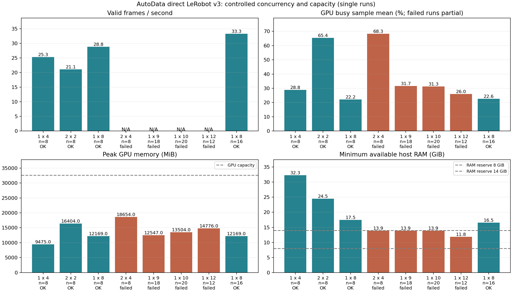

# AutoData Ray 并行与 LeRobot v3 生产实验

创建日期：2026-10-22。本文接续[初始实现记录](autodata-ray-20261022.md)，使用用户明确授权的现有原生 autodata 环境。实验原始数据保存在本机 `runs/autodata-ray-20261022/`，不上传数据集或研究平台。

## 结果与生产建议

在当前主机已有约 39 GiB 共享内存备份占用的条件下，推荐 **1 个仿真进程 × 8 个内部环境、2 个 Ray 导出 actor**，主机可用内存保留 14 GiB。连续 16 条实测完成 21,963 帧，耗时 659.35 秒，**33.31 有效帧/秒，折算 87.36 条/小时**，GPU 全程采样均值 22.64%，峰值显存 11.88 GiB，最低可用主机内存 16.52 GiB。这是约 11 分钟批次验证，不是全天候稳定性或空载机器容量认证。

显存没有填满：在当前图像缓存和主机备份占用下，主机内存先成为限制。9、10 环境和 2×4 均触发 14 GiB 余量保护，12 环境发生采样停滞及 OOM-kill 计数增长。这些配置未完成生产验收，因此未继续测试 16 环境。

| 布局 P×E | 目标/完成条数 | 端到端秒 | 有效帧/秒 | GPU 均值 / P95 | 峰值显存 GiB | 最小可用 RAM GiB |
| --- | ---: | ---: | ---: | ---: | ---: | ---: |
| 1×4 | 8/8 | 433.57 | 25.29 | 28.84% / 49% | 9.25 | 32.29 |
| 2×2 | 8/8 | 523.52 | 21.14 | 65.40% / 89% | 16.02 | 24.47 |
| 1×8 | 8/8 | 381.88 | 28.83 | 22.20% / 50% | 11.88 | 17.48 |
| 1×8 | 16/16 | 659.35 | 33.31 | 22.64% / 49% | 11.88 | 16.52 |

相同总计 4 环境、相同 8 条目标时，2×2 比 1×4 的有效帧吞吐下降 **16.4%**，但 GPU 均值从 28.84% 升到 65.40%，显存从 9.25 GiB 升到 16.02 GiB。因此本轮不支持“增加 Ray 仿真进程就能提速”。从单进程 4 环境增至 8 环境，同样完成 8 条时吞吐提升 **14.0%**。8 环境 16 条批次与 8 条批次的目标工作量不同，其更高吞吐含启动成本摊薄，不能当作进一步的并行加速比。所有成功批次完成样本的成功率均为 100%；达到目标后分别取消了 4、4、8、8 条在途尝试，未混入完成样本分母。

| 容量/布局档 | 目标条数 | 结果 | 已观测峰值显存 GiB | 已采样最小可用 RAM GiB |
| --- | ---: | --- | ---: | ---: |
| 2×4 | 8 | 触发 14 GiB 主机内存余量保护；0 条完整产出 | 18.22 | 13.88 |
| 1×9 | 18 | 触发 14 GiB 主机内存余量保护；0 条完整产出 | 12.25 | 13.90 |
| 1×10 | 20 | 触发 14 GiB 主机内存余量保护；0 条完整产出 | 13.19 | 13.94 |
| 1×12 | 12 | 采样停滞后人工停止，OOM-kill 计数 +1；0 条完整产出 | 14.43 | 11.85 |

12 环境的有效采样最大间隔约 114.7 秒，其资源极值只代表已观测样本，不能视为真实峰值；失败批次没有有效生产率。其余最终试验没有新增 OOM-kill 计数。强化保护前后仅监督器及其测试文件哈希变化，生成、规划、导出及输入哈希一致；三个先前成功配置均未触及新旧任一内存阈值。

8 环境/8 条批次的导出背压累计等待 91.21 秒，逐条共享内存打包累计 11.89 秒，每条写入平均 35.65 秒。当前官方写入路径仍有临时图像写入和 CPU H.264 编码开销。低 GPU 均值与这些等待相符，但本轮没有通过独立消融完全归因。进一步提升容量应先处理主机内存条件、去掉未活动右手空白流，再单独测试分段录制/编码；这些会改变变量，未混入当前布局对照。已有备份文件保持原样，未为实验腾空或删除。

[机器可读结果与逐分片验证记录](autodata-ray-20261022-r02.json) 包含原始 case 路径、执行配置、源码哈希、资源采样统计及成功回读索引。全部 4 个成功批次合计 **40 条、54,999 数据帧、164,997 路视频帧**，视频全量解码通过；所有 float32 数值有限，官方加载器核验 120 个 episode 首/中/末位置的动作与状态。回读通过表示文件与语义结构符合验收，不等于对所有轨迹质量做过人工审查。第三人称、活动左手及未活动右手在最终批次第 700 帧均已抽查：第三人称可见夹持方块，左手视角被近距离方块占据，右手为空白。

## 比较范围与控制变量

原始版本采用可执行的 AutoData 公开 v0.1，提交 `1c7360d85c9ad131ca6c8c70f1f731a6312616f3`；仓库最早提交只有 LICENSE，不能运行。保留公开版原始 planner、embodiment adapter 和生成循环。为在同一 OpenArm 任务上运行，共享任务注册、观测语义、60 步末尾稳定、遥测和直接 LeRobot v3 导出适配；原版另外将同一机器人配置物化为绝对路径 YAML，并保留非活动关节锁定配置。它不是无适配的上游官方任务，也不是此前本地修改版冒充原始版本。AutoData、Arena、IsaacLab 的实际 HEAD 与记录的版本一致，核心源码无本次修改；本机 GR00T 的更深层依赖含既有 dirty 状态，保持原样，因此环境不能称为全新、完全干净的上游检出。

修改版使用已有 OpenArm 规划与执行适配，加上本次 Ray 进程调度、Ray 导出 actor 和共享内存传输。上游文件和版本引用不变。公开版在当前任务中无有效产出，不能计算“相对原版加速倍数”；并行效率比较仅限能够成功生成的修改版。

共同条件：RTX 5090（32,607 MiB 显存）、约 94 GiB 主机内存，固定输入示范、左臂拾取放置任务、三路 640×480 RGB、30 FPS、60 步末尾稳定、基准 seed=1、失败上限 2、2 个导出 actor、8 GiB 在途共享内存预算、24 个逻辑 CPU。多进程按完整物理核分配并均衡 P/E 核，SMT 同胞不拆分；OMP/MKL=2、OpenBLAS=1。两进程的 seed 分别为 1、2；这固定了实验配置，但不保证跨进程布局生成逐帧相同的样本。单条轨迹长度不同，故同时报告有效条数和有效帧数。

`P×E` 表示 Ray 调度的仿真进程数乘每个进程内部环境数，总环境数为乘积。Ray 的资源声明不是显存硬隔离：GPU 由监督器采样，超过 30 GiB 显存、低于预留主机内存或低于 4 GiB 可用磁盘时停止。初始主机内存余量为 8 GiB；12 环境发生资源采样停滞后，新试验将余量提高到 14 GiB，并在独立 worker 中增加 20 秒采样失联停止。先前成功的三个配置最低可用内存均高于 14 GiB，未触发任一阈值。仅同一个共享主机队列任务占用 GPU，所有实验输出独立，失败不自动重试。容量扩展改变总环境数；并行布局对照固定总环境数，不能混为同一个控制变量实验。

使用既有 `runs/lerobot-v3-conversion-env`，包含 Ray 2.52.1、LeRobot 0.4.3、PyTorch 2.11.0、Isaac Sim 6.0.1.0；未安装或更新仿真依赖。CPU affinity 约束仿真及其导出子进程，总预算不包括监督器少量开销。主机 `/dev/shm/worldsim-local-backup-20261022/` 的已有备份分卷占用约 39 GiB，仍由已有 concat 进程打开，未移动、删除或终止。`/dev/shm` 可用约 8.2 GiB，原始单条图像约 3.6 GiB，因此这是带既有主机内存占用的容量实验，不是空载硬件上限；本机实验限制两个并发 writer，不能在相同共享内存预算下随意扩展到四个进程各自导出。

## 计时与指标

端到端计时从 Ray 初始化前到所有仿真 worker 返回，包含仿真初始化、规划、执行、录制、直接写入、写入排空和仿真关闭，不含最终父 Ray 关闭。只有整个 run 成功且分片完成才计入有效生产率。GPU 利用率为 `nvidia-smi` 的忙碌时间比例采样，不是 SM occupancy；报告有效样本均值、95 分位和峰值显存，缺失采样不作为零负载。主机可用内存是整机值，RSS 的共享页不能相加当作物理用量。单次配置测试不能建立统计显著性，也不是长时间无人值守稳定性认证。

## 直接导出的数据契约

每个 actor 独占一个官方 LeRobot v3 数据集分片，包含 `meta/`、`data/`、`videos/`；父目录仅为 manifest，不能直接作为一个合并数据集加载。只导出成功轨迹，九维 `action` 是绝对关节目标，`observation.state` 是相同名称和弧度单位的动作前状态；另保留原始 TCP 动作、实际施加目标及后状态。不创建中间输出 HDF5，输入示范仍为 HDF5。

生产者拥有共享内存的创建和删除，actor 只接收描述符并读取；收到写入 ACK 后才释放，最多每 actor 一个在途 episode。逐块打包释放原 recorder 列表，避免整条图像再叠加一次 NumPy 堆叠与 Ray 序列化。此实现是本机进程间传输，不支持多主机 Ray 集群。未活动右手相机为空白帧（最终批次抽帧为黑色），所有配置保留相同相机开销；第三人称和活动左手相机已人工抽帧检查，不能把右手空白流解释为有效视觉信息。

## 失败与证据边界

原始版在当前 OpenArm 配置第二段接触规划返回 `MotionGenStatus.INVALID_START_STATE_WORLD_COLLISION`，两次尝试均无成功轨迹。路径物化与关节锁定配置问题先行排除后仍复现，诊断见 `upstream-debug-r2`。这说明该任务适配下无法形成原版生产基线，不说明原版在其官方任务上没有生产能力。若要得到原版的公平吞吐比，需要另行在两版本均支持的官方任务上建立相同输入与资产基线。

共享内存版 12 环境试验中，仿真及资源采样在最后约 11.8 GiB 可用内存处停滞；通过 STOP 和对本次仿真进程发 SIGTERM 结束。该次主机 `oom_kill` 计数从 2 增至 3，具体被杀进程没有独立内核日志确认。它是容量失败，零完整有效产出，不能报告为 12 环境通过。采样函数本身可能随内核/驱动停滞，使同线程资源保护延迟；因此增加了独立 worker 失联保护并提高主机内存余量，不继续上探 16 环境。

早期普通 Ray 数组传输的 8 环境试验曾以 SIGKILL 退出，退出前主进程 RSS 约 45.6 GiB，符合内存压力情形，但没有前后 OOM 计数或内核日志证明，不能直接归因为已证实的 OOM。另有早期试验因一次 NVML 查询超时而中断；现已记录缺失样本，连续失联超过 60 秒才停止。早期两进程使用连续 CPU 编号会不均衡分配 P/E 核，已改为按物理核均衡分组。以上诊断试验均不计入最终布局对照。

格式依据：[LeRobot v0.4.3 数据集说明](https://huggingface.co/docs/lerobot/v0.4.3/en/lerobot-dataset-v3)、[Ray actors](https://docs.ray.io/en/latest/ray-core/actors.html)、[Ray 资源声明](https://docs.ray.io/en/latest/ray-core/scheduling/resources.html)、[AutoData 上游](https://github.com/isaac-sim/AutoData)。

## 复现与证据定位

执行入口为 [benchmark_parallel.py](../../workspace-overlays/openarm-production/benchmark_parallel.py)，通过仓库共享任务队列提交；`--processes P --envs E --total-envs N` 必须满足 `P×E=N`。`--total-cpus 24 --total-writers 2 --total-memory-gib 8` 是本次总预算，不是每进程预算。每个 case 的 `config.json` 保存输入 SHA256、执行时 overlay 文件哈希和 CPU 分组；`process-*/worker.json` 保存具体命令；`result.json` 保存批次结果；`gpu.jsonl` 保存原始显卡与内存采样。哈希对应实际执行内容，不能仅用未提交工作树的 HEAD 标识实现版本。

固定输入 SHA256：`7321968fb3f0037b2b7d94bcaa0f0c0ff609c99c89671cd443fcd210c4fec2da`。既有 runtime 来源归档 SHA256：`afa092e722605cb5b12115ebcb70317565360976c571c68f1e09e6ad2735aa48`。实验队列 ID：327=1×8，328=1×4，329=2×2，330=1×12；331 在启动期主动停止，332 取消，均不计性能。333=2×4 重测，334=1×10/20 条目标，335=1×8/16 条目标，336 为产出回读，337 补测 1×9/18 条目标，338 回读该边界档。诊断队列 322 为原始版碰撞失败，323 为旧传输路径的 SIGKILL，326 为共享内存 Ray/官方格式集成冒烟。

[回读脚本](../../scripts/validate-autodata-ray.py) 全量解码所有视频并核对帧数、FPS 和分辨率，检查全部 float32 数值有限性与关节维度，通过官方 `LeRobotDataset(video_backend="torchcodec")` 回读每条 episode 的首、中、末帧并与 Parquet 动作/状态逐值比较。[汇总脚本](../../scripts/summarize-autodata-ray.py) 从原始结果重建吞吐和资源表，失败批次的有效吞吐标记为空。视频压缩是有损 H.264，不能要求解码 RGB 与原始数组逐像素一致。

## 自审与提交边界

已审阅分片独占、共享内存 ACK 后释放及失败清理、无自动重试、源 recorder 所有权转移、动作/状态时序、真实官方格式回读、物理核分配、资源停止和独立失联保护。旧 HDF5 路径保留默认兼容行为，新增路径显式选择 `lerobot-v3`；不修改上游或现有 Python 环境，不把数据集加入 Git。主机生产套件包含 53 项测试，连同 `cloud-check.sh --allow-uninitialized` 纳入提交门禁；该选项仅对应任务 worktree 有意未检出的上游，源码相关测试只读引用现有已配置目录。检查回执绑定提交树，代理自审不是独立 reviewer 批准。原始版任务适配失败、单次配置测量、主机既有内存占用和约 11 分钟的连续批次长度均是本报告的实测边界。
