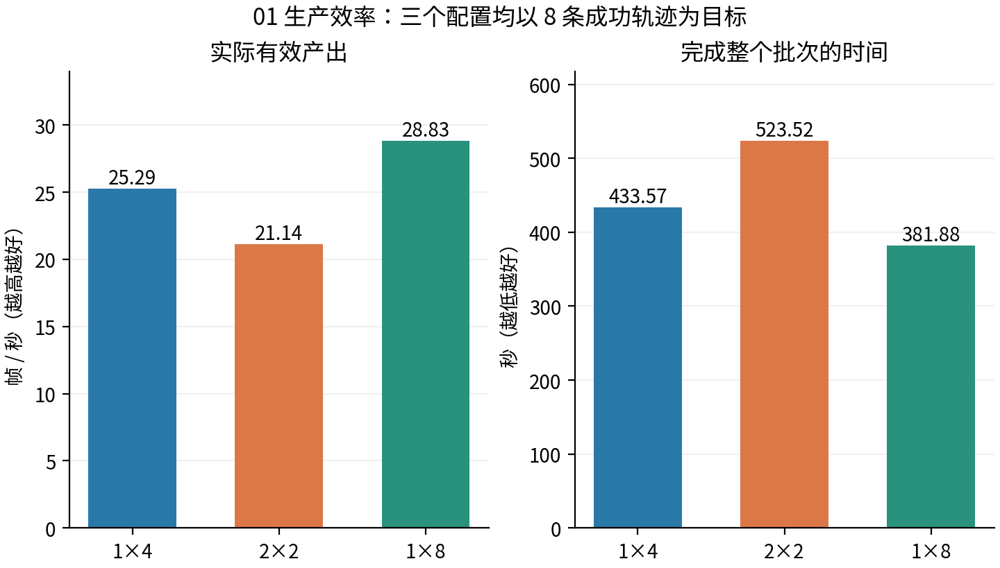
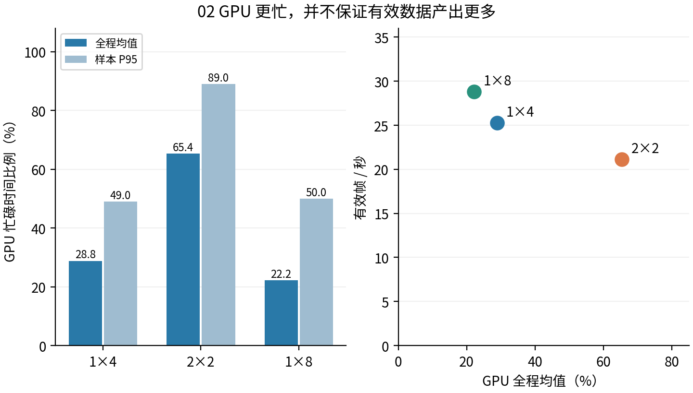
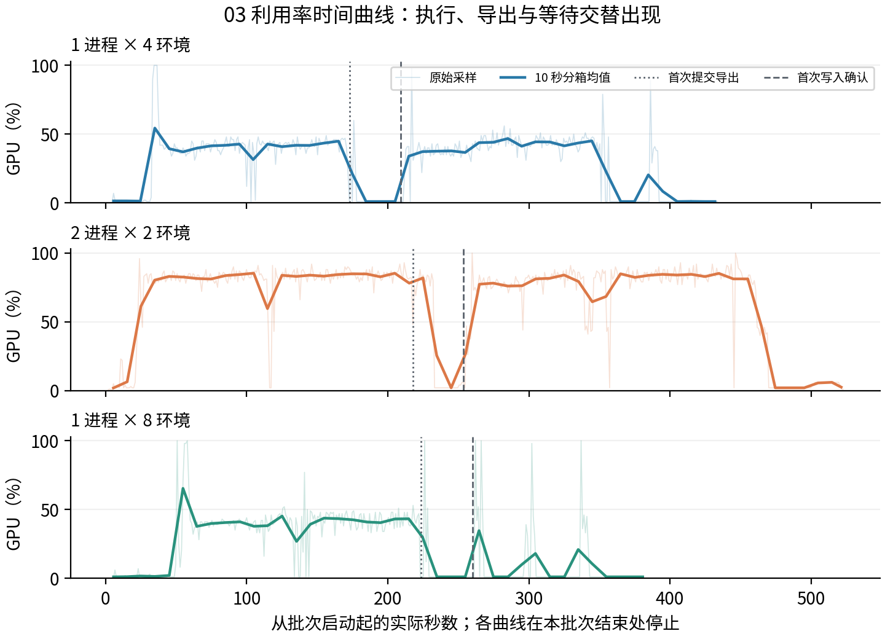
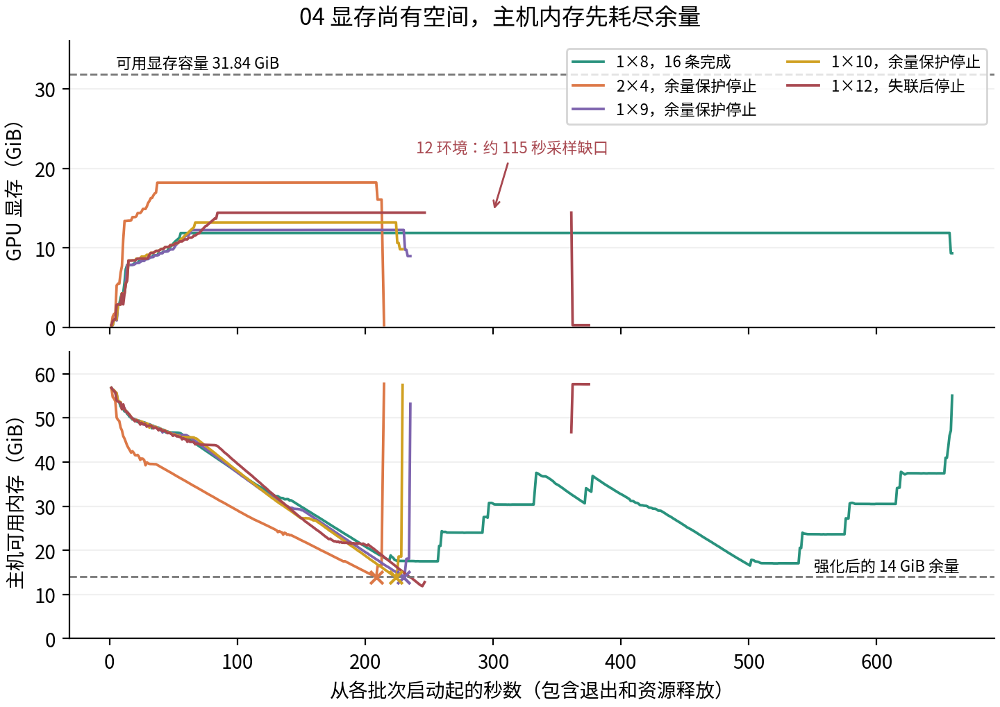
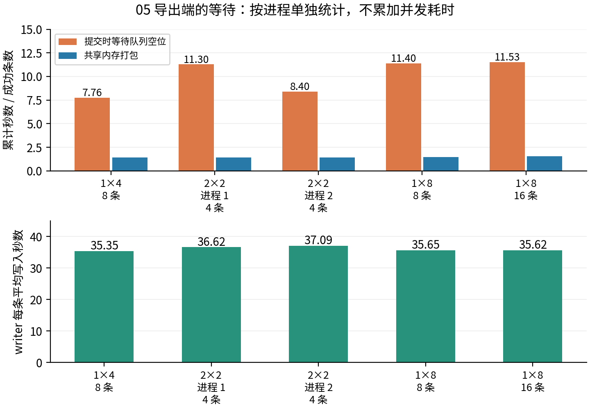
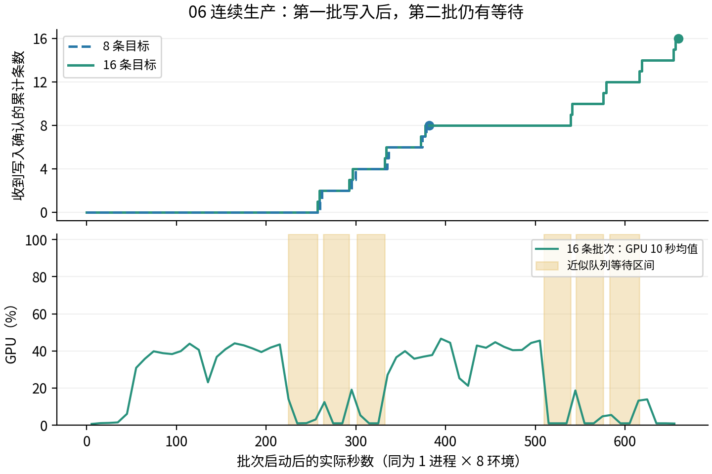

# AutoData 生产效率与 GPU 利用率

**图解实验报告 · 2026-10-22 · 修订 03**

本版用六组图解释已有实测结果，没有追加 GPU 实验。完整实验方法和失败记录保留在[上一版报告](autodata-ray-20261022-r02.md)。每个配置均为单次批次观测，图中没有统计置信区间。

**当前生产建议：1 个仿真进程 × 8 个内部环境，配 2 个 Ray 导出 actor。** 在现有主机占用下，连续 16 条生成并直接写入 LeRobot v3，达到 **33.31 有效帧/秒**；整批 659.35 秒，折算约 87.36 条/小时。GPU 全程采样均值 22.64%，峰值显存 11.88 GiB，最低可用主机内存 16.52 GiB。

| 要回答的问题 | 对应图 | 本轮观察 |
| --- | --- | --- |
| 多进程是否提高生产效率？ | 图 1、图 2 | 同为 4 环境，2×2 比 1×4 吞吐低 16.4%，GPU 却更忙 |
| GPU 在什么时间忙、什么时候等待？ | 图 3 | 持续执行段与导出阶段交替；首次产出和整批完成时间不同 |
| 为什么没有把显存填满？ | 图 4 | 主机图像缓存及已有备份占用先触及内存余量 |
| 导出是不是值得优化？ | 图 5、图 6 | 有可观的队列等待，单条 writer 写入约 35–37 秒 |

**读图约定。** P×E 表示“仿真进程数 × 每进程内部环境数”；两者相乘才是总环境数。有效帧/秒按完整批次成功写入的帧数除以端到端时间计算，包含初始化、生成、写入及仿真关闭。GPU 利用率是 `nvidia-smi` 采样的忙碌时间比例，并不表示使用了多少比例的峰值计算能力。

对照组统一使用 24 个逻辑 CPU、2 个 writer、8 GiB 导出共享内存预算、三路 640×480 RGB、30 FPS 和同一输入示范。两进程均衡分配物理核。并行布局改变后随机样本不保证逐帧相同，因此同时核对条数、帧数和完成状态。

## 图 1｜先比较有效产出，再看资源占用

**同总环境数比较：1×4 与 2×2。** 都有 4 个环境，都以 8 条成功轨迹为目标。2×2 的有效吞吐从 25.29 降到 21.14 帧/秒，下降 **16.4%**；批次时间从 433.57 增到 523.52 秒。当前结果不支持增加仿真进程就能加速这一任务。

**增加总环境数比较：1×4 与 1×8。** 这是容量扩展实验，不能与前一个比较混为一谈。相同 8 条目标下，环境数翻倍后吞吐提高 **14.0%**，批次耗时缩短约 51.69 秒，收益远小于环境数量的增幅。

柱形图使用零起点，失败批次没有混入。三组实际有效帧数分别为 10,963、11,065、11,008，均完整写入并通过回读。16.4% 和 14.0% 是本轮观测差异，不是对其他任务的普遍保证。

## 图 2｜GPU 利用率不能代替生产效率

左图显示 **2×2 的 GPU 全程均值为 65.40%，P95 为 89%**，明显高于 1×4 的 28.84% 和 49%。但右图中，2×2 的实际吞吐反而最低。右侧的点更靠右，只表示 GPU 忙的时间更多；更靠上，才表示单位时间生产了更多有效帧。

1×8 的均值只有 22.20%，但在相同 8 条目标的三个配置中吞吐最高。平均值包含初始化、执行、导出与等待，不能把 22.20% 解释为“只发挥了显卡 22.20% 的性能”。P95 也只描述采样分布的高负载部分，不等于整批持续利用率。

多个进程会各自创建仿真和规划上下文，同时分享既定的 CPU、内存与 GPU 资源。重复上下文是实现事实；本轮没有独立消融来测量各项成本，因此不将减速全部归因于其中某一项。

## 图 3｜首次产出延迟与整批吞吐是两回事

浅线是原始采样，深线是 10 秒分箱均值。点线表示首次提交导出，虚线表示首次收到写入确认；它们是日志事件，不是整段流水线的精确阶段边界。横轴保留实际秒数，没有把不同批次拉伸到同一长度。

| 配置 | 首条写入确认（秒） | 整批完成（秒） |
| --- | ---: | ---: |
| 1×4 | 209.34 | 433.57 |
| 2×2 | 253.63 | 523.52 |
| 1×8 | 260.05 | 381.88 |

1×8 的首条产出更晚，却更早完成全部 8 条，说明“尽快拿到第一条”和“批量产出更多”是不同目标。2×2 的高 GPU 利用率持续更久，但首条和整批都没有更快。曲线能定位等待窗口，不能单凭形状区分规划、渲染、物理仿真各自的计算耗时。

## 图 4｜显存没满，主机内存余量已经不足

上图所有配置都未填满 31.84 GiB 可用显存；下图的主机可用内存却随录制逐渐下降。一个约 1,400 帧的三路 RGB episode，未压缩图像约 3.6 GiB。主机 `/dev/shm` 另有约 39 GiB 既有备份分卷，占用了本可用于生产的内存空间；本轮没有清理这些备份。

× 标记表示 2×4、1×9、1×10 触发 **14 GiB 主机余量保护**。这些配置未完成完整批次，不能作为有效生产配置。1×8 的 16 条批次最低仍有 16.52 GiB，可连续完成本轮工作。资源在退出时回升/释放是正常清理，不是采样错误。

1×12 使用加固前的 8 GiB 余量条件，出现约 115 秒采样缺口和 OOM-kill 计数增加；曲线在缺口处断开，没有补零或插值。具体被杀进程未确认，已采样最低内存不能当成实际最低值。随后才提高余量并加入独立失联停止。

**结论适用于当前内存占用和保护策略。** 它不证明空载机器最多只能运行 8 环境；也不能用尚余的显存推断可以继续增加环境数。

## 图 5｜导出等待是真实成本，但不能相加成总耗时

上图把每个进程累计等待/打包秒数除以其成功条数。1×8、8 条批次的队列等待累计 **91.21 秒**，折合每条 11.40 秒；共享内存打包累计 11.89 秒，折合每条 1.49 秒。16 条批次的等待累计 184.43 秒，折合每条 11.53 秒，等待并没有因持续运行而消失。

下图是 actor 内每条写入请求的平均耗时，约 **35–37 秒**，包括数据添加及视频编码等写入工作。2×2 的两个进程分别列出，避免把并行运行时间误加成一个串行总时间。不同 actor 的写入可以重叠，也可与部分仿真工作重叠，因此不能把“条数 × 平均写入秒数”直接加到整批耗时里。

这些图说明导出队列和 CPU H.264 编码路径值得优化，但不是完整的关键路径分解。不能据此制作“仿真占多少、导出占多少”的总时间饼图，也不能把全部 GPU 低负载都归因于编码。

## 图 6｜更长批次提高整体吞吐，但第二批仍有等待

两条阶梯线都使用 1×8。纵轴统计收到写入确认的条数，末端圆点才是整个批次返回的时刻；单条写入确认不等于所有分片已完成最终关闭。16 条批次没有在第一批结束后重新初始化整个仿真，因此可观察到连续生产的表现。

| 目标条数 | 有效帧数 | 整批秒数 | 有效帧/秒 | GPU 全程均值 |
| --- | ---: | ---: | ---: | ---: |
| 8 | 11,008 | 381.88 | 28.83 | 22.20% |
| 16 | 21,963 | 659.35 | 33.31 | 22.64% |

16 条的总体吞吐比 8 条高约 **15.6%**，GPU 均值却接近。更长批次可以摊薄初始化成本，但样本序列和长度也不同，本轮不能把增益全部归因为启动成本摊薄，更不能将它记为增加并行度的收益。

下图浅黄色区域根据“导出提交时间－打包耗时－队列等待耗时”近似还原等待区间，事件记录存在小量开销，所以不是逐指令计时。多段等待与 GPU 低负载同时出现；第二批也继续经历等待。约 11 分钟的连续测试支持本轮配置选择，不代表长期无人值守稳定性。

## 实验边界、数据质量与复现

**原始开源版本的对照没有形成有效吞吐。** 可执行公开 v0.1 提交为 `1c7360d85c9ad131ca6c8c70f1f731a6312616f3`。为接入同一 OpenArm 任务，共享必要的任务、观测和 LeRobot v3 导出适配，保留原始规划器；它在接触规划返回 `INVALID_START_STATE_WORLD_COLLISION`，两次尝试无成功轨迹。因此本文没有“修改版相对原版加速多少”的图，不能用规划失败耗时作为加速比分母。

**真正验证的是完整有效产出。** 四个成功批次合计 40 条、54,999 数据帧、164,997 路视频帧。视频全量解码及帧数/FPS/分辨率核对通过；数值有限性、九维关节语义和官方加载器首/中/末位置回读通过。产出为各 writer 独占的 LeRobot v3 分片，父目录仅是 manifest，不是一个合并数据集。未活动右手流为空白，保留是为了控制本轮相机开销，不应作为有效训练视觉信息。

**当前可执行建议。** 在此主机占用下采用 1×8、2 个 writer，保留 14 GiB 主机可用内存及失联保护。后续优化应分别测试去掉无效右手流、分段录制/编码、备份内存占用解除后的容量；这些都会改变变量，不能未经实测直接套用本报告的吞吐数字。已有备份未移动或删除。

**取样和计算规则。** 全程 GPU 均值是有效采样的算术平均，图中深线为 10 秒分箱均值；无样本分箱留空，原始曲线遇超过 5 秒间隔断开。资源曲线包含初始化与退出。阴影只表示近似等待窗口，没有用于扣除总时间。各配置只测一批，没有误差条、显著性结论或全天产量保证。

[完整方法与失败记录](autodata-ray-20261022-r02.md) · [原始汇总与验证清单](autodata-ray-20261022-r02.json) · [本版可移植曲线数据](autodata-ray/evidence-20261022.json) · [绘图脚本](../../scripts/plot-autodata-ray.py)

本版曲线数据保存相对时间、GPU 利用率/显存、主机可用内存、导出事件及来源日志 SHA256。可用绘图脚本的 `--evidence` 与 `--output-dir` 重建六组图，不需要拷贝视频数据集；`--summary` 则从本机原始日志重建曲线快照。PDF 保留中文字体、页码和可点击来源链接。
