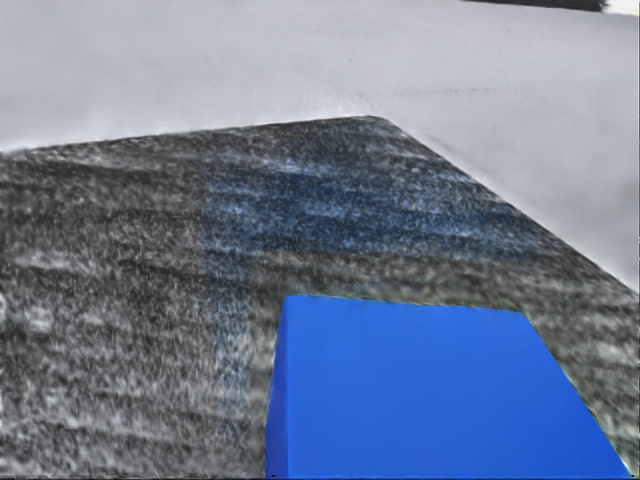

# OpenArm GS 预设任务视频：外部与腕部视角（2026-10-23 r02）

本版本补齐同一条 AutoData SkillGen 生产轨迹的左右腕部视频，作为扩充后的交付入口。前一版报告与产物保留：提交 `f2421cd`，本机[生产与独立回放记录](/home/tangyuan/WorldSimReady-Home/.worktrees/openarm-gs-production/docs/openarm-gs-production-20261023.md)。原任务为 `Isaac-PickPlace-Cube-OpenArm-GS-Bimanual-Left-IK-Rel-v0`，使用交付配置中的左臂拾取放置任务；上一轮实际生成 1 次、成功 1 条，独立物理回放通过。

| 视角 | 视频 | 尺寸与时间 | 来源 |
| --- | --- | --- | --- |
| 左腕（操作臂） | [左腕 MP4](openarm-gs-production/left-wrist-20261023.mp4) | 640×480，30 fps，2,636 帧，87.8667 秒 | 原生产 HDF5 的 `obs/left_hand_rgb` |
| 右腕（停放臂） | [右腕原始 MP4](openarm-gs-production/right-wrist-20261023.mp4) | 640×480，30 fps，2,636 帧，87.8667 秒 | 原生产 HDF5 的 `obs/right_hand_rgb`，近乎全黑 |
| 外部机位 | [外部 MP4](/home/tangyuan/WorldSimReady-Home/.worktrees/openarm-gs-production/docs/openarm-gs-production/task-20261023.mp4) | 1280×960，15 fps，1,318 帧，87.8667 秒 | 上一轮独立物理回放时的额外预览相机 |



本轮直接导出保存的 RGB，没有重新仿真、修改相机位姿、裁剪暗帧、插帧或加速。MP4 为 H.264/yuv420p、CRF 18，有损编码；原 RGB 数据保留。两路视频均完整解码为 2,636 帧，尺寸和帧率校验通过。输入 HDF5 在导出前后 SHA256 相同：`7feec70707608ae23a61816124fe2c12e2dc5455b66e67606f35aae5c1c3ef5f`。

左腕抽查可见接近、抓取及放置区域；开头部分帧很暗。右腕全部 2,636 帧的全图标准差小于 1，平均像素值约 0.000221（0–255），因此保留为原始导出供核对，不视为有效任务观察画面。右臂确实处于停放状态，但本轮未单独诊断黑画面的原因，没有用其他相机画面替换它。

三路视频具有相同轨迹时长，但未做逐帧时间校正：原生产 RGB 由 `PreStepFlatPolicyObservationsRecorderCfg` 在动作前记录，外部视频在独立回放执行动作后取帧；严密对齐时须考虑约一个控制步（1/30 秒）的采样相位差，以及外部视角每两个控制步采样一次。不能直接按相同帧号比较。

[完整导出与解码回执](openarm-gs-production/wrist-check-20261023.json) 记录输入哈希、各路视频哈希、像素统计和解码参数。队列任务 350 成功；任务 349 的逐帧读取方式会反复解压跨 165 帧的 HDF5 压缩块，已停止并保留不完整输出，未用作交付。最终入口按整个时间压缩块读取，图像内容和顺序保持原样。

实现为 [export_wrist.py](../workspace-overlays/openarm-gs-production/export_wrist.py)。原始本机运行目录为 `/home/tangyuan/WorldSimReady-Home/runs/openarm-gs-production-20261023/wrist-r2/`。可在本任务 worktree 中使用现有环境复现，输出目录必须尚不存在：

```bash
python3 scripts/task-queue.py submit --name gs-wrist-export --timeout 600 -- \
  /home/tangyuan/miniconda3/envs/autodata/bin/python \
  workspace-overlays/openarm-gs-production/export_wrist.py \
  --input /home/tangyuan/WorldSimReady-Home/runs/openarm-gs-production-20261023/generation-r2/episodes.hdf5 \
  --output /absolute/path/to/new-wrist-output
```

本次不改变原 GS 配置、任务、HDF5、上游代码或仿真环境。源轨迹仍是上一轮记录的实验测试源；这些视频不增加成功率、训练效果或真机有效性的证据。
