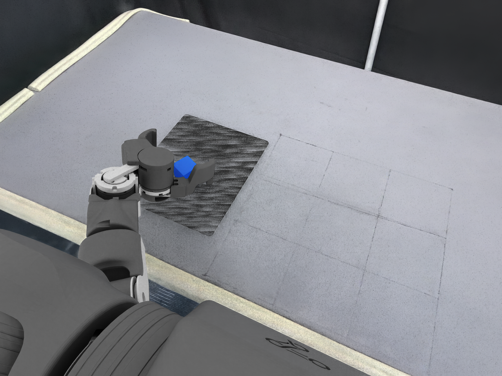

# OpenArm GS 生产视频：新增头部机位（2026-10-23 r03）

按用户明确选择，新增一个固定在机器人机身上的虚拟头部机位，回放同一条已成功生产的 AutoData SkillGen 轨迹。视频为 1280×960、15 fps、1,318 帧、87.8667 秒，完整解码检查通过。此前外部与腕部视角的交付保留，本版本补齐头部视角入口。

[观看头部机位视频](openarm-gs-production/head-view-20261023.mp4)



## 机位定义

原包仅配置左右腕及 `third_person` 相机，后者挂载 `openarm_right_base_link`；不存在独立的 head 标定流。本次是用户要求新增的虚拟机位，没有把原第三路 RGB 改名为头部图像，也没有覆盖原标定。

新配置位于 [configs/head_preview.json](../workspace-overlays/openarm-gs-production/configs/head_preview.json)。相机作为 `Robot/Geometry/world/openarm_body_link0/HeadPreviewCamera` 的子节点固定在机身上；在本次环境中的初始位置为 (0.15, 0, 1.65) m，朝向 (0.53, 0.18, 1.10) m，即从机器人上方看向桌面操作区。坐标相对于环境原点。

使用 18 mm 针孔焦距、24×18 mm 成像孔径、1280×960 RGB；约 67.4° 水平视场。此配置用于仿真预览，不代表已经标定的真机头部传感器。没有新增碰撞体、关节、动作或任务成功阈值。

## 轨迹与验证

环境仍为 `Isaac-PickPlace-Cube-OpenArm-GS-Bimanual-Left-IK-Rel-v0`。输入是前一轮真实 AutoData 生成的 `generation-r2/episodes.hdf5`：1 条成功轨迹、2,636 个控制步，SHA256 为 `7feec70707608ae23a61816124fe2c12e2dc5455b66e67606f35aae5c1c3ef5f`。

在现有主机环境重新创建同一 GS 环境，从记录的初始状态执行全部原动作。头部相机只增加 RGB 渲染，不改变动作、物体或原任务配置。末 30 步均通过原 GS 放置成功函数；逐步方块位置与生产 HDF5 的最大差值为 0 m（限本次运行，不推广为其他运行的确定性保证）。

每两个控制步取一个执行后的头部相机帧，以 15 fps 编码为 H.264/yuv420p、CRF 18，时长等于原轨迹仿真时间；无插帧、加速或场景合成。与此前外部回放视频使用相同的控制步采样方式；原生产腕部 RGB 是动作前记录，其采样相位差见上一版说明。

共享队列任务 352 完成物理回放，任务 353 完成全部 1,318 帧解码、尺寸、帧率、视频哈希检查，两者退出码均为 0。[验证回执](openarm-gs-production/head-check-20261023.json) 保存输入及视频哈希、机位定义、回放差值和解码参数。原始逐步状态、视频及截图保存在主工作区 `runs/openarm-gs-production-20261023/head-replay-r1/`。这是同一条轨迹的新增视角，不增加生产成功率或真机验证证据。

## 本机全部视角入口

- [头部新增机位](openarm-gs-production/head-view-20261023.mp4)
- [此前外部机位](/home/tangyuan/WorldSimReady-Home/.worktrees/openarm-gs-production/docs/openarm-gs-production/task-20261023.mp4)
- [此前左腕原始视频](/home/tangyuan/WorldSimReady-Home/.worktrees/openarm-gs-wrist-video/docs/openarm-gs-production/left-wrist-20261023.mp4)
- [此前右腕原始视频（近乎全黑）](/home/tangyuan/WorldSimReady-Home/.worktrees/openarm-gs-wrist-video/docs/openarm-gs-production/right-wrist-20261023.mp4)

前版证据和源轨迹的实验标注限制分别保留在提交 `f2421cd` 的生产记录与提交 `8e7203f` 的腕部记录中；不改写前版结论。

## 复现

实现为 [replay_head.py](../workspace-overlays/openarm-gs-production/replay_head.py)，复用现有主机 Isaac Lab / AutoData / `openarm-production` 兼容环境，不安装依赖、不开容器。本任务的 `runtime/openarm_autodata` 显式链接此前已校验的 GS 包提取目录；该目录不进入 Git。准备相同 runtime 后，在本任务 worktree 中提交，输出目录必须是新目录：

```bash
python3 scripts/task-queue.py submit --name gs-head-replay --timeout 600 -- \
  bash workspace-overlays/openarm-gs-production/run.sh replay_head \
  --workspace /home/tangyuan/WorldSimReady-Home \
  --input /home/tangyuan/WorldSimReady-Home/runs/openarm-gs-production-20261023/generation-r2/episodes.hdf5 \
  --output /absolute/new-head-output

# 等回放完成后，再验证视频。
python3 scripts/task-queue.py submit --name gs-head-decode --timeout 180 -- \
  bash workspace-overlays/openarm-gs-production/run.sh video_check /absolute/new-head-output
```
