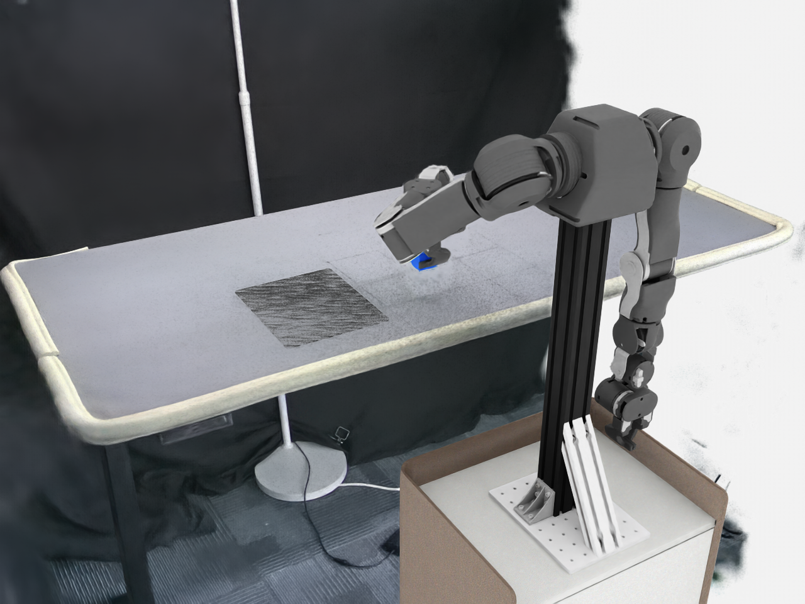

# OpenArm GS 预设任务生产与视频（2026-10-23）

按用户要求使用现有主机环境，不使用容器。实际运行 AutoData SkillGen 生成 1 条成功轨迹，并在独立环境中从保存的初始状态逐步回放、录制视频。没有新增任务定义或放宽成功条件。

[观看完整视频：1280×960，15 fps，约 87.9 秒](openarm-gs-production/task-20261023.mp4)



## 使用的预设任务

| 项目 | 本次取值 |
| --- | --- |
| Gym 环境 | `Isaac-PickPlace-Cube-OpenArm-GS-Bimanual-Left-IK-Rel-v0` |
| 环境 profile | `openarm_left_gs_table.yaml` |
| 任务 descriptor | `openarm_bimanual_left_pick_place.yaml` |
| planner profile | `openarm_pick_place_left_gs_table` |
| 算法 | AutoData `skillgen`，包含 cuRobo 规划 |
| 控制 | 左臂相对 TCP IK，7 维动作；右臂停放 |
| 生产目标 | 1 条成功轨迹，1 个环境；原配置 `guarantee_success: true`、失败预算 25 |
| 收尾 | 额外保持最终目标 60 步，使释放后的物体稳定；成功阈值不变 |

上述 YAML 均直接读取交付包原件，使用 `gs_table.yaml` 的高斯场景、独立动态鼠标垫及原来的放置成功函数。共享 task descriptor 的放置参考物仍是 table，未改成另一套任务。新包 SHA256 为 `4664f143fe5904d1d7cc0dd8e1fa18e4bdc9f5ac6780434a5952acfe92ab21df`；185 项 manifest 内容校验通过。

主机现有 AutoData checkout HEAD 为 `1c7360d85c9ad131ca6c8c70f1f731a6312616f3`；使用其现有工作树及已准备的兼容补丁，未宣称是完全干净的上游运行。未安装或升级依赖，未修改上游代码、子模块 pin 或既有数据。

## 结果与验证范围

- AutoData 结果：`num_attempts=1`、`num_success=1`、`num_failures=0`。导出 `demo_0`，2,636 步，7 维有限动作，控制周期 1/30 秒。
- HDF5 包含 `left_hand_rgb`、`right_hand_rgb`、`third_person_rgb`，各为 `(2636, 480, 640, 3)`、uint8；磁盘文件约 1.3 GiB。
- 独立回放重新创建环境，恢复 HDF5 初始状态并执行保存的全部动作。最后 30 步均满足原 GS 成功函数；逐步方块位置与生产 HDF5 的最大差值为 0 m（仅此样例，不推广为其他运行的确定性保证）。
- MP4 来自该独立物理回放的额外预览相机，每两个控制步取一帧，共 1,318 帧、15 fps。时长与仿真时间一致，未插帧或加速；原配置三路相机的 RGB 保留在 HDF5。
- [验证摘要](openarm-gs-production/validation-20261023.json) 保存生产计数、回放和视频解码结果及哈希。生产输入和关键代码共 11 项在运行后再次校验，未发生变化。

这是一次管线与预设任务的视频测试，不是成功率基准、训练结果或真机验证，也未验证移动鼠标垫后的跨布局扩增。

## 示教输入与兼容处理

包内没有 HDF5，主机也未发现匹配当前 GS 布局的已标注示教。最初的简单平移采集未抓取成功，没有用作 SkillGen 输入。随后使用既有实验 fixture 的 TCP 姿态作为控制参考，按当前方块和鼠标垫位置重定向，在当前 GS 环境内重新执行并测量记录；没有把旧场景 HDF5 直接改名成新场景，也没有传送物体或关闭物理。

参考 fixture SHA256 为 `7321968fb3f0037b2b7d94bcaa0f0c0ff609c99c89671cd443fcd210c4fec2da`，历史来源为实验推断标注，并非人工审核示教。本轮 GS 源轨迹为 1,368 步，通过至少 8 cm 抬升和原放置条件，最后 60 步均成功；技能起止使用实验边界。源文件最初漏写了 initial_state 的单例批次维，另存 `source-ready.hdf5` 仅修复该维度，动作和测量轨迹不变。最终采集入口已直接保存正确维度，并锁定所用 fixture 哈希。

交付包的 planner 配置比锁定 AutoData API 多出 `warmup`、`contact_offset_axis`、`gripper_closes_on_increasing_position` 及机器人 YAML 加载方法；通过本任务 [planner_compat.py](../workspace-overlays/openarm-gs-production/planner_compat.py) 在当前进程补齐，保留包内字段值。相对 IK 缩放、cuRobo 与生成循环则复用既有 `openarm-production` 兼容层。第一次生成启动因缺字段中断，未生成有效结果；接入兼容层后的实际生成才是上面的 1/1。不能把启动日志或仅有退出码 0 当作成功。

## 本地产物与复现

本任务实现位于 [workspace-overlays/openarm-gs-production](../workspace-overlays/openarm-gs-production/)。主工作区 `runs/openarm-gs-production-20261023/` 保留源轨迹、完整状态、原始 HDF5、日志与视频；大型数据和提取资产不进入 Git。

| 位置（相对主工作区） | 内容 |
| --- | --- |
| `runs/openarm-gs-production-20261023/source-r3/` | GS 源轨迹、物理检查、另存的维度修复文件与修复说明 |
| `runs/openarm-gs-production-20261023/generation-r2/episodes.hdf5` | 实际 AutoData 生产数据 |
| `runs/openarm-gs-production-20261023/generation-r2/result.json` | AutoData 原始成功计数 |
| `runs/openarm-gs-production-20261023/generation-r2/provenance.json` | 输入、任务及关键实现哈希 |
| `runs/openarm-gs-production-20261023/replay-r1/` | 独立回放逐步状态、原始 MP4 与解码检查 |

共享队列任务 344（GS 源采集）、346（SkillGen 生产）、347（独立回放视频）、348（视频解码检查）分别保留日志。342/343 为未完成或失败的采集尝试；345 为缺字段的启动失败，虽进程返回 0，也未计作生产成功。所有失败产物保留。

在新任务 worktree 根目录按以下顺序执行。需要已有兼容的主机环境、AutoData 核心和 `openarm-production/runtime/patches`；不自动安装环境。所有输出目录必须是新目录；不要修改已排队或运行中的代码。

```bash
# 原始 ZIP 已在前一任务移入该任务的 runtime/packages，或使用它的备份。
python3 workspace-overlays/openarm-gs-production/prepare.py /absolute/path/OpenArm_GS_config_assets_20261017_193312.zip

python3 scripts/task-queue.py submit --name gs-source --timeout 600 -- \
  bash workspace-overlays/openarm-gs-production/run.sh source \
  --workspace /home/tangyuan/WorldSimReady-Home \
  --reference /home/tangyuan/WorldSimReady-Home/workspace-overlays/openarm-production/runtime/inputs/openarm_left_fixture_clearance_source.hdf5 \
  --output /absolute/new-run/source

# 等源采集成功，再提交生产；当前入口无需额外修复 initial_state。
python3 scripts/task-queue.py submit --name gs-generate --timeout 900 -- \
  bash workspace-overlays/openarm-gs-production/run.sh generate \
  --workspace /home/tangyuan/WorldSimReady-Home \
  --input /absolute/new-run/source/source.hdf5 --output /absolute/new-run/generation

# 等生产结束并确认 result.json 及 HDF5，再独立回放。
python3 scripts/task-queue.py submit --name gs-replay --timeout 600 -- \
  bash workspace-overlays/openarm-gs-production/run.sh replay \
  --workspace /home/tangyuan/WorldSimReady-Home \
  --input /absolute/new-run/generation/episodes.hdf5 --output /absolute/new-run/replay

python3 scripts/task-queue.py submit --name gs-video-check --timeout 180 -- \
  bash workspace-overlays/openarm-gs-production/run.sh video_check /absolute/new-run/replay
```

本次运行时 runtime 使用前一任务已验证提取目录的显式链接；准备工具另在独立目录完成了同包 185 项校验及提取，不改变正在运行的输入。源码与报告保存在独立任务分支，不修改主目录已有暂存内容。主机检查使用 `--allow-uninitialized`，仅因本任务 worktree 有意不初始化上游；实际 GPU 运行使用上面记录的主机已有源码，二者验证范围不同。
