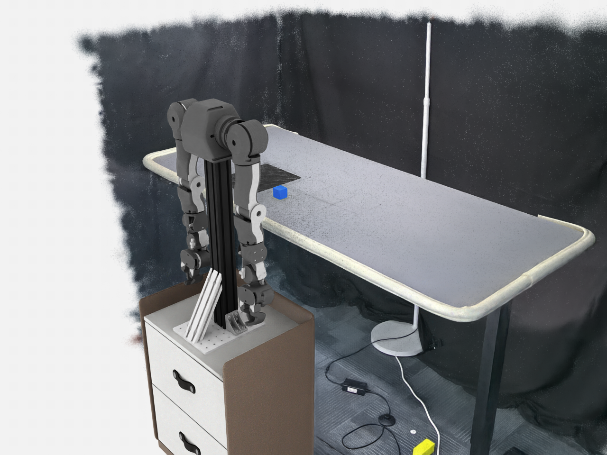

# OpenArm GS 配置检查与渲染（2026-10-23）

已在 RTX 5090、主机 Isaac Sim 6 上输出 1280×960 RGB 样例。加载到一个 `ParticleField3DGaussianSplat`，USD 组合错误列表为空。此结果验证配置布局、资产组合及 RGB 渲染，不表示 AutoData reset/step、抓取、放置判定或轨迹扩增通过。



## 配置与资产位置

新配置的版本管理入口为 [workspace-overlays/openarm-gs-render/configs](../workspace-overlays/openarm-gs-render/configs/)，共 27 个文件，保留包内 `openarm_autodata/` 的相对关系。包含场景、左右臂环境、机器人、相机标定、AutoData profiles、tasks、embodiments 和 planners 配置。[来源清单](../workspace-overlays/openarm-gs-render/source-provenance.json) 记录每个配置的原始路径及 SHA256；这些是原样配置参考，依赖的完整模块仍从原包准备，不能仅把 configs 加入 PYTHONPATH 就当作完整任务安装。

原根目录的 `OpenArm_GS_config_assets_20261017_193312.zip` 已移动到本任务 worktree 的 `workspace-overlays/openarm-gs-render/runtime/packages/`。runtime 已由该 overlay 的 `.gitignore` 忽略，原包与大型资产不提交到 Git。代码及报告在 `codex/openarm-gs-render` 分支；未修改上游代码、子模块 pin 或主目录原有暂存内容。

包 SHA256：`4664f143fe5904d1d7cc0dd8e1fa18e4bdc9f5ac6780434a5952acfe92ab21df`。包记录来源提交为 `1bf7a3ba28d735de052582e9bd86a4000533f736`；这是原包声明，未联网核验私有仓库。原包包含的历史验证报告不能替代本次运行。

## 检查结果与限制

- manifest 内 185 个文件的字节数与 SHA256 一致；46 个 Python 文件通过 AST 语法解析。
- 左右臂 GS profiles 分别引用对应的 GS Gym ID；场景使用 `table_scene_aligned.usda` 和 `mouse_pad_fixed.usda`，保留原 USDZ 的高斯视觉及适配层碰撞。
- 渲染入口直接读取规范目录中的 `gs_table.yaml`；桌面配置高度 1.063 m，鼠标垫变换计算中心为 (0.555, 0.315, 1.06383) m。它们是配置及组合检查结果，不是新测得的物理支撑高度。
- 样例可见高斯桌面和背景、床头柜、双臂机器人、蓝色方块与鼠标垫。高斯采集区域边缘有稀疏及缺失；未进行图像质量基准测试。
- 机器人使用 USD 自带姿态，未应用环境中的初始关节角；相机是本次新增预览机位，不是训练配置的三路标定相机。
- Kit 日志包含大三角碰撞网格的 PhysX cooking 警告。未执行碰撞稳定性、动态鼠标垫、任务成功判定或完整操作验证。源资产本身也保留了局部 3 mm 公差未完整验证的元数据，不能由这张图认定几何标定通过。
- 本机没有运行中的 AutoData 容器。完整任务验证须按 `AutoData/AGENTS.md`，由用户先通过 `./docker/run_docker.sh -c` 启动容器，再使用包内任务入口。本次独立渲染不导入或执行 AutoData 模块，不安装仿真依赖。

原始运行目录为主工作区 `runs/openarm-gs-render-20261023-r3/`，保留提取资产、可重开 USD 场景及原始图片。队列任务 341 成功，退出码 0；[渲染结果 JSON](openarm-gs-render/result-20261023.json) 保存本次验证范围、类型统计与图像尺寸。任务 339 在依赖预扫描阶段无进展，主动停止；任务 340 未完成输出，虽然 Kit 关闭返回 0，仍按失败尝试处理。最终入口已显式传递异常退出码，并要求 RGB、Gaussian prim 和结果文件齐全。

## 重现样例

在本任务 worktree 根目录执行，输出目录必须尚不存在；运行通过同一主机共享队列提交。保留原始 ZIP，勿把 configs 当作独立安装包。生成的 `scene.usda` 引用本次输出目录提取的资产，移动场景时必须同时保留 assets。

```bash
python3 scripts/task-queue.py submit --name openarm-gs-render --timeout 240 -- \
  env OMNI_KIT_ACCEPT_EULA=YES /opt/isaac-sim6.0/python.sh \
  workspace-overlays/openarm-gs-render/render.py \
  --package workspace-overlays/openarm-gs-render/runtime/packages/OpenArm_GS_config_assets_20261017_193312.zip \
  --output runs/openarm-gs-render-new
```

基础检查：`bash scripts/cloud-check.sh --allow-uninitialized` 通过（42 项脚本测试、8 项共享配置测试及版本/索引/文档检查）；本任务隔离 worktree 有意未初始化上游源码。该检查不表示 GPU 仿真任务通过。
