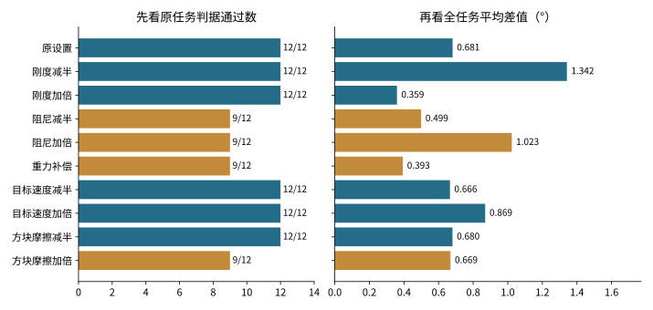
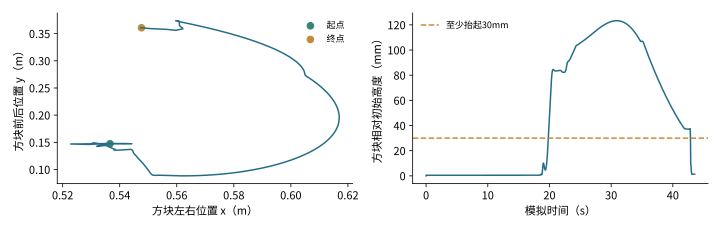
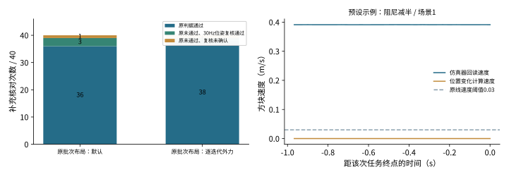
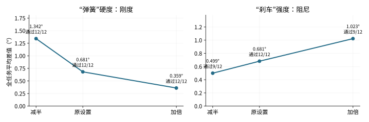
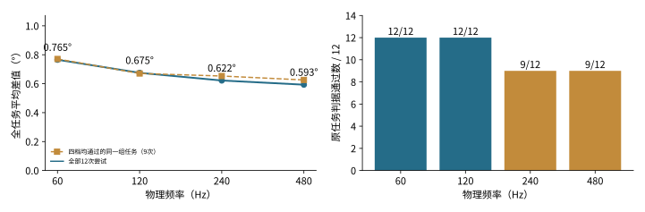
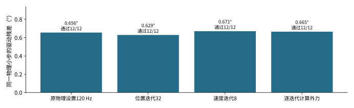
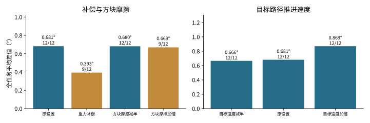
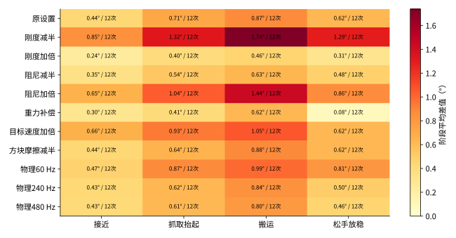

# 完成抓取任务后的指令与实际位置差值实验报告

## 实验结论

降低刚度、增大阻尼会明显增大差值；物理频率也会改变结果

本实验用完整抓取任务查明哪些设置会改变差值，为控制匹配与训练数据解释提供依据。主矩阵共 **192次任务尝试、16个条件**，每个条件使用相同4个初始场景、各重复3次。共174次通过原任务判据。新实验基线（Baseline，沿用原控制参数）通过 **12/12**，通过任务平均耗时44.1秒，完整任务臂关节平均差值0.681°。另做12次物理布局复核、80次原布局验收核对和4次240 Hz诊断。

*图1 每组均尝试12次。橙色条件存在未通过原判据的尝试，全部保留；判据差异见第3页。*

| 对照 | 相对原设置的平均差值变化 | 原判据通过 |
| --- | --- | --- |
| 刚度减半 / 加倍 | +97.2% / -47.2% | 12/12 / 12/12 |
| 阻尼减半 / 加倍 | -26.7% / +50.0% | 9/12 / 9/12 |
| 加入重力补偿 | -42.0% | 9/12 |

使用独立布局配对基线，物理频率60、120、240、480 Hz的原判据通过数分别为12/12、12/12、9/12、9/12，平均差值分别为0.765°、0.675°、0.622°、0.593°。这些是本机完整任务对照，控制频率始终30 Hz。

**参数优劣由能否完成任务、完成时的差值、耗时和运动响应共同判断。** 主文保留增益、补偿、速度、接触摩擦和物理求解实验，旧的移走方块、放宽上限和降低控制频率对照移作背景材料。

部分未通过的轨迹存在“方块位姿稳定、速度回读较大”的验收口径差异。原统计保持不变，第3页并列给出独立位姿与物理小步诊断，避免把判据差异直接当成抓取能力下降。

## 预设任务是抓起方块并在指定区域放稳

完成一次任务的标准，先于误差指标固定

任务分为接近方块、闭合并抬起、搬运到目标区域、松手并放稳四个阶段。阶段按预设路线节点标注，实际抬起和放稳由物体状态另行验收。控制器跟踪同一批预设的机械臂手部位姿路线（TCP pose path，含位置和朝向），并根据当前位置持续修正指令；偏离目标过远时暂停路线推进。

*图2 原设置的一次实际任务：左图是方块移动路线，右图记录确实发生的抬起过程。*

| 验收步骤 | 具体要求 |
| --- | --- |
| 曾经抓起 | 方块中心至少高于恢复初始位置30毫米 |
| 确实松手 | 进入释放阶段并发出张开指令，两根手指实际角度均至少0.3弧度 |
| 放到指定位置 | 沿用原任务判据：方块整个投影在桌面目标区域内，底面高度偏差不超过8毫米 |
| 连续放稳 | 方块线速度不超过0.03m/s、角速度不超过0.5rad/s，上述放置条件连续保持0.5秒 |

满足全部条件才停止并记成功；方块跌落或120秒内未完成，均记失败。**失败数据保留，不能用不动或失败造成的小差值来证明控制更好。**

**action（目标指令）**表示这一步希望关节转到的角度；**state（实际状态）**表示发指令前关节所在角度。例如目标10°、实际9°，差值就是1°。每步对7个臂关节取绝对差，再对整次尝试平均，得到**平均绝对差（Mean absolute error，MAE）**。从开始记录到通过或超时，完整过程全部计入。

这套实验测量任务控制流程在不同设置下的总响应。此前固定关节目标实验用于隔离驱动机制，两者承担不同的比较目的。

## 先检查放稳判据 再解释未通过的任务

原判据、30 Hz位姿复核和物理小步抖动分别检查

部分未通过轨迹的方块位置几乎不变，仿真器回读速度却较大。小批次预检的通过情况与主矩阵不同；随后按原40环境、10种设定×4初态，分别核对默认与逐迭代外力设置，各40次。

*图3 原40环境布局下，默认与逐迭代外力各核对40次；右图为阻尼减半场景1。*

| 原布局核对 | 原判据通过 | 原未通过但30Hz复核通过 | 复核仍未确认 |
| --- | --- | --- | --- |
| 原批次布局：默认 | 36/40 | 3 | 1 |
| 原批次布局：逐迭代外力 | 38/40 | 1 | 1 |

对原未通过个案，从连续位姿计算速度，保留相同阈值、抬起、松手、目标区及连续0.5秒条件。原判据已通过的任务随即停止；其位姿差分判据可能少一个过渡帧，故不以截断记录重新判失败。240 Hz补充组原判据3/4通过，30 Hz位姿复核4/4通过。

示例末秒的位置变化不足0.001毫米，速度回读约0.391m/s，按30 Hz位置差分计算接近0。240 Hz场景2的逐物理小步复核也发现差异：末秒回读线速度0.388m/s、角速度12.83rad/s；位姿差分最大仅0.000057m/s、0.00154rad/s，均低于放稳阈值。[PhysX文档](https://nvidia-omniverse.github.io/PhysX/physx/5.8.0/docs/Simulation.html)专门解释了TGS求解器的稳态速度与位置差异，提供了可核查的机制线索；其具体作用由本轮逐迭代外力对照检验。

**30 Hz复核也会漏掉高频抖动。** 阻尼减半场景1虽通过30 Hz复核，每物理小步计算的末秒角速度中位数仍为0.557rad/s，超过0.5阈值。摩擦加倍场景2则是目标区几何不满足。原判据、采样抖动与真实放置偏移需要分别解释，主192次统计保持预设口径。

## 刚度和阻尼明显改变差值

刚度 Stiffness 像弹簧硬度，阻尼 Damping 像运动时的刹车

*图4 两类增益均使用减半、原设置、加倍三个设定点；标注原判据通过数。*

| 条件 | 全尝试平均差值 | 成功尝试平均差值 | 原判据通过 | 平均耗时 |
| --- | --- | --- | --- | --- |
| 原设置 | 0.681° | 0.681° | 12/12 | 44.1s |
| 刚度减半 | 1.342° | 1.342° | 12/12 | 44.4s |
| 刚度加倍 | 0.359° | 0.359° | 12/12 | 44.0s |
| 阻尼减半 | 0.499° | 0.508° | 9/12 | 63.2s |
| 阻尼加倍 | 1.023° | 1.079° | 9/12 | 63.3s |

较硬的“弹簧”在同样位置偏差下能产生更强的纠正作用；更强的“刹车”会改变运动跟随和接触响应。本轮闭环控制器还会根据偏差继续修正目标，因此数据包含驱动响应与任务反馈的共同作用。

同样的目标路线、初态、成功判据和外层反馈规则用于每个条件。差值以度为单位，排除夹爪，仅统计7个臂关节。失败尝试的成功专用指标留空，避免用失败平均掩盖任务代价。

本轮三档设定显示：降低刚度、提高阻尼会增大整段差值。调参用于匹配真实驱动响应；生产增益还要结合夹持力、超调和振荡确定。

## 物理频率如何影响完整任务差值

控制频率固定30 Hz，改变每条指令内的计算步数

**物理频率（Physics frequency）**是仿真器每秒计算运动和接触的次数；**控制频率（Control frequency）**是每秒更新指令的次数。60、120、240、480 Hz分别把1秒拆成60、120、240、480个物理小步。对应每条控制指令计算2、4、8、16小步，指令更新本身始终每秒30次。

*图5 同一任务、同一控制频率下的物理频率实测结果。点是12次尝试的等权平均。*

| 物理频率 | 原判据通过 | 全尝试MAE | 同组均通过任务MAE | 成功平均耗时 |
| --- | --- | --- | --- | --- |
| 60 Hz | 12/12 | 0.765° | 0.771° | 44.094s |
| 120 Hz | 12/12 | 0.675° | 0.671° | 44.133s |
| 240 Hz | 9/12 | 0.622° | 0.653° | 44.289s |
| 480 Hz | 9/12 | 0.593° | 0.626° | 44.133s |

物理频率改变电机、重力和接触在时间上的计算精细度。对[隐式驱动（Implicit drive）](https://docs.isaacsim.omniverse.nvidia.com/6.1.0/robot_setup/ext_isaacsim_robot_setup_gain_tuner.html)，每个小步的约束一起参与求解，因此同一组刚度、阻尼在不同步长下可产生不同数值响应。频率提高会增加计算量；方向和幅度由上面的任务实测确定，不能按频率比例换算差值。

每条控制指令只计算一次逆运动学（Inverse kinematics，IK），把手部位姿换成关节目标。每个物理小步再按“目标限速×小步时长”推进施加目标。臂目标限速始终2rad/s，每控制步总推进上限仍为2/30rad；提高物理频率只是把这段推进分得更细。

120 Hz参照采用额外12次、4环境布局复核，与60/240/480 Hz的布局匹配；主矩阵共享批次的原设置独立保留。表中原判据通过数还需结合第3页的速度口径诊断解释。

同组均通过列只比较四档都通过原判据的相同初态/重复编号，共9次配对任务，减少失败等待时长不同对均值的影响。同组对照在60 Hz为0.771°、480 Hz为0.626°，用于检查频率趋势是否只是失败后等待造成。完整任务分布仍由全尝试列保留。

这些频率条件使用同一源路线与配对初态。实际路线推进时间可因跟踪和接触改变，这正是任务执行效果的一部分。

## 求解器迭代的影响较小 且方向不同

每次只动一个求解设置，核对它实际生效

**求解器（Solver）**负责把电机驱动、关节约束、重力和接触一起算出来。位置迭代（Position iterations）和速度迭代（Velocity iterations）是每小步中的求解次数；[逐迭代外力（External forces every iteration）](https://nvidia-omniverse.github.io/PhysX/physx/5.4.0/_api_build/struct_px_scene_flag.html)开启后，把重力等外力分配到TGS的位置迭代中。

*图6 同步物理小步的施加目标减实际位置残差，区别于控制步开始的请求差值。*

| 条件 | 原判据通过 | 主指标MAE | 相对主指标变化 |
| --- | --- | --- | --- |
| 原物理设置120 Hz | 12/12 | 0.675° | +0.0% |
| 位置迭代32 | 12/12 | 0.651° | -3.5% |
| 速度迭代8 | 12/12 | 0.690° | +2.3% |
| 逐迭代计算外力 | 12/12 | 0.685° | +1.5% |

三项对照分别是：位置迭代16→32、速度迭代4→8、逐迭代外力关闭→开启；均保持物理120 Hz、控制30 Hz，其余参数不变。场景创建后回读的USD属性保存在各批次`effective-physics-attributes.json`，确认配置确实写入。

逐迭代外力在主物理对照中使平均差值变化+1.5%；原布局验收由36/40变为38/40。开启后仍出现刚度加倍场景3的速度口径差异，以及摩擦加倍场景1的目标区偏移，因此该开关的作用要逐场景评价。

主矩阵原设置的同步分解为：请求目标减施加目标 **0.00011°**，施加目标减小步开始实际位置 **0.661°**，施加目标减小步结束实际位置 **0.650°**。这批任务中限速改写很小，主要差值保留在驱动跟踪环节。隐式驱动的实际求解力矩需要专门测量。

## 重力补偿降低差值 放慢路径作用有限

接触条件改变后，仍要求完成原抓取放置任务

*图7 每组均保留方块与相同成功判据，摩擦只改变方块材质。*

| 条件 | 原判据通过 | 全任务MAE | 成功任务MAE | 平均耗时 |
| --- | --- | --- | --- | --- |
| 原设置 | 12/12 | 0.681° | 0.681° | 44.1s |
| 重力补偿 | 9/12 | 0.393° | 0.466° | 63.2s |
| 目标速度减半 | 12/12 | 0.666° | 0.666° | 87.2s |
| 目标速度加倍 | 12/12 | 0.869° | 0.869° | 23.3s |
| 方块摩擦减半 | 12/12 | 0.680° | 0.680° | 44.1s |
| 方块摩擦加倍 | 9/12 | 0.669° | 0.693° | 63.1s |

**重力补偿（Gravity compensation）**提前提供托住机械臂的力量。**目标速度（Reference speed）**改变预设路线的推进速度；外层控制仍每秒更新30次，偏差过大仍会暂停推进。**接触摩擦（Contact friction）**只把方块材质的静态和动态摩擦同时乘0.5或2，机器人其余接触设置保持不变。

原方块静摩擦系数为1.2、动摩擦为1.0；减半组为0.6/0.5，加倍组为2.4/2.0。接触的最终作用还取决于接触双方材质的组合规则。摩擦属性通过物理视图写入后立即回读核对；增益在每次恢复初态后再次核对。本轮不通过移走方块或关闭碰撞来比较任务成功，因为那会改变抓取任务本身。

目标推进速度减半后，耗时由44.1秒增至87.2秒，平均差值只变化-2.3%；加倍后差值变化+27.8%。因此，放慢路径没有按比例消除差值，负载与驱动响应仍在起作用。重力补偿后的变化为-42.0%；这个数是整套任务响应的变化幅度，不能直接当作“重力占误差的比例”。

## 分阶段看差值：先接近，再抓起和搬运

阶段覆盖与速度关系分别保留

*图8 单元格为阶段MAE与到达该阶段的尝试数。每次任务先算阶段均值，再对尝试等权平均。*

长时间停在某个阶段会改变全任务平均。原设置的运动帧平均差值为0.724°，四阶段等权平均为0.661°，完整任务平均为0.681°。运动帧按任一臂关节的位置差分速度超过5°/s定义。

## 读懂相关性：方向一致与动得更快

这一项分析想回答：**关节动得越快，action与state的差值是不是就越大？** 表里分别比较运动方向和运动快慢。

### 第一列：运动方向与目标偏差是否一致

**有符号误差（Signed error）＝目标角度action－实际角度state。** 实际9°、目标10°，偏差是＋1°；实际9°、目标8°，偏差是－1°。关节向角度增大的方向运动，速度为正；反方向运动，速度为负。

第一列比较偏差与速度是否同向变化。数值越接近1，它们一起增大或减小的关系越强。例如关节3的0.925，表示两者有很强的同向变化关系。

### 第二列：运动快慢与差值大小是否一起变化

去掉方向，只比较**差值大小（Absolute error）**和**速率（Speed，速度的绝对值）**。它直接回答：关节转得更快时，目标与实际位置之间是否也差得更多？

| 原设置 | 有符号误差与速度 r | 差值大小与速率 r |
| --- | --- | --- |
| 关节1 | 0.646 | 0.165 |
| 关节2 | 0.656 | 0.309 |
| 关节3 | 0.925 | 0.724 |
| 关节4 | 0.874 | 0.280 |
| 关节5 | 0.849 | 0.699 |
| 关节6 | 0.716 | 0.465 |
| 关节7 | 0.803 | 0.220 |

## 用实际数值理解r 以及它能回答什么

下面用表里的实际数值说明两列的区别。

| 例子 | 通俗解释 |
| --- | --- |
| 关节3：第二列0.724 | 运动越快，差值越大的关系比较明显。 |
| 关节5：第二列0.699 | 也有比较明显的同向变化关系。 |
| 关节1：第二列0.165 | 关系较弱，单看速度很难判断差值大小。 |
| 关节4：第一列0.874，第二列0.280 | 偏差方向与运动方向较一致，但动得更快时，差值未必增加很多。 |

### r是什么，实际差了多少又看什么

**r是相关系数（Correlation coefficient），范围为−1到1。** 接近1表示同向变化关系强，接近−1表示反向变化关系强，接近0表示线性关系弱。

**0.724不是0.724°，也不是“72.4%的误差由速度造成”。** 它衡量两者一起变化的程度。实际差了多少度，要看平均绝对差值（Mean absolute error，MAE）。

第一列的正相关描述偏差与运动方向的关系；据此不能判断“多少帧目标领先”，也不能算出延迟了多少毫秒。

### 这项分析怎样计算，结论是什么

原设置有4个初始场景，各重复3次，共12次任务尝试。对每次任务、每个关节分别计算相关系数，再取12次结果的中位数；每个关节分别统计，不把7个关节混在一起。

速度来自相邻两帧实际角度的变化：**速度≈（本帧角度－上一帧角度）×30**，因为每秒记录30帧。计算不跨任务边界。

**结论：速度与差值有关，但各关节的关系强弱不同。** 这张表用于寻找规律；刚度、阻尼、重力等因素影响多少，要结合“每次只改一个参数”的对照实验判断。时间上相邻的记录不是独立实验重复。

## 训练评价先保证任务完成 再对齐真实响应

保留重要实验，把低信息量诊断移到附录

**建议当前生产参数先保持原样，以真实机器人的任务响应作为调整依据。** 本轮已确定哪些参数会改变差值；下一步应对齐真机的运动滞后、超调、夹持与放置表现，再选配置。每次任务从开始记录到通过或失败，全部样本保留。

| 评价口径 | 作用 |
| --- | --- |
| 全尝试指标 | 显示整个实验矩阵的实际表现，含失败和等待 |
| 成功任务指标 | 回答完成相同任务时差值与耗时怎样变化 |
| 运动帧与阶段均值 | 检查静止等待、阶段时长是否改变整体均值 |
| 同小步驱动残差 | 把请求处理与驱动跟踪分开 |
| 配对初态与重复 | 同样4个源场景、各3次，观察本场景的响应与重复波动 |

原来的移走方块、放宽力矩/速度上限、15 Hz控制实验保留为机制背景，主文不再将它们作为完成抓取任务的主要比较。新实验重点覆盖驱动增益、重力、目标推进、摩擦、物理频率与求解器。

本轮是独立对照实验，生产配置和训练数据保持原样。模型学习请求关节目标，实际位置作为观测与执行结果分别保存。真机迁移需要对齐控制接口、重力补偿、驱动响应与限制，后续还应测量接触力、超调、抖动和真实任务成功率。

这是一套使用原示教TCP路线的反馈跟踪器，成功率属于该路线、初态、控制器和仿真场景。它不等于已训练视觉策略的泛化成功率。四种初态与重复用于局部配对比较，未覆盖机器人、物体和任务总体。

## 附录 参数与复算材料

完整结果与被精简的历史对照均可追溯

| 项目 | 配置或来源 |
| --- | --- |
| 任务数据 | 原OpenArm HDF5的demo_0至demo_3，4个恢复初态和TCP路线；重复种子11、22、33 |
| 控制器 | 相对末端指令→原任务IK→绝对关节请求→原目标限速→隐式驱动；反馈增益0.25，暂停阈值15mm/0.18rad |
| 基线臂Kp / Kd | [370,370,370,360,310,310,310] / [32.75,32.5,32,32,30.7,30.6,30.5] |
| 限制 | 臂目标2rad/s、手指目标1rad/s；原力矩与物理速度限制保留 |
| 对照数量 | 10个控制/接触条件，加3个额外物理频率、3个求解条件，共16条件×12次=192尝试 |
| 物理有效值 | 每批provenance记录实际dt；场景属性回读确认TGS、迭代数和外力开关 |
| 诊断与正式实验 | 主矩阵只用final-batches；布局复核与验收诊断另存，pilot和20次缺诊断集成回执的预检保留为开发记录 |

### 与开源项目的联系

此前核查的控制频率包括ALOHA50 Hz、robosuite家族20 Hz、ManiSkill基础20 Hz、CALVIN30 Hz；所核查项目的控制频率集中20–50 Hz，这是样本中的常用范围。各项目机器人、关节或末端控制架构不同，没有一套可直接照搬的统一刚度、阻尼或物理频率规范；本轮固定30 Hz控制。正式发布包元数据、源码默认和本机运行时设置保持区分，详见[开源参数报告](openarm-task-error/open-source-parameter-survey-20261021.pdf)。

### 实验记录

[完整汇总](openarm-task-error/evidence/summary.json) · [验收诊断](openarm-task-error/evidence/acceptance-audit.json) · [物理小步诊断](openarm-task-error/evidence/physics-step-audit.json) · [原布局验收](openarm-task-error/evidence/layout-acceptance-audit.json) · [原布局小步诊断](openarm-task-error/evidence/layout-physics-step-audit.json) · [物理布局配对](openarm-task-error/evidence/physics-bridge-comparison.json) · [运动帧与相关性复算](openarm-task-error/evidence/supplementary-metrics.json) · [冻结实验协议](openarm-task-error/evidence/frozen-protocol.json) · [分析口径](openarm-task-error/evidence/analysis-plan.json) · [共享队列ID](openarm-task-error/evidence/queue-ids.json) · [数据与依赖哈希](openarm-task-error/evidence/dependency-provenance.json) · [192次独立复算](openarm-task-error/evidence/numeric-verification.json)。每批目录还保存`trials.json`、原始逐控制步NPZ、配置来源和完成回执。

代码入口在工作区`workspace-overlays/openarm-task-error/`；旧固定目标对照与入门说明保留在`runs/action-state-causality-20261021/`。报告、图表和诊断数组均在本地保存。

本轮没有直接测量关节实际驱动力矩、连续接触力或全部几何穿透量；成功判定基于原任务函数、抬起与松手条件和连续稳定时间。原始控制步记录保留任务函数的放置标志，可按验收时序复核。

### 本次修订

2026-10-21 r02在相关性表格旁新增第9–10页的通俗解释、角度示例、读表示例与计算方法，更新此前“目标通常领先”的表述为偏差与速度的同向变化关系。实验数据、相关系数和其余实验结论沿用原报告，本次只作说明与排版更新。原版报告保留在原位置。
