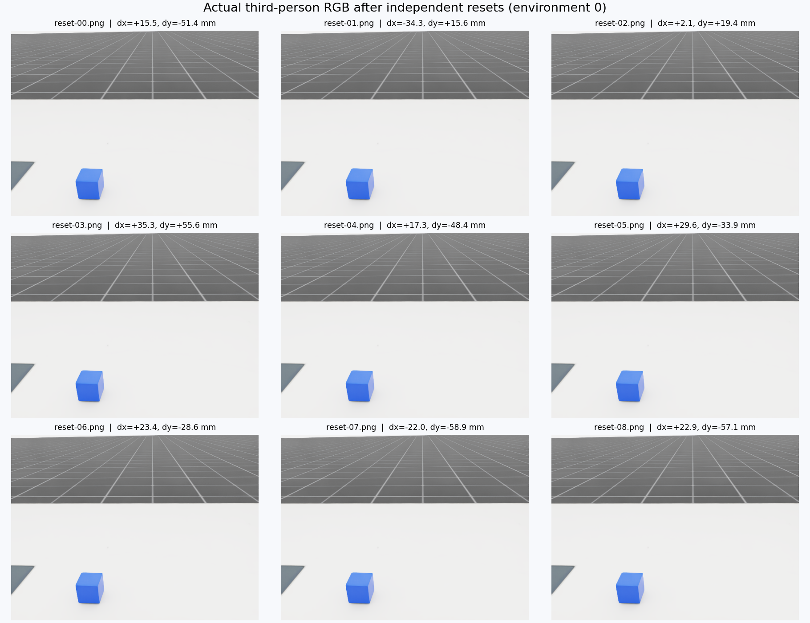

# AutoData 域随机化实测

2026-10-16，RTX 5090，现有 autodata 环境。测试对象为已准备的 OpenArm 左臂拾放任务，4 个并行环境 × 64 次 reset，共 256 个位姿样本。结果：**passed**。

当前启用的是物体 XY 初始位置随机化：相对默认中心 x ±40 mm、y ±60 mm。默认中心为 [0.5299999713897705, 0.11999999731779099, 1.0809999704360962] m；高度、朝向、光照、相机、纹理、材质、质量和摩擦系数未配置随机化。本结果不覆盖其他 AutoData 任务。

| 检查 | 结果 |
| --- | --- |
| 位姿数值有限 | 通过 |
| XY 均在配置范围内 | 通过 |
| XY 实际发生变化 | 通过 |
| 高度保持固定 | 通过 |
| 朝向保持固定 | 通过 |
| 相同种子复现 | 通过 |
| 不同种子产生不同样本 | 通过 |
| 关闭随机化后位置固定 | 通过 |
| 12 步物理运行数值有限 | 通过 |

同种子比较包含 8 次连续 reset × 4 环境的 XYZ 和四元数，最大误差 0。固定位置对照同样采集 32 个样本。统计采样均在 reset 后、额外物理步之前；最后单独执行 12 步零动作物理测试。


虚线框是配置边界，颜色表示环境编号；红色十字是关闭随机化后的默认中心。直方图虚线表示配置的均匀分布密度，仅作视觉比较，未进行均匀性显著性检验。



九张图来自环境 0 的独立 reset，标注偏移来自同次 reset 的物理状态。完整原图、位姿数组、种子对照数组与结果 JSON 均保存在本目录。

本次验证 reset 事件、种子行为、短程物理步和相机渲染；没有运行 cuRobo 轨迹生成，没有评估抓取成功率、训练收益或 sim-to-real 效果。相同种子复现只适用于本次进程和环境配置。

初次启动因未设置生产启动器的 CUDA 库路径失败；修正进程环境后重跑。失败日志保留在 runs/domain-randomization-20261016/probe/error.txt，成功运行日志在同级 console-r02.log。没有修改上游代码或 conda 依赖。

复现命令（需已有准备目录、GPU 和 autodata 环境；输出目录必须不存在）：

```bash
bash workspace-overlays/autodata-domain-randomization/run.sh --output runs/domain-randomization-NEW
MPLCONFIGDIR=/tmp/autodata-dr-mpl /home/tangyuan/miniconda3/envs/autodata/bin/python workspace-overlays/autodata-domain-randomization/report.py --run runs/domain-randomization-NEW --output outputs/autodata-domain-randomization/vNEW
```
