# AutoData 生产效率改进复盘

材料截止：2026-10-15（北京时间）。分析对象：2026-10-14 保存的 OpenArm 左臂 AutoData 测试记录。本次只复核历史 JSON、CSV 和遥测，不启动新的 GPU 测试，不重新扫描 HDF5。

## 先看代码区别：三种保存方式，共用同一生成任务

本节依据本轮测试目录中冻结的 launcher 源码，而非后来可能变动的工作区代码。示意代码经过简化，用于解释控制流；不是可直接执行的补丁。cuRobo v1 的同步、上限 4、上限 8、auto 共用任务与规划后端，差别集中在导出路径与 writer 扩容策略。

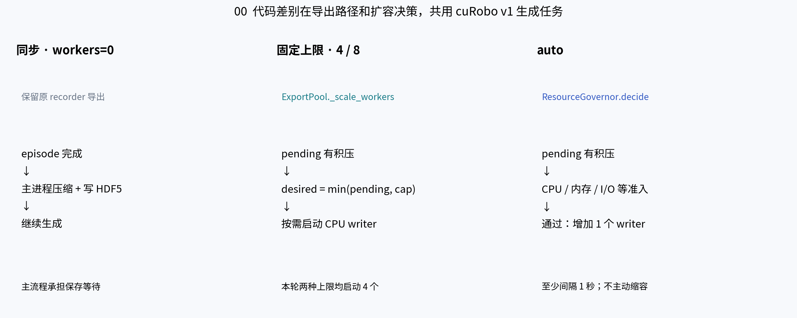

| 方法 | 代码入口与具体差别 | 优化作用与代价 |
|---|---|---|
| 同步 workers=0 | generate.py:33 的异步分支不启用；保留原 recorder 导出路径 | 主流程等待压缩和 HDF5 保存；没有异步分片合并 |
| 固定上限 workers=4 / 8 | ExportPool._scale_workers 中 desired=min(pending,max_workers)，有积压才启动进程 | 让 CPU 保存与生成重叠；4/8 是上限，并非预启动数量，本轮均只启动 4 个 |
| auto | ExportPool 初始化 ResourceGovernor；decide 通过后每次仅增 1 个 writer，检查间隔至少 1 秒 | 按 CPU、内存、进程配额、共享内存、磁盘空间和 I/O 压力决定是否扩容；没有直接按 GPU 利用率扩容，也没有运行中自动缩容 |

异步模式共有的四项代码调整如下，固定上限和 auto 都使用它们：

1. **CPU 帧按环境独立持有。** async_export.py:37–60 将 CPU batch 的切片改为每个环境独立 clone，避免保留整批其他环境数据；GPU 分支仍保留原有批量 clone。它解决内存生命周期问题，不是“零拷贝”。
2. **数据移交改为有界共享内存。** Bridge.export 调用 pool.submit(..., release_source=True)；submit 先等待预算，再 pack，共享内存仅传名字和布局给 writer，复制后释放源数据。队列背压仍可能阻塞主流程。
3. **保存转入 CPU 子进程。** writer 写各自分片，回执确认后回收共享内存；HDF5 句柄和仿真对象不跨进程传递。并发改变调度位置，没有消除压缩计算。
4. **增加完成屏障和合并校验。** finish 等待全部 pending 清空、等待 writer 退出，_merge 复制各分片到临时 HDF5、检查属性/shape/dtype/压缩方式，再发布最终文件。output_ready 在后续 env.close 后发出，所以收尾区间略大于 drain+merge。

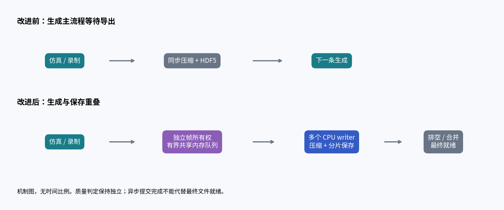

这些优化没有在本组中改用 lzf、降低图像分辨率或取消质量检查。auto 额外优化的是资源准入，而不是新增一种压缩算法。内存修复、异步保存与分片合并没有分别做消融测试，不能把整批提速精确拆成每一项改动的独立贡献。

## 内部耗时变化：按三种计时范围分别看

### A. 每个 episode 的主流程均值

以下分母为每组 **17 个已完成 episode（16 成功 + 1 失败）**，不是只统计 16 条成功输出。同步导出与异步入队代表不同工作，不能把异步的 export=0 理解为不需要保存。

| 内部阶段（秒 / 已完成 episode） | 同步 | 上限 4 | 上限 8 | auto | auto 相对同步 |
|---|---:|---:|---:|---:|---:|
|重置|0.278|0.156|0.187|0.151|-45.6%|
|运动规划|1.740|1.567|1.464|1.423|-18.2%|
|执行 / 等待|310.274|178.166|170.896|167.215|-46.1%|
|主流程同步导出|25.615|0.000|0.000|0.000|-100.0%|
|主流程异步入队|0.000|2.652|2.620|2.619|新增阶段|

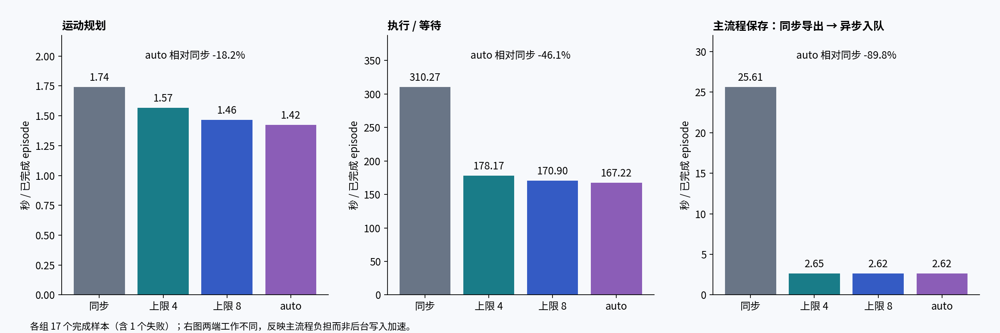

执行/等待由 310.274 降至 167.215 秒，下降 46.1%；主流程的同步导出 25.615 秒被约 2.619 秒的异步入队替代，该主流程阶段负担下降约 89.8%。这不是后台保存加速 89.8%：writer 仍需约 27–28 秒写一条数据。

### B. 异步移交与后台写入：可以重叠，不能相加为总耗时

| 内部指标 | 上限 4 | 上限 8 | auto | 统计范围 |
|---|---:|---:|---:|---|
|共享内存打包|26.708|25.104|24.462|整轮累计秒数|
|等待队列预算|18.032|19.119|19.727|整轮累计秒数|
|后台单条写入均值|28.311|27.619|27.303|16 个 export_saved 的均值，秒 / 条|
|后台单条写入 P95|33.035|30.609|30.436|历史遥测报告的 P95，秒 / 条|

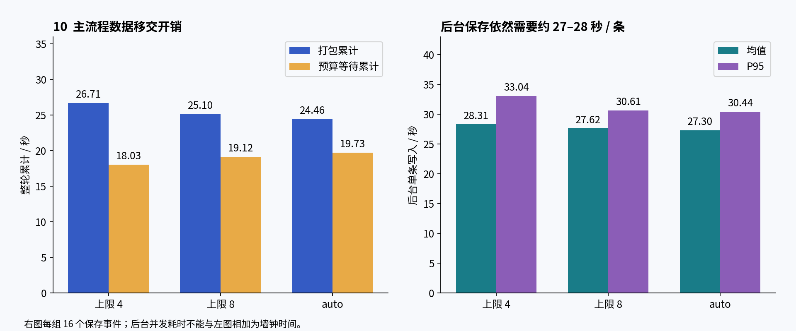

打包、预算等待与主流程入队计时存在包含关系，起止点和样本范围也不完全一致；不应把它们再次加入 episode 阶段总和。后台写入与主流程并发，多 writer 写入的耗时总和也不等于墙钟时长。同步模式没有异步 writer 的同名测量，缺失值不填 0。

### C. 整批收尾：auto 本轮生成最快，却没有最早交付

| 区间（整批秒数） | 同步 | 上限 4 | 上限 8 | auto |
|---|---:|---:|---:|---:|
|首条启动 → 最后完成|997.669|604.721|563.470|549.171|
|finish 排空队列并等待进程退出|不适用|28.927|27.283|27.152|
|export_complete 报告的合并阶段|不适用|8.157|8.503|45.665|
|最后完成 → output_ready|1.677|38.987|37.345|74.477|
|首条启动 → output_ready|999.346|643.707|600.815|623.648|

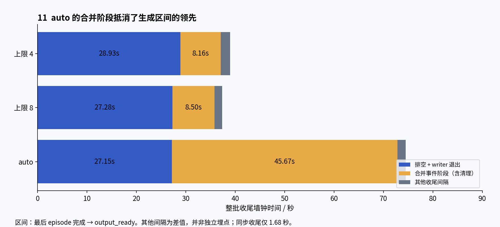

auto 的生成区间比上限 8 短约 14.30 秒，但收尾多约 37.13 秒，导致最终就绪反而晚 22.83 秒。主要差异出现在 merge 事件：45.67 秒对 8.50 秒。代码中 export_complete 的 merge_seconds 还覆盖合并后的 manifest 写入、分片目录清理及队列关闭等操作，因此不是纯 HDF5 copy 的独立计时。单轮不能确认是策略、缓存、磁盘或系统负载导致；需要重复测试及更细的 I/O 埋点。

### D. cuRobo v2 只作阶段诊断，不纳入完整吞吐排名

v2 的历史阶段均值采用 16 个已完成 episode，v1 auto 为 17 个，样本分母不同。v2 的规划均值 8.089 秒、执行/等待 172.618 秒、入队 3.626 秒；v1 auto 分别为 1.423、167.215、2.619 秒。这些值不支持“v2 的规划阶段更快”，也不足以隔离后端升级的因果影响。v2 尚缺最终就绪与校验，不能与 v1 的完整生产耗时混比。

## 结论：异步保存已经带来收益，v2 的完整生产收益尚未证实

最新一组 8 环境、16 条成功数据、seed 101、cuRobo v1 的对照中，同步保存需 999.35 秒，异步保存需 600.82–643.71 秒。最终就绪吞吐由 0.961 条/分钟升至 1.491–1.598 条/分钟，相对提升 55.25%–66.33%，耗时减少 35.59%–39.88%。auto 模式为 623.65 秒、1.539 条/分钟，吞吐提升 60.24%。

这些是单轮观测，不能据此确定 auto、上限 4、上限 8 的稳定排名。三个异步配置实际都只启动了 4 个 writer；“上限 8”不等于同时使用 8 个保存进程。

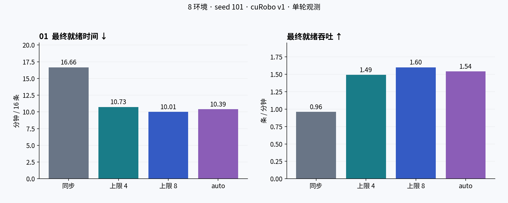

| 配置 | 实际 writer | 最终就绪 / 秒 | 吞吐 / 条每分钟 | 含启动退出的总耗时 / 秒 |
|---|---:|---:|---:|---:|
| 同步 | 0 | 999.35 | 0.961 | 1067.93 |
| 上限 4 | 4 | 643.71 | 1.491 | 692.45 |
| 上限 8 | 4 | 600.82 | 1.598 | 651.95 |
| auto | 4 | 623.65 | 1.539 | 667.06 |

## 改了什么：把保存从生成主流程中拆出

此前，同步导出占用生成主流程，压缩与 HDF5 写入期间无法继续推进同一流程。异步方案让主进程准备独立所有权的数据帧，经有界共享内存队列交给 CPU writer，生成与保存可以重叠。最后仍要排空队列、合并文件，才能确认数据就绪。

历史记录还包含内存所有权修复：早期异步尝试曾出现 OOM，原因涉及 CPU batch view 保留其他环境的数据；后续改为各环境独立持有 CPU 帧，并在移交时释放已复制帧。该修复与保存池共同组成方案，但现有实验不能单独量化各改动的贡献。

## 为什么提速：主流程等待减少，而不是规划器突然更快

最新同步配置的每个已完成 episode 平均执行/等待为 310.27 秒，auto 为 167.22 秒；同步导出均值为 25.61 秒，auto 的主流程入队均值为 2.62 秒。这里的 execution_wait 是执行与调度等待的合计，不能理解为纯 GPU kernel 时间；后台写入也没有凭空消失。

规划阶段均值从同步的 1.74 秒变为 auto 的 1.42 秒，相比执行/等待并非主要耗时。当前证据支持优先优化数据记录、压缩保存和流程重叠，不能把全部收益归因于某个单独函数。

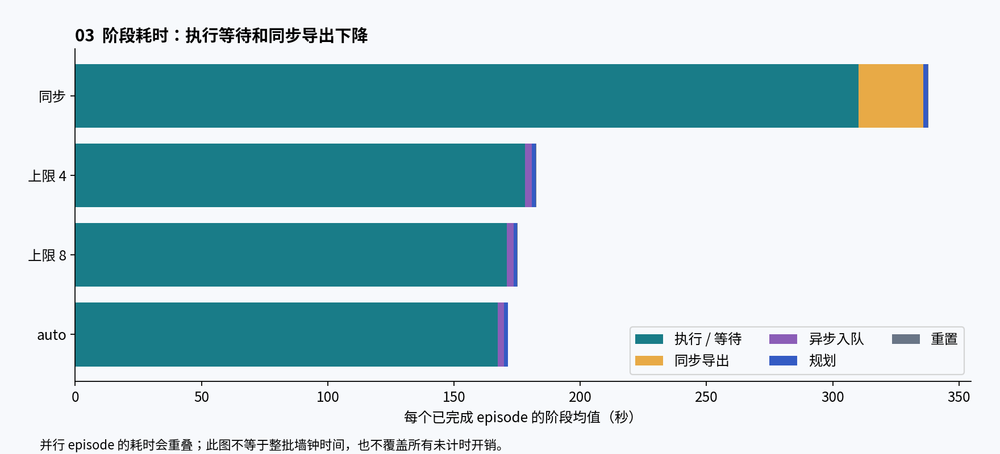

## 统一口径：最终文件可用，才算生产完成

主指标采用 `output_ready.elapsed_seconds − 第一个 episode_started.elapsed_seconds`，吞吐为成功保存条数 × 60 / 最终就绪秒数。本次已从遥测事件重新计算四个结果，并与 summary.csv 核对一致。launcher 总耗时另列，包含启动和退出，不能混入同一个加速比。

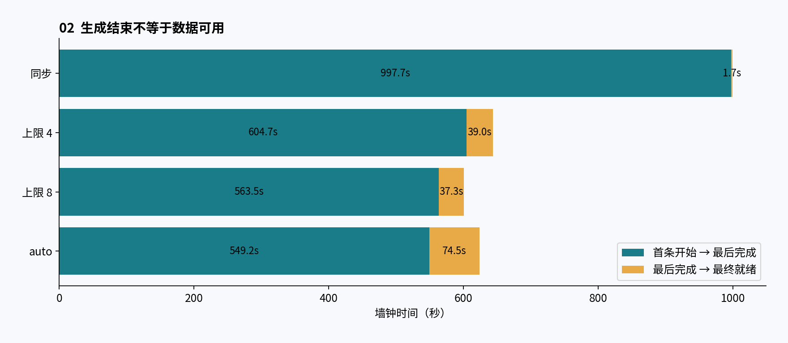

保存尾部的等待与合并会影响最终收益。最新 auto 的 merge 事件耗时约 45.67 秒，上限 4 和上限 8 分别约 8.16、8.50 秒。单轮中这可能受文件系统、缓存和系统状态影响，尚不能认定为 auto 策略本身的固定开销。阶段累计时间和并行 episode 均值不能直接相加为整批墙钟时间。

## 资源利用率：有所提高，但“GPU 跑满”不是验收条件

首条开始至 output_ready 区间内，按有效设备采样时间加权，GPU 利用率均值为：同步 22.7%，上限 4 为 40.8%，上限 8 为 35.6%，auto 为 32.8%。采样设备为 NVIDIA GeForce RTX 5090。

上限 4 的 GPU 利用率高于上限 8，但本轮完成更慢。这说明利用率只能辅助定位瓶颈，最终应看质量合格数据的就绪吞吐。这里统计的是设备级利用率，可能包含其他进程；只覆盖有效采样间隔，不是逐 kernel 测量，也不是 GPU 独占证明。

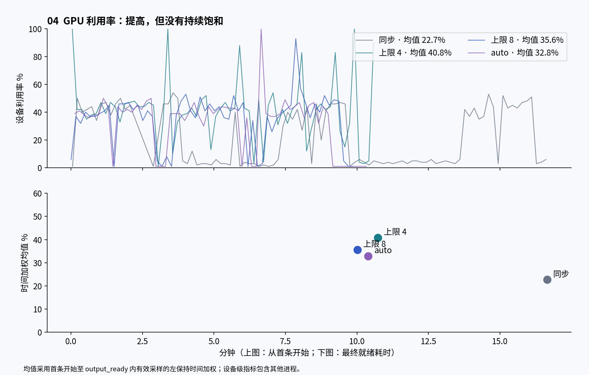

## 质量效果：本轮指标没有下降，但不代表全面质量认证

四个 v1 配置均完成 17 次尝试，其中 16 次生成成功、1 次失败，生成成功率为 94.12%；保存的 16 条均通过已有末态物理检查。达到目标后取消的在途 episode 不计为失败。本次复核历史校验 JSON，不声称进行了新的物理重放。

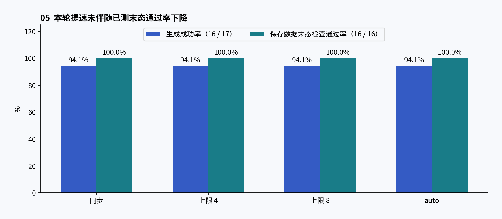

末态通过、格式兼容与图像有效性是不同维度。历史校验记录中的部分 right_hand_rgb 首尾均值接近零；这不影响现有末态通过统计，但说明训练前仍需独立检查相机有效性、轨迹完整性和多样性。不能将“16/16 末态通过”写成“全部训练质量通过”。

## 早期测试：收益方向一致，不能拼成连续加速曲线

早期 8 环境、24 条测试中，同步、1 writer、2 writers 的最终就绪时间分别为 1156.74、1022.19、891.22 秒；2 writers 相对同步吞吐提升 29.79%，耗时减少 22.95%。三个模式都记录 24 条成功，但严格末态检查仅 23 条通过，同一个 demo_2 仍在运动。该组不得写成质量完全通过。

离线 4 条保存对照中，同步和 1 writer 的最终就绪分别为 105.13、105.45 秒，2 writers 为 56.66 秒。1 writer 的提交耗时虽降到约 4.58 秒，但完整保存并未变快；这正是不能用“提交返回”代替“最终就绪”的例子。

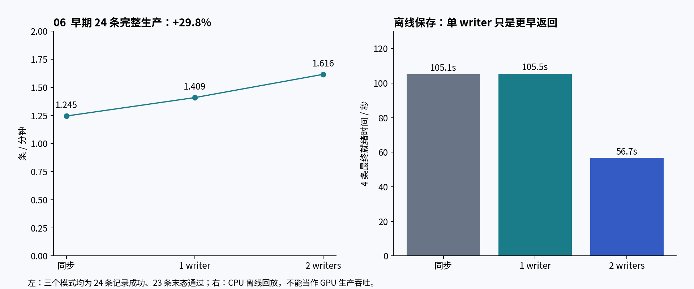

24 条与 16 条实验的批量、seed 和实现状态未证明完全一致，因此只在各自组内比较，不把 29.79% 与 66.33% 相乘，也不宣称最新结果代表持续递增的累计收益。

## 尚未落地为生产结论的优化：压缩策略与 cuRobo v2

离线全长 RGB、相同 chunk 的单轮对照显示：gzip 创建耗时 25.75 秒、文件 0.55 GB；lzf 为 16.98 秒、0.83 GB；无压缩为 10.10 秒、3.72 GB。lzf 有速度收益但增加体积，无压缩的存储代价更大。这些只覆盖离线 RGB 保存，不是完整生成，也不是已经采用新压缩方案后的生产测试。dataset_create 同时包含压缩、HDF5 和 I/O，差值不能作为纯压缩耗时。

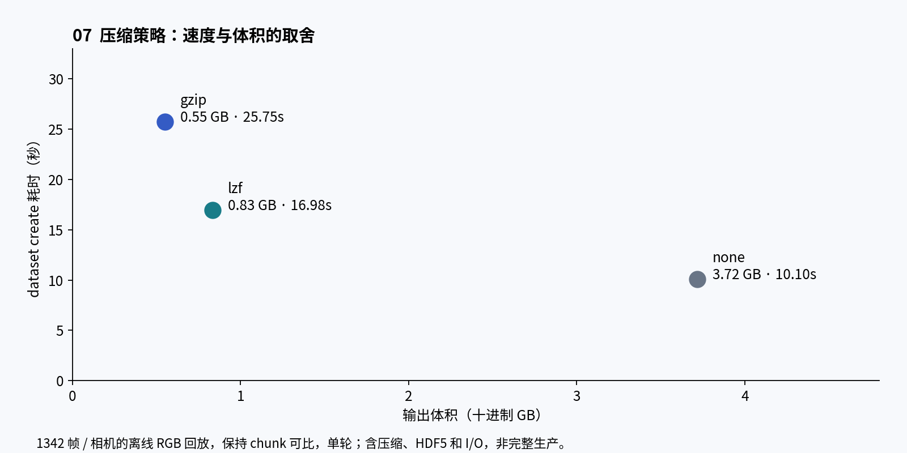

cuRobo v2 的 auto 记录显示 16 次成功、16 个保存分片；但 run 和 export 元数据仍为 running，未找到 output_ready、最终校验文件和完整汇总。这里只能确认历史记录中的阶段进度，不能断言进程现在仍在运行，也不能计算完整交付吞吐或宣称 v2 胜过 v1。

此前“32 个 episode”测试的 report.md 仍含未填写模板。本次未将其计入完成的基准，也不把 16 条或 24 条结果线性放大为实测 32 条结果。

## 下一步如何把结论变成稳定生产配置

1. 保留同步基线，重复测试固定 4 writers 与 auto；保持输入、任务、seed 列表、质量判据、8 环境和输出批量一致，并交错测试顺序。报告中位数、分位数和波动，而不只报最好一轮。
2. 优先调查最终合并耗时和队列背压。需要提高并行度时同时记录内存、OOM、磁盘空间、真实 writer 数和其他进程负载。
3. v2 补齐最终合并、格式读回与相同质量检查后，再加入统一对照；不把求解成功率当作数据生产成功率。
4. 把训练前图像有效性检查补入质量验收。压缩策略若要调整，另做完整生产、读取兼容性与体积对照。

## 证据与复现

新增 `code-evidence.md` 提供本轮冻结代码的相关片段及行号；`internal-timing.csv` 保存新增内部指标和统计口径。

- 主对照：`AutoData/datasets/efficiency_20261014_201834/v1/summary.csv`，及各 r01_v1_w* 目录中的 run、telemetry、resources、validation 记录。
- 未完成对照：同测试目录下 `v2/r01_v2_wauto` 的 run、telemetry 与 export 元数据。
- 历史对照及离线实验：`outputs/autodata-efficiency-report/v001/evidence.json`。
- 数据摘要、可复算数值及输入 SHA-256：本包 `data.json`；平面汇总为 `data.csv`。图表可用 `python build_figures.py` 重建，需要 matplotlib 和 Noto CJK 字体。原始大型遥测与 HDF5 不随包复制。
- 图册：`charts.pdf`，共 12 页；图像同时提供 PNG 与 SVG。没有基于单轮结果构造置信区间或误差条。

本次仅本地交付，不上传飞书或 ChatGPT，不提交或推送 GitHub。
