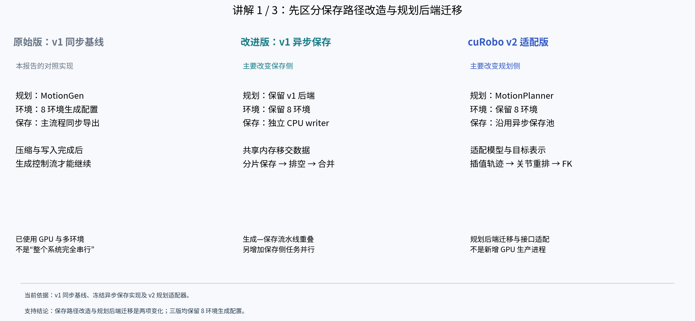
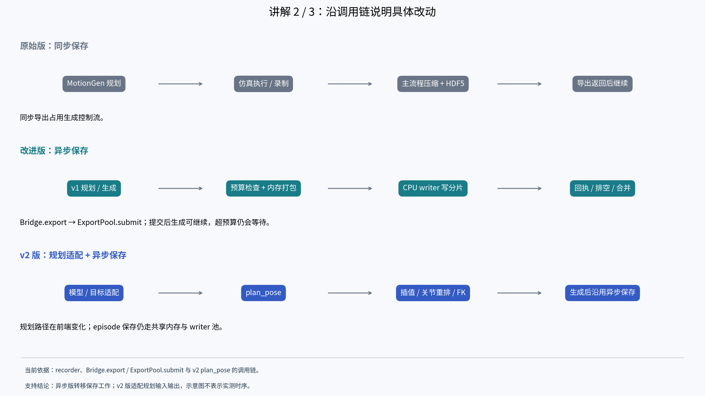
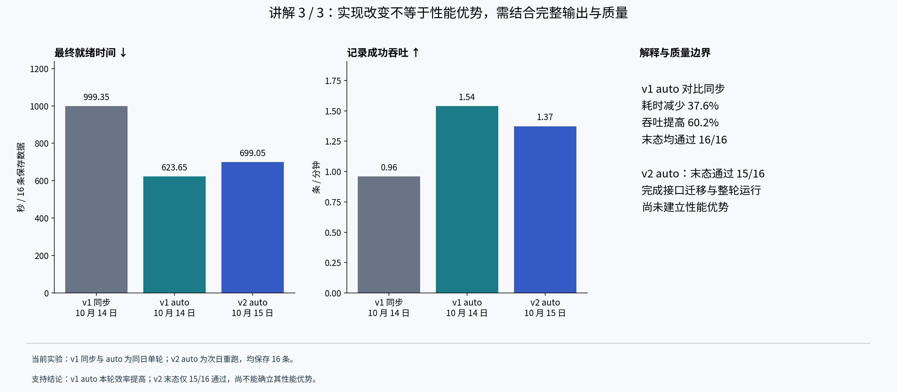

# 三版本实现差异讲解稿

## 开场讲解：原始版、异步改进版与 cuRobo v2 适配版

这里的“原始版”专指本报告中的 **cuRobo v1 + 同步保存基线**，不是未经修改的上游最初版本。“改进版”指 **cuRobo v1 + 异步保存池**；“cuRobo v2 版”指 **v2 规划适配器 + 已有异步保存池**。这三个名称描述当前测试实现，不能理解为三个独立的官方软件发行版。

### 第一页：三版到底改了什么

三版都在相同任务定义下生成机器人操作数据，生产配置均为 8 个环境。第一个变化发生在保存侧：将压缩和 HDF5 写入从生成主进程移到 CPU 写入进程；第二个变化发生在规划侧：将 v1 的 MotionGen 接口适配为 v2 的 MotionPlanner，并处理模型配置、坐标系和轨迹格式。因此，异步保存改进与规划后端迁移是两项不同的实现变化。

| 对比项 | 原始同步基线 | v1 异步改进版 | cuRobo v2 适配版 |
|---|---|---|---|
| 规划后端 | cuRobo v1，MotionGen | 保留 v1 规划后端 | MotionPlanner / GoalToolPose / plan_pose |
| 环境组织 | 8 环境生成配置 | 仍为 8 环境 | 仍为 8 环境，每环境规划对象 |
| 保存位置 | 主流程同步压缩与写入 | spawn 创建独立 CPU writer | 沿用异步 writer 保存路径 |
| 数据移交 | recorder 在原导出路径处理数据 | CPU 帧独立持有；共享内存打包；发送名称与布局 | 复用异步数据移交机制 |
| 并发控制 | 无后台 writer 池 | 固定上限 4/8 或 auto；本轮实际均为 4 | 本轮 auto，实际 4 个 writer |
| 输出完成 | 同步导出及关闭后最终就绪 | 分片保存回执 → 排空 → 合并 → 关闭后最终就绪 | 保留相同完成链，额外验证 v2 输出 |
| 主要新增工作 | 对照基线 | 内存所有权、背压、进程池、分片与合并 | 模型字段转换、接触处理、轨迹插值与关节重排 |

讲解要点：原始版已经使用 GPU 和多环境生成。异步改进增加的是 CPU 保存侧的任务并行与生成—保存重叠。v2 版在已有保存机制上替换规划后端，不能把它称为“进一步增加 GPU 并行进程”。

### 第二页：从代码调用看数据如何流动

原始版中，episode 完成后沿 recorder 的同步路径执行压缩和 HDF5 写入，该调用返回前生成控制流受到保存工作阻塞。异步改进版将该入口改为 Bridge.export → ExportPool.submit：先检查共享内存预算并打包数据，再把任务交给 writer；提交完成后主流程可以继续。后台 writer 写独立分片，回执到达后主进程释放共享内存；整轮结束仍要等待全部保存与合并。以上调用链是源码摘要，不是可直接运行的伪补丁。

v2 版保留异步保存链，主要改动出现在 episode 生成过程中的规划调用：模型字段 ee_link → tool_frames、retract_config → default_joint_position；目标与动态物体转换到机器人基座系；调用 MotionPlanner.plan_pose；通过 get_interpolated_plan 取得执行采样，再按关节名称重排、经正向运动学转换为末端位姿。持物和接触阶段还需要附着、临时碰撞配置及恢复；它不是只改一个 import。

讲解要点：第一处改动缩短主流程承担保存工作的区间，但没有消除压缩计算；第二处改动接入新的规划接口与轨迹表示，其速度和末态质量必须重新测量。两者都保留结束时的输出校验要求。

### 第三页：实验能支持什么结论

为便于讲解，下面选 v1 auto 作为“异步改进版”的代表，使它与 v2 auto 保持相同的保存策略；没有选择本轮更快的 cap8 来混合比较。固定上限 4/8 的完整结果仍保留在后文。

| 指标 | 原始同步基线 | v1 auto 异步改进版 | v2 auto 适配版 |
|---|---:|---:|---:|
| 测试日期 | 10 月 14 日 | 10 月 14 日 | 10 月 15 日 |
| 最终就绪，秒 | 999.35 | 623.65 | 699.05 |
| 记录成功吞吐，条/分钟 | 0.961 | 1.539 | 1.373 |
| 规划阶段均值，秒/完成 episode | 1.740 | 1.423 | 8.038 |
| 主流程导出／入队均值，秒/完成 episode | 25.615（同步导出） | 2.619（异步入队） | 3.694（异步入队） |
| 完成 episode 数（阶段统计分母） | 17 | 17 | 16 |
| 实际 CPU writer 数 | 0 | 4 | 4 |
| 最终保存条数 | 16 | 16 | 16 |
| 保存数据末态通过 | 16/16 | 16/16 | 15/16 |

v1 auto 相比同步基线，最终就绪耗时减少约 37.6%，记录成功吞吐提高约 60.2%，本轮已测末态通过率保持 16/16。这支持“异步保存整体实现改善了本轮生产效率”，不能将收益精确归因于某一个内部改动。

v2 auto 已完成整轮生成、合并和文件读回，但本轮没有表现出更高吞吐，并有一条数据未通过角速度末态检查。v1/v2 为跨日期单轮比较，缓存、热身和系统状态未控制一致，因此既不能宣称 v2 提速，也不能据此断定 v2 后端普遍更慢。原始版与改进版的 17 个完成样本包含失败，v2 阶段均值使用 16 个完成样本；同步导出与异步入队也有不同工作范围，不能把表中阶段差值作为纯写盘速度或纯规划器速度的因果估计。

讲解要点：当前已观察到的生产效率收益主要来自 v1 保存路径改造；v2 的成果是完成接口迁移与一次端到端运行，性能优势和全量末态质量仍未建立。

