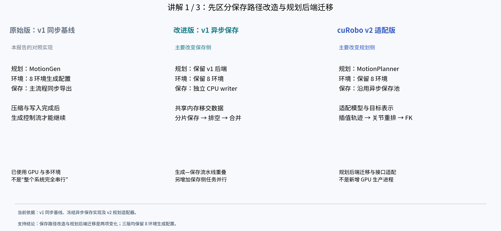
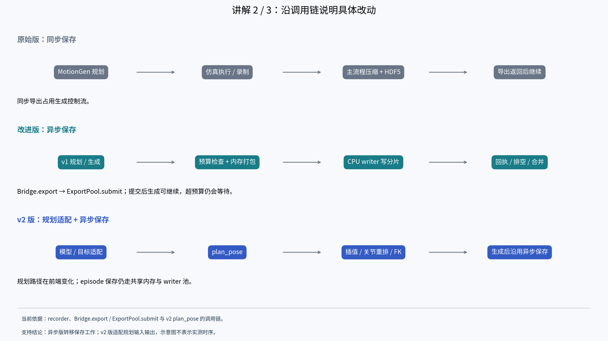
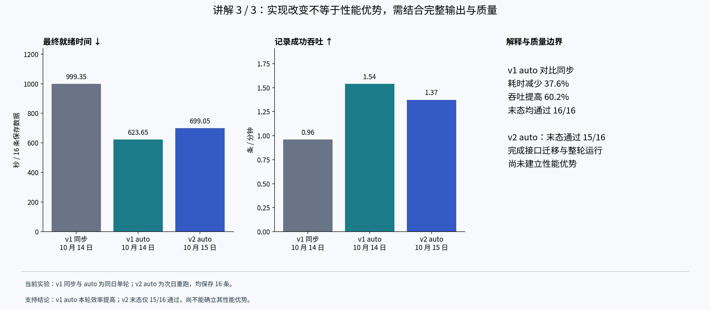
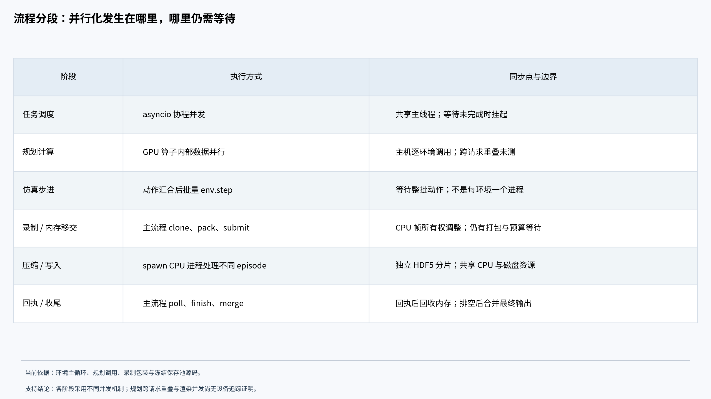
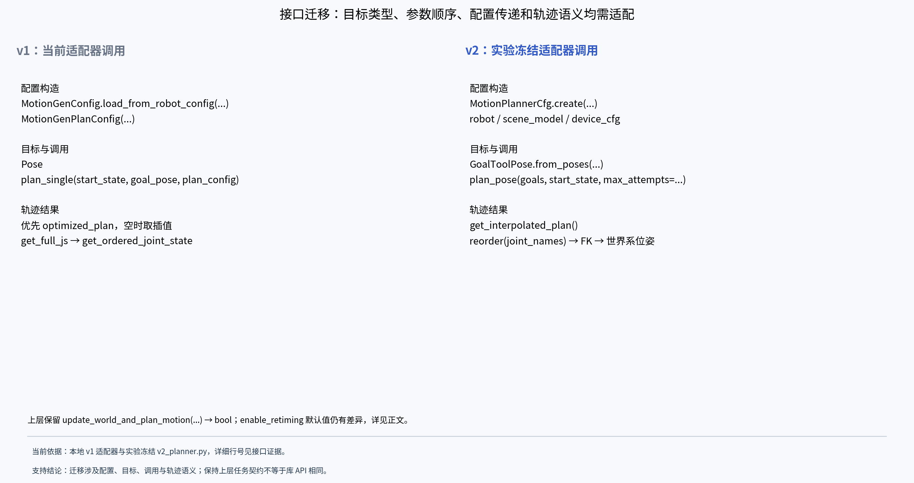
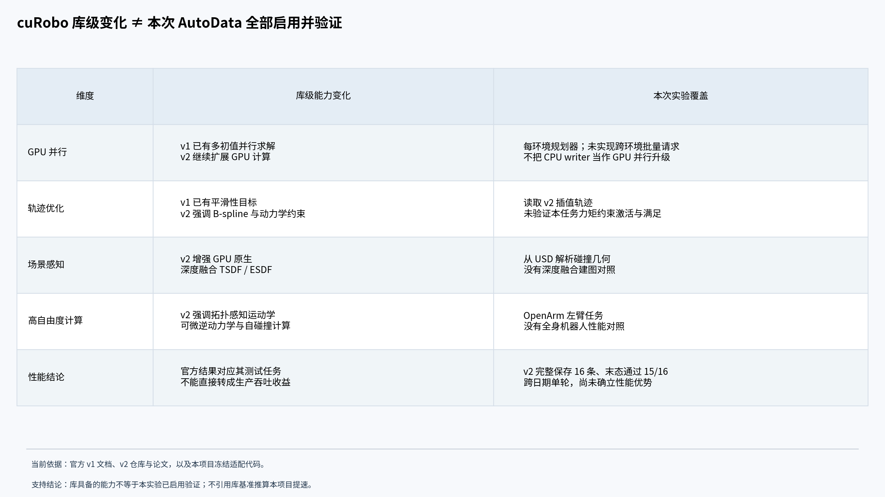

# 三版本实现差异讲解稿

## 开场讲解：原始版、异步改进版与 cuRobo v2 适配版

这里的“原始版”专指本报告中的 **cuRobo v1 + 同步保存基线**，不是未经修改的上游最初版本。“改进版”指 **cuRobo v1 + 异步保存池**；“cuRobo v2 版”指 **v2 规划适配器 + 已有异步保存池**。这三个名称描述当前测试实现，不能理解为三个独立的官方软件发行版。

### 第一页：三版到底改了什么

三版都在相同任务定义下生成机器人操作数据，生产配置均为 8 个环境。第一个变化发生在保存侧：将压缩和 HDF5 写入从生成主进程移到 CPU 写入进程；第二个变化发生在规划侧：将 v1 的 MotionGen 接口适配为 v2 的 MotionPlanner，并处理模型配置、坐标系和轨迹格式。因此，异步保存改进与规划后端迁移是两项不同的实现变化。

| 对比项 | 原始同步基线 | v1 异步改进版 | cuRobo v2 适配版 |
|---|---|---|---|
| 规划后端 | cuRobo v1，MotionGen | 保留 v1 规划后端 | MotionPlanner / GoalToolPose / plan_pose |
| 环境组织 | 8 环境生成配置 | 仍为 8 环境 | 仍为 8 环境，每环境规划对象 |
| 保存位置 | 主流程同步压缩与写入 | spawn 创建独立 CPU writer | 沿用异步 writer 保存路径 |
| 数据移交 | recorder 在原导出路径处理数据 | CPU 帧独立持有；共享内存打包；发送名称与布局 | 复用异步数据移交机制 |
| 并发控制 | 无后台 writer 池 | 固定上限 4/8 或 auto；本轮实际均为 4 | 本轮 auto，实际 4 个 writer |
| 输出完成 | 同步导出及关闭后最终就绪 | 分片保存回执 → 排空 → 合并 → 关闭后最终就绪 | 保留相同完成链，额外验证 v2 输出 |
| 主要新增工作 | 对照基线 | 内存所有权、背压、进程池、分片与合并 | 模型字段转换、接触处理、轨迹插值与关节重排 |

讲解要点：原始版已经使用 GPU 和多环境生成。异步改进增加的是 CPU 保存侧的任务并行与生成—保存重叠。v2 版在已有保存机制上替换规划后端，不能把它称为“进一步增加 GPU 并行进程”。

### 第二页：从代码调用看数据如何流动

原始版中，episode 完成后沿 recorder 的同步路径执行压缩和 HDF5 写入，该调用返回前生成控制流受到保存工作阻塞。异步改进版将该入口改为 Bridge.export → ExportPool.submit：先检查共享内存预算并打包数据，再把任务交给 writer；提交完成后主流程可以继续。后台 writer 写独立分片，回执到达后主进程释放共享内存；整轮结束仍要等待全部保存与合并。以上调用链是源码摘要，不是可直接运行的伪补丁。

v2 版保留异步保存链，主要改动出现在 episode 生成过程中的规划调用：模型字段 ee_link → tool_frames、retract_config → default_joint_position；目标与动态物体转换到机器人基座系；调用 MotionPlanner.plan_pose；通过 get_interpolated_plan 取得执行采样，再按关节名称重排、经正向运动学转换为末端位姿。持物和接触阶段还需要附着、临时碰撞配置及恢复；它不是只改一个 import。

讲解要点：第一处改动缩短主流程承担保存工作的区间，但没有消除压缩计算；第二处改动接入新的规划接口与轨迹表示，其速度和末态质量必须重新测量。两者都保留结束时的输出校验要求。

### 第三页：实验能支持什么结论

为便于讲解，下面选 v1 auto 作为“异步改进版”的代表，使它与 v2 auto 保持相同的保存策略；没有选择本轮更快的 cap8 来混合比较。固定上限 4/8 的完整结果仍保留在后文。

| 指标 | 原始同步基线 | v1 auto 异步改进版 | v2 auto 适配版 |
|---|---:|---:|---:|
| 测试日期 | 10 月 14 日 | 10 月 14 日 | 10 月 15 日 |
| 最终就绪，秒 | 999.35 | 623.65 | 699.05 |
| 记录成功吞吐，条/分钟 | 0.961 | 1.539 | 1.373 |
| 规划阶段均值，秒/完成 episode | 1.740 | 1.423 | 8.038 |
| 主流程导出／入队均值，秒/完成 episode | 25.615（同步导出） | 2.619（异步入队） | 3.694（异步入队） |
| 完成 episode 数（阶段统计分母） | 17 | 17 | 16 |
| 实际 CPU writer 数 | 0 | 4 | 4 |
| 最终保存条数 | 16 | 16 | 16 |
| 保存数据末态通过 | 16/16 | 16/16 | 15/16 |

v1 auto 相比同步基线，最终就绪耗时减少约 37.6%，记录成功吞吐提高约 60.2%，本轮已测末态通过率保持 16/16。这支持“异步保存整体实现改善了本轮生产效率”，不能将收益精确归因于某一个内部改动。

v2 auto 已完成整轮生成、合并和文件读回，但本轮没有表现出更高吞吐，并有一条数据未通过角速度末态检查。v1/v2 为跨日期单轮比较，缓存、热身和系统状态未控制一致，因此既不能宣称 v2 提速，也不能据此断定 v2 后端普遍更慢。原始版与改进版的 17 个完成样本包含失败，v2 阶段均值使用 16 个完成样本；同步导出与异步入队也有不同工作范围，不能把表中阶段差值作为纯写盘速度或纯规划器速度的因果估计。

讲解要点：当前已观察到的生产效率收益主要来自 v1 保存路径改造；v2 的成果是完成接口迁移与一次端到端运行，性能优势和全量末态质量仍未建立。

## 按流程定位并行方式与接口变动

本节区分三种证据：实验冻结 launcher、2026-10-15 当前 AutoData 源码、官方库文档。v2 实验记录的 cuRobo commit 为 `78fd485fa82d9b9a063fb4985e371814587e666a`；官方 latest 文档用于解释库能力，不作为该固定提交所有接口行为的替代依据。当前 v1 主代码不构成历史实验源码逐字相同的证明。接口证据摘录、行号和哈希另存于 interface-evidence.md。

### 各阶段在哪里执行，采用哪种并行方式

| 流程阶段 | 接口或代码位置 | 实际执行方式 | 同步点与限制 |
|---|---|---|---|
| 环境任务调度 | setup_async_generation → event_loop.create_task(run_data_generator(...)) | 单主进程、单事件循环线程中的协程并发 | 仅在等待操作未完成时挂起；不等于 Python 多核并行 |
| 轨迹规划入口 | planner.update_world_and_plan_motion(...) | 每环境规划器实例，由普通同步函数调用进入 | 该调用没有协程调度点；不据此推断设备是否已全局同步 |
| IK、轨迹与碰撞计算 | v1 plan_single；v2 plan_pose | 规划算子内部的 GPU 数据并行；多初值用于候选求解 | 本项目逐环境调用，未改为跨 8 环境的批量规划请求；不同请求的 kernel 重叠未测量 |
| 动作汇合与仿真 | queue.put((env_id, action)) → queue.join；env_loop → env.step(actions) | 各环境提交动作，凑齐后一次批量步进 | 等待完整动作批次；task_done 只更新队列完成计数，不是 CUDA 同步 |
| 录制与帧持有 | RecorderManager.add_to_episodes；owned_recording_method | 主流程录制，CPU 帧按环境独立 clone；GPU 数据仍保留批量 clone 路径 | 这是数据所有权调整；没有新增录制子进程，也不是零拷贝 |
| episode 移交 | Bridge.export → ExportPool.submit → pack → jobs.put | 主进程检查预算、打包共享内存，再提交描述信息 | 打包仍占用主流程；在途字节预算不足时通过 poll 等待回执 |
| 压缩与分片写入 | spawn Process(target=writer) → write_job | 独立 CPU 进程处理不同 episode；各进程串行消费任务 | 多核计算可并行；I/O 共享磁盘，实际吞吐受资源限制；不多进程写同一 HDF5 |
| 回收与最终发布 | poll → saved；finish → _merge | 主进程处理回执、等待 writer 退出，再合并输出 | 分片已保存不等于最终文件就绪；合并不是新增的并行保存阶段 |

渲染由仿真运行时管理，GPU 参与其中；本次没有单独的渲染 stream、渲染进程或 kernel 时间线证据，不将它描述为与规划必然同时执行。三版沿用 8 环境生成配置；保存侧并行化没有改变规划请求的组织方式。

### 保存接口：调用入口兼容，完成语义改变

| 原始路径 | 异步改进实现 | 准确的语义变化 |
|---|---|---|
| recorder.export_episodes(...) | Bridge 初始化时用 MethodType 将该实例方法转接为 Bridge.export(env_ids=None, demo_ids=None) | 继续接收环境 ID 与可选 demo ID；返回不再代表对应 HDF5 已写完 |
| RecorderManager.add_to_episodes | configure 包装该方法，CPU 切片使用 clone=cpu_owned | 避免 CPU 单环境切片持有整批数据；GPU 分支仍整批 clone |
| 实际数据文件 handler | env_cfg.recorders.dataset_file_handler_class_type = MetadataHandler | 主流程 handler 管理元数据；真实 HDF5 句柄归 writer 所有 |
| 在主流程完成实际写入 | ExportPool.submit(data, output, env_args, attributes, compression, demo_id, env_id, format_version, release_source) | Bridge 显式传 release_source=True；返回 demo 索引，后台保存仍可能进行中 |
| 无异步回执处理 | poll() 处理 saved / failed；update_counters 更新已保存计数 | 已提交数量与已保存数量分离；失败需要传播给主流程 |
| 无后台分片完成屏障 | finish(expected_successes=None) → pool.finish() → _merge() | 核对成功提交数、排空、等待退出、合并；关闭环境后记录 output_ready |

这些是本项目保存层接口变化，不属于 cuRobo v1/v2 的公开 API 变化。异步保存是后台进程机制，Bridge.export 和 ExportPool.submit 自身仍是普通函数，并非 async def，也没有把磁盘写入改为操作系统异步 I/O API。

### 规划接口：保留上层契约，替换库调用与数据类型

AutoData 上层仍调用 update_world_and_plan_motion，传入 target_pose、expected_attached_object、env_id、step_size 和 enable_retiming，并接收 bool；随后通过 get_planned_poses 获取末端位姿列表。这是适配层维持的任务契约，不是 cuRobo 官方方法。当前 v1 的 enable_retiming 默认值为 None，冻结 v2 的默认值为 False，不能描述为完整函数签名逐字相同。

| 位置 | 当前 v1 实现 | 冻结 v2 适配实现 | 迁移要点 |
|---|---|---|---|
| 导入 | curobo.wrap.reacher.motion_gen 中 MotionGen / MotionGenConfig / MotionGenPlanConfig | curobo.motion_planner 中 MotionPlanner / MotionPlannerCfg | 类型与模块组织改变；适配器内部属性仍叫 motion_gen，但装的是 MotionPlanner |
| 设备配置 | TensorDeviceType；tensor_args=... | DeviceCfg；device_cfg=... | 新类型和参数名，不能只改类名 |
| 构建配置 | MotionGenConfig.load_from_robot_config(robot_cfg, world_cfg, ...) | MotionPlannerCfg.create(robot=..., scene_model=..., ...) | 配置结构改变；机器人与场景对象须先适配 |
| 精度参数 | position_threshold / rotation_threshold | position_tolerance / orientation_tolerance | 本适配器按旧任务配置值传入新命名参数 |
| 碰撞配置 | collision_activation_distance；collision_cache 的 obb 项 | optimizer_collision_activation_distance；cache 将 obb 映射为 cuboid | 这是当前适配映射，不代表所有选项一一等价 |
| 目标类型 | goal_pose 为 Pose | GoalToolPose.from_poses({ee_link_name: goal_pose}, ordered_tool_frames=planner.tool_frames) | 目标从单 Pose 转为按工具坐标系命名的容器 |
| 规划调用 | plan_single(start_state, goal_pose, self.plan_config) | plan_pose(goals, start_state, max_attempts=config.max_planning_attempts) | 参数顺序、目标类型和配置传递方式均改变 |
| 成功判断 | result.success.item() | 先检查 result 非 None，再 result.success.all().item() | 按实际返回结构处理，不把 None 当成功 |
| 读取轨迹 | 优先 optimized_plan，空时 get_interpolated_plan() | get_interpolated_plan()，随后检查非空与有限性 | v2 不把 B-spline 控制点直接当执行采样 |
| 关节顺序 | get_full_js(...) → get_ordered_joint_state(common_js_names) | trajectory.reorder(planner.joint_names) → 按活动关节数 reshape | 两版选择与排列规则不同，需按关节身份而非数组位置适配 |
| FK 末端结果 | compute_kinematics(...).ee_pose，再读取 position / get_rotation() | compute_kinematics(state).tool_poses.get_link_pose(ee_link_name) | v2 按工具坐标系名称读取位姿，再变换回世界坐标系 |
| 动态碰撞体 | world_coll_checker.update_obstacle_pose(...) | scene_collision_checker.update_obstacle_pose(name, pose, env_idx=0) | 每环境一个独立 planner，因此内部场景索引为 0，不是全局 env_id |
| 搬运附着 | attach_objects_to_robot / detach_object_from_robot | attachment_manager.attach_from_scene / detach | 需要适配坐标偏置、球体拟合和附着 link；不是裸函数替换 |

v1 的 MotionGenPlanConfig 还含 enable_graph、enable_graph_attempt、enable_finetune_trajopt 和 time_dilation_factor。v2 适配器在配置层禁用 graph_planner，并在禁用 finetune 时包装 trajopt_solver.solve_pose、强制 finetune_attempts=0。它不是将整个 MotionGenPlanConfig 原样传给 plan_pose。当前摘录没有为 enable_graph_attempt 和 time_dilation_factor 建立直接一对一映射，不能据字段近似宣称求解策略完全一致。

v2 适配器还导入 curobo._src.types.robot.RobotCfg 与 curobo._src.util.usd_scene_parser.UsdSceneParser。它们在固定版本中没有公开导出，因此存在私有接口依赖；升级库版本后必须重新核对，不能将该适配代码当作跨版本稳定接口规范。

### cuRobo v1 与 v2：库的变化与本项目使用范围

“v1”在这里指旧一代 API，不是名为 1.0 的包版本；官方仓库将 v0.7.8 标为保留 v1 API 的标签，并说明 v2 是公开 API 有变化的较大重写。本实验固定提交，不因在线文档更新而自动改变。[官方仓库说明](https://github.com/NVlabs/curobo)

| 维度 | cuRobo v1 | cuRobo v2 | 本项目覆盖情况 |
|---|---|---|---|
| GPU 并行 | 已使用多初值并行轨迹优化及 GPU 运动学、碰撞计算 | 延续 GPU 计算，并扩展高自由度计算能力 | 两版都有 GPU 求解；异步 writer 不是 v2 才有的库能力 |
| 轨迹优化 | 以碰撞规避、运动学约束和平滑运动生成为核心，已有加速度与 jerk 代价 | B-spline 表示，强调动力学感知、平滑性与力矩限制 | 本适配器读取 v2 插值轨迹；未验证本任务力矩约束的激活与满足情况 |
| 场景感知 | 支持几何碰撞环境，也有深度感知相关集成 | 提供 GPU 原生深度融合 TSDF/ESDF 管线 | 本实验从 USD 解析碰撞几何，不是深度融合建图实验 |
| 高自由度计算 | 已有 GPU 运动学与碰撞能力 | 强调拓扑感知运动学、可微逆动力学、map-reduce 自碰撞计算 | 当前是 OpenArm 左臂任务，没有全身或高自由度性能对照 |
| 应用 API | MotionGen / MotionGenPlanConfig 等旧接口 | MotionPlanner / MotionPlannerCfg 与工具目标表示 | 已迁移单环境规划调用；没有接入跨环境批量规划接口 |

以上库级能力来自[旧版官方概述](https://curobo.org/readme.html)、[v2 官方仓库](https://github.com/NVlabs/curobo)及[v2 论文](https://arxiv.org/abs/2603.05493)。接口文档参见[v1 MotionGen](https://curobo.org/_api/curobo.wrap.reacher.motion_gen.html)与[v2 MotionPlanner](https://nvlabs.github.io/curobo/latest/api/curobo.motion_planner.html)。论文中的专用基准收益不作为本项目生产吞吐的估计。

本项目能确认的是保存链路改造、v2 适配实现与已记录的端到端结果。不能从“库支持多环境／动力学／感知”推出“本次全部启用并验证”，也不能从 v2 库级改进推出此任务必然更快。当前仍保留 v2 末态检查 15/16 的结果和跨日期单轮比较限制。

