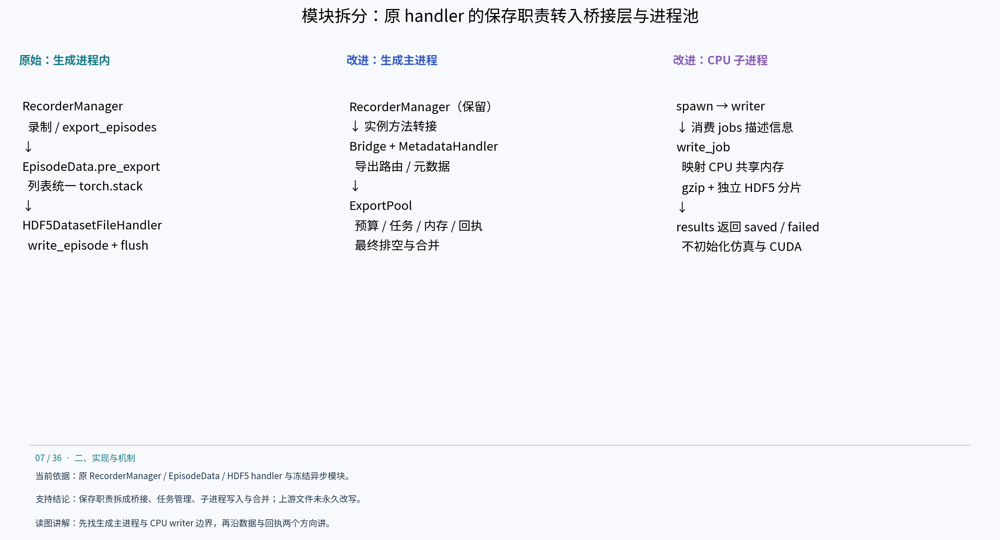
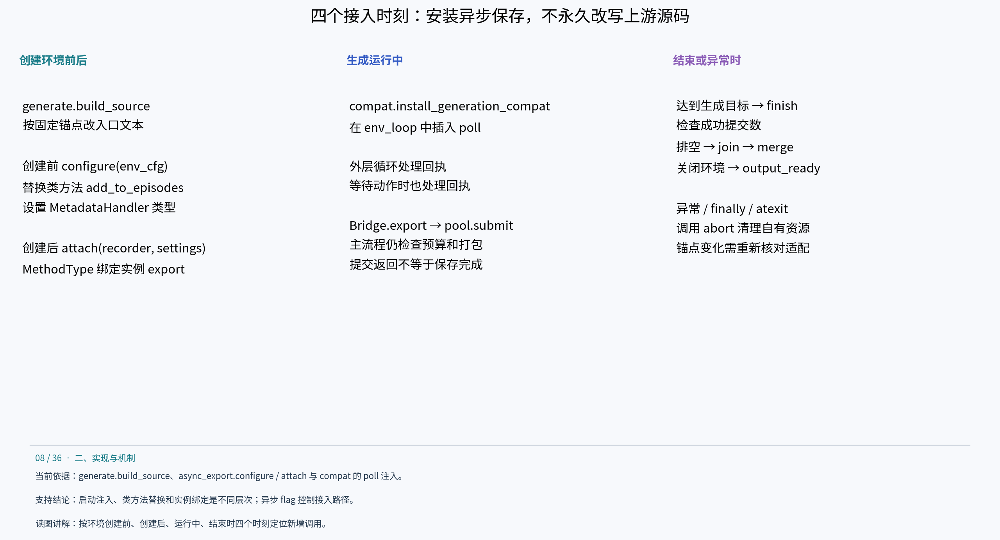
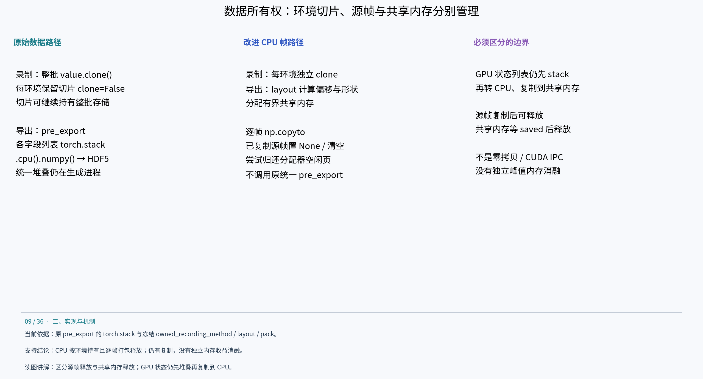
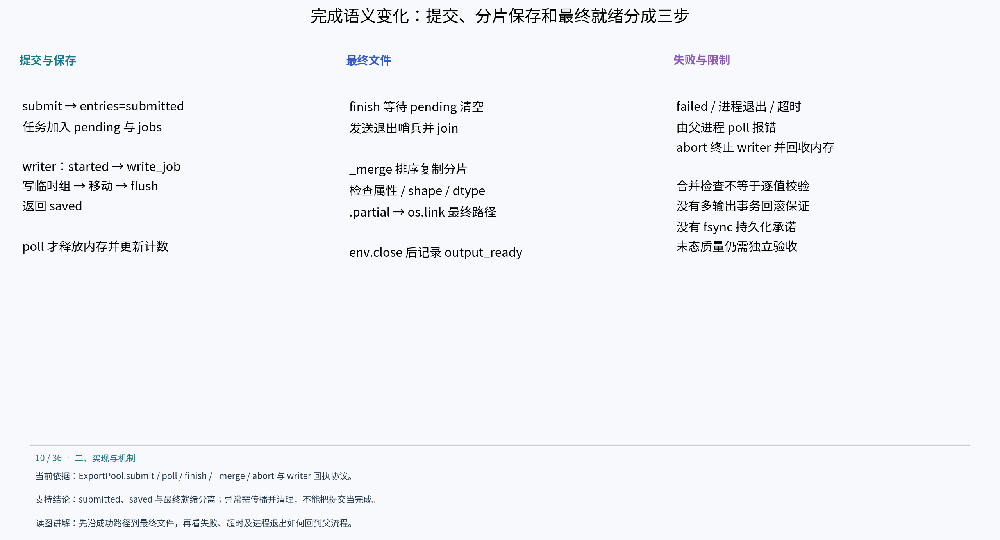

# 原始版与改进版代码结构说明

## 原始同步基线到异步改进版：代码结构详解

本章只比较 cuRobo v1 下的同步保存基线与异步保存实现。它们共用规划后端、生成任务及 8 环境配置。这里的“新增／替换”指异步分支相对同步分支的运行时结构变化，不是由两个完整 Git 提交计算出的历史 diff。原始 recorder 依据当前本地 IsaacLab 源码，改进实现依据实验目录冻结的 v1 launcher；逐字历史同源性没有额外证明。摘录、路径、行号及哈希见 code-structure-evidence.md。

### 1. 模块职责怎样拆分



原始保存链由 RecorderManager 协调，EpisodeData 管理每环境缓冲，HDF5DatasetFileHandler 在生成进程中写文件。改进后，recorder 继续管理录制与 episode，但“导出路由与元数据”“内存移交与任务状态”“实际压缩写入”“最终合并”由不同组件承担。

| 文件／组件 | 同步基线 | 异步改进版 | 结构变化 |
|---|---|---|---|
| generate.py / build_source | 仍安装任务兼容层、遥测、失败上限等公共逻辑 | workers 非零或 auto 时注入 configure、attach、finish | 条件安装异步分支；workers=0 清除异步标记 |
| compat.py / install_generation_compat | 保留任务结束判断与 final hold 等公共适配 | 异步标记存在时，在 env_loop 外层及等待动作处插入 poll | 在生成过程中处理写入回执与异常，不等最后结束才处理 |
| RecorderManager.add_to_episodes | clone 整批 tensor，按环境保存切片 | owned_recording_method 为 CPU 数据改为各环境独立 clone | 类方法在当前进程内替换；GPU 分支保留批量 clone |
| RecorderManager.export_episodes | pre_export → handler.write_episode → flush | recorder 实例方法被 MethodType 转接到 Bridge.export | 替换实例调用，不修改上游文件，也不是新增 recorder 子类 |
| async_export.py / MetadataHandler | 不使用 | 保存输出路径、env_args、demo_count；不创建真实 HDF5 | 占位 handler，满足这条 recorder 路径所需元数据接口 |
| async_export.py / Bridge | 不使用 | 保留导出模式、成功属性和 ID 路由，调用 ExportPool | 在 recorder 契约与后台任务协议间做适配 |
| export_pool.py / ExportPool | 不创建池 | 持有预算、pending、entries、共享内存句柄及进程列表 | 父进程统一管理任务与资源生命周期 |
| export_pool.py / writer、write_job | 不启动 | spawn 子进程只压缩并写独立分片 | 不导入 Isaac Sim、torch 或 CUDA，不传递仿真对象 |
| export_resources.py / export_governor.ResourceGovernor | 不启用后台池资源检查 | 初始容量检查；auto 额外按资源准入扩容 | 固定上限与 auto 共用保存协议，扩容决策不同 |
| telemetry.py / validate_output.py | 已有计时及输出校验相关路径 | 增加异步事件与内部阶段观测 | 埋点和校验是证据来源，不应全算作异步性能优化 |

规划、环境任务调度和主循环组织仍由原 AutoData 代码负责。没有将每个环境改造成一个操作系统进程；新增进程集中在 CPU 保存侧。

### 2. 启动时在哪里接入：源码注入、类方法替换、实例绑定



generate.py 读取原 scripts/generate_dataset.py 文本，build_source 按固定字符串锚点插入代码，然后编译执行生成的入口。每个锚点都要求出现一次；上游代码变化会触发断言，而不是自动理解新结构。这是运行时集成 overlay，不是永久改写上游源码。

以下为控制顺序摘要，省略日志和部分参数，不是可直接应用的补丁：

```python
# 控制顺序摘要；settings 与 export_workers 来自 launcher 配置。
install()  # 公共路径：安装任务兼容和遥测
if export_workers:
    configure(env_cfg)  # 环境创建前：替换录制方法与 handler 类型
env = gym.make(env_name, cfg=env_cfg).unwrapped
if export_workers:
    attach(env.recorder_manager, settings)  # 创建后：绑定实例导出方法
# workers=0 不进入两个条件分支，沿原 recorder 保存路径执行。
```

实际绑定语句是 `attach(env.recorder_manager, settings)`。configure 修改 RecorderManager.add_to_episodes 类方法，并将 env_cfg.recorders.dataset_file_handler_class_type 设为 MetadataHandler；attach 创建 Bridge，然后针对这个 recorder 实例绑定导出方法：

```python
recorder.export_episodes = MethodType(
    lambda instance, *a, **k: self.export(*a, **k), recorder
)
```

因此只有配置 flag 打开时才安装异步保存链；但录制方法的替换作用于当前进程中的 RecorderManager 类。owned_recording_method 用标记避免重复包装。MetadataHandler 的 close 是空操作，因为真正的 HDF5 由 writer 关闭；它不是对所有文件 handler API 的通用完整实现。

compat.py 在外层迭代和等待动作的循环中调用 poll，既处理保存成功回执，也尽早发现 writer 失败。生成达到目标后，launcher 先 finish(expected_successes=生成成功数)，再沿原结束路径关闭环境；output_ready 在 env.close 之后记录。异常路径和 atexit 则调用 abort。

### 3. 原始调用链与改进调用链逐步对照

原始同步路径如下（当前 recorder 源码摘要）：

```python
# RecorderManager.export_episodes
self._episodes[env_id].pre_export()  # 递归 torch.stack，各列表转成 tensor
handler.write_episode(episode, demo_id, dataset_compression)
# handler 内：value.cpu().numpy() → h5py.create_dataset(...)
# 默认开启压缩时 gzip level 2
self._episodes[env_id] = EpisodeData()
# 本次 export 的写入完成后 flush handler
```

改进后的 Bridge.export 保留空数据判断、导出模式、成功/失败输出路由、seed/success 属性及可选 demo_ids，但不调用原 pre_export 或原 write_episode：

```python
# Bridge.export 摘要：提交原始 episode.data，允许逐帧打包后释放源数据。
self.pool.submit(
    episode.data, output=handler.path,
    env_args=dict(handler._env_args), attributes=attrs,
    compression=recorder.cfg.dataset_compression,
    demo_id=chosen_demo_id, env_id=env_id,
    format_version=self.format_version, release_source=True,
)
episode.data.clear()
recorder._episodes[env_id] = self.episode_class()
```

chosen_demo_id 是讲解用变量，真实代码按 demo_ids 是否提供选择 ID。submit 返回的是 demo 索引，Bridge.export 没有将其返回为完成凭证。两者都为普通函数；异步来自后台进程，不来自 async def。submit 返回前仍可能等待预算并执行 CPU 打包。

原 recorder 在完成导出处理后更新 episode 计数；Bridge 将已保存计数更新放在 saved 回执处理后，并用 saved_seen 防止重复计数。MetadataHandler.demo_count 主要服务默认 ID 的索引进展，不是“最终文件已存在”的证明。任务生成成功数、已提交数、已保存数与末态合格数必须分别理解。

### 4. 内存路径为什么需要改：切片所有权与整条堆叠



原 add_to_episodes 先 clone 一份包含所有环境的 tensor，再把 value[value_index] 以 clone=False 放入 EpisodeData。切片可以继续持有底层整批存储；即使部分环境结束，只要其他切片仍在使用，共用的存储就不能回收。改进逻辑如下，循环与字典处理省略：

```python
# 原始：批量 clone 后保留每环境切片。
value = value.clone()
episode.add(key, value[value_index], clone=False)

# 改进：CPU 按环境独立持有；GPU 仍保留原批量 clone 路径。
cpu_owned = value.device.type == 'cpu'
if not cpu_owned:
    value = value.clone()
episode.add(key, value[value_index], clone=cpu_owned)
```

第二个改动发生在导出时。原 pre_export 对所有叶子列表 torch.stack；改进 layout 先确定嵌套字段的 path、shape、dtype、offset 和 bytes，将偏移按 64 字节对齐，再分配共享内存。CPU 列表按帧复制到目标缓冲，release_source=True 时把已复制源帧替换为 None，累计释放约 64 MiB 时尝试 malloc_trim，末尾清空列表。它降低源帧与额外整条堆叠副本同时存在的需求，但仍存在复制开销，没有测得独立峰值内存收益的消融结果。

GPU 状态列表采用 torch.stack(value).detach().cpu().numpy() 后一次复制到共享内存，目的是减少逐帧设备到主机转换。不是所有字段都逐帧复制，也不是 CUDA IPC：writer 收到的是 CPU 共享内存。该路径没有消除设备到主机的数据传输或同步成本。

### 5. 新增任务协议与父子进程状态

| 信息／状态 | 由谁持有 | 用途与变更 |
|---|---|---|
| jobs / results | multiprocessing spawn context 创建的两个 Queue | jobs 传描述信息；results 返回 started、saved 或 failed |
| job.memory / leaves | 共享内存名及字段布局 | writer 按 shape、dtype、offset 构建只读 NumPy view；不通过 Queue 传整段图像数组 |
| route / demo_id / key | 父进程生成或检查 | route 区分输出文件；key=route:demo_id 防止重复 ID |
| env_args / attributes | 由 Bridge 提取、父进程传递 | 保存元数据、seed、success、num_samples 和格式版本 |
| pending | 已提交但尚未收到 saved 的任务 | 包含排队、进程启动与写入中的工作；扩容不依赖 Queue.qsize |
| entries | 任务记录，初始 submitted，回执后 saved | 写入 manifest，供统计与合并使用；started 主要记录 writing_started 时间 |
| memories / used | 父进程共享内存句柄与在途字节数 | submitted 后占预算；saved 后 close、unlink、扣减 used |

submit 先检查单条 size ≤ limit，再在 used+size 超预算时 poll(wait=.05)；之后分配内存、pack、再 poll、登记 pending 与 entries、jobs.put、按需扩容。检查顺序很重要：打包期间完成的保存任务可以在第二次 poll 中被回收，已有 writer 也可能再次消费任务。

writer 通过 jobs.get 取任务；write_job 按 worker PID 与 route 打开独立 HDF5 文件。数据先写入 _pending_<id> 组，成功后移动到 /data/demo_<id>，更新 total 并 flush，然后发送 saved。这里的组移动与 flush 是分片内部完成步骤，不是“最终输出已经合并”。gzip level 2 与原路径保持一致，h5py 仍自动选择 chunk；未在这组改造中启用离线实验中的 lzf。

### 6. 正常完成、失败退出和最终文件的语义



| 事件 | 原始同步路径 | 异步路径新增行为 |
|---|---|---|
| 导出调用返回 | 对该次写入已执行 write_episode 与 flush | 仅完成数据提交；后台可以仍在保存 |
| 单任务完成 | 无跨进程回执 | saved 到达后回收共享内存，并更新保存计数 |
| 整轮结束 | 沿原导出与关闭路径完成 | finish 排空 pending，发 None 哨兵，join 并检查进程退出码 |
| 合并与发布 | 直接写原 handler 的输出 | 排序复制分片到 .partial.hdf5，检查元数据、shape、dtype、压缩和条数，再用 os.link 发布最终路径 |
| writer 失败 | 不存在该故障类型 | failed 回执、意外进程退出、超时在父进程中报错 |
| 失败清理 | 由原调用异常路径处理 | abort 终止自有 writer、join／必要时 kill、释放自有共享内存、标记 failed、关闭队列 |

_merge 的检查不是逐值比较，也不是物理质量验收；保存后还需独立 validate_output。os.link 拒绝覆盖已有文件，单次文件名发布具有对应的原子语义，但没有跨多个输出 route 的事务回滚保证，也不能等同于 fsync 持久化保证。清理时保留的分片与 manifest 不是已实现的自动恢复机制。

poll 的单任务超时使用 writing_started（已收到 started 时）或 submitted_at（尚未开始写入时）作为参考；因此应分别理解排队期间与写入期间的等待。主循环通过 poll 发现异常，finish 自身失败时会 abort，launcher finally / atexit 作为退出清理路径。不能把“后台执行”理解为后台失败不会影响主任务。

### 7. 改动与实验指标怎样对应

| 结构改动 | 预期影响的计时／资源 | 本轮证据及边界 |
|---|---|---|
| 保存移入 CPU writer | 主流程 export / enqueue、execution_wait、整批最终就绪 | 已观察整体改善；enqueue 与 export 工作范围不同 |
| CPU 独立帧与流式 pack | 源数据存活时间、复制峰值、packing_seconds | 有源码与打包计时；没有单独内存修复消融 |
| 有界预算与 poll | queue_wait_seconds、在途共享内存 | 等待仍存在；它限制积压，不保证提交永不阻塞 |
| 多 writer 与扩容准入 | 保存吞吐、实际 writer 数、CPU / I/O 竞争 | cap4、cap8、auto 实际都为 4；不能视为 4 对 8 进程实验 |
| 分片与最终合并 | drain_seconds、merge_seconds、tail_seconds | 增加收尾成本，解释生成完成不等于最终就绪 |

讲解顺序建议：先讲模块拆分，再讲安装点和方法替换，然后沿一条 episode 跟踪内存、任务、文件和回执，最后用计时结果解释收益与代价。结论仍是本轮异步整体实现改善效率，而非已证明某个单函数贡献了全部加速。

