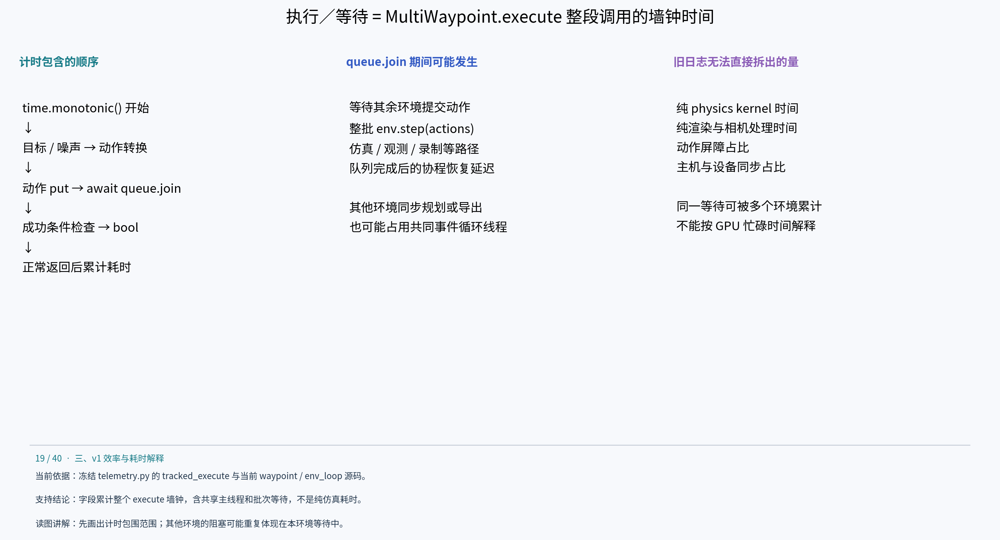
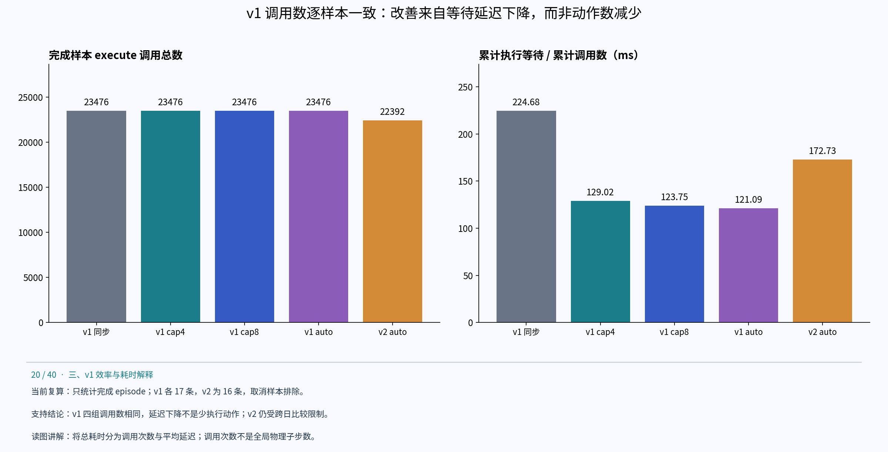
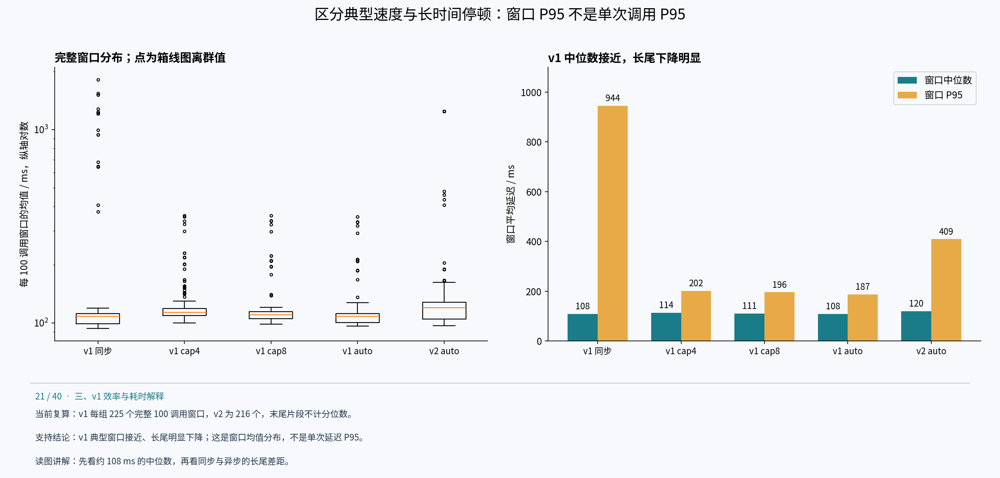
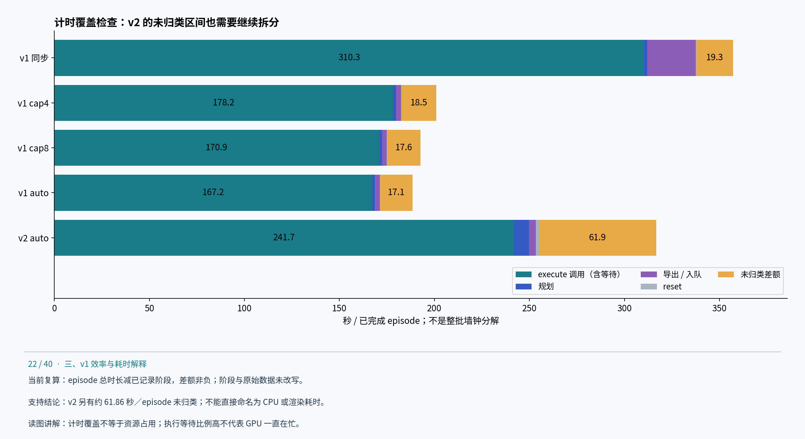

# 执行／等待内部耗时分析

## 执行／等待专项分析：累计的是协程调用延迟，不是纯仿真时间

### 1. 计时器具体包住了什么



实验冻结 telemetry.py:233–250 在 MultiWaypoint.execute 外包一层 tracked_execute：先读取 time.monotonic，await 原 execute 返回，再给 execution_steps 加一，并将整个区间累计为 execution_wait_seconds。每完成 100 次调用记录一条 execution_progress。它没有显式同步 GPU，也没有对每个内部步骤分别计时。该字段更准确的名称是“**MultiWaypoint.execute 累计墙钟耗时（含协程等待）**”。

```python
started = time.monotonic()
result = await original_execute(self, *args, **kwargs)
episode['execution_steps'] += 1
episode['execution_wait_seconds'] += time.monotonic() - started
```

计数在正常返回后递增，包括返回 False 的调用；异常或取消使本次调用未执行到累加语句。因此这里的 execution_steps 是被包装方法正常返回的调用次数，不能直接称为全局物理子步数。simulated_seconds 也是由调用数乘 step_dt 推得，不是独立测得的仿真工作量。

当前 MultiWaypoint.execute 的操作顺序为：构造末端目标、噪声及透传动作 → target_eef_pose_to_action → 向队列放入 (env_id, action) → await queue.join() → 调用成功条件并转为 bool。生产的队列分支由 env_loop 收齐动作后执行一次 env.step(actions)，再调用 task_done；等待协程恢复后才返回。

| 区间 | 是否落入 execution_wait | 能否从旧日志单独计时 |
|---|---|---|
| 动作编码、目标到动作转换 | 是 | 不能，未独立埋点 |
| 等待其余环境准备动作 | 是，处于 queue.join 等待区间 | 不能，缺每环境动作就绪时间 |
| env.step 与关联运行时工作 | 是，位于等待完成之前 | 不能，缺整批 step 起止与内部计时 |
| 动作处理、物理子步、渲染、状态／观测与录制 | 可能通过 env.step 路径计入，具体顺序取决于运行时类与配置 | 当前源码可解释职责，旧日志不能给出各项占比 |
| 队列完成后到协程实际恢复 | 是 | 不能，缺 task_done 与恢复时间戳 |
| 成功条件计算、索引及 bool 转换 | 是 | 不能，未独立埋点；可能有设备到主机等待 |
| 本 episode 在 execute 之外的规划／导出 | 不由该 execute 调用直接包住 | 自身有 motion_plan、export 等独立事件 |
| 其他环境阻塞主线程的规划、导出、重置等 | 若发生在本环境 execute 挂起期间，会增加本环境此区间的墙钟时间 | 能看到部分其他事件，但不能恢复每次 execute 的精确包含关系 |

例如环境 A 已入队等待，环境 B 在同一事件循环线程执行同步导出，那么 B 的导出耗时可能同时出现在 A 的 execution_wait 中。多个环境等待同一批 env.step，也会各自累计这段时间。因此 8 个环境的执行等待之和不是机器的独占工作时间；把它当作 GPU 仿真总耗时会重复计数。

### 2. 已有日志能再拆一层：调用次数 × 每次调用平均延迟



本版重新读取五组原始 telemetry.jsonl，仅统计 episode_finished 样本，排除 episode_cancelled 和仍在途任务。v1 各 17 条完成（16 成功、1 失败），v2 新重跑 16 条完成。定义加权平均调用延迟为 Σexecution_wait / Σexecution_steps，避免把不同长度 episode 的均值再次等权平均。

| 配置 | 完成数 | execute 调用总数 | 平均调用数／episode | 执行等待均值／秒 | 加权平均毫秒／调用 |
|---|---:|---:|---:|---:|---:|
| v1 同步 | 17 | 23,476 | 1,380.94 | 310.27 | 224.68 |
| v1 cap4 | 17 | 23,476 | 1,380.94 | 178.17 | 129.02 |
| v1 cap8 | 17 | 23,476 | 1,380.94 | 170.90 | 123.75 |
| v1 auto | 17 | 23,476 | 1,380.94 | 167.22 | 121.09 |
| v2 auto | 16 | 22,392 | 1,399.50 | 241.74 | 172.73 |

v1 四组不仅总调用数一致，按 env_id 与 attempt 编号匹配的 17 个完成样本也逐一具有相同调用数。这支持“v1 执行等待下降不是由已完成样本少执行了动作造成的”：auto 比同步的平均调用延迟下降约 46.1%。相同编号与次数不证明每个动作数值完全相同，也没有核对逐帧内容一致性。

v2 与 v1 的完成数及轨迹调用数不同。归一化后 v2 仍有较高平均调用延迟，但这是跨日期系统观测，不能解释成 v2 的物理仿真 kernel 必然更慢。总调用数也不是独立 env.step 批次数，因为多个环境共享同一次批量步进。

### 3. 更明显的区别在长尾，而不是典型窗口



execution_progress 每 100 次正常返回记录一次累计值。对同一完成 episode 的相邻累计值求差，可得到“100 次 execute 调用的累计耗时／100”。首个窗口以累计值 0 为基准；末尾不足 100 次的片段不纳入窗口分位数，但仍包含在上一表总量中。v1 每组 225 个完整窗口，v2 为 216 个。窗口跨并发 episode，彼此可能重叠，不能当成独立重复实验。

| 配置 | 窗口中位数，毫秒／调用 | 窗口 P95，毫秒／调用 | 最慢窗口均值，毫秒／调用 |
|---|---:|---:|---:|
| v1 同步 | 108.29 | 944.32 | 1,819.53 |
| v1 cap4 | 113.74 | 201.55 | 359.85 |
| v1 cap8 | 110.56 | 196.02 | 359.55 |
| v1 auto | 108.46 | 187.04 | 354.89 |
| v2 auto | 120.16 | 409.12 | 1,249.46 |

P95 使用排序后索引 floor(0.95×(n−1))，未插值。**这里是 100 次调用窗口均值的分位数，不是单次调用延迟的 P95。** 同步版与 auto 的窗口中位数都约 108 毫秒，但窗口 P95 从 944 毫秒降到 187 毫秒。它说明典型执行区间的速度接近，长时间停顿明显减少；这与同步保存阻塞共享主线程的机制相符，但没有逐调用追踪，不能把长尾减少全部定量归因于保存。

v2 窗口中位数约 120 毫秒、P95 约 409 毫秒，既存在典型区间差异，也存在长尾。现有数据不能进一步区分其中多少来自执行路径、渲染、规划占用其他环境的等待、设备同步或系统状态。

### 4. 还有一个此前未单独画出的部分：未归类区间



以每个完成 episode 的 duration_seconds 减去已记录的 reset、motion_plan、export／export_enqueue 与 execution_wait，可计算“未被这些计时段覆盖的差额”。本轮所有差额非负。它是剩余墙钟区间，不应直接命名为 CPU 计算、轨迹生成或调度耗时。

| 配置 | episode 总时长均值／秒 | execution_wait 占该组累计 episode 时长 | 未归类差额均值／秒 |
|---|---:|---:|---:|
| v1 同步 | 357.21 | 86.86% | 19.31 |
| v1 cap4 | 201.03 | 88.63% | 18.49 |
| v1 cap8 | 192.72 | 88.67% | 17.56 |
| v1 auto | 188.49 | 88.71% | 17.08 |
| v2 auto | 316.81 | 76.30% | 61.86 |

v1 auto 的执行等待绝对值大幅下降，但占比从约 86.9% 变成 88.7%，原因是其他阶段也下降；不能仅凭“占比仍高”认定优化无效。v2 的未归类差额约 61.86 秒／episode，明显高于 v1 auto 的 17.08 秒，下一轮除了拆 env.step，也应定位这些未覆盖区间。候选包括 execute 之外的数据生成、规划结果转换、控制逻辑、日志及调度间隔，但旧日志不足以逐项确认。

本表是完成 episode 的计时覆盖检查，未包含取消样本的全部执行，也没有覆盖整批启动、排空和合并；不能将其堆叠条形当作整批墙钟分解。

### 5. 真正拆到物理、渲染和等待，需要哪些新计时点

| 需要回答的问题 | 新增主机计时点 | 设备侧或解释约束 |
|---|---|---|
| 动作转换是否慢 | execute 入口、target_eef_pose_to_action 前后、put 前后 | 仍是主机区间，不直接等价于 GPU kernel 时间 |
| 等待谁准备动作 | 每条动作附 env_id 与 step 序号；记录入队、整批就绪与 step 开始 | 使用明确批次 ID 关联，避免靠相近时间猜测 |
| env.step 内部谁耗时 | 记录 action processing、pre-step recorder、physics、render、scene update、observation、post-step recorder | 不重复累计嵌套区间；先确认实际运行时 step 实现 |
| 完成后谁迟迟没有恢复 | step 结束、task_done、各协程恢复和 execute 返回 | queue.join 完成与协程运行之间仍可能有调度延迟 |
| 其他环境是否阻塞事件循环 | 关联规划、导出、重置的起止与未就绪动作集合 | 用重叠区间解释依赖，不把各环境等待和重复当独占 CPU 时间 |
| v2 未归类差额在哪里 | 为 execute 外轨迹生成、FK／结果转换与调度逻辑补齐区间 | 先闭合 episode 时间覆盖，再分析哪段需要 GPU 追踪 |

若需设备 kernel 的准确时间与重叠关系，应另开带 CUDA events／profiler 的诊断运行；不要为了计时在每一步无条件加 cuda.synchronize，再把受干扰的运行与旧吞吐直接比较。当前新增的是离线日志复算，没有开展细粒度重跑，也没有声称已测出物理、渲染和队列等待各自占比。

复算文件：execution-analysis.json、execution-episodes.csv、execution-windows.csv；analyze_execution.py 接收 v1 日志根目录和 v2 日志路径。原始日志哈希记录在分析文件中。窗口 interval_start/end 是相邻进度事件的时间戳，可能包含 execute 之外的间隔，不是每次 execute 的精确起止时间，不能直接用它们算内部子阶段占比。

