# AutoData 生产效率改进复盘

## 新增 4 环境插桩配对与加速方案

本图册纳入 2026-10-15 的独立 4 环境配对：同步与 auto 各 8/8 严格终态通过，8 组完整动作序列精确匹配，最终文件吞吐提升 47.2%。这组结果不替换历史 8 环境数据，也不代表已测得 GPU kernel 占比。

详见 [内部计时与加速方案](acceleration-analysis.html) 和图册第 29–36 页；原始结果、计时脚本与校验记录在 paired4/ 中。加速分析优先去除重复相机刷新和重复 CPU 图像副本，缓存优化尚未实施。


图册 v015 共 51 页，含 45 页主线与 6 页附录。每页图下直接说明实验怎么做、这样做的意义、当前结论及读图术语。PDF 保留原图尺寸并扩展说明区域，网页版直接显示说明；完整逐页原文见 charts-guide.md，顺序阅读入口见 charts.html。

历史 8 环境生产对照、新增 4 环境内部计时配对与 v2 跨日期运行分别解释，数据与结论范围不混用。GPU 源码分析见 gpu-analysis.html；本版只补充阅读说明和排版，没有新增仿真运行，也没有实施相机缓存方案。

材料截止：2026-10-15（北京时间）。分析对象：2026-10-14 保存的 OpenArm 左臂 AutoData 测试记录。历史 v1 数据复核 JSON、CSV 与遥测；v003 新增 v2 GPU 重跑及最终 HDF5 读回，本版补充 协程并发、GPU 数据并行与 CPU 多进程保存的原理图解及术语定义，详见新实验章节。

## 开场讲解：原始版、异步改进版与 cuRobo v2 适配版

这里的“原始版”专指本报告中的 **cuRobo v1 + 同步保存基线**，不是未经修改的上游最初版本。“改进版”指 **cuRobo v1 + 异步保存池**；“cuRobo v2 版”指 **v2 规划适配器 + 已有异步保存池**。这三个名称描述当前测试实现，不能理解为三个独立的官方软件发行版。

### 第一页：三版到底改了什么

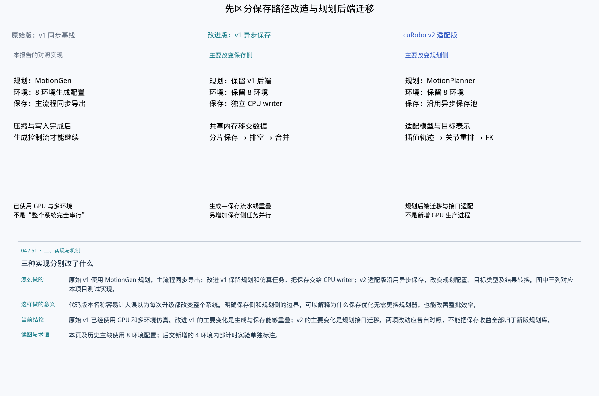

三版都在相同任务定义下生成机器人操作数据，生产配置均为 8 个环境。第一个变化发生在保存侧：将压缩和 HDF5 写入从生成主进程移到 CPU 写入进程；第二个变化发生在规划侧：将 v1 的 MotionGen 接口适配为 v2 的 MotionPlanner，并处理模型配置、坐标系和轨迹格式。因此，异步保存改进与规划后端迁移是两项不同的实现变化。

| 对比项 | 原始同步基线 | v1 异步改进版 | cuRobo v2 适配版 |
|---|---|---|---|
| 规划后端 | cuRobo v1，MotionGen | 保留 v1 规划后端 | MotionPlanner / GoalToolPose / plan_pose |
| 环境组织 | 8 环境生成配置 | 仍为 8 环境 | 仍为 8 环境，每环境规划对象 |
| 保存位置 | 主流程同步压缩与写入 | spawn 创建独立 CPU writer | 沿用异步 writer 保存路径 |
| 数据移交 | recorder 在原导出路径处理数据 | CPU 帧独立持有；共享内存打包；发送名称与布局 | 复用异步数据移交机制 |
| 并发控制 | 无后台 writer 池 | 固定上限 4/8 或 auto；本轮实际均为 4 | 本轮 auto，实际 4 个 writer |
| 输出完成 | 同步导出及关闭后最终就绪 | 分片保存回执 → 排空 → 合并 → 关闭后最终就绪 | 保留相同完成链，额外验证 v2 输出 |
| 主要新增工作 | 对照基线 | 内存所有权、背压、进程池、分片与合并 | 模型字段转换、接触处理、轨迹插值与关节重排 |

讲解要点：原始版已经使用 GPU 和多环境生成。异步改进增加的是 CPU 保存侧的任务并行与生成—保存重叠。v2 版在已有保存机制上替换规划后端，不能把它称为“进一步增加 GPU 并行进程”。

### 第二页：从代码调用看数据如何流动

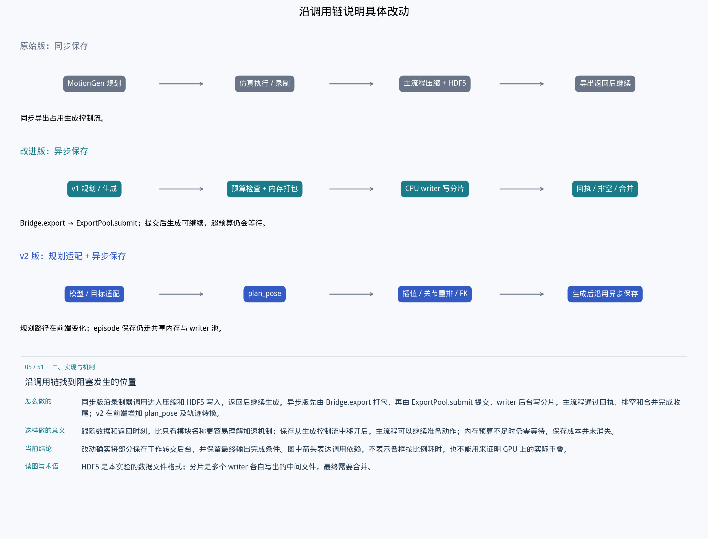

原始版中，episode 完成后沿 recorder 的同步路径执行压缩和 HDF5 写入，该调用返回前生成控制流受到保存工作阻塞。异步改进版将该入口改为 Bridge.export → ExportPool.submit：先检查共享内存预算并打包数据，再把任务交给 writer；提交完成后主流程可以继续。后台 writer 写独立分片，回执到达后主进程释放共享内存；整轮结束仍要等待全部保存与合并。以上调用链是源码摘要，不是可直接运行的伪补丁。

v2 版保留异步保存链，主要改动出现在 episode 生成过程中的规划调用：模型字段 ee_link → tool_frames、retract_config → default_joint_position；目标与动态物体转换到机器人基座系；调用 MotionPlanner.plan_pose；通过 get_interpolated_plan 取得执行采样，再按关节名称重排、经正向运动学转换为末端位姿。持物和接触阶段还需要附着、临时碰撞配置及恢复；它不是只改一个 import。

讲解要点：第一处改动缩短主流程承担保存工作的区间，但没有消除压缩计算；第二处改动接入新的规划接口与轨迹表示，其速度和末态质量必须重新测量。两者都保留结束时的输出校验要求。

### 第三页：实验能支持什么结论

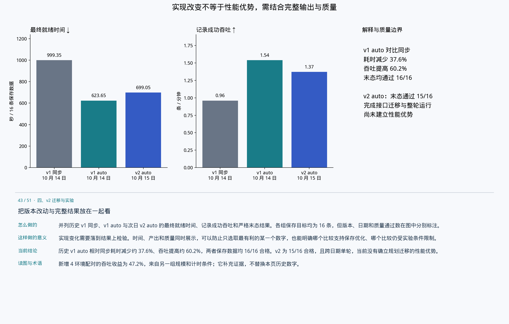

为便于讲解，下面选 v1 auto 作为“异步改进版”的代表，使它与 v2 auto 保持相同的保存策略；没有选择本轮更快的 cap8 来混合比较。固定上限 4/8 的完整结果仍保留在后文。

| 指标 | 原始同步基线 | v1 auto 异步改进版 | v2 auto 适配版 |
|---|---:|---:|---:|
| 测试日期 | 10 月 14 日 | 10 月 14 日 | 10 月 15 日 |
| 最终就绪，秒 | 999.35 | 623.65 | 699.05 |
| 记录成功吞吐，条/分钟 | 0.961 | 1.539 | 1.373 |
| 规划阶段均值，秒/完成 episode | 1.740 | 1.423 | 8.038 |
| 主流程导出／入队均值，秒/完成 episode | 25.615（同步导出） | 2.619（异步入队） | 3.694（异步入队） |
| 完成 episode 数（阶段统计分母） | 17 | 17 | 16 |
| 实际 CPU writer 数 | 0 | 4 | 4 |
| 最终保存条数 | 16 | 16 | 16 |
| 保存数据末态通过 | 16/16 | 16/16 | 15/16 |

v1 auto 相比同步基线，最终就绪耗时减少约 37.6%，记录成功吞吐提高约 60.2%，本轮已测末态通过率保持 16/16。这支持“异步保存整体实现改善了本轮生产效率”，不能将收益精确归因于某一个内部改动。

v2 auto 已完成整轮生成、合并和文件读回，但本轮没有表现出更高吞吐，并有一条数据未通过角速度末态检查。v1/v2 为跨日期单轮比较，缓存、热身和系统状态未控制一致，因此既不能宣称 v2 提速，也不能据此断定 v2 后端普遍更慢。原始版与改进版的 17 个完成样本包含失败，v2 阶段均值使用 16 个完成样本；同步导出与异步入队也有不同工作范围，不能把表中阶段差值作为纯写盘速度或纯规划器速度的因果估计。

讲解要点：当前已观察到的生产效率收益主要来自 v1 保存路径改造；v2 的成果是完成接口迁移与一次端到端运行，性能优势和全量末态质量仍未建立。

## 执行／等待专项分析：累计的是协程调用延迟，不是纯仿真时间

### 1. 计时器具体包住了什么

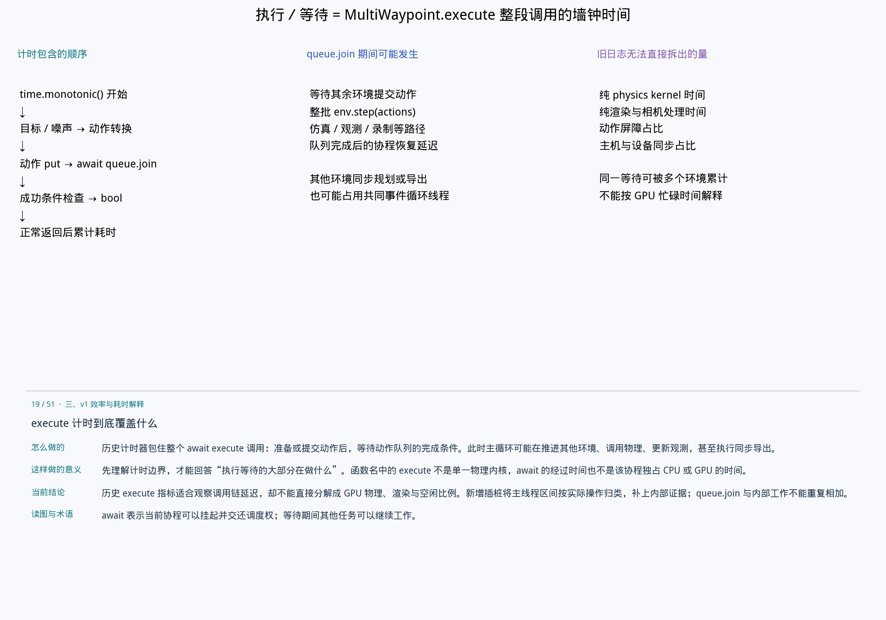

实验冻结 telemetry.py:233–250 在 MultiWaypoint.execute 外包一层 tracked_execute：先读取 time.monotonic，await 原 execute 返回，再给 execution_steps 加一，并将整个区间累计为 execution_wait_seconds。每完成 100 次调用记录一条 execution_progress。它没有显式同步 GPU，也没有对每个内部步骤分别计时。该字段更准确的名称是“**MultiWaypoint.execute 累计墙钟耗时（含协程等待）**”。

```python
started = time.monotonic()
result = await original_execute(self, *args, **kwargs)
episode['execution_steps'] += 1
episode['execution_wait_seconds'] += time.monotonic() - started
```

计数在正常返回后递增，包括返回 False 的调用；异常或取消使本次调用未执行到累加语句。因此这里的 execution_steps 是被包装方法正常返回的调用次数，不能直接称为全局物理子步数。simulated_seconds 也是由调用数乘 step_dt 推得，不是独立测得的仿真工作量。

当前 MultiWaypoint.execute 的操作顺序为：构造末端目标、噪声及透传动作 → target_eef_pose_to_action → 向队列放入 (env_id, action) → await queue.join() → 调用成功条件并转为 bool。生产的队列分支由 env_loop 收齐动作后执行一次 env.step(actions)，再调用 task_done；等待协程恢复后才返回。

| 区间 | 是否落入 execution_wait | 能否从旧日志单独计时 |
|---|---|---|
| 动作编码、目标到动作转换 | 是 | 不能，未独立埋点 |
| 等待其余环境准备动作 | 是，处于 queue.join 等待区间 | 不能，缺每环境动作就绪时间 |
| env.step 与关联运行时工作 | 是，位于等待完成之前 | 不能，缺整批 step 起止与内部计时 |
| 动作处理、物理子步、渲染、状态／观测与录制 | 可能通过 env.step 路径计入，具体顺序取决于运行时类与配置 | 当前源码可解释职责，旧日志不能给出各项占比 |
| 队列完成后到协程实际恢复 | 是 | 不能，缺 task_done 与恢复时间戳 |
| 成功条件计算、索引及 bool 转换 | 是 | 不能，未独立埋点；可能有设备到主机等待 |
| 本 episode 在 execute 之外的规划／导出 | 不由该 execute 调用直接包住 | 自身有 motion_plan、export 等独立事件 |
| 其他环境阻塞主线程的规划、导出、重置等 | 若发生在本环境 execute 挂起期间，会增加本环境此区间的墙钟时间 | 能看到部分其他事件，但不能恢复每次 execute 的精确包含关系 |

例如环境 A 已入队等待，环境 B 在同一事件循环线程执行同步导出，那么 B 的导出耗时可能同时出现在 A 的 execution_wait 中。多个环境等待同一批 env.step，也会各自累计这段时间。因此 8 个环境的执行等待之和不是机器的独占工作时间；把它当作 GPU 仿真总耗时会重复计数。

### 2. 已有日志能再拆一层：调用次数 × 每次调用平均延迟

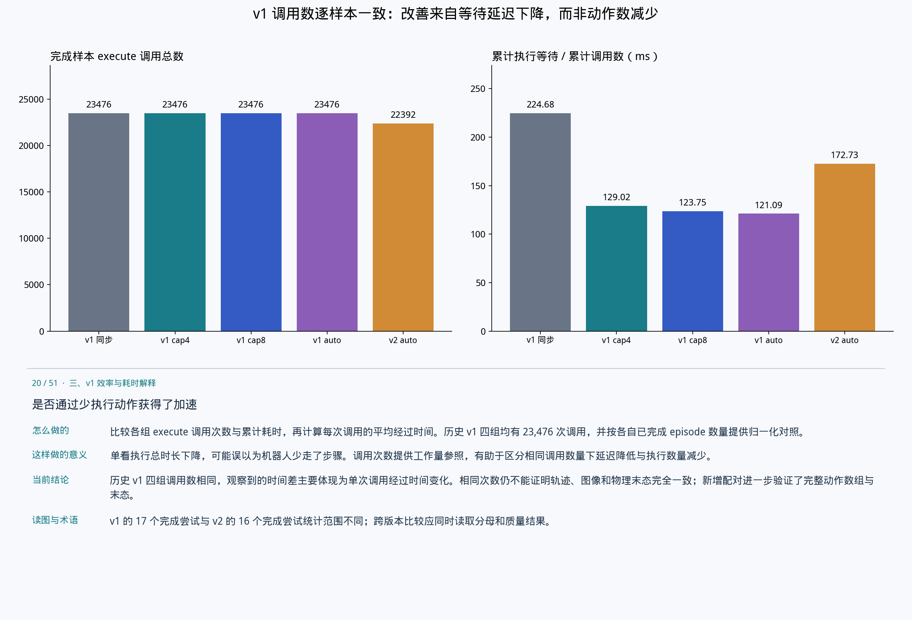

本版重新读取五组原始 telemetry.jsonl，仅统计 episode_finished 样本，排除 episode_cancelled 和仍在途任务。v1 各 17 条完成（16 成功、1 失败），v2 新重跑 16 条完成。定义加权平均调用延迟为 Σexecution_wait / Σexecution_steps，避免把不同长度 episode 的均值再次等权平均。

| 配置 | 完成数 | execute 调用总数 | 平均调用数／episode | 执行等待均值／秒 | 加权平均毫秒／调用 |
|---|---:|---:|---:|---:|---:|
| v1 同步 | 17 | 23,476 | 1,380.94 | 310.27 | 224.68 |
| v1 cap4 | 17 | 23,476 | 1,380.94 | 178.17 | 129.02 |
| v1 cap8 | 17 | 23,476 | 1,380.94 | 170.90 | 123.75 |
| v1 auto | 17 | 23,476 | 1,380.94 | 167.22 | 121.09 |
| v2 auto | 16 | 22,392 | 1,399.50 | 241.74 | 172.73 |

v1 四组不仅总调用数一致，按 env_id 与 attempt 编号匹配的 17 个完成样本也逐一具有相同调用数。这支持“v1 执行等待下降不是由已完成样本少执行了动作造成的”：auto 比同步的平均调用延迟下降约 46.1%。相同编号与次数不证明每个动作数值完全相同，也没有核对逐帧内容一致性。

v2 与 v1 的完成数及轨迹调用数不同。归一化后 v2 仍有较高平均调用延迟，但这是跨日期系统观测，不能解释成 v2 的物理仿真 kernel 必然更慢。总调用数也不是独立 env.step 批次数，因为多个环境共享同一次批量步进。

### 3. 更明显的区别在长尾，而不是典型窗口

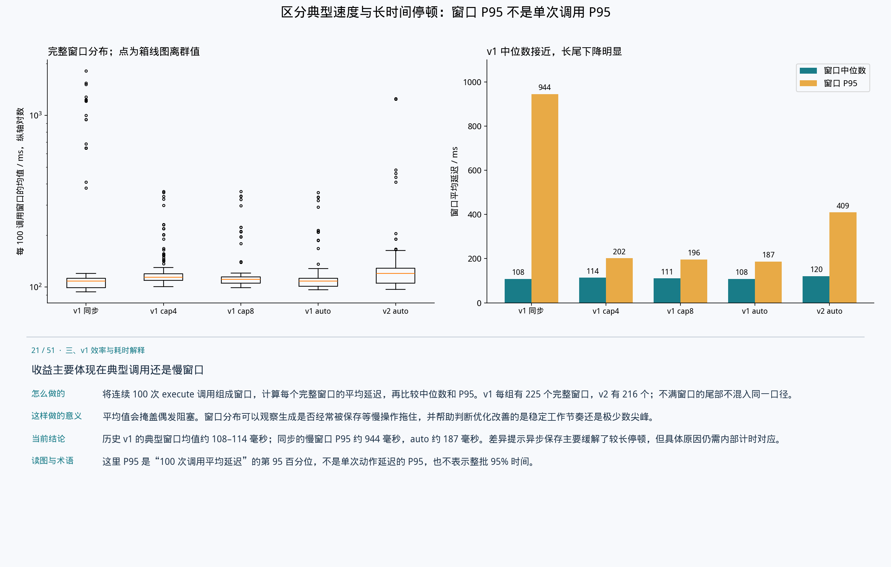

execution_progress 每 100 次正常返回记录一次累计值。对同一完成 episode 的相邻累计值求差，可得到“100 次 execute 调用的累计耗时／100”。首个窗口以累计值 0 为基准；末尾不足 100 次的片段不纳入窗口分位数，但仍包含在上一表总量中。v1 每组 225 个完整窗口，v2 为 216 个。窗口跨并发 episode，彼此可能重叠，不能当成独立重复实验。

| 配置 | 窗口中位数，毫秒／调用 | 窗口 P95，毫秒／调用 | 最慢窗口均值，毫秒／调用 |
|---|---:|---:|---:|
| v1 同步 | 108.29 | 944.32 | 1,819.53 |
| v1 cap4 | 113.74 | 201.55 | 359.85 |
| v1 cap8 | 110.56 | 196.02 | 359.55 |
| v1 auto | 108.46 | 187.04 | 354.89 |
| v2 auto | 120.16 | 409.12 | 1,249.46 |

P95 使用排序后索引 floor(0.95×(n−1))，未插值。**这里是 100 次调用窗口均值的分位数，不是单次调用延迟的 P95。** 同步版与 auto 的窗口中位数都约 108 毫秒，但窗口 P95 从 944 毫秒降到 187 毫秒。它说明典型执行区间的速度接近，长时间停顿明显减少；这与同步保存阻塞共享主线程的机制相符，但没有逐调用追踪，不能把长尾减少全部定量归因于保存。

v2 窗口中位数约 120 毫秒、P95 约 409 毫秒，既存在典型区间差异，也存在长尾。现有数据不能进一步区分其中多少来自执行路径、渲染、规划占用其他环境的等待、设备同步或系统状态。

### 4. 还有一个此前未单独画出的部分：未归类区间

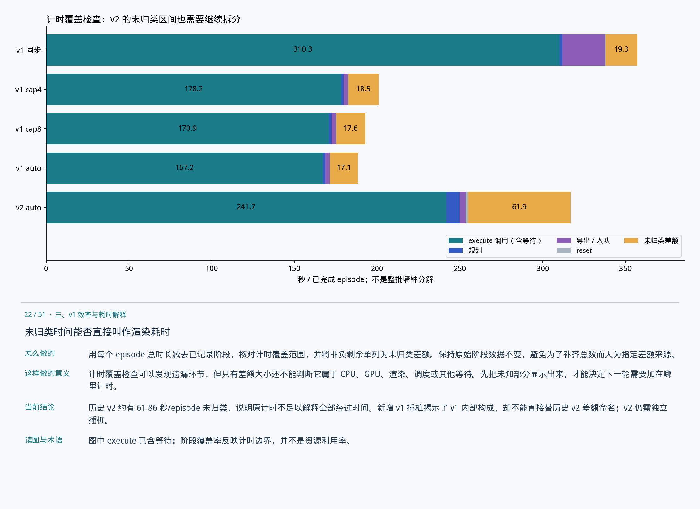

以每个完成 episode 的 duration_seconds 减去已记录的 reset、motion_plan、export／export_enqueue 与 execution_wait，可计算“未被这些计时段覆盖的差额”。本轮所有差额非负。它是剩余墙钟区间，不应直接命名为 CPU 计算、轨迹生成或调度耗时。

| 配置 | episode 总时长均值／秒 | execution_wait 占该组累计 episode 时长 | 未归类差额均值／秒 |
|---|---:|---:|---:|
| v1 同步 | 357.21 | 86.86% | 19.31 |
| v1 cap4 | 201.03 | 88.63% | 18.49 |
| v1 cap8 | 192.72 | 88.67% | 17.56 |
| v1 auto | 188.49 | 88.71% | 17.08 |
| v2 auto | 316.81 | 76.30% | 61.86 |

v1 auto 的执行等待绝对值大幅下降，但占比从约 86.9% 变成 88.7%，原因是其他阶段也下降；不能仅凭“占比仍高”认定优化无效。v2 的未归类差额约 61.86 秒／episode，明显高于 v1 auto 的 17.08 秒，下一轮除了拆 env.step，也应定位这些未覆盖区间。候选包括 execute 之外的数据生成、规划结果转换、控制逻辑、日志及调度间隔，但旧日志不足以逐项确认。

本表是完成 episode 的计时覆盖检查，未包含取消样本的全部执行，也没有覆盖整批启动、排空和合并；不能将其堆叠条形当作整批墙钟分解。

### 5. 真正拆到物理、渲染和等待，需要哪些新计时点

| 需要回答的问题 | 新增主机计时点 | 设备侧或解释约束 |
|---|---|---|
| 动作转换是否慢 | execute 入口、target_eef_pose_to_action 前后、put 前后 | 仍是主机区间，不直接等价于 GPU kernel 时间 |
| 等待谁准备动作 | 每条动作附 env_id 与 step 序号；记录入队、整批就绪与 step 开始 | 使用明确批次 ID 关联，避免靠相近时间猜测 |
| env.step 内部谁耗时 | 记录 action processing、pre-step recorder、physics、render、scene update、observation、post-step recorder | 不重复累计嵌套区间；先确认实际运行时 step 实现 |
| 完成后谁迟迟没有恢复 | step 结束、task_done、各协程恢复和 execute 返回 | queue.join 完成与协程运行之间仍可能有调度延迟 |
| 其他环境是否阻塞事件循环 | 关联规划、导出、重置的起止与未就绪动作集合 | 用重叠区间解释依赖，不把各环境等待和重复当独占 CPU 时间 |
| v2 未归类差额在哪里 | 为 execute 外轨迹生成、FK／结果转换与调度逻辑补齐区间 | 先闭合 episode 时间覆盖，再分析哪段需要 GPU 追踪 |

若需设备 kernel 的准确时间与重叠关系，应另开带 CUDA events／profiler 的诊断运行；不要为了计时在每一步无条件加 cuda.synchronize，再把受干扰的运行与旧吞吐直接比较。当前新增的是离线日志复算，没有开展细粒度重跑，也没有声称已测出物理、渲染和队列等待各自占比。

复算文件：execution-analysis.json、execution-episodes.csv、execution-windows.csv；analyze_execution.py 接收 v1 日志根目录和 v2 日志路径。原始日志哈希记录在分析文件中。窗口 interval_start/end 是相邻进度事件的时间戳，可能包含 execute 之外的间隔，不是每次 execute 的精确起止时间，不能直接用它们算内部子阶段占比。

## 原始同步基线到异步改进版：代码结构详解

本章只比较 cuRobo v1 下的同步保存基线与异步保存实现。它们共用规划后端、生成任务及 8 环境配置。这里的“新增／替换”指异步分支相对同步分支的运行时结构变化，不是由两个完整 Git 提交计算出的历史 diff。原始 recorder 依据当前本地 IsaacLab 源码，改进实现依据实验目录冻结的 v1 launcher；逐字历史同源性没有额外证明。摘录、路径、行号及哈希见 code-structure-evidence.md。

### 1. 模块职责怎样拆分

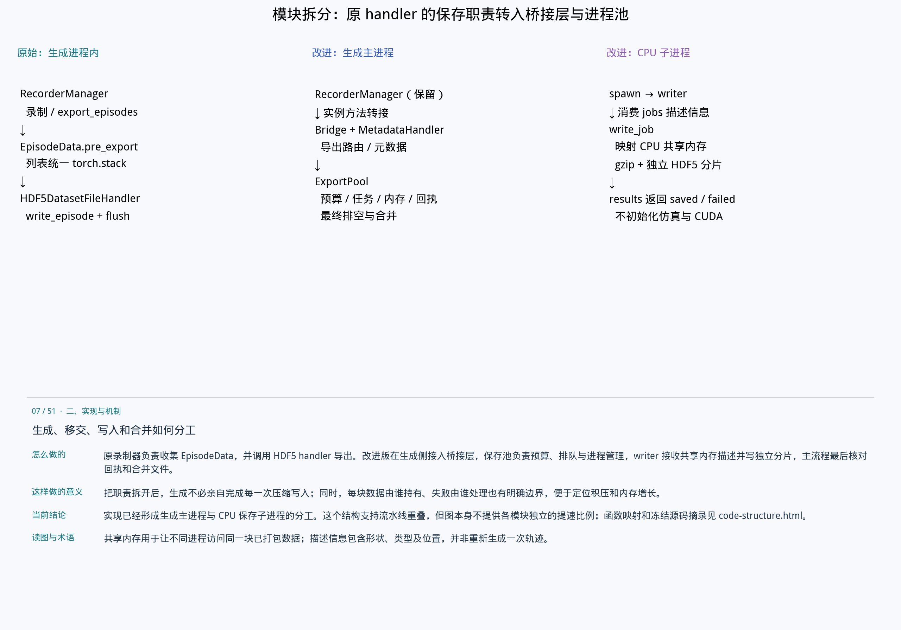

原始保存链由 RecorderManager 协调，EpisodeData 管理每环境缓冲，HDF5DatasetFileHandler 在生成进程中写文件。改进后，recorder 继续管理录制与 episode，但“导出路由与元数据”“内存移交与任务状态”“实际压缩写入”“最终合并”由不同组件承担。

| 文件／组件 | 同步基线 | 异步改进版 | 结构变化 |
|---|---|---|---|
| generate.py / build_source | 仍安装任务兼容层、遥测、失败上限等公共逻辑 | workers 非零或 auto 时注入 configure、attach、finish | 条件安装异步分支；workers=0 清除异步标记 |
| compat.py / install_generation_compat | 保留任务结束判断与 final hold 等公共适配 | 异步标记存在时，在 env_loop 外层及等待动作处插入 poll | 在生成过程中处理写入回执与异常，不等最后结束才处理 |
| RecorderManager.add_to_episodes | clone 整批 tensor，按环境保存切片 | owned_recording_method 为 CPU 数据改为各环境独立 clone | 类方法在当前进程内替换；GPU 分支保留批量 clone |
| RecorderManager.export_episodes | pre_export → handler.write_episode → flush | recorder 实例方法被 MethodType 转接到 Bridge.export | 替换实例调用，不修改上游文件，也不是新增 recorder 子类 |
| async_export.py / MetadataHandler | 不使用 | 保存输出路径、env_args、demo_count；不创建真实 HDF5 | 占位 handler，满足这条 recorder 路径所需元数据接口 |
| async_export.py / Bridge | 不使用 | 保留导出模式、成功属性和 ID 路由，调用 ExportPool | 在 recorder 契约与后台任务协议间做适配 |
| export_pool.py / ExportPool | 不创建池 | 持有预算、pending、entries、共享内存句柄及进程列表 | 父进程统一管理任务与资源生命周期 |
| export_pool.py / writer、write_job | 不启动 | spawn 子进程只压缩并写独立分片 | 不导入 Isaac Sim、torch 或 CUDA，不传递仿真对象 |
| export_resources.py / export_governor.ResourceGovernor | 不启用后台池资源检查 | 初始容量检查；auto 额外按资源准入扩容 | 固定上限与 auto 共用保存协议，扩容决策不同 |
| telemetry.py / validate_output.py | 已有计时及输出校验相关路径 | 增加异步事件与内部阶段观测 | 埋点和校验是证据来源，不应全算作异步性能优化 |

规划、环境任务调度和主循环组织仍由原 AutoData 代码负责。没有将每个环境改造成一个操作系统进程；新增进程集中在 CPU 保存侧。

### 2. 启动时在哪里接入：源码注入、类方法替换、实例绑定

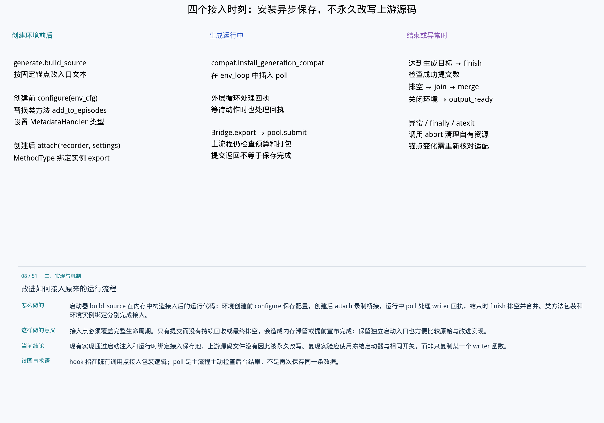

generate.py 读取原 scripts/generate_dataset.py 文本，build_source 按固定字符串锚点插入代码，然后编译执行生成的入口。每个锚点都要求出现一次；上游代码变化会触发断言，而不是自动理解新结构。这是运行时集成 overlay，不是永久改写上游源码。

以下为控制顺序摘要，省略日志和部分参数，不是可直接应用的补丁：

```python
# 控制顺序摘要；settings 与 export_workers 来自 launcher 配置。
install()  # 公共路径：安装任务兼容和遥测
if export_workers:
    configure(env_cfg)  # 环境创建前：替换录制方法与 handler 类型
env = gym.make(env_name, cfg=env_cfg).unwrapped
if export_workers:
    attach(env.recorder_manager, settings)  # 创建后：绑定实例导出方法
# workers=0 不进入两个条件分支，沿原 recorder 保存路径执行。
```

实际绑定语句是 `attach(env.recorder_manager, settings)`。configure 修改 RecorderManager.add_to_episodes 类方法，并将 env_cfg.recorders.dataset_file_handler_class_type 设为 MetadataHandler；attach 创建 Bridge，然后针对这个 recorder 实例绑定导出方法：

```python
recorder.export_episodes = MethodType(
    lambda instance, *a, **k: self.export(*a, **k), recorder
)
```

因此只有配置 flag 打开时才安装异步保存链；但录制方法的替换作用于当前进程中的 RecorderManager 类。owned_recording_method 用标记避免重复包装。MetadataHandler 的 close 是空操作，因为真正的 HDF5 由 writer 关闭；它不是对所有文件 handler API 的通用完整实现。

compat.py 在外层迭代和等待动作的循环中调用 poll，既处理保存成功回执，也尽早发现 writer 失败。生成达到目标后，launcher 先 finish(expected_successes=生成成功数)，再沿原结束路径关闭环境；output_ready 在 env.close 之后记录。异常路径和 atexit 则调用 abort。

### 3. 原始调用链与改进调用链逐步对照

原始同步路径如下（当前 recorder 源码摘要）：

```python
# RecorderManager.export_episodes
self._episodes[env_id].pre_export()  # 递归 torch.stack，各列表转成 tensor
handler.write_episode(episode, demo_id, dataset_compression)
# handler 内：value.cpu().numpy() → h5py.create_dataset(...)
# 默认开启压缩时 gzip level 2
self._episodes[env_id] = EpisodeData()
# 本次 export 的写入完成后 flush handler
```

改进后的 Bridge.export 保留空数据判断、导出模式、成功/失败输出路由、seed/success 属性及可选 demo_ids，但不调用原 pre_export 或原 write_episode：

```python
# Bridge.export 摘要：提交原始 episode.data，允许逐帧打包后释放源数据。
self.pool.submit(
    episode.data, output=handler.path,
    env_args=dict(handler._env_args), attributes=attrs,
    compression=recorder.cfg.dataset_compression,
    demo_id=chosen_demo_id, env_id=env_id,
    format_version=self.format_version, release_source=True,
)
episode.data.clear()
recorder._episodes[env_id] = self.episode_class()
```

chosen_demo_id 是讲解用变量，真实代码按 demo_ids 是否提供选择 ID。submit 返回的是 demo 索引，Bridge.export 没有将其返回为完成凭证。两者都为普通函数；异步来自后台进程，不来自 async def。submit 返回前仍可能等待预算并执行 CPU 打包。

原 recorder 在完成导出处理后更新 episode 计数；Bridge 将已保存计数更新放在 saved 回执处理后，并用 saved_seen 防止重复计数。MetadataHandler.demo_count 主要服务默认 ID 的索引进展，不是“最终文件已存在”的证明。任务生成成功数、已提交数、已保存数与末态合格数必须分别理解。

### 4. 内存路径为什么需要改：切片所有权与整条堆叠

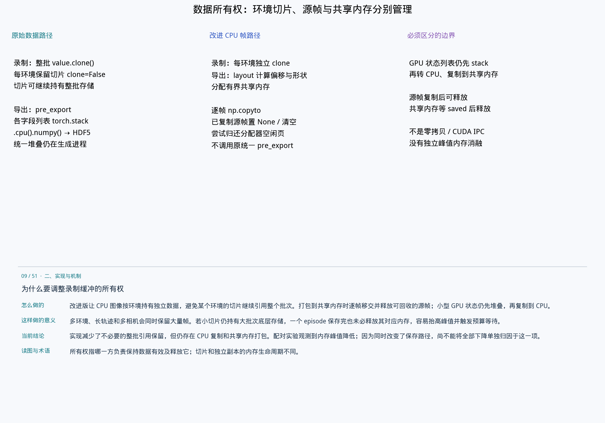

原 add_to_episodes 先 clone 一份包含所有环境的 tensor，再把 value[value_index] 以 clone=False 放入 EpisodeData。切片可以继续持有底层整批存储；即使部分环境结束，只要其他切片仍在使用，共用的存储就不能回收。改进逻辑如下，循环与字典处理省略：

```python
# 原始：批量 clone 后保留每环境切片。
value = value.clone()
episode.add(key, value[value_index], clone=False)

# 改进：CPU 按环境独立持有；GPU 仍保留原批量 clone 路径。
cpu_owned = value.device.type == 'cpu'
if not cpu_owned:
    value = value.clone()
episode.add(key, value[value_index], clone=cpu_owned)
```

第二个改动发生在导出时。原 pre_export 对所有叶子列表 torch.stack；改进 layout 先确定嵌套字段的 path、shape、dtype、offset 和 bytes，将偏移按 64 字节对齐，再分配共享内存。CPU 列表按帧复制到目标缓冲，release_source=True 时把已复制源帧替换为 None，累计释放约 64 MiB 时尝试 malloc_trim，末尾清空列表。它降低源帧与额外整条堆叠副本同时存在的需求，但仍存在复制开销，没有测得独立峰值内存收益的消融结果。

GPU 状态列表采用 torch.stack(value).detach().cpu().numpy() 后一次复制到共享内存，目的是减少逐帧设备到主机转换。不是所有字段都逐帧复制，也不是 CUDA IPC：writer 收到的是 CPU 共享内存。该路径没有消除设备到主机的数据传输或同步成本。

### 5. 新增任务协议与父子进程状态

| 信息／状态 | 由谁持有 | 用途与变更 |
|---|---|---|
| jobs / results | multiprocessing spawn context 创建的两个 Queue | jobs 传描述信息；results 返回 started、saved 或 failed |
| job.memory / leaves | 共享内存名及字段布局 | writer 按 shape、dtype、offset 构建只读 NumPy view；不通过 Queue 传整段图像数组 |
| route / demo_id / key | 父进程生成或检查 | route 区分输出文件；key=route:demo_id 防止重复 ID |
| env_args / attributes | 由 Bridge 提取、父进程传递 | 保存元数据、seed、success、num_samples 和格式版本 |
| pending | 已提交但尚未收到 saved 的任务 | 包含排队、进程启动与写入中的工作；扩容不依赖 Queue.qsize |
| entries | 任务记录，初始 submitted，回执后 saved | 写入 manifest，供统计与合并使用；started 主要记录 writing_started 时间 |
| memories / used | 父进程共享内存句柄与在途字节数 | submitted 后占预算；saved 后 close、unlink、扣减 used |

submit 先检查单条 size ≤ limit，再在 used+size 超预算时 poll(wait=.05)；之后分配内存、pack、再 poll、登记 pending 与 entries、jobs.put、按需扩容。检查顺序很重要：打包期间完成的保存任务可以在第二次 poll 中被回收，已有 writer 也可能再次消费任务。

writer 通过 jobs.get 取任务；write_job 按 worker PID 与 route 打开独立 HDF5 文件。数据先写入 _pending_<id> 组，成功后移动到 /data/demo_<id>，更新 total 并 flush，然后发送 saved。这里的组移动与 flush 是分片内部完成步骤，不是“最终输出已经合并”。gzip level 2 与原路径保持一致，h5py 仍自动选择 chunk；未在这组改造中启用离线实验中的 lzf。

### 6. 正常完成、失败退出和最终文件的语义

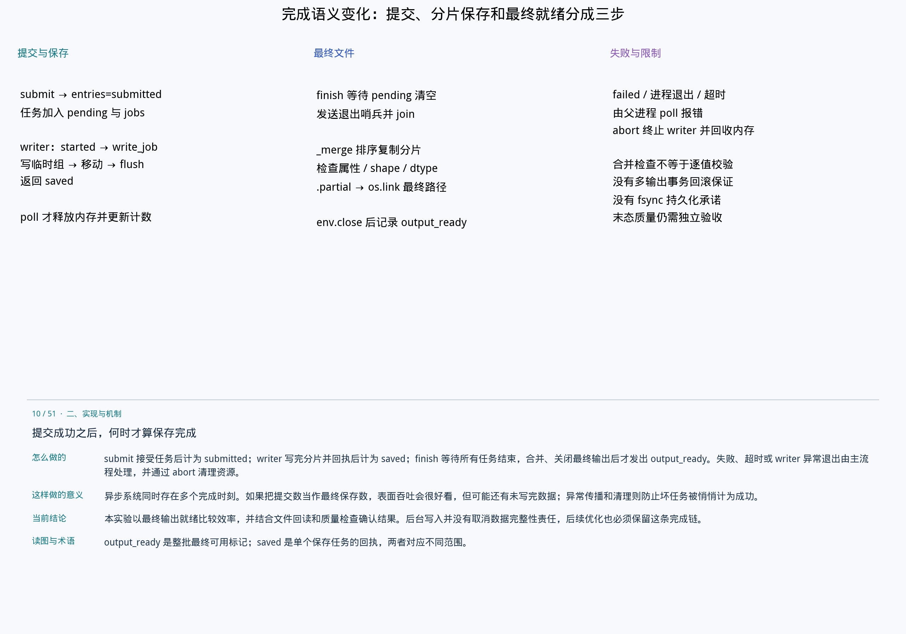

| 事件 | 原始同步路径 | 异步路径新增行为 |
|---|---|---|
| 导出调用返回 | 对该次写入已执行 write_episode 与 flush | 仅完成数据提交；后台可以仍在保存 |
| 单任务完成 | 无跨进程回执 | saved 到达后回收共享内存，并更新保存计数 |
| 整轮结束 | 沿原导出与关闭路径完成 | finish 排空 pending，发 None 哨兵，join 并检查进程退出码 |
| 合并与发布 | 直接写原 handler 的输出 | 排序复制分片到 .partial.hdf5，检查元数据、shape、dtype、压缩和条数，再用 os.link 发布最终路径 |
| writer 失败 | 不存在该故障类型 | failed 回执、意外进程退出、超时在父进程中报错 |
| 失败清理 | 由原调用异常路径处理 | abort 终止自有 writer、join／必要时 kill、释放自有共享内存、标记 failed、关闭队列 |

_merge 的检查不是逐值比较，也不是物理质量验收；保存后还需独立 validate_output。os.link 拒绝覆盖已有文件，单次文件名发布具有对应的原子语义，但没有跨多个输出 route 的事务回滚保证，也不能等同于 fsync 持久化保证。清理时保留的分片与 manifest 不是已实现的自动恢复机制。

poll 的单任务超时使用 writing_started（已收到 started 时）或 submitted_at（尚未开始写入时）作为参考；因此应分别理解排队期间与写入期间的等待。主循环通过 poll 发现异常，finish 自身失败时会 abort，launcher finally / atexit 作为退出清理路径。不能把“后台执行”理解为后台失败不会影响主任务。

### 7. 改动与实验指标怎样对应

| 结构改动 | 预期影响的计时／资源 | 本轮证据及边界 |
|---|---|---|
| 保存移入 CPU writer | 主流程 export / enqueue、execution_wait、整批最终就绪 | 已观察整体改善；enqueue 与 export 工作范围不同 |
| CPU 独立帧与流式 pack | 源数据存活时间、复制峰值、packing_seconds | 有源码与打包计时；没有单独内存修复消融 |
| 有界预算与 poll | queue_wait_seconds、在途共享内存 | 等待仍存在；它限制积压，不保证提交永不阻塞 |
| 多 writer 与扩容准入 | 保存吞吐、实际 writer 数、CPU / I/O 竞争 | cap4、cap8、auto 实际都为 4；不能视为 4 对 8 进程实验 |
| 分片与最终合并 | drain_seconds、merge_seconds、tail_seconds | 增加收尾成本，解释生成完成不等于最终就绪 |

讲解顺序建议：先讲模块拆分，再讲安装点和方法替换，然后沿一条 episode 跟踪内存、任务、文件和回执，最后用计时结果解释收益与代价。结论仍是本轮异步整体实现改善效率，而非已证明某个单函数贡献了全部加速。

## 按流程定位并行方式与接口变动

本节区分三种证据：实验冻结 launcher、2026-10-15 当前 AutoData 源码、官方库文档。v2 实验记录的 cuRobo commit 为 `78fd485fa82d9b9a063fb4985e371814587e666a`；官方 latest 文档用于解释库能力，不作为该固定提交所有接口行为的替代依据。当前 v1 主代码不构成历史实验源码逐字相同的证明。接口证据摘录、行号和哈希另存于 interface-evidence.md。

### 各阶段在哪里执行，采用哪种并行方式

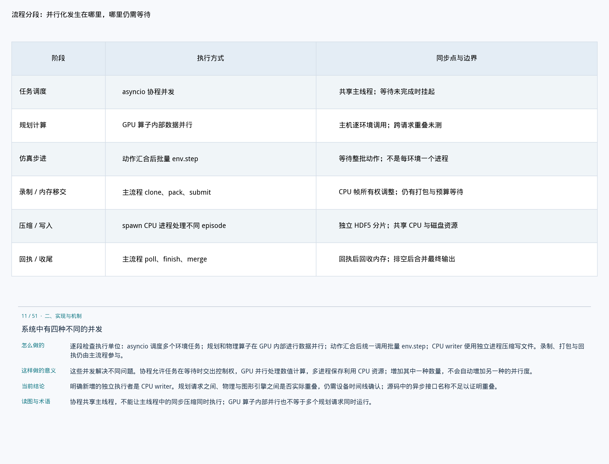

| 流程阶段 | 接口或代码位置 | 实际执行方式 | 同步点与限制 |
|---|---|---|---|
| 环境任务调度 | setup_async_generation → event_loop.create_task(run_data_generator(...)) | 单主进程、单事件循环线程中的协程并发 | 仅在等待操作未完成时挂起；不等于 Python 多核并行 |
| 轨迹规划入口 | planner.update_world_and_plan_motion(...) | 每环境规划器实例，由普通同步函数调用进入 | 该调用没有协程调度点；不据此推断设备是否已全局同步 |
| IK、轨迹与碰撞计算 | v1 plan_single；v2 plan_pose | 规划算子内部的 GPU 数据并行；多初值用于候选求解 | 本项目逐环境调用，未改为跨 8 环境的批量规划请求；不同请求的 kernel 重叠未测量 |
| 动作汇合与仿真 | queue.put((env_id, action)) → queue.join；env_loop → env.step(actions) | 各环境提交动作，凑齐后一次批量步进 | 等待完整动作批次；task_done 只更新队列完成计数，不是 CUDA 同步 |
| 录制与帧持有 | RecorderManager.add_to_episodes；owned_recording_method | 主流程录制，CPU 帧按环境独立 clone；GPU 数据仍保留批量 clone 路径 | 这是数据所有权调整；没有新增录制子进程，也不是零拷贝 |
| episode 移交 | Bridge.export → ExportPool.submit → pack → jobs.put | 主进程检查预算、打包共享内存，再提交描述信息 | 打包仍占用主流程；在途字节预算不足时通过 poll 等待回执 |
| 压缩与分片写入 | spawn Process(target=writer) → write_job | 独立 CPU 进程处理不同 episode；各进程串行消费任务 | 多核计算可并行；I/O 共享磁盘，实际吞吐受资源限制；不多进程写同一 HDF5 |
| 回收与最终发布 | poll → saved；finish → _merge | 主进程处理回执、等待 writer 退出，再合并输出 | 分片已保存不等于最终文件就绪；合并不是新增的并行保存阶段 |

渲染由仿真运行时管理，GPU 参与其中；本次没有单独的渲染 stream、渲染进程或 kernel 时间线证据，不将它描述为与规划必然同时执行。三版沿用 8 环境生成配置；保存侧并行化没有改变规划请求的组织方式。

### 保存接口：调用入口兼容，完成语义改变

| 原始路径 | 异步改进实现 | 准确的语义变化 |
|---|---|---|
| recorder.export_episodes(...) | Bridge 初始化时用 MethodType 将该实例方法转接为 Bridge.export(env_ids=None, demo_ids=None) | 继续接收环境 ID 与可选 demo ID；返回不再代表对应 HDF5 已写完 |
| RecorderManager.add_to_episodes | configure 包装该方法，CPU 切片使用 clone=cpu_owned | 避免 CPU 单环境切片持有整批数据；GPU 分支仍整批 clone |
| 实际数据文件 handler | env_cfg.recorders.dataset_file_handler_class_type = MetadataHandler | 主流程 handler 管理元数据；真实 HDF5 句柄归 writer 所有 |
| 在主流程完成实际写入 | ExportPool.submit(data, output, env_args, attributes, compression, demo_id, env_id, format_version, release_source) | Bridge 显式传 release_source=True；返回 demo 索引，后台保存仍可能进行中 |
| 无异步回执处理 | poll() 处理 saved / failed；update_counters 更新已保存计数 | 已提交数量与已保存数量分离；失败需要传播给主流程 |
| 无后台分片完成屏障 | finish(expected_successes=None) → pool.finish() → _merge() | 核对成功提交数、排空、等待退出、合并；关闭环境后记录 output_ready |

这些是本项目保存层接口变化，不属于 cuRobo v1/v2 的公开 API 变化。异步保存是后台进程机制，Bridge.export 和 ExportPool.submit 自身仍是普通函数，并非 async def，也没有把磁盘写入改为操作系统异步 I/O API。

### 规划接口：保留上层契约，替换库调用与数据类型

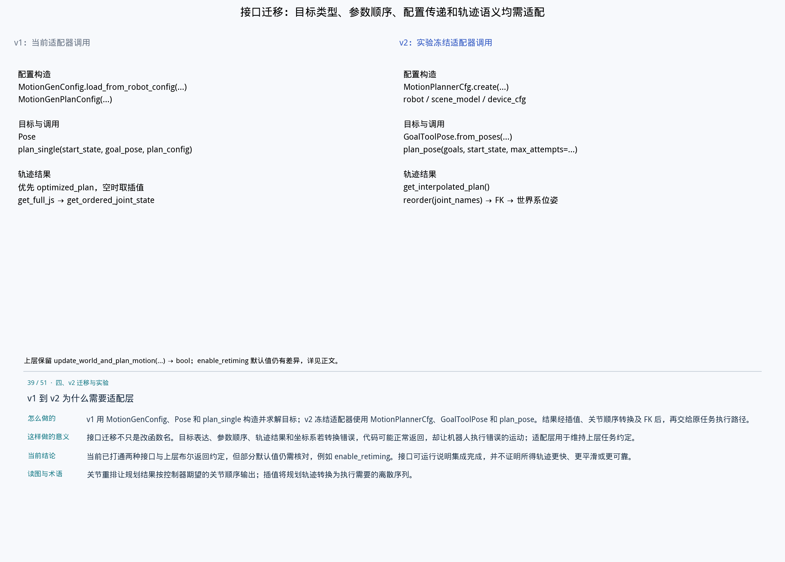

AutoData 上层仍调用 update_world_and_plan_motion，传入 target_pose、expected_attached_object、env_id、step_size 和 enable_retiming，并接收 bool；随后通过 get_planned_poses 获取末端位姿列表。这是适配层维持的任务契约，不是 cuRobo 官方方法。当前 v1 的 enable_retiming 默认值为 None，冻结 v2 的默认值为 False，不能描述为完整函数签名逐字相同。

| 位置 | 当前 v1 实现 | 冻结 v2 适配实现 | 迁移要点 |
|---|---|---|---|
| 导入 | curobo.wrap.reacher.motion_gen 中 MotionGen / MotionGenConfig / MotionGenPlanConfig | curobo.motion_planner 中 MotionPlanner / MotionPlannerCfg | 类型与模块组织改变；适配器内部属性仍叫 motion_gen，但装的是 MotionPlanner |
| 设备配置 | TensorDeviceType；tensor_args=... | DeviceCfg；device_cfg=... | 新类型和参数名，不能只改类名 |
| 构建配置 | MotionGenConfig.load_from_robot_config(robot_cfg, world_cfg, ...) | MotionPlannerCfg.create(robot=..., scene_model=..., ...) | 配置结构改变；机器人与场景对象须先适配 |
| 精度参数 | position_threshold / rotation_threshold | position_tolerance / orientation_tolerance | 本适配器按旧任务配置值传入新命名参数 |
| 碰撞配置 | collision_activation_distance；collision_cache 的 obb 项 | optimizer_collision_activation_distance；cache 将 obb 映射为 cuboid | 这是当前适配映射，不代表所有选项一一等价 |
| 目标类型 | goal_pose 为 Pose | GoalToolPose.from_poses({ee_link_name: goal_pose}, ordered_tool_frames=planner.tool_frames) | 目标从单 Pose 转为按工具坐标系命名的容器 |
| 规划调用 | plan_single(start_state, goal_pose, self.plan_config) | plan_pose(goals, start_state, max_attempts=config.max_planning_attempts) | 参数顺序、目标类型和配置传递方式均改变 |
| 成功判断 | result.success.item() | 先检查 result 非 None，再 result.success.all().item() | 按实际返回结构处理，不把 None 当成功 |
| 读取轨迹 | 优先 optimized_plan，空时 get_interpolated_plan() | get_interpolated_plan()，随后检查非空与有限性 | v2 不把 B-spline 控制点直接当执行采样 |
| 关节顺序 | get_full_js(...) → get_ordered_joint_state(common_js_names) | trajectory.reorder(planner.joint_names) → 按活动关节数 reshape | 两版选择与排列规则不同，需按关节身份而非数组位置适配 |
| FK 末端结果 | compute_kinematics(...).ee_pose，再读取 position / get_rotation() | compute_kinematics(state).tool_poses.get_link_pose(ee_link_name) | v2 按工具坐标系名称读取位姿，再变换回世界坐标系 |
| 动态碰撞体 | world_coll_checker.update_obstacle_pose(...) | scene_collision_checker.update_obstacle_pose(name, pose, env_idx=0) | 每环境一个独立 planner，因此内部场景索引为 0，不是全局 env_id |
| 搬运附着 | attach_objects_to_robot / detach_object_from_robot | attachment_manager.attach_from_scene / detach | 需要适配坐标偏置、球体拟合和附着 link；不是裸函数替换 |

v1 的 MotionGenPlanConfig 还含 enable_graph、enable_graph_attempt、enable_finetune_trajopt 和 time_dilation_factor。v2 适配器在配置层禁用 graph_planner，并在禁用 finetune 时包装 trajopt_solver.solve_pose、强制 finetune_attempts=0。它不是将整个 MotionGenPlanConfig 原样传给 plan_pose。当前摘录没有为 enable_graph_attempt 和 time_dilation_factor 建立直接一对一映射，不能据字段近似宣称求解策略完全一致。

v2 适配器还导入 curobo._src.types.robot.RobotCfg 与 curobo._src.util.usd_scene_parser.UsdSceneParser。它们在固定版本中没有公开导出，因此存在私有接口依赖；升级库版本后必须重新核对，不能将该适配代码当作跨版本稳定接口规范。

### cuRobo v1 与 v2：库的变化与本项目使用范围

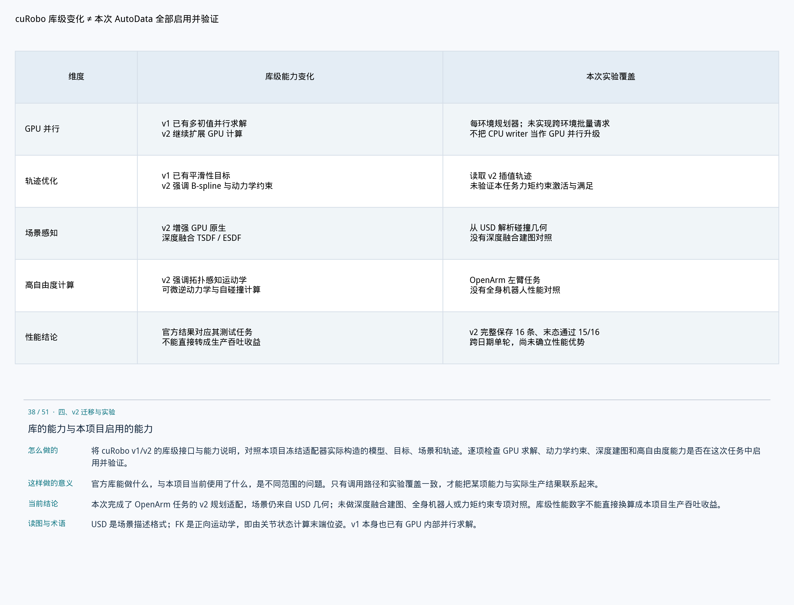

“v1”在这里指旧一代 API，不是名为 1.0 的包版本；官方仓库将 v0.7.8 标为保留 v1 API 的标签，并说明 v2 是公开 API 有变化的较大重写。本实验固定提交，不因在线文档更新而自动改变。[官方仓库说明](https://github.com/NVlabs/curobo)

| 维度 | cuRobo v1 | cuRobo v2 | 本项目覆盖情况 |
|---|---|---|---|
| GPU 并行 | 已使用多初值并行轨迹优化及 GPU 运动学、碰撞计算 | 延续 GPU 计算，并扩展高自由度计算能力 | 两版都有 GPU 求解；异步 writer 不是 v2 才有的库能力 |
| 轨迹优化 | 以碰撞规避、运动学约束和平滑运动生成为核心，已有加速度与 jerk 代价 | B-spline 表示，强调动力学感知、平滑性与力矩限制 | 本适配器读取 v2 插值轨迹；未验证本任务力矩约束的激活与满足情况 |
| 场景感知 | 支持几何碰撞环境，也有深度感知相关集成 | 提供 GPU 原生深度融合 TSDF/ESDF 管线 | 本实验从 USD 解析碰撞几何，不是深度融合建图实验 |
| 高自由度计算 | 已有 GPU 运动学与碰撞能力 | 强调拓扑感知运动学、可微逆动力学、map-reduce 自碰撞计算 | 当前是 OpenArm 左臂任务，没有全身或高自由度性能对照 |
| 应用 API | MotionGen / MotionGenPlanConfig 等旧接口 | MotionPlanner / MotionPlannerCfg 与工具目标表示 | 已迁移单环境规划调用；没有接入跨环境批量规划接口 |

以上库级能力来自[旧版官方概述](https://curobo.org/readme.html)、[v2 官方仓库](https://github.com/NVlabs/curobo)及[v2 论文](https://arxiv.org/abs/2603.05493)。接口文档参见[v1 MotionGen](https://curobo.org/_api/curobo.wrap.reacher.motion_gen.html)与[v2 MotionPlanner](https://nvlabs.github.io/curobo/latest/api/curobo.motion_planner.html)。论文中的专用基准收益不作为本项目生产吞吐的估计。

本项目能确认的是保存链路改造、v2 适配实现与已记录的端到端结果。不能从“库支持多环境／动力学／感知”推出“本次全部启用并验证”，也不能从 v2 库级改进推出此任务必然更快。当前仍保留 v2 末态检查 15/16 的结果和跨日期单轮比较限制。

## 先看代码区别：三种保存方式，共用同一生成任务

本节依据本轮测试目录中冻结的 launcher 源码，而非后来可能变动的工作区代码。示意代码经过简化，用于解释控制流；不是可直接执行的补丁。cuRobo v1 的同步、上限 4、上限 8、auto 共用任务与规划后端，差别集中在导出路径与 writer 扩容策略。

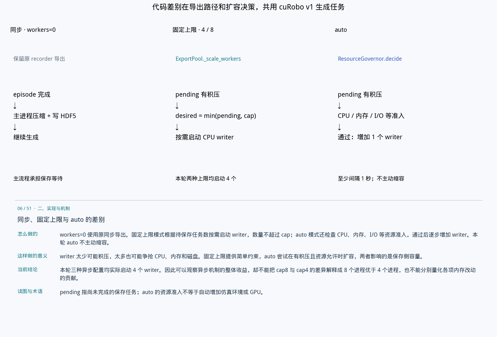

| 方法 | 代码入口与具体差别 | 优化作用与代价 |
|---|---|---|
| 同步 workers=0 | generate.py:33 的异步分支不启用；保留原 recorder 导出路径 | 主流程等待压缩和 HDF5 保存；没有异步分片合并 |
| 固定上限 workers=4 / 8 | ExportPool._scale_workers 中 desired=min(pending,max_workers)，有积压才启动进程 | 让 CPU 保存与生成重叠；4/8 是上限，并非预启动数量，本轮均只启动 4 个 |
| auto | ExportPool 初始化 ResourceGovernor；decide 通过后每次仅增 1 个 writer，检查间隔至少 1 秒 | 按 CPU、内存、进程配额、共享内存、磁盘空间和 I/O 压力决定是否扩容；没有直接按 GPU 利用率扩容，也没有运行中自动缩容 |

异步模式共有的四项代码调整如下，固定上限和 auto 都使用它们：

1. **CPU 帧按环境独立持有。** async_export.py:37–60 将 CPU batch 的切片改为每个环境独立 clone，避免保留整批其他环境数据；GPU 分支仍保留原有批量 clone。它解决内存生命周期问题，不是“零拷贝”。
2. **数据移交改为有界共享内存。** Bridge.export 调用 pool.submit(..., release_source=True)；submit 先等待预算，再 pack，共享内存仅传名字和布局给 writer，复制后释放源数据。队列背压仍可能阻塞主流程。
3. **保存转入 CPU 子进程。** writer 写各自分片，回执确认后回收共享内存；HDF5 句柄和仿真对象不跨进程传递。并发改变调度位置，没有消除压缩计算。
4. **增加完成屏障和合并校验。** finish 等待全部 pending 清空、等待 writer 退出，_merge 复制各分片到临时 HDF5、检查属性/shape/dtype/压缩方式，再发布最终文件。output_ready 在后续 env.close 后发出，所以收尾区间略大于 drain+merge。

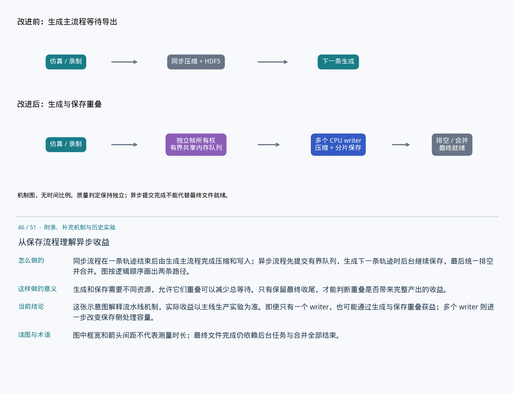

这些优化没有在本组中改用 lzf、降低图像分辨率或取消质量检查。auto 额外优化的是资源准入，而不是新增一种压缩算法。内存修复、异步保存与分片合并没有分别做消融测试，不能把整批提速精确拆成每一项改动的独立贡献。

## 并发与并行的实现层次：协程调度、GPU 数据并行与保存进程

当前实现可以概括为：**一个生成主进程通过单线程 asyncio 事件循环调度 8 个环境任务，并维护各环境的规划器实例；仿真、渲染及规划中的设备计算由 GPU 执行；独立 CPU 写入进程负责压缩与分片保存。** 8 个环境、4 个 writer、规划器内部的候选解数量，是三个不同维度，不能相乘当作生产加速倍数。

本报告按执行层次使用以下术语。“并发”表示多个任务在重叠的时间区间内取得进展；“并行”表示多个执行单元在同一时刻执行工作。并发不必然意味着同时执行。

| 准确术语 | 本报告中的含义 | 不应混同的概念 |
|---|---|---|
| 单线程协程并发 | asyncio 在任务可挂起的位置切换执行；环境任务共享事件循环线程 | 多线程或多进程同时执行 Python 代码 |
| 多环境批量步进 | 将各环境动作组合为一个批次，调用一次 env.step | 每个环境对应独立进程、CUDA stream 或 GPU |
| GPU 算子内部数据并行 | 算子将数据元素映射到 GPU 线程执行；具体映射取决于实现 | 不同规划请求或不同 kernel 必然同时执行 |
| CPU 多进程任务并行 | 多个写入进程处理不同 episode；实际同时执行取决于 CPU 与 I/O 资源 | GPU 规划并行、单文件多进程并发写入 |
| 生成—保存流水线重叠 | 生成后续数据与保存已有数据在时间上重叠 | 保存计算量消失，或提交完成即文件就绪 |
| 单 GPU 多进程共享 | 多个主机进程向同一 GPU 提交工作 | 多张 GPU 并行；本组没有此方案的对照实验 |
| 多 GPU 任务分配 | 将生产任务分配给绑定不同 GPU 的进程 | 仅增加 CPU writer 数量；本组没有此方案的对照实验 |

本节主循环依据 2026-10-15 本地 AutoData 源码检查；保存池依据实验冻结源码。主循环并非新增的历史实验快照，不能仅凭当前代码断定每个历史提交细节完全相同。以下三张图均为机制示意，不是 GPU profiler 实测时间线；本版未新增实验数据。

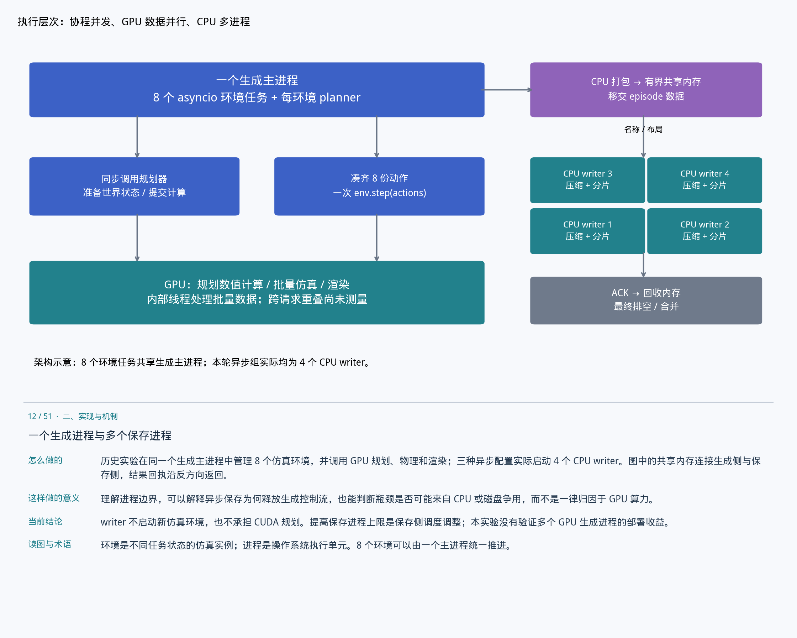

### 1. 同进程协程与批量仿真：8 个环境如何一起推进

setup_async_generation 对每个 env_id 创建 asyncio task，任务共享生成器和仿真对象。协程在 await 的操作尚未完成、需要挂起时让出事件循环线程；若该操作已经完成，await 不一定导致任务切换。普通同步 Python 函数调用没有为该事件循环提供协程调度点。它不是启动 8 个操作系统进程，也不保证 8 次规划调用同时执行。

具体到一步动作，MultiWaypoint.execute 将 (env_id, action) 放入队列，随后 await queue.join()。env_loop 等到队列长度达到 env.num_envs，取出整批动作，按 env_id 填入 actions，再调用一次 env.step(actions)。env.step 返回后，对本批取出的队列项逐一调用 task_done；队列未完成任务计数降到零时，queue.join 的等待者才可继续。task_done 是队列处理完成的记账操作，不是 CUDA 设备同步调用。因此某个环境暂时没有提交动作，整批就需要等它。这里的 asyncio.gather 用来批量取队列数据，不能据此宣称启动了并行 GPU 规划。

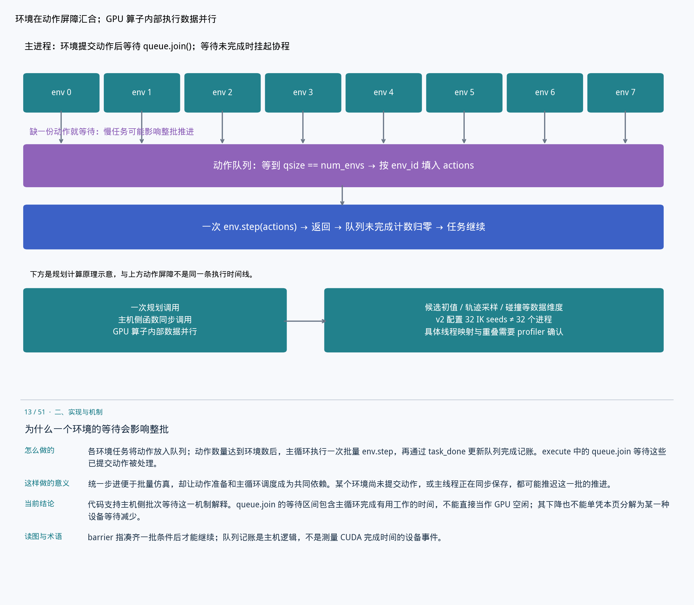

规划调用 planner.update_world_and_plan_motion 在当前 algorithms.py 中是同步调用，没有通过 executor 或独立规划进程提交。每个环境一个 planner 解决各环境世界状态与轨迹的管理问题，不意味着每个环境绑定独立 CUDA stream。这里的“同步调用”描述主机侧函数控制流，不意味着每次调用都会同步等待全部 GPU 工作完成。GPU 上是否发生不同规划请求、仿真与渲染 kernel 的重叠，要结合 CUDA stream 和设备追踪确认，本组日志不足以证明。

### 2. GPU 算子内部数据并行与跨 kernel 并发执行

GPU 适合将相似数值运算组织为批量数据，由许多线程执行。例如规划可围绕候选初值、轨迹采样点或碰撞计算展开；仿真批次则包含多个环境的状态与动作。这种并行发生在 GPU 运算内部，不需要为每个候选解启动一个 Python 进程。候选数和线程数也不是一一对应关系，具体映射由算子实现决定。

v2 适配器配置 32 个 IK seeds，表示为求解提供多组候选初值；不表示 32 个 writer、32 条独立生产轨迹，亦不保证 32 倍提速。CUDA Graph 通过重放预先构建或捕获的工作依赖图，降低重复提交工作的主机侧开销；本适配器启用了相关配置，实际收益未单独测量。它不能绕过动作汇合屏障，也不把同步 Python 规划调用自动变成跨环境并行。当前证据没有各 kernel 的耗时、占用率或重叠比例，不能据设备利用率反推出这些数值。

### 3. CPU 多进程：把保存从生成线程移出去

ExportPool 使用 multiprocessing 的 spawn 创建独立 writer。主进程先将 episode 打包到有界共享内存，再向子进程发送共享内存名称和布局。writer 在自己的进程中执行压缩与 HDF5 分片写入，保存完成发送 ACK；主进程收到回执后释放共享内存与预算。不同 writer 可处理不同 episode，单个 writer 内部仍按任务保存。

这些 writer 不初始化仿真或 CUDA。增加 writer 改变的是 CPU 保存能力，并不会增加 GPU 数量或仿真环境数量。收益来自两部分：生成与保存可以重叠；多个保存任务可以并行处理。代价是共享内存打包、通信、CPU / 内存带宽 / 磁盘竞争，以及最终排空和合并。当在途共享内存占用加上待提交数据大小超过字节预算时，主进程需要等待预算释放，因此异步保存不等于没有阻塞。

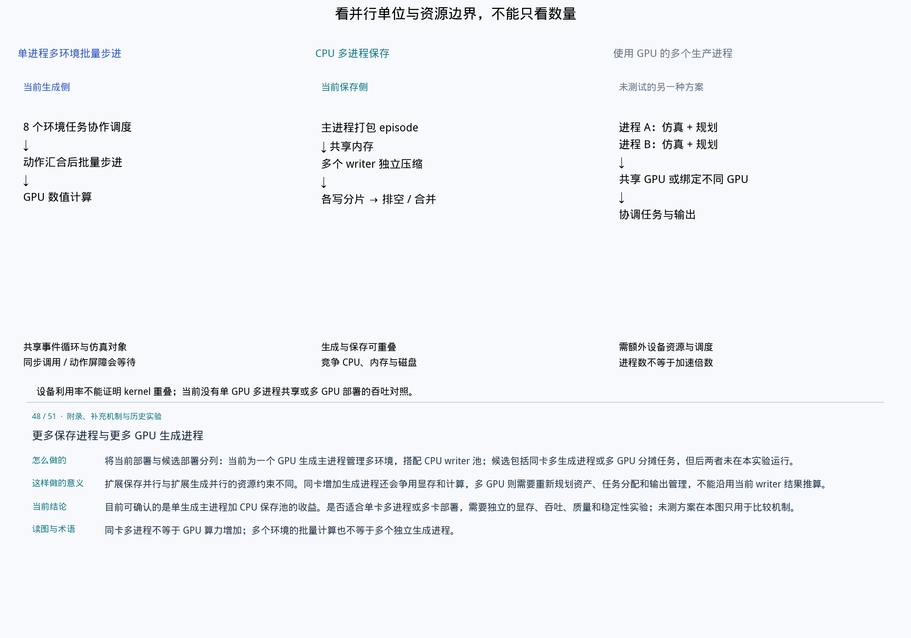

### 4. 单 GPU 多进程共享与多 GPU 任务分配

“GPU 进程”在此应表述为“使用 GPU 的主机进程”。另一个可选架构是多个主机进程分别建立仿真与规划器，再向同一张 GPU 提交工作，即单 GPU 多进程共享。这属于新的实现方案，本报告没有该方案的实测对照。它通常需要额外的模型、世界状态和设备资源；GPU 仍由多个任务共同竞争，进程数不能直接变成吞吐倍数。采用多张 GPU 时，还需要明确进程与设备绑定、任务分配和输出汇总，也属于另外的实验条件。

| 实现 | 并行单位与共享边界 | 当前证据与主要限制 |
|---|---|---|
| asyncio 多环境 | 同一主进程内的任务；共享事件循环和仿真对象 | 已检查代码；同步规划调用占用事件循环线程，动作存在整批屏障 |
| GPU 批量计算 | 算子内部线程处理批量状态或候选数据 | 有批量仿真接口和规划配置证据；没有 kernel 级并发追踪 |
| CPU 多 writer | 独立进程处理不同 episode；共享内存移交数据 | 已有完整生产计时；受 CPU、内存、磁盘及收尾限制 |
| 使用 GPU 的多个生产进程 | 各进程维护生成状态；可共享单 GPU，也可绑定不同 GPU | 两种部署方式都未做对照测试，不能用多 writer 结果代替 |

### 5. 怎样解释已观察到的效率变化

v1 同步与 cap8 的最终就绪时间为 999.35 秒和 600.82 秒，缩短约 39.9%；吞吐由 0.961 增至 1.598 条 / 分钟，增加约 66.3%。两组都是 8 个环境，cap8 实际只启动 4 个 writer。这组差异支持“改变保存路径后，整批生产效率提高”，不能解释为环境数翻倍或 GPU 计算本身快了 66.3%。

同步保存会占用生成控制流，可能延迟其他环境提交动作，继而影响批次推进。将压缩和写入移出主进程可以减轻这类等待，这也能解释为何改善会体现在 execution_wait，而不只体现在 export。但这只是与代码及阶段计时一致的机制解释，缺少逐次调用追踪，不能精确分配因果贡献。异步仍保留打包、背压、排空和合并，所以并行收益有上限。

若继续验证 GPU 瓶颈，应记录每环境动作就绪时刻、批次等待时间、规划调用开始结束、共享内存预算等待与 writer 队列长度，并加入 CUDA 事件或 profiler 追踪；同时对相同输入、环境数和硬件做重复对照。这样才能区分“GPU 算得慢”“主线程没有及时提交工作”和“保存积压反向阻塞生成”。上述验证尚未执行。

## 串行与并行版本的变化原理

这里的“串行”和“并行”主要指数据保存方式。此前各组都使用 8 个仿真环境，同步保存基线也采用多环境批量步进，不能称为整个系统完全串行。需要区分三个层次：

| 并行层次 | 本次比较的内容 |
|---|---|
| 环境任务并发与批量步进 | 8 个环境任务共享事件循环，动作汇合后批量步进；各组环境数保持一致 |
| 生成—保存流水线重叠 | 生成流程是否必须等待压缩、HDF5 写入完成 |
| 保存进程并行 | 是否允许多个 CPU writer 同时保存不同 episode |

### 各版本究竟改变了什么

| 方式 | 执行机制 | 主要收益与代价 |
|---|---|---|
| 同步保存，workers=0 | 生成流程执行导出，完成后继续推进 | 实现简单；压缩和写入阻塞生成主流程 |
| 异步单 writer | 主进程提交数据，一个后台进程保存 | 生成与保存重叠；后台仍串行保存，积压后主流程仍会等待 |
| 异步多 writer | 多个 CPU 进程各自压缩、写入独立分片 | 提高保存侧处理能力；增加 CPU、内存竞争与最终合并成本 |
| auto | 使用相同异步保存池，按资源余量决定是否增加 writer | 控制扩容；不保证每次最快，也不以 GPU 跑满为目标 |
| cuRobo v2 + auto | 保留异步保存，另外更换规划器及接口适配 | 属于规划后端变化，不能与保存并行视为同一项优化 |

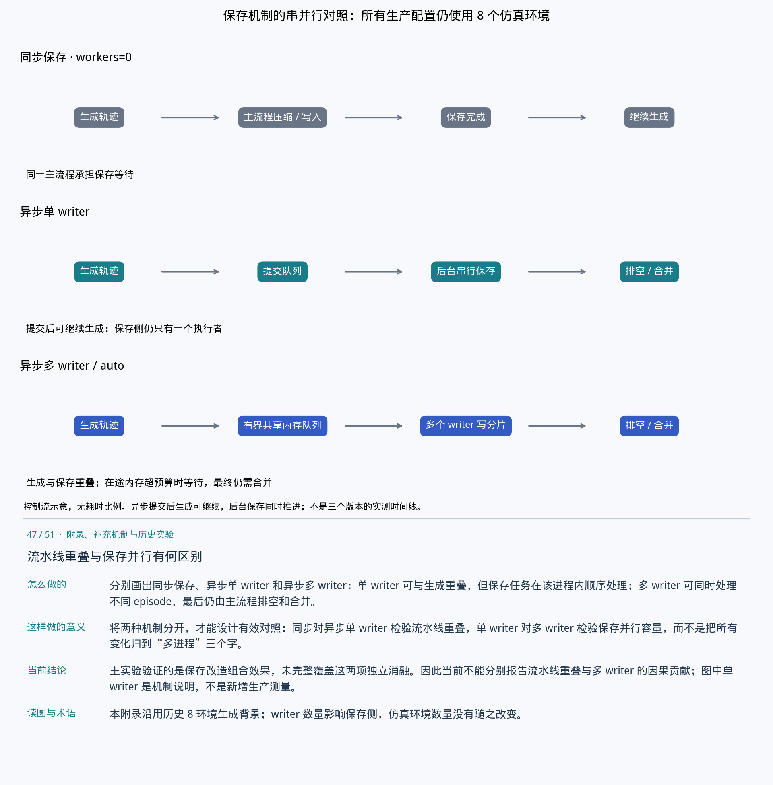

### 加速来自哪里：把相加的工作变成重叠的工作

在理想化的单生产者、单保存阶段模型中，若生成一条需 G、保存一条需 W，同步模式处理 N 条约需 N×(G+W)；异步单 writer 的流水线约需 G+W+(N−1)×max(G,W)。这说明单 writer 也能通过重叠提高完整生产吞吐，但保存侧本身没有变快。

多个 writer 在独立资源充足时可以进一步提高保存侧容量；实际收益还受进程调度、数据打包、内存预算、磁盘吞吐和末尾排空约束。上述公式用于解释机制，**不是本次 8 环境系统的拟合公式**；不能把并发 episode 的阶段累计值直接代入推算实测墙钟时间。

### 为什么异步单 writer 不一定让文件更早就绪

离线保存同样 4 条数据时，同步最终就绪为 105.13 秒，异步单 writer 为 105.45 秒，异步双 writer 为 56.66 秒。单 writer 让提交更早返回，但保存工作仍由一个进程串行完成；双 writer 才增加了保存侧并行处理能力。离线实验没有持续生成可供重叠，不能直接作为完整 GPU 生产的加速比。

### 完整生产中，变化集中在主流程等待

| 指标 | 同步 | 上限 4 | 上限 8 | auto |
|---|---:|---:|---:|---:|
| 执行／等待均值，秒 / episode | 310.27 | 178.17 | 170.90 | 167.22 |
| 主流程导出或入队均值，秒 / episode | 25.61 | 2.65 | 2.62 | 2.62 |
| 后台单条写入均值，秒 / 条 | 不适用 | 28.31 | 27.62 | 27.30 |
| 整批 16 条最终就绪，秒 | 999.35 | 643.71 | 600.82 | 623.65 |

前两行统计每组 17 个已完成 episode，包含 1 次失败；第三行异步配置统计 16 个保存事件；最后一行是整批墙钟时间。这些指标范围不同，不能直接相加。

后台写一条仍需约 27–28 秒，并未变成 2.6 秒。2.6 秒是主流程移交数据的平均负担。保存移到后台后与生成重叠，整批记录成功吞吐相对同步提升约 55%–66%。

“上限 4”和“上限 8”本轮实际都只启动了 4 个 writer，所以不能把它们的差值解释为 8 个保存进程相对 4 个的收益；单轮也不足以确定稳定排名。

### 为什么增加并行度不会一直加速

多个保存进程会竞争 CPU、内存带宽和磁盘；共享内存队列有字节预算，保存跟不上时仍会触发背压；最后还需等待分片完成并合并。仿真、渲染、规划和调度也可能成为新的瓶颈。

本轮 auto 的生成区间比“上限 8”快约 14 秒，但收尾多约 37 秒，最终晚约 23 秒交付。应优先比较最终合格数据的交付吞吐，GPU 利用率和主流程生成速度只作为辅助指标。

### cuRobo v2 是独立的比较维度

10 月 15 日 v2 auto 补跑最终就绪为 699.05 秒、记录成功吞吐 1.373 条/分钟、末态通过 15/16；旧 v1 auto 为 623.65 秒、末态通过 16/16。两次跨日期、缓存状态不同，目前只能作为观测对照，不能证明 v2 升级造成提速或减速，也不能把异步保存收益归到规划器版本升级。

## 实现细节：从 episode 内存到最终 HDF5

### 1. 一份数据在谁手里，何时可以释放

录制阶段的 RGB 已在 CPU，少量状态字段仍可能在 GPU。`owned_recording_method` 让 CPU 帧按环境 clone，避免一个切片保留其他环境的整批缓冲区；它并没有消除复制。GPU 仍用原来的批量 clone 语义。

`layout` 遍历嵌套数据，记录每个叶子的路径、shape、dtype、offset、bytes；`pack` 在共享内存中按布局创建 NumPy view。CPU 帧逐帧复制，开启 `release_source=True` 时释放已复制的源帧，每累计释放约 64 MiB 尝试归还分配器空闲内存。小型 GPU 状态列表先 `torch.stack` 再一次转 CPU，减少逐帧设备同步。这里的 64 MiB 是尝试 trim 的触发量，不是保证 RSS 立即下降的配额。

writer 只接收共享内存名称与布局元数据，重新构造只读 NumPy view，不接收 CUDA tensor、Isaac Sim 对象或跨进程 HDF5 句柄。writer 完成写入并 flush 后发出 `saved` 回执；父进程收到回执才 `close + unlink` 共享内存，并减少 `used` 预算。这个顺序防止 writer 读取未完成时内存被提前释放。

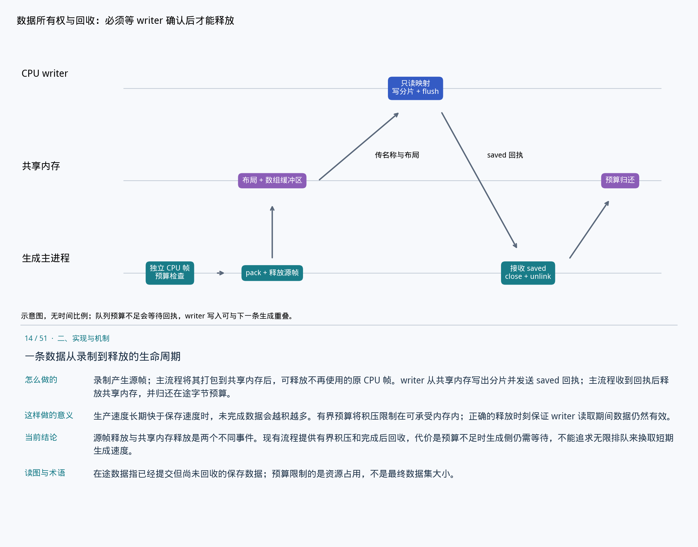

### 2. 队列背压控制的是字节，不是 episode 数

提交前要求单条数据不超过队列预算；当 `used + size > limit` 时，主进程反复 `poll(wait=.05)`，接收已完成回执释放预算。随后还检查 `/dev/shm` 可用量，再分配共享内存并打包。它是有界队列，但背压仍会暂停主流程，所以异步入队的 P95 高于典型入队耗时。

本组请求预算 16 GiB。每条同时包含三路 640×480 RGB，不能把“8 个环境”理解成可以无代价地同时保留 8 条完整轨迹。实际占用取决于长度、源帧是否释放、已提交且尚未确认的数据、writer 私有内存与仿真器本身。

### 3. writer 如何扩容，为什么上限 8 只开了 4 个

固定模式按 `min(待完成任务数, 上限)` 扩容；这里的待完成包含排队、正在写入和进程启动阶段的任务。打包完成后会先 poll 一次，优先复用已有空闲 writer，再决定是否启动新进程。因此 writer 数由任务到达节奏与保存速度共同决定，配置上限不等于实际并行度。

auto 至少每隔 1 秒重新采样并最多新增 1 个 writer。CPU 容量同时考虑亲和性与 cgroup quota；保留 CPU 核心数为 min(2, 容量×25%)，内存保留量为 max(256 MiB, 容量×15%)，还检查进程槽位、共享内存余量、输出磁盘余量和 I/O pressure。I/O pressure 的 avg10 达到 20% 时拒绝扩容；磁盘余量必须至少容纳一条数据加 1 GiB。资源读取失败也拒绝扩容。

这些检查发生在新增 worker 的准入点，不是持续调整仿真环境数，不会主动缩容，也不是 GPU 利用率控制器。参数是当前冻结代码的规则，不保证在其他机器上最优。

### 4. 为什么写分片，为什么最终还要等待

每个 writer 按 route 维护自己的分片 HDF5，使用 gzip level 2，chunk 由 h5py 自动选择。单条先写 `_pending_<id>`，叶子和属性全部完成后移到 `/data/demo_<id>`，更新帧数并 flush，再回复 saved。独立分片避免多个进程同时写同一个 HDF5 文件。

`finish` 等待所有回执、发送退出哨兵并 join writer。`_merge` 按 demo_id 排序，将每条复制到 `.partial.hdf5`，核对属性、空组、shape、dtype、压缩设置和 episode 数；完成后用拒绝覆盖的硬链接发布最终路径，再移除临时链接。它避免未完成文件提前出现在最终路径，但不等于每个字节都经过独立读回，也不等于 fsync 持久化承诺。

`output_ready` 在后续 `env.close` 后记录。因此最终耗时包括生成、排空、合并及关闭等收尾，而 `export_saved` 只表示分片已写。此次旧 v2 实验正缺少这个最终完成链。

### 5. 出错时如何处理

writer 发送 failed、意外退出或单条超时会使父流程报错；abort 终止本任务的 writer，回收仍持有的共享内存并将 manifest 记为 failed。分片可能留存便于检查，但当前代码没有自动恢复所有中断状态的通用机制。仅凭 manifest 里的 saved 计数，不能认定对应磁盘文件现在仍存在。

## cuRobo v2 的实现适配：不是只换一个版本号

| 适配点 | 当前 v2 overlay 的具体实现 | 对正确性与计时的影响 |
|---|---|---|
| 规划 API | 从 v1 的 MotionGen 接口适配到 MotionPlanner / GoalToolPose / plan_pose | 保持 AutoData 的规划调用契约；不保证优化器耗时相同 |
| 机器人配置 | 深拷贝原字典，把 ee_link 改为 tool_frames，retract_config 改为 default_joint_position | 保留原始几何与关节配置，避免改动公共源文件 |
| 夹爪状态 | 预计算开/闭两种 KinematicsCfg，再原地更新 IK 和 trajopt 的参数 | 保持 CUDA graph 地址稳定，避免把夹爪状态变化当作模型重新初始化 |
| 世界坐标 | 将目标与动态物体从世界系转到机器人基座系，按对象名称更新碰撞体 | 处理每个环境独立的位姿，不能省略对象更新 |
| 抓取与搬运 | 持物时 attach_from_scene；接触阶段暂时禁用指定 link 碰撞，finally 中恢复；结束后 detach | 保留接触和附着语义；不是全程关闭碰撞检测 |
| 轨迹读取 | 使用 get_interpolated_plan，不把样条控制点直接当作执行采样 | 返回关节按名称重排，检查维度与有限性，再经 FK 转回末端世界位姿 |
| 重定时 | 仅在 enable_retiming 且提供 step_size 时按关节路径距离重采样 | 不能把可选路径写成每次都执行；执行长度会影响总耗时 |
| 优化设置 | 32 IK seeds、random_seed=1531、use_cuda_graph=True；禁用 finetune 时包装 solve_pose 设置 finetune_attempts=0 | task seed=101 与优化器随机种子不同；当前适配依赖被固定的 v2 API |

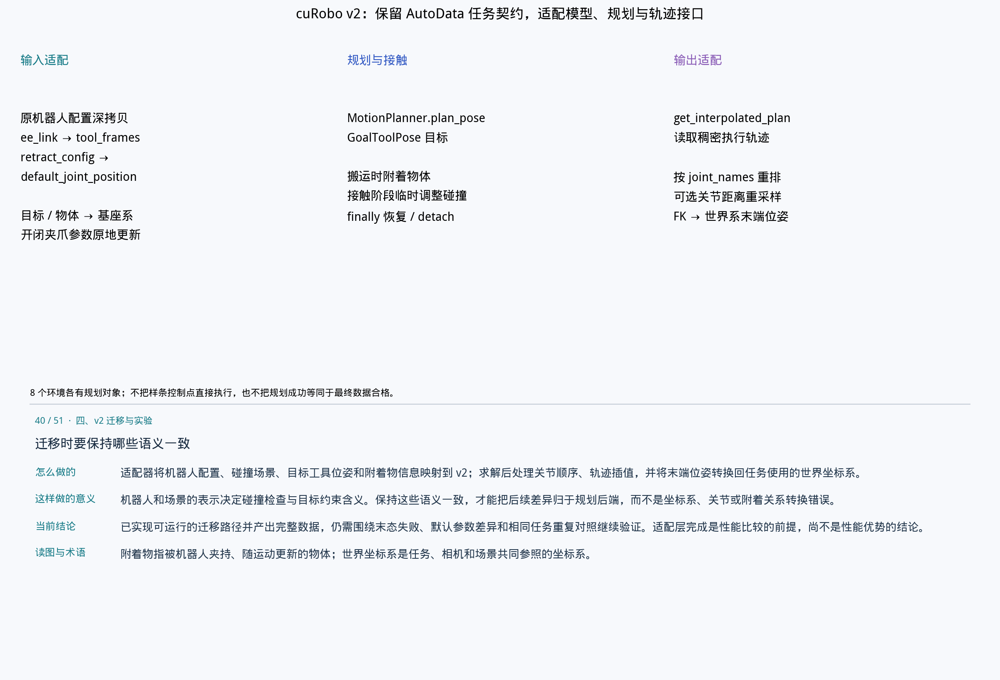

该适配器按 env_id 为各环境构造规划对象；代码中的单环境规划调用不等于跨 8 个环境的一次批量规划。8 环境批量仿真与规划器批处理是不同层次，不能仅凭 num_envs 推断 GPU 求解并行度。

另外，v2 的 solver iteration 埋点在旧遥测中不可用。监控行显示“求解 0 次”时，应同时检查 `planner_requests`、`planner_request_success_rate` 和 `solver_iteration_instrumentation_available`；0 不能解释为没有调用规划器。报告将规划请求与内部求解迭代分开，缺失的迭代统计不参与 v1/v2 比较。

## cuRobo v2 已补跑：生产完成，严格末态验收 15/16

旧实验的 4 个分片已不在 manifest 指向的位置，无法直接恢复。本次使用保留的 v2 环境、冻结 launcher、同一源 HDF5 和 seed 101 任务配置，在新的本地目录重跑 8 环境、16 条成功目标。没有改上游代码、质量阈值、图像分辨率或压缩算法。

新实验记录了 output_ready，进程正常退出，最终文件存在且可读：**生成成功 16/16，保存 16 条，末态检查通过 15/16**。校验使用与历史测试相同的 validate_output.py，覆盖动作维度/有限性、图像形状与首尾读取、末态放置/速度检查并计算整个文件 SHA-256。它不是逐帧物理重放，也不是完整图像质量认证。

| 指标 | 10 月 14 日 v1 auto | 10 月 15 日 v2 auto 新实验 |
|---|---:|---:|
| 最终就绪 / 秒 | 623.648 | 699.046 |
| 吞吐 / 条每分钟 | 1.539 | 1.373 |
| 生成区间 / 秒 | 549.171 | 663.222 |
| 整批收尾 / 秒 | 74.477 | 35.824 |
| 实际 writer 数 | 4 | 4 |
| 生成成功 / 已完成 | 16 / 17 | 16 / 16 |
| 保存数据末态通过 | 16 / 16 | 15 / 16 |
| 含启动退出总耗时 / 秒 | 667.059 | 782.918 |

**质量检查整体未通过。** 未通过项为 demo_2：物体在目标区域内，高度误差约 0.23 mm，线速度 0.0221 m/s 低于阈值 0.03 m/s，但角速度 0.8538 rad/s 超过 0.5 rad/s 的原阈值。校验器返回码为 1；原生结构检查返回码为 0。没有修改阈值或删除该条数据。应先分析结束判据与稳定等待，再决定是否需要增加静止窗口并另开实验，不能用本轮声称 16 条全部合格。

按已测末态合格条数计算，吞吐为 **15×60/699.046 = 1.287 条/分钟**；按生成器记录成功条数计算为 1.373 条/分钟。两者均不包含校验器运行时间；如衡量端到端质量验收交付，还需把校验耗时纳入计时。旧 v1 auto 的 16 条均通过末态检查，表中的 1.539 条/分钟在该检查口径下不变。

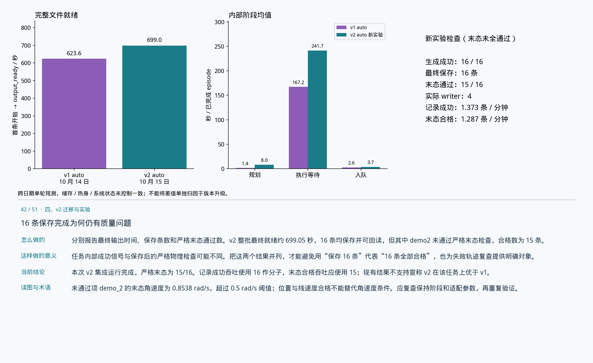

**这张表是跨日期的观测对照，不是隔离版本因素的公平速度排名。** 新实验启用了独立缓存目录，首次初始化可能含编译开销；系统负载、CPU 调频与缓存状态未与昨天完全对齐。即使从首条开始计时，延迟初始化仍可能进入生产区间。后续若要确认 v2 的稳定收益，需要同日交错重复 v1/v2，并记录一致的热身策略。

新实验内部阶段的统计分母为 16 个已完成 episode；旧 v1 auto 为 17 个。新实验规划均值 8.038 秒、执行/等待 241.740 秒、入队 3.694 秒；排空 27.228 秒、合并事件阶段 4.134 秒。后台写入均值 28.409 秒/条，仍与主流程重叠，不能直接相加。

原始运行产物保存在当前工作区 `workspace-overlays/efficiency-review-runtime/v2-auto-16-seed101/`。报告只附指标与校验记录，大型 HDF5 留在该本地目录；文件 SHA-256 为 `801cc08322f51e0d38a800fc00445931246d3b25ccd47bc06f657576ccf27bb2`。详见本包 v2-result.json 与 v2-validation.json。

## 内部耗时变化：按三种计时范围分别看

### A. 每个 episode 的主流程均值

以下分母为每组 **17 个已完成 episode（16 成功 + 1 失败）**，不是只统计 16 条成功输出。同步导出与异步入队代表不同工作，不能把异步的 export=0 理解为不需要保存。

| 内部阶段（秒 / 已完成 episode） | 同步 | 上限 4 | 上限 8 | auto | auto 相对同步 |
|---|---:|---:|---:|---:|---:|
|重置|0.278|0.156|0.187|0.151|-45.6%|
|运动规划|1.740|1.567|1.464|1.423|-18.2%|
|执行 / 等待|310.274|178.166|170.896|167.215|-46.1%|
|主流程同步导出|25.615|0.000|0.000|0.000|-100.0%|
|主流程异步入队|0.000|2.652|2.620|2.619|新增阶段|

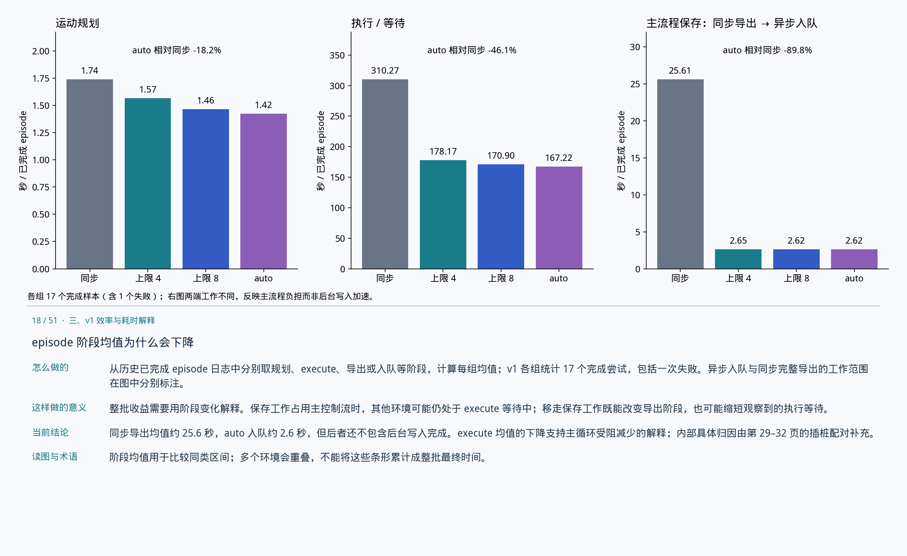

执行/等待由 310.274 降至 167.215 秒，下降 46.1%；主流程的同步导出 25.615 秒被约 2.619 秒的异步入队替代，该主流程阶段负担下降约 89.8%。这不是后台保存加速 89.8%：writer 仍需约 27–28 秒写一条数据。

### B. 异步移交与后台写入：可以重叠，不能相加为总耗时

| 内部指标 | 上限 4 | 上限 8 | auto | 统计范围 |
|---|---:|---:|---:|---|
|共享内存打包|26.708|25.104|24.462|整轮累计秒数|
|等待队列预算|18.032|19.119|19.727|整轮累计秒数|
|后台单条写入均值|28.311|27.619|27.303|16 个 export_saved 的均值，秒 / 条|
|后台单条写入 P95|33.035|30.609|30.436|历史遥测报告的 P95，秒 / 条|

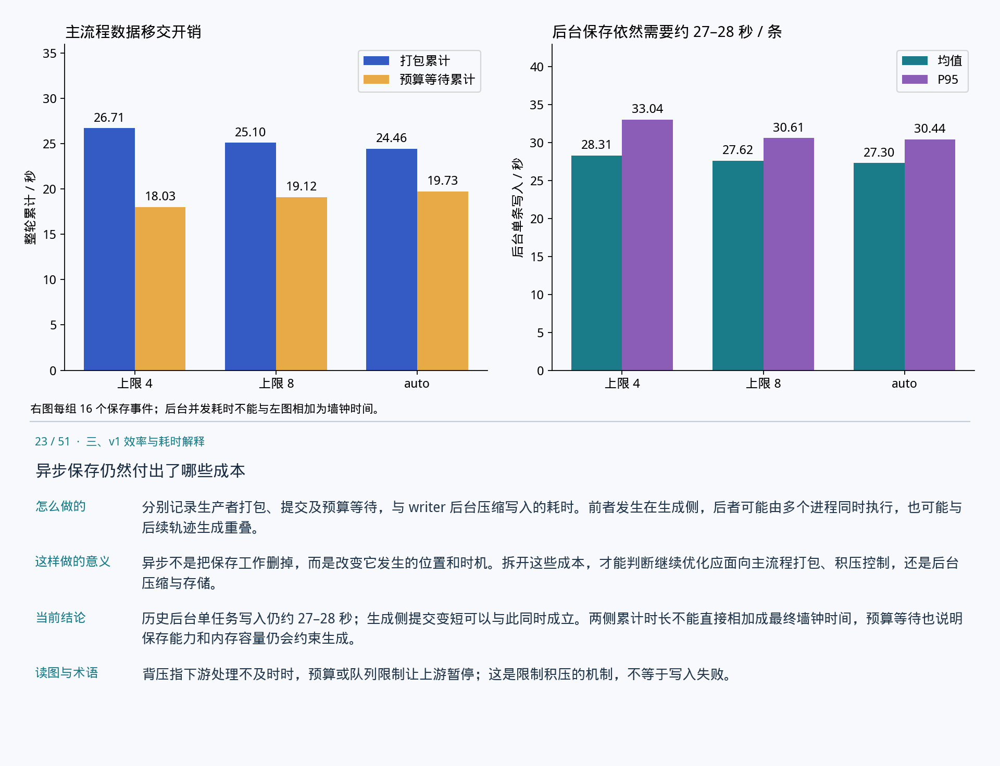

打包、预算等待与主流程入队计时存在包含关系，起止点和样本范围也不完全一致；不应把它们再次加入 episode 阶段总和。后台写入与主流程并发，多 writer 写入的耗时总和也不等于墙钟时长。同步模式没有异步 writer 的同名测量，缺失值不填 0。

### C. 整批收尾：auto 本轮生成最快，却没有最早交付

| 区间（整批秒数） | 同步 | 上限 4 | 上限 8 | auto |
|---|---:|---:|---:|---:|
|首条启动 → 最后完成|997.669|604.721|563.470|549.171|
|finish 排空队列并等待进程退出|不适用|28.927|27.283|27.152|
|export_complete 报告的合并阶段|不适用|8.157|8.503|45.665|
|最后完成 → output_ready|1.677|38.987|37.345|74.477|
|首条启动 → output_ready|999.346|643.707|600.815|623.648|

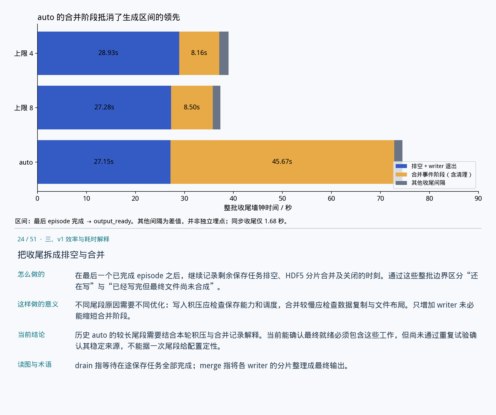

auto 的生成区间比上限 8 短约 14.30 秒，但收尾多约 37.13 秒，导致最终就绪反而晚 22.83 秒。主要差异出现在 merge 事件：45.67 秒对 8.50 秒。代码中 export_complete 的 merge_seconds 还覆盖合并后的 manifest 写入、分片目录清理及队列关闭等操作，因此不是纯 HDF5 copy 的独立计时。单轮不能确认是策略、缓存、磁盘或系统负载导致；需要重复测试及更细的 I/O 埋点。

### D. 旧 cuRobo v2 中断记录：保留阶段诊断，新结果见补跑章节

v2 的历史阶段均值采用 16 个已完成 episode，v1 auto 为 17 个，样本分母不同。v2 的规划均值 8.089 秒、执行/等待 172.618 秒、入队 3.626 秒；v1 auto 分别为 1.423、167.215、2.619 秒。这些值不支持“v2 的规划阶段更快”，也不足以隔离后端升级的因果影响。这份旧 v2 记录缺最终就绪与校验；本版新增的完整重跑单独列示，不覆盖旧记录。

## 结论：异步保存已经带来收益，v2 已补齐一次完整运行

最新一组 8 环境、16 条成功数据、seed 101、cuRobo v1 的对照中，同步保存需 999.35 秒，异步保存需 600.82–643.71 秒。最终就绪吞吐由 0.961 条/分钟升至 1.491–1.598 条/分钟，相对提升 55.25%–66.33%，耗时减少 35.59%–39.88%。auto 模式为 623.65 秒、1.539 条/分钟，吞吐提升 60.24%。

这些是单轮观测，不能据此确定 auto、上限 4、上限 8 的稳定排名。三个异步配置实际都只启动了 4 个 writer；“上限 8”不等于同时使用 8 个保存进程。

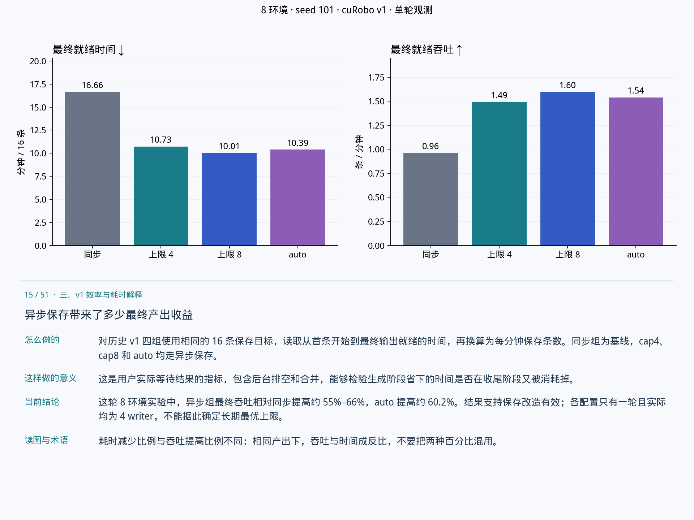

| 配置 | 实际 writer | 最终就绪 / 秒 | 吞吐 / 条每分钟 | 含启动退出的总耗时 / 秒 |
|---|---:|---:|---:|---:|
| 同步 | 0 | 999.35 | 0.961 | 1067.93 |
| 上限 4 | 4 | 643.71 | 1.491 | 692.45 |
| 上限 8 | 4 | 600.82 | 1.598 | 651.95 |
| auto | 4 | 623.65 | 1.539 | 667.06 |

## 改了什么：把保存从生成主流程中拆出

此前，同步导出占用生成主流程，压缩与 HDF5 写入期间无法继续推进同一流程。异步方案让主进程准备独立所有权的数据帧，经有界共享内存队列交给 CPU writer，生成与保存可以重叠。最后仍要排空队列、合并文件，才能确认数据就绪。

历史记录还包含内存所有权修复：早期异步尝试曾出现 OOM，原因涉及 CPU batch view 保留其他环境的数据；后续改为各环境独立持有 CPU 帧，并在移交时释放已复制帧。该修复与保存池共同组成方案，但现有实验不能单独量化各改动的贡献。


## 为什么提速：主流程等待减少，而不是规划器突然更快

最新同步配置的每个已完成 episode 平均执行/等待为 310.27 秒，auto 为 167.22 秒；同步导出均值为 25.61 秒，auto 的主流程入队均值为 2.62 秒。这里的 execution_wait 是执行与调度等待的合计，不能理解为纯 GPU kernel 时间；后台写入也没有凭空消失。

规划阶段均值从同步的 1.74 秒变为 auto 的 1.42 秒，相比执行/等待并非主要耗时。当前证据支持优先优化数据记录、压缩保存和流程重叠，不能把全部收益归因于某个单独函数。

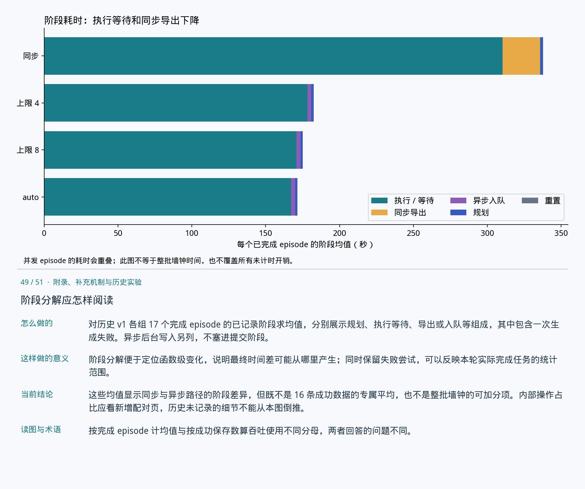

## 统一口径：最终文件可用，才算生产完成

主指标采用 `output_ready.elapsed_seconds − 第一个 episode_started.elapsed_seconds`，吞吐为成功保存条数 × 60 / 最终就绪秒数。本次已从遥测事件重新计算四个结果，并与 summary.csv 核对一致。launcher 总耗时另列，包含启动和退出，不能混入同一个加速比。

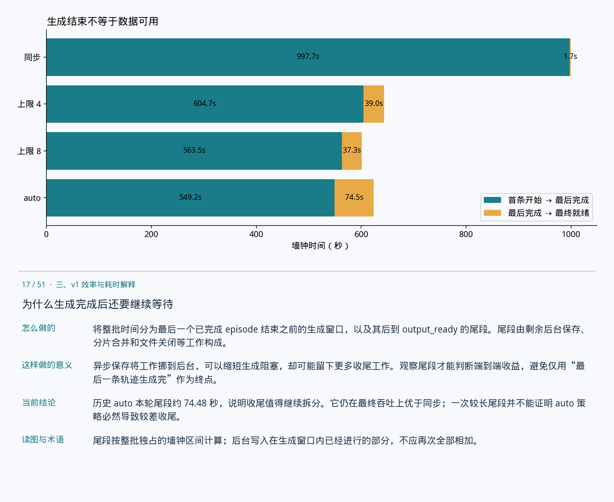

保存尾部的等待与合并会影响最终收益。最新 auto 的 merge 事件耗时约 45.67 秒，上限 4 和上限 8 分别约 8.16、8.50 秒。单轮中这可能受文件系统、缓存和系统状态影响，尚不能认定为 auto 策略本身的固定开销。阶段累计时间和并行 episode 均值不能直接相加为整批墙钟时间。

## 资源利用率：有所提高，但“GPU 跑满”不是验收条件

首条开始至 output_ready 区间内，按有效设备采样时间加权，GPU 利用率均值为：同步 22.7%，上限 4 为 40.8%，上限 8 为 35.6%，auto 为 32.8%。采样设备为 NVIDIA GeForce RTX 5090。

上限 4 的 GPU 利用率高于上限 8，但本轮完成更慢。这说明利用率只能辅助定位瓶颈，最终应看质量合格数据的就绪吞吐。这里统计的是设备级利用率，可能包含其他进程；只覆盖有效采样间隔，不是逐 kernel 测量，也不是 GPU 独占证明。

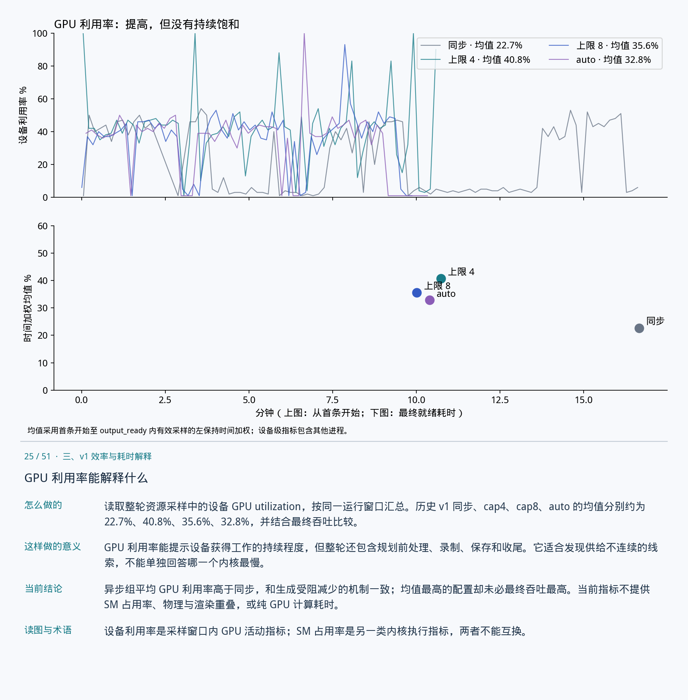

## 质量效果：本轮指标没有下降，但不代表全面质量认证

四个 v1 配置均完成 17 次尝试，其中 16 次生成成功、1 次失败，生成成功率为 94.12%；保存的 16 条均通过已有末态物理检查。达到目标后取消的在途 episode 不计为失败。本次复核历史校验 JSON，不声称进行了新的物理重放。

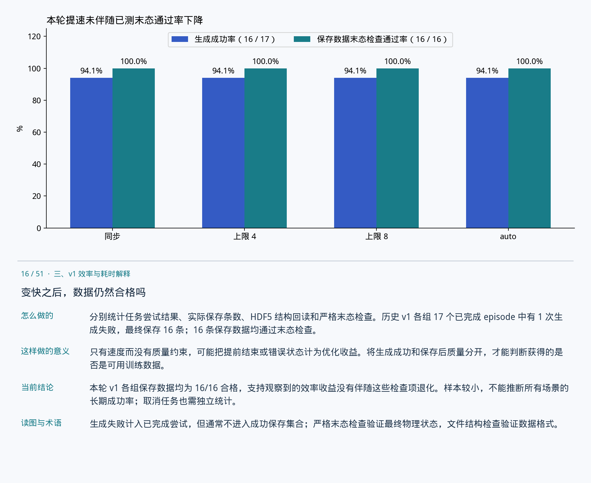

末态通过、格式兼容与图像有效性是不同维度。历史校验记录中的部分 right_hand_rgb 首尾均值接近零；这不影响现有末态通过统计，但说明训练前仍需独立检查相机有效性、轨迹完整性和多样性。不能将“16/16 末态通过”写成“全部训练质量通过”。

## 早期测试：收益方向一致，不能拼成连续加速曲线

早期 8 环境、24 条测试中，同步、1 writer、2 writers 的最终就绪时间分别为 1156.74、1022.19、891.22 秒；2 writers 相对同步吞吐提升 29.79%，耗时减少 22.95%。三个模式都记录 24 条成功，但严格末态检查仅 23 条通过，同一个 demo_2 仍在运动。该组不得写成质量完全通过。

离线 4 条保存对照中，同步和 1 writer 的最终就绪分别为 105.13、105.45 秒，2 writers 为 56.66 秒。1 writer 的提交耗时虽降到约 4.58 秒，但完整保存并未变快；这正是不能用“提交返回”代替“最终就绪”的例子。

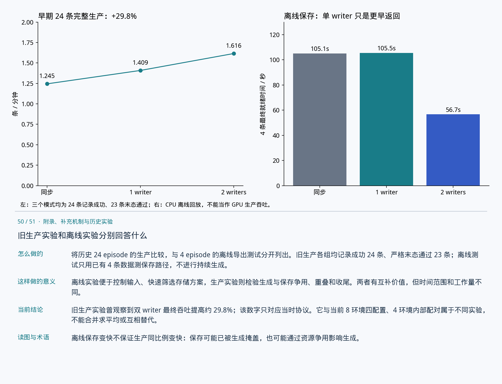

24 条与 16 条实验的批量、seed 和实现状态未证明完全一致，因此只在各自组内比较，不把 29.79% 与 66.33% 相乘，也不宣称最新结果代表持续递增的累计收益。

## 尚未落地的压缩改动与旧 v2 中断记录

离线全长 RGB、相同 chunk 的单轮对照显示：gzip 创建耗时 25.75 秒、文件 0.55 GB；lzf 为 16.98 秒、0.83 GB；无压缩为 10.10 秒、3.72 GB。lzf 有速度收益但增加体积，无压缩的存储代价更大。这些只覆盖离线 RGB 保存，不是完整生成，也不是已经采用新压缩方案后的生产测试。dataset_create 同时包含压缩、HDF5 和 I/O，差值不能作为纯压缩耗时。

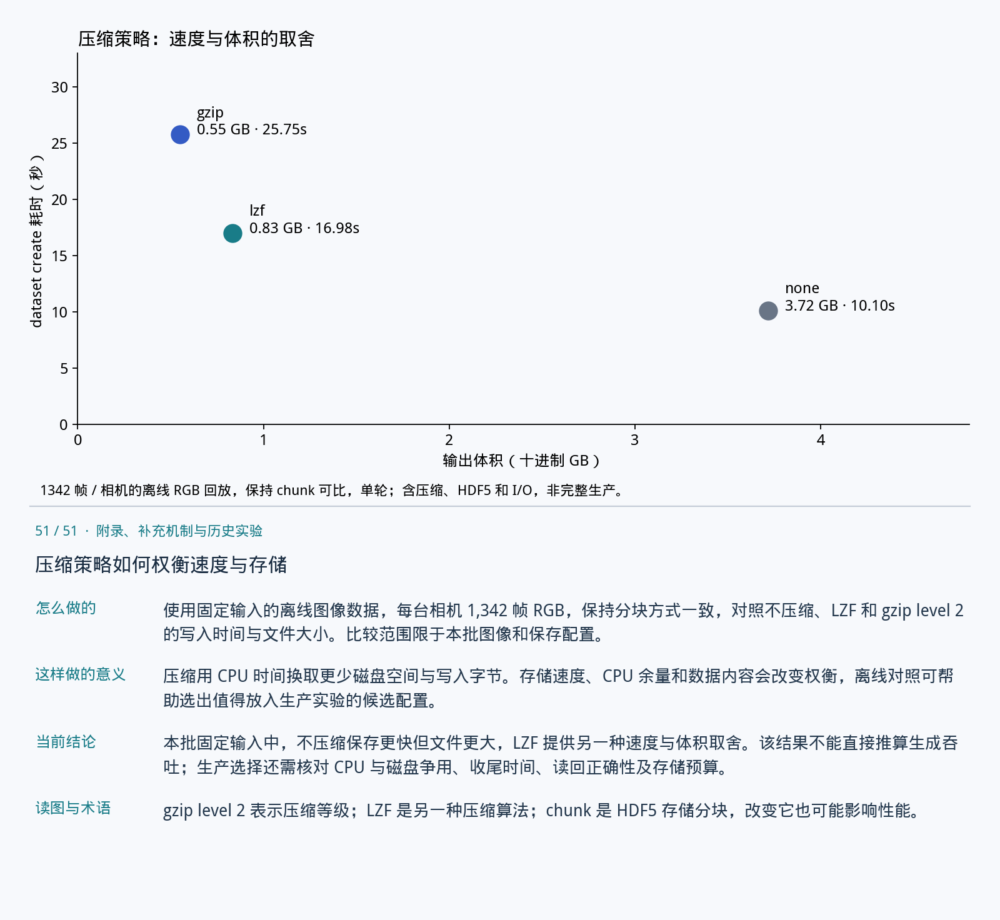

10 月 14 日旧 cuRobo v2 的 auto 记录显示 16 次成功、16 个保存分片；但 run 和 export 元数据仍为 running，未找到 output_ready、最终校验文件和完整汇总。这份旧记录只能确认历史阶段进度，不能作为完整交付结果。本版已另行补跑并加入最终结果，不改写旧运行状态。

此前“32 个 episode”测试的 report.md 仍含未填写模板。本次未将其计入完成的基准，也不把 16 条或 24 条结果线性放大为实测 32 条结果。

## 下一步如何把结论变成稳定生产配置

1. 保留同步基线，重复测试固定 4 writers 与 auto；保持输入、任务、seed 列表、质量判据、8 环境和输出批量一致，并交错测试顺序。报告中位数、分位数和波动，而不只报最好一轮。
2. 优先调查最终合并耗时和队列背压。需要提高并行度时同时记录内存、OOM、磁盘空间、真实 writer 数和其他进程负载。
3. v2 本版已补齐一次最终合并与输出校验，下一步进行同日交错重复 v1/v2；不把求解成功率当作数据生产成功率。
4. 把训练前图像有效性检查补入质量验收，并检查 v2 demo_2 的末态旋转残留。压缩策略若要调整，另做完整生产、读取兼容性与体积对照。

## 证据与复现

新增 `code-evidence.md` 提供本轮冻结代码的相关片段及行号；`internal-timing.csv` 保存新增内部指标和统计口径。

- 主对照：`AutoData/datasets/efficiency_20261014_201834/v1/summary.csv`，及各 r01_v1_w* 目录中的 run、telemetry、resources、validation 记录。
- 未完成对照：同测试目录下 `v2/r01_v2_wauto` 的 run、telemetry 与 export 元数据。
- 历史对照及离线实验：`outputs/autodata-efficiency-report/v001/evidence.json`。
- 数据摘要、可复算数值及输入 SHA-256：本包 `data.json`；平面汇总为 `data.csv`。图表可用 `python build_figures.py` 重建，需要 matplotlib 和 Noto CJK 字体。原始大型遥测与 HDF5 不随包复制。
- 图册：`charts.pdf`，共 16 页；图像同时提供 PNG 与 SVG。没有基于单轮结果构造置信区间或误差条。

本次仅本地交付，不上传飞书或 ChatGPT，不提交或推送 GitHub。新 v2 实验已运行并完成读回；严格末态校验未全通过，不能标记为质量验收通过。


## GPU 未满载：源码分析补充

当前最明确的结构性限制是：GPU 批量仿真嵌在一个由主线程推进的闭环里；每批动作需要等齐，观测会回传 CPU，规划与打包也占用这条主线程。异步 writer 移走压缩和写盘，尚未把整个生成流程改为可持续提交 GPU 工作的流水线。以下解释代码为什么可能留下设备空闲区间；已有日志不能给各原因分配百分比。

### 先明确“拉不满”的指标

已有 v1 设备级 GPU 利用率均值为同步 22.7%、cap4 40.8%、cap8 35.6%、auto 32.8%。它统计采样周期内有一个或多个 kernel 执行的时间比例，不是 SM occupancy，也不是 GPU 算力使用比例。不能据此推导剩余算力或理论加速倍数。定义见 [NVIDIA nvidia-smi 文档](https://docs.nvidia.com/deploy/nvidia-smi/index.html)。

统计窗口含生成后的排空、合并等收尾，auto 的最后完成到 output_ready 为 74.477 秒。因此整批均值不能代表稳态仿真利用率。cap4 的平均 GPU 利用率最高，cap8 的最终就绪最快；优化目标应是单位时间的合格产出。

### 1．全环境动作屏障：8 个环境不是 8 条独立的 GPU 提交流

[env_loop 原代码 250 行](source/env-loop.html#L250) 在队列长度等于 num_envs 之前，只推进协程和处理 reset；[271 行](source/env-loop.html#L271) 才调用整批 env.step，随后逐个 task_done。每个环境在 [MultiWaypoint.execute 333–336 行](source/waypoint.html#L333) 提交动作后等待 queue.join。

```python
while env_action_queue.qsize() != env.num_envs:
    asyncio_event_loop.run_until_complete(asyncio.sleep(0))
# 等齐后收集动作
env.step(actions)
for _ in range(env.num_envs):
    env_action_queue.task_done()
```

因果链：某环境正在同步规划、重置或提交导出 → 它尚未提交下一动作 → 整批 step 尚不能开始。asyncio 让协程交替推进，不会把同步 Python 函数自动移到另一线程。这里确认的是全批动作屏障；等待期间 GPU 也可能执行规划工作，不能把全部屏障时间算作 GPU 空闲。

改进方向：先记录各环境动作就绪时刻与整批 step 开始时刻。批量规划、预计算或分组调度需要保持世界状态和动作步对齐；不能简单跳过慢环境而改变任务语义。仅增大 num_envs 还会增加相机、内存及等待负担。

### 2．相机观测：GPU 图像每次都复制回 CPU

冻结任务的 [cameras.py 46–55 行](source/camera.html#L46) 是直接证据：

```python
def rgb_image(env, name):
    update_mounted_camera_poses(env.scene)
    return env.scene[name].data.output["rgb"].torch[..., :3].to(device="cpu", copy=True)
```

这里明确要求 CPU 上的新副本，且没有请求 non_blocking。CPU 消费者必须等数据可读后继续。这样做原本是为了避免 recorder 将整条轨迹的 RGB 长期保留在显存中，目的合理，但会让设备到主机传输进入 step 的关键路径。异步 HDF5 writer 不会消除这次传输。

[20–43 行](source/camera.html#L20) 的 update_mounted_camera_poses 每次循环更新三个相机；[配置 122–124 行](source/config.html#L122) 为三路 RGB 分别注册 rgb_image。因此一次完整观测计算会调用三次 RGB 回传，并调用九次 set_world_poses。每次处理的是当前整批环境，不是单张图片。这是函数调用次数，不是渲染次数，也不是 kernel 次数。

### 3．启用录制时可能重复计算观测：先录制，再返回重置后状态

当前 [ManagerBasedRLEnv.step 242–245 行](source/rl-step.html#L242) 在 recorder 有 active_terms 时计算观测供录制；[270 行](source/rl-step.html#L270) 在 reset、command 和 interval event 之后再次计算观测并更新历史。

```python
if len(self.recorder_manager.active_terms) > 0:
    self.obs_buf = self.observation_manager.compute()
    self.recorder_manager.record_post_step()
# reset / command / interval events
self.obs_buf = self.observation_manager.compute(update_history=True)
```

[ObservationManager.compute 333–341 行](source/observation.html#L333) 每次重建观测字典，并没有在入口直接返回上次缓存。[395 行](source/observation.html#L395) 对每个 term 执行 func(...).clone()。当 term 是 rgb_image 时，先产生 CPU RGB 副本，再做 CPU clone；录制还可能另行复制以管理所有权。

在“运行时加载当前这份 RL step、录制开启、三路 RGB 启用”三个条件同时成立时，一次外层 step 的两次观测计算意味着至少六次批量 RGB 回传调用、十八次相机 set_world_poses 调用及相应观测 clone。reset 还可能产生额外调用。**这不是实测次数，也不是六次渲染。** 相机 data 读取是否复用缓存、是否触发更新，需要进一步追踪。

版本边界：相机和任务配置来自 v1 冻结实验包；上述 RL step 与 observation_manager 来自当前依赖源码。尚未通过历史运行的 __file__ 与源码 hash 证明依赖逐字一致，因此该重复路径是当前代码的明确候选，不能直接归因为历史实验已证实的瓶颈。

改进方向：把一次 step 内相机位姿刷新集中处理；给图像读回与观测缓存添加有效性标记。只有在 reset、事件、相机姿态和观测历史语义均允许时，才能复用结果。不能直接删除第二次 compute，因为它负责返回重置后的正确观测。另可评估有界 pinned-memory 缓冲与异步传输，但消费者读取前仍须等待事件，且必须保留正确的帧归属。

### 4．同步规划和标量读回：GPU 能并行求解，不等于上层调用并行

[algorithms.py 240–247 行](source/algorithms.html#L240) 直接调用 planner.update_world_and_plan_motion，没有在线程池或进程池中调度。冻结加载器 [compat.py 98–104 行](source/compat.html#L98) 加载 runtime/patches/curobo_planner.py；该补丁在 [1312–1314 行](source/planner.html#L1312) 使用 plan_single 并读取 result.success.item()。

```python
result = self.motion_gen.plan_single(start_state, goal_pose, self.plan_config)
if result.success.item():
    ...
```

plan_single 内部可使用 GPU 批量 seeds，但接口调用仍是单个环境的问题。主线程调用期间其他协程不能靠 asyncio 自行推进；success 若在 CUDA 上，item() 还需等待结果可供主机读取。不能把“内部求解并行”理解为“8 个环境同时提交一个批量规划请求”。

同样，[waypoint.py 336 行](source/waypoint.html#L336) 每环境每次动作后执行 bool(success_term.func(...)[env_id])。若返回 CUDA tensor，转 Python bool 是主机读取结果的同步边界；它还可能重复计算整个环境批次的成功条件。实际张量设备、函数计算范围以及同步延迟需要采样验证。

另一个 v1 候选是 [get_planned_poses 1599–1604 行](source/planner.html#L1599)：逐 waypoint 调用 _compute_kinematics，可能产生较多小任务与主机调度开销。v2 适配器 [233 行](source/v2-planner.html#L233) 已将整条 _current_plan 传入 _state 和 _ee_pose 计算矩阵，因此不能把这一 v1 循环问题原样套到 v2。它也不能证明 v2 整体更快，现有实验并未建立这样的结论。

改进方向：在状态不变且语义相同的边界批量计算成功条件，再集中读回；评估跨环境批量规划和 v1 FK 批处理。每项分别消融，保留动作、轨迹与成功判定一致性检查。

### 5．异步导出只移走保存的一部分，主线程仍打包和等待预算

冻结 [ExportPool.submit 296–314 行](source/export.html#L296) 先检查共享内存预算，必要时 poll(wait=.05) 等待释放，再分配 SharedMemory 并同步 pack。这里 .05 是预算不足时的轮询等待参数，不是每步固定睡眠 50 ms。

[pack 77–107 行](source/export.html#L77) 对 CPU 帧逐帧 np.copyto；GPU 状态列表仍需 stack、cpu 和复制。writer 接收的是已打包的共享内存任务，压缩和写盘才在子进程内进行。因此保存已经并行，提交大 episode 时主线程仍可能停顿，并通过动作屏障影响下一批 step。

[export_governor.evaluate 143–170 行](source/governor.html#L143) 使用 CPU、内存、进程数、共享内存及 I/O 等条件决定资源策略；没有按 GPU 利用率闭环扩容。增加 writer 不能保证 GPU 更忙，且可能争用主线程所需的 CPU 和内存带宽。

### 6．现有实验支持到哪一步，下一次怎样定量拆开

v1 四组完成样本的 execute 调用数均为 23,476；每 100 次调用窗口的中位数约 108–114 ms，而窗口 P95 从同步约 944 ms 降至 auto 约 187 ms。它支持“等待长尾减少”，不能证明余下约 108 ms 主要耗在 physics 或相机。execute 本身包含动作屏障、env.step 和协程恢复等墙钟时间，多环境累计会重叠。

| 优先级 | 要确认的代码区间 | 最少记录 | 判据与正确性检查 |
|---|---|---|---|
| 1 | 两次 observation.compute → rgb_image | 实际加载文件 hash；每 step 调用计数；CPU 区间与 CUDA 复制时间线 | 确认重复读回后再改缓存；比较 RGB、重置后观测与帧序 |
| 2 | action put → step → task_done | 每环境动作就绪时间、最早/最晚就绪、step 起止 | 判断设备空隙是否与等齐动作一致；不能将 CPU 区间直接视作 GPU 空闲 |
| 3 | success bool/item 与 plan_single | NVTX 区间、CPU/CUDA 关联；规划调用和同步耗时 | 分开 CPU 调用耗时、GPU 工作和同步等待；复用判定须语义相同 |
| 4 | submit/pack/预算等待 | pack 秒数、budget wait、内存占用与设备时间线 | 确认导出是否阻断下一批提交；监控峰值内存与输出一致性 |
| 5 | 仿真与渲染内部 | profiler 中 physics、render、copy 的时间线；必要时再查 kernel 指标 | 先判断提交间隙还是设备工作本身昂贵，再决定是否增大批次 |

以上是诊断方案，本版未新增 GPU 实验。建议在单独诊断运行使用 CPU 区间标记与设备追踪，避免每个子步骤插入全局 synchronize 而改变原本调度。对照实验按生成阶段与最终收尾分别统计，最终仍用合格吞吐、输出完整性和任务质量判断改进。

另需排除一个误解：[任务配置 215–218 行](source/config.html#L215) 的 dt=1/120、decimation=4 给出每外层 step 的仿真时间推进量约 1/30 秒，并不等于墙钟必须等待 1/30 秒；仅凭这个参数不能断言代码限帧。
