# AutoData 数据生成原理与实验结果图解

> 面向初次接触机器人数据生成的读者，讲清数据怎样组织、程序如何分工，以及各版本改了什么。

AutoData 要做的事，是让机器人在电脑里的虚拟场景中反复完成任务，并把执行过程保存成数据，供后续训练和检查使用。它既要让机器人“做出来”，也要把过程“记下来、存好”。

目前讨论的改进分为两步：先让保存数据少耽误下一次任务，再尝试更换计算运动路线的软件。理解这两步，就能分清各版本的区别。

### 阅读路线

| 先看什么 | 对应内容 | 要回答的问题 |
| --- | --- | --- |
| 任务与数据 | 01～02 | 生成什么，怎样记录 |
| 代码结构与版本 | 03～07 · 图 1～3 | 谁负责生成，谁负责保存，版本改了哪里 |
| 保存效果 | 08～09 · 图 4～7 | 更快了多少，时间省在哪里 |
| 内部计时 | 10 · 图 8～9 | 哪个环节真正减少了等待 |
| v2 结果与下一步 | 11～13 · 图 10～11 | 已经验证什么，哪些仍需实验 |

> **先看图，再看解释。** 每张图下都说明读图方法、关键观察和结论范围。机制图用于理解分工，实验图用于判断效果，两者不能互相替代。

---

## 01 从一次机器人任务说起

以“机器人拿起一个物体并放到指定位置”为例。这个例子用于说明流程，具体任务以实验配置为准。

**确定目标并计算路线。** 程序确定机器人要到哪里、周围有哪些障碍物。接着，规划器计算运动路线。规划器可以理解为机器人的导航软件：给它当前状态和目标，它尝试算出一条能够执行的运动路线。

**执行动作并记录过程。** 仿真环境让机器人沿着路线一步步运动，并计算物体怎样移动、是否发生接触。这里的仿真环境，就是电脑里的一套虚拟机器人和场景。程序在执行过程中记录相机画面、机器人状态、动作等配置要求的数据。

从任务开始到这次尝试结束，称为一条 episode，下面统一叫“一次任务记录”。尝试可能成功，也可能失败；哪些记录会被保存，由保存配置决定。

**整理并保存记录。** 一次任务结束后，程序还要整理数据、压缩并写入文件。机器人做完动作，并不代表这些工作也已经完成。

## 02 一次任务的数据怎样组织

可以把一次任务记录想成一个资料夹：里面有按时间排列的过程记录，也有说明这次任务结果的标签。

| 资料夹里有什么 | 怎么理解 |
| --- | --- |
| 相机画面 | 执行过程中看到的图像序列 |
| 机器人状态 | 不同记录时刻的机器人状态，例如关节位置 |
| 动作 | 程序交给机器人执行的动作序列 |
| 任务信息 | 这次任务是否成功、样本数量等说明 |

这个表是帮助理解的示意，实际记录哪些相机、哪些状态，要看录制配置。

### 在内存里按任务分类

程序在内存里按“环境 → 这次任务 → 数据类别 → 时间顺序”整理过程数据。内存是程序工作时临时放东西的地方，写入磁盘文件后才能作为输出留存。

例如，某个环境正在执行一次任务，相机每次采集到的新画面会接在前面的画面后面，机器人状态也会追加到对应类别中。因此，一次任务记录包含的是一段过程，而不只是结束时的一张照片。不同类别记录多少次，取决于它们的采集方式。

下面是便于理解的结构示意，实际字段取决于录制配置：

```text
一个虚拟环境
└── 当前这次任务
    ├── 相机画面  → 按采集顺序排列
    ├── 机器人状态 → 按记录顺序排列
    ├── 动作      → 按执行顺序排列
    └── 任务信息  → 成功标记、样本数量等
```

### 在文件里按记录留存

最终文件使用 HDF5 格式。初次接触时，可以把它理解成“一个能分层存放大量图像和数字的文件”：文件里有多条任务记录，每条下面再分成画面、状态、动作等内容。代码里常见的 demo 编号，就是用来区分这些保存记录的。

> **两个编号的区别**
>
> 环境编号表示“来自哪个虚拟场景”，记录编号表示“保存下来的哪一次任务”。同一个环境可以连续产生很多条记录。

## 03 代码里的几部分分别负责什么

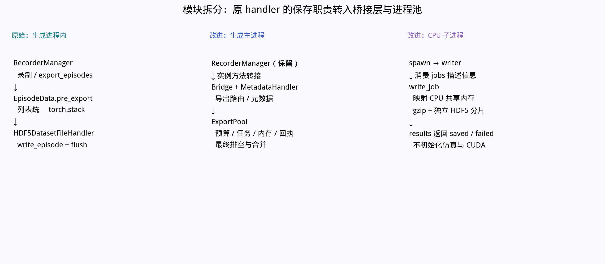

*图 1｜从左到右看：原来由生成主程序完成的保存工作，改成由主程序协调、CPU 保存助手执行。*

**先看三列，不必先记函数名。** 左列是原来的同步路径：记录好数据后，主程序继续完成整理和写文件。中列是改进后的主程序，它保留录制职责，并增加交接、排队和结果检查。右列是新开的保存助手，专门压缩并写入文件。

图里的 RecorderManager 是“录制器”，Bridge 是“交接入口”，ExportPool 是“保存任务协调者”，writer 是“保存助手”。这些名字分别对应一种职责：记录、交接、管理、执行。


代码虽然分成许多文件，但主要分工可以按下面五项理解。

| 部分 | 主要负责什么 |
| --- | --- |
| 任务程序 | 安排当前要做什么，判断何时进入下一步、何时结束 |
| 规划器 | 根据目标、机器人状态和障碍物，计算运动路线 |
| 仿真环境 | 执行动作，计算机器人和物体的变化 |
| 录制器 | 把执行过程按环境和任务分别记下来 |
| 保存模块 | 整理记录、压缩、写文件，并确认输出完成 |

前四项共同产生数据。保存模块接手已经录好的数据，把它变成可以使用的文件。

### 主程序与保存助手

当前实现中，生成工作的主要组织者是一个主程序。它可以管理多个虚拟环境，让多套任务一起推进；这并不意味着每个环境都有一个完全独立的主程序。环境之间仍有协调和等待，例如动作准备好后才一起推进仿真。

改进版另外启动了专门保存数据的后台程序，可以把它们看作“保存助手”。它们负责压缩和写文件。机器人运动规划等计算仍由原来的生成部分组织，保存助手不负责计算运动路线。

## 04 为什么要把保存交给后台

原来的做法是：一次任务需要导出时，生成主程序自己把数据整理、压缩并写入文件，完成这次保存后再继续推进生成。这叫同步保存。

这样做容易理解，但相机图像很多时，保存需要时间。主程序忙着保存，就会耽误后续生成。

改进后的做法是：主程序先准备好待保存的数据，交给保存助手，然后继续生成。助手在后台完成压缩和写文件。这叫异步保存，意思是生成工作不用每次都等保存工作全部做完。

### 对比两种工作方式

| 同步保存 | 异步保存 |
| --- | --- |
| 生成一条记录 | 生成一条记录 |
| 主程序完成保存 | 主程序把数据交给助手 |
| 保存后继续生成 | 主程序继续生成，助手同时保存 |

*这里只表示分工与先后关系，不表示实际耗时比例。*

> **为什么能提速**
>
> 生成和保存可以在同一段时间里进行。压缩和写文件仍然要花时间，只是其中一部分时间不再由生成主程序停下来等待。

交接也有成本。主程序仍要整理和复制数据；如果数据积压太多，它也必须等一等。因此，异步保存不等于主程序永远不会等待。

## 05 数据怎样交接与回收

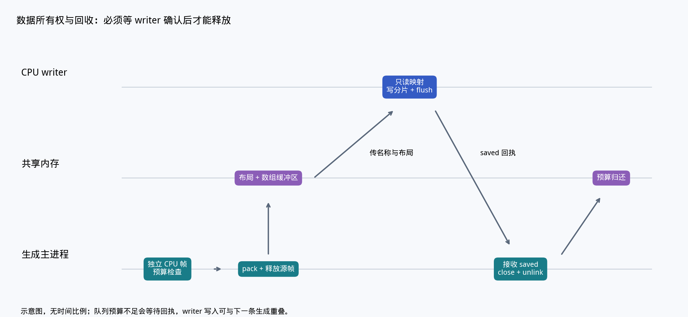

*图 2｜三条横线分别代表生成主程序、共用的临时存放区和保存助手。沿箭头看数据与通知怎样流动，箭头长度不表示耗时。*

从左下方出发：主程序准备数据，放进中间的临时存放区；保存助手根据位置说明读取数据并写文件；写完后通知主程序，主程序才释放对应空间。图中 saved 就是“已写完”的通知。


### 共用临时存放区

主程序和保存助手之间，需要有一块双方都能读取的临时存放区，叫共享内存。

主程序把待保存的数据放进去，再给助手一张“说明单”：数据在哪里、有哪些类别、每类有多少内容、该保存成哪条记录。助手按说明单找到数据并写入文件。这样，任务通知里传递的是位置和说明，不必把整段图像都塞进通知消息。

### 确认写完后再回收空间

在助手确认写完之前，主程序不能清掉这块存放区，否则助手可能读不到完整数据。收到写完的通知后，主程序才回收空间，留给后面的记录使用。

临时存放区有容量限制。生成比保存快时，待保存数据会越积越多；达到限制后，主程序会暂停提交，等助手腾出空间。这是为了防止内存被不断增长的数据占满。

### 分清三个完成时刻

多个助手各自写自己的临时文件，避免同时修改同一个输出文件。整批任务结束后，主程序还要等剩余数据写完，再检查并合并这些文件。

所以，完成有三个不同的时刻：

1. **交接完成**：数据已经交给助手，但可能还没写入文件。
2. **单条保存完成**：助手确认这条记录已经写入自己的文件。
3. **整批输出就绪**：剩余保存、文件合并和相关收尾都已完成。

实验比较总耗时时，应比较第三个时刻。否则，可能只是更早把工作交了出去，最终文件却还不能用。文件保存完成后，还要检查任务结果是否合格；“写成功了”和“机器人做得合格”是两件事。

## 06 三种实现版本到底有什么区别

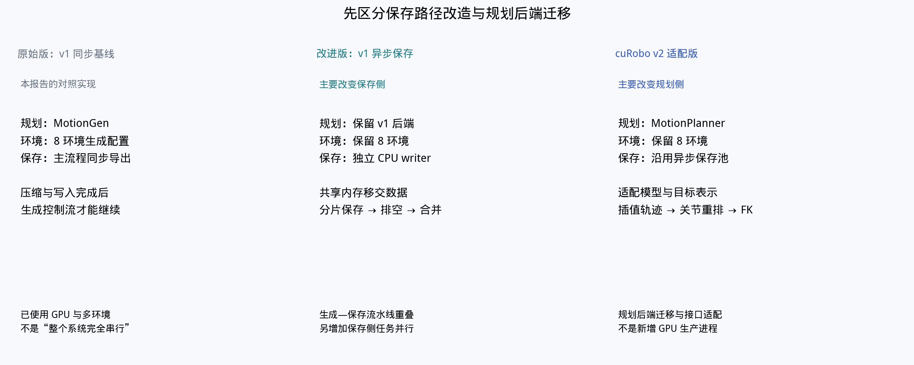

*图 3｜三列对应三种测试实现。先看“规划”和“保存”两行：第一次改保存，第二次改规划。图中的 8 环境属于历史主实验；后文 4 环境配对单列。*


| 实现版本 | 运动路线由谁计算 | 数据怎样保存 | 核心变化 |
| --- | --- | --- | --- |
| v1 同步基线 | cuRobo v1 规划器 | 生成主程序自己保存，写完再继续 | 用作比较的原有保存方式 |
| v1 异步改进版 | 仍用 cuRobo v1 | 后台助手保存，生成可以继续 | 改变生成和保存的分工 |
| v2 适配版 | 换成 cuRobo v2 | 继续使用后台保存 | 更换规划软件，并处理输入输出差异 |

cuRobo 是这里使用的机器人运动规划软件。v1 和 v2 指它的两代接口与实现。

### 第一次改动 把保存工作交出去

从同步基线到异步改进版，可以理解为“导航软件保持原样，增加专门整理和存档的人”。这一轮主要解决保存耽误生成的问题，同时调整数据在内存中的存放和释放方式。

### 第二次改动 更换计算路线的软件

从 v1 异步版到 v2 适配版，则是“保留已有存档分工，更换导航软件”。新软件接收的目标描述和返回的路线格式发生了变化，所以中间还需要一层转换。

举例来说，两套软件可能采用不同的关节排列顺序，或用不同的参考位置描述目标。转换层需要把这些含义对齐，再把新规划器的结果交给原任务执行。因此，迁移不只是更改软件名称，也要重新检查机器人是否正确完成任务。

原来的 v1 已经使用 GPU，也能运行多个仿真环境。GPU 是擅长同时处理大量计算的处理器。异步保存新增的是 CPU 上的保存助手，不能理解为直到 v2 才开始使用 GPU 或多环境。

## 07 保存助手的数量怎样控制

这几个名字说的是“最多允许多少个保存助手、什么时候增加助手”，不代表机器人任务或规划器换了版本。

- **cap4**：保存助手最多开到 4 个，按需要启动。
- **cap8**：最多开到 8 个，不保证一定启动 8 个。
- **auto**：结合待保存任务和计算机资源情况，决定是否增加助手。本轮实现只按条件扩容，不会主动减少已经启动的助手。

> **上限不等于实际数量**
>
> 历史实验里，三种异步配置实际都启动了 **4 个助手**。因此，cap8 的结果不能解读为“8 个助手比 4 个助手更快”。

还要区分两类数量：环境数决定同时管理多少套虚拟场景，助手数决定有多少后台程序处理保存。增加保存助手，不会自动增加虚拟机器人。

## 08 实验一 保存改造有没有让整批数据更快可用

### 先明确比较条件

这组历史实验使用 **8 个虚拟环境、seed 101、每组保存目标 16 条**，规划软件都使用 cuRobo v1，只比较同步保存和三种异步保存配置。seed 是用于控制随机过程的编号，便于在相近条件下重复任务。各配置只有一轮记录。

图中的“最终就绪时间”从第一条任务开始算起，一直算到后台保存和收尾完成、最终文件可用。“吞吐”表示平均每分钟得到多少条记录：数值越大，同样时间内产出的数据越多。

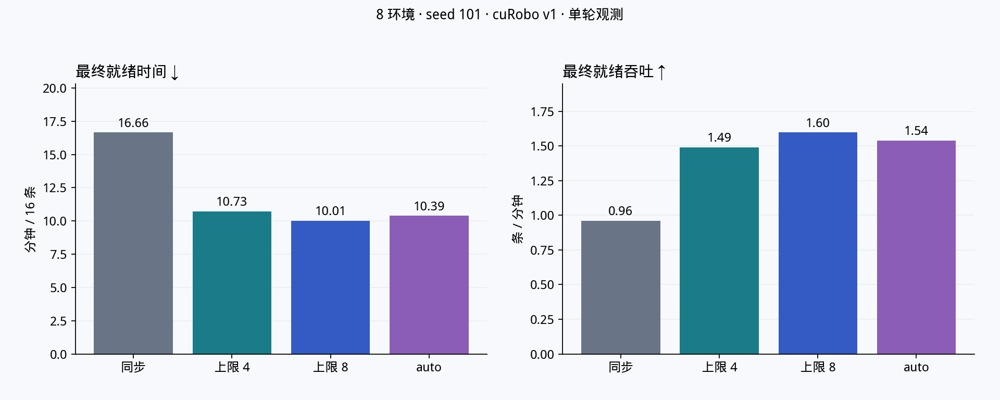

*图 4｜左图越低越好，右图越高越好。两图从不同角度描述同一批数据的生产效率。*

| 保存方式 | 实际保存助手数 | 整批就绪时间 | 每分钟保存条数 | 保存记录的末态通过数 |
| --- | ---: | ---: | ---: | ---: |
| 同步保存 | 0 | 999.35 秒 | 0.961 | 16 / 16 |
| 上限 4 | 4 | 643.71 秒 | 1.491 | 16 / 16 |
| 上限 8 | 4 | 600.82 秒 | 1.598 | 16 / 16 |
| auto | 4 | 623.65 秒 | 1.539 | 16 / 16 |

**先看同步与异步的差距。** 同步保存需要约 16.66 分钟，三种异步配置约为 10.01～10.73 分钟。以 auto 为例，同样保存 16 条，整批耗时减少约 **37.6%**，每分钟产出提高约 **60.2%**。耗时下降比例和产出提升比例的分母不同，所以这两个百分比不相等。

**再看三种异步配置之间的差距。** 本轮上限 8 最快，但三个配置实际都只开了 4 个助手，而且没有重复试验。因此，这张图支持“异步整体实现对本任务有效”，还不足以证明“cap8 总是最好”或“助手越多越快”。

### 速度提高后 数据质量有没有下降

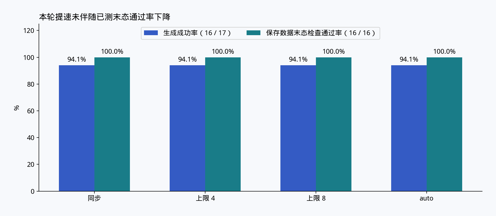

*图 5｜蓝色统计任务尝试的成功情况，绿色统计已保存记录的末态检查，二者分母不同。*

每组都完成了 17 次任务尝试，其中 16 次被记录为成功；保存下来的 16 条记录，又全部通过了本报告采用的末态检查。末态是任务结束时的状态，例如物体是否仍在明显转动。

这说明本轮没有观察到保存改造导致已测末态质量下降。它不代表每次尝试都成功，也不代表其他任务或更大规模下的所有质量要求都已验证。

> **这组实验回答的问题**
>
> 在当前任务和检查标准下，异步保存让合格数据更快可用；具体哪项内部改动贡献了多少收益，还不能从这组整体对比中拆出来。

## 09 为什么更快 结合代码分工看时间去了哪里

### 主程序少等了什么

回看图 1 的模块分工：同步版由生成主程序完成压缩和写文件；异步版把其中一部分工作交给保存助手。下面的分段计时可以帮助理解这一变化。

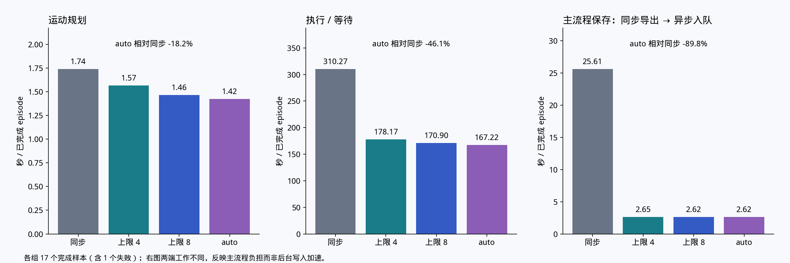

*图 6｜历史 8 环境实验；每个阶段按完成的任务取平均。这些阶段均值不能相加当作整批总时间。*

最右侧最直观：同步导出平均约 **25.61 秒**，auto 的提交平均约 **2.62 秒**。前者包含主程序亲自保存数据的工作；后者主要是准备数据并交给后台。**这不是把同样的完整写盘工作从 25.61 秒加速到 2.62 秒，而是主程序不再等它全部做完。**

中间的执行与等待也明显缩短。这个区间不仅包括机器人运动，还可能包含多个环境之间的等待和其他主流程工作。主程序少被保存占住后，后续动作有机会更早推进；不能把整个下降都称为“物理仿真加速”。

左侧规划时间也有变化，但 v1 规划后端没有因此换成新算法。仅凭单轮阶段均值，不能认定规划器自身得到了相同比例的优化。

### 为什么生成结束后还要等

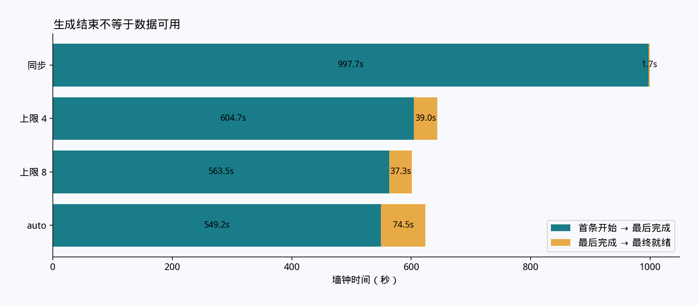

*图 7｜绿色是首条任务开始到最后任务完成，黄色是之后到最终文件就绪的等待和收尾。*

| 保存方式 | 生成阶段结束 | 之后的收尾 | 最终就绪 |
| --- | ---: | ---: | ---: |
| 同步保存 | 997.67 秒 | 1.68 秒 | 999.35 秒 |
| auto | 549.17 秒 | 74.48 秒 | 623.65 秒 |

同步版在生成过程中已经完成大部分保存，所以最后剩下的工作很少。auto 让生成提前结束，但后台还有记录要写完，随后还要合并文件和关闭环境。

因此，auto 的黄色部分更长，并不推翻整体提速：绿色加黄色仍然明显短于同步版。它提醒我们，**比较效率必须看整条柱子的终点，不能只看机器人什么时候做完。**

图 2 中“写完后回收空间”的通知，以及主程序最后等待、合并的步骤，正是这些收尾成本对应的代码职责。

## 10 实验二 用更细的计时检查原因

### 这是一组独立的配对实验

2026 年 10 月 15 日，在同一张 RTX 5090 上依次运行 v1 同步保存和 auto 保存。这里使用 **4 个环境、seed 101、每组目标 8 条、60 个最终保持步**，并加入更细的内部计时。最终保持步是任务结束前继续推进仿真、观察物体是否稳定的一段时间。

这组实验的规模和计时方式与前面的 8 环境实验不同，应在组内比较，不能直接把两组耗时排成同一张快慢榜。

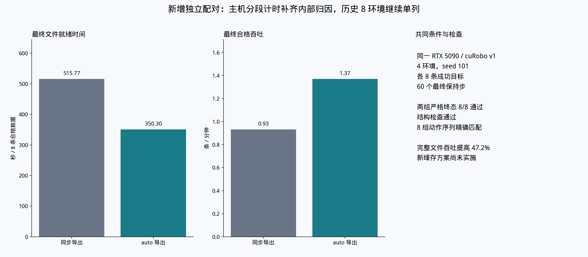

*图 8｜两组都通过 8 / 8 的结构与严格末态检查，8 组完整动作序列精确匹配。*

| 指标 | 同步保存 | auto 保存 |
| --- | ---: | ---: |
| 最终文件就绪 | 515.77 秒 | 350.30 秒 |
| 每分钟合格记录 | 约 0.93 条 | 约 1.37 条 |
| 严格末态通过数 | 8 / 8 | 8 / 8 |

auto 的整批时间减少约 **32.1%**，合格数据产出提高约 **47.2%**。动作序列匹配意味着两组执行了对应一致的动作序列，减少了“只是动作任务不同”这一解释的空间；它不等于已经证明所有图像逐像素相同。

### 相机占比变大 为什么不一定是相机变慢

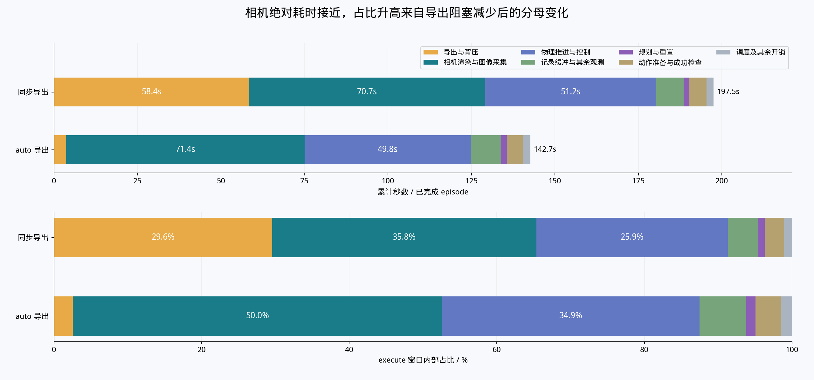

*图 9｜上半图看实际秒数，下半图看占比。先看秒数，再看占比，才能判断哪部分真正变快或变慢。*

| 环节 | 同步平均耗时 | auto 平均耗时 | 怎样理解 |
| --- | ---: | ---: | --- |
| 导出及容量不足时的等待 | 58.41 秒 | 3.64 秒 | 主流程等待明显减少 |
| 相机相关工作 | 70.72 秒 | 71.41 秒 | 绝对耗时接近 |
| 物理推进与控制 | 51.20 秒 | 49.80 秒 | 绝对耗时接近 |
| 整个执行区间 | 197.53 秒 | 142.71 秒 | 平均减少约 54.82 秒 |

执行区间减少约 54.82 秒，其中导出相关减少约 54.77 秒。这组计时更直接地支持了“减少保存对主流程的阻塞”这一解释。

相机时间却基本不变。由于整个执行区间缩短了，它的占比从约 **35.8%** 上升到 **50.0%**。可以把它想成一张账单：住宿费减少后，餐费占总支出的比例会变大，即使餐费本身没有增加。

这些秒数描述主程序经历的调用和等待区间，并非对 GPU 各项计算的单独计时。多个环境的执行区间还会重叠，不能将它们累加成整批耗时。

> **这组图带来的判断**
>
> 保存等待已经大幅减少，接下来更值得检查相机相关工作。继续只增加保存助手，未必能解决剩余的主要耗时。

## 11 实验三 换成 v2 规划软件后怎样

这一组保留 auto 异步保存，把规划软件从 v1 换成 v2。对照图 3，可以理解为“保存分工保留，计算运动路线的软件发生变化”。

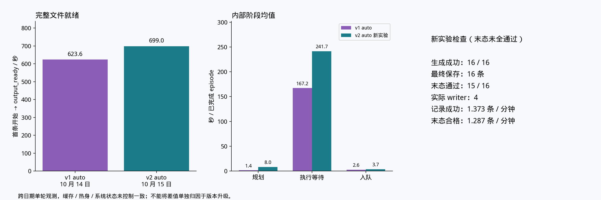

*图 10｜v1 在 2026 年 10 月 14 日运行，v2 在 10 月 15 日运行；这是跨日期单轮比较。*

| 指标 | v1 auto | v2 auto |
| --- | ---: | ---: |
| 最终就绪时间 | 623.65 秒 | 699.05 秒 |
| 保存条数 | 16 | 16 |
| 严格末态通过数 | 16 / 16 | 15 / 16 |
| 每分钟保存记录 | 1.539 条 | 1.373 条 |
| 每分钟末态合格记录 | 1.539 条 | 1.287 条 |

**这次运行没有表现出 v2 的速度优势。** 它保存了相同数量的记录，但用时更长；其中一条还未通过角速度末态检查，即任务结束时的转动状态没有达到该项要求。

这也解释了为什么要同时看“保存条数”和“合格条数”。只看文件里的记录数量，两版都是 16 条；考虑质量后，本轮实际可计入该严格标准的产出不同。

不过，两次运行不在同一天，缓存、热身和系统状态没有控制一致，缺少重复配对。因此，目前可以说“v2 适配完成过整轮运行，但尚未证明效率和质量优势”，不能据此断定 v2 在所有任务上更慢。

## 12 下一步优化该看哪里

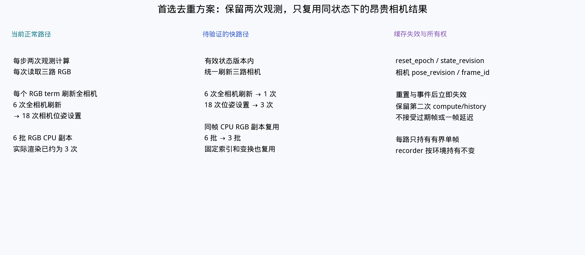

*图 11｜这是根据代码和内部计时提出的方案，还没有实施后的性能结果。*

前面图 9 表明，auto 路径中相机相关工作约占执行区间的一半。进一步拆分后，相机位置与朝向更新约占 **25.32%**，实际渲染约占 **20.30%**，显式 RGB 图像复制约占 **2.91%**；这些比例都以 auto 的执行区间为分母。

相机位置与朝向，决定它从哪里、朝哪个方向看场景。当前路径在一次正常仿真推进中可能多次刷新同一状态下的全部相机信息。图中提出的第一步，是确认场景状态没有变化时，复用已经算好的结果，减少重复计算。

第二步是检查同一张已经准备好的图像，能否供多次读取使用，减少重复复制。这里必须保证图像和机器人状态对应同一时刻；场景重置或相机位置变化后，要及时重新计算，不能为了速度使用过期画面。

图中“6 次变 1 次”“6 批变 3 批”描述的是目标调用次数，不是已经测得的整批提速。是否有效，需要分别启用每项改动，检查质量后，再比较最终文件就绪时间。

## 13 把结构图和实验结果连起来

| 代码做了什么 | 图中看到了什么 | 目前可以怎样判断 |
| --- | --- | --- |
| 保存助手接手压缩与写入 | 图 4 整批耗时下降，图 6 主流程提交区间缩短 | 异步整体实现改善了本任务效率 |
| 保存完成后回收空间，末尾等待并合并 | 图 7 异步版仍有收尾时间 | 交接完成不能当作输出就绪 |
| 对执行区间加入更细的计时 | 图 9 主要减少的是导出相关等待 | 这组配对支持减少阻塞的解释 |
| 保留保存方式，更换规划软件 | 图 10 v2 本轮更慢且末态通过 15 / 16 | 迁移跑通，收益仍待验证 |
| 尝试复用相机重复计算的结果 | 图 11 是设计方案 | 必须经过新实验才能判断收益 |

**当前最清楚的进展是保存方式改造带来的效率改善。** 数据仍然按一次任务组织，规划、仿真、录制仍在生成侧配合完成；新增加的后台分工减少了主程序等待保存的时间。规划软件迁移和相机复用方案，则分别处于“已跑通但优势未建立”和“待实施验证”的阶段。

---

## 附录 数据来源与阅读方式

本文沿用 v015 的历史实验和冻结代码证据，没有新增仿真运行。v020 是本文档的修订号，与规划软件 v1、v2 无关。

- [8 环境历史实验数据](evidence/data.csv)
- [v1 与 v2 对照数据](evidence/backend-comparison.csv)
- [4 环境内部耗时与优化方案原文](evidence/acceleration-analysis.md)
- [代码结构证据](evidence/code-structure-evidence.md)
- [规划接口证据](evidence/interface-evidence.md)
- [原始实验图册 PDF](evidence/v015-charts.pdf)

图 1～3 是代码机制示意，没有按耗时比例绘制；图 4～10 来自已有运行记录；图 11 是待验证方案。正文涉及的“成功”“合格”和计时范围均按对应实验分别解释。

随附的 figures 文件夹包含全部插图。移动或分享本文时，请将 Markdown 文件与 figures、evidence 文件夹一起保留；打包文件已包含这些内容。evidence 中的原始说明保留了原报告的相对链接，深入查看其扩展资料时，请使用 v015 完整目录。
