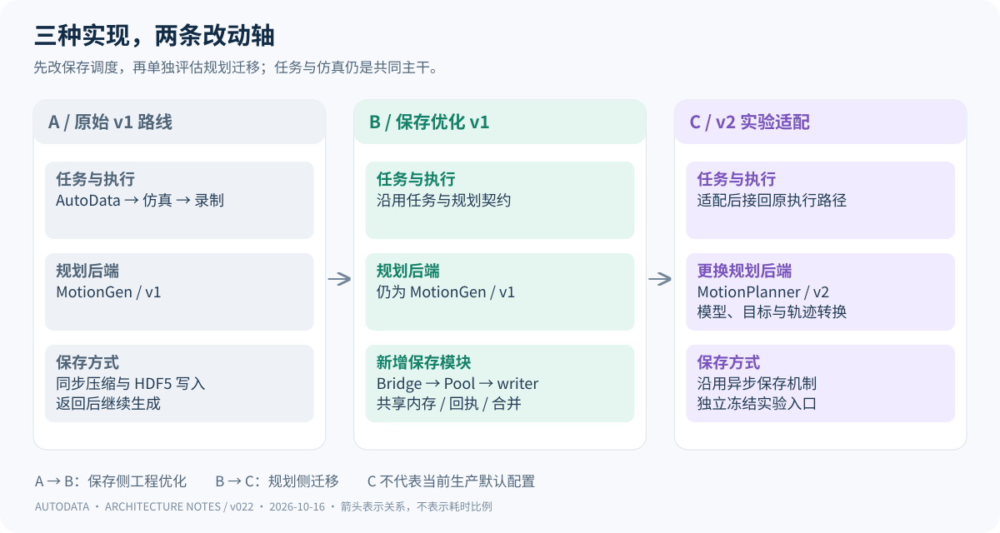
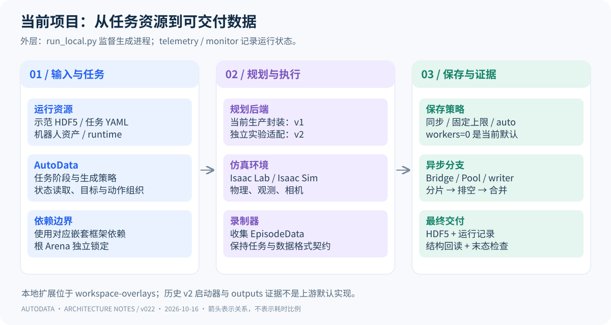
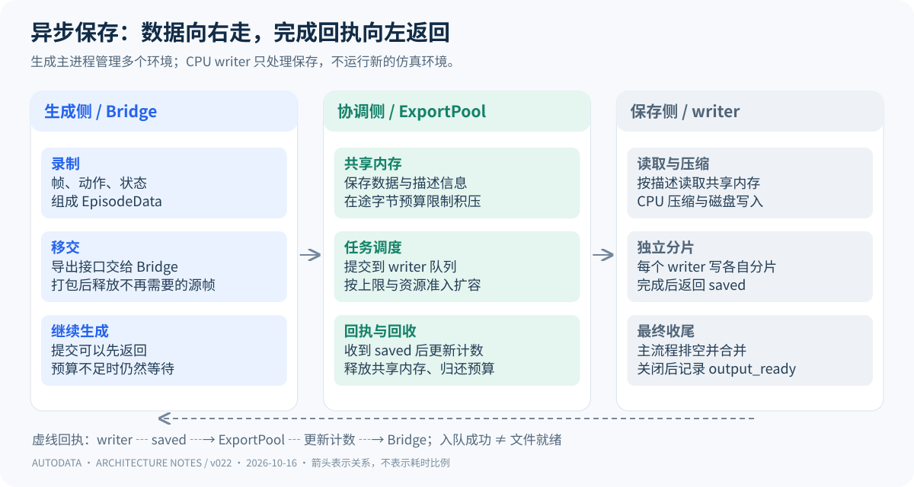
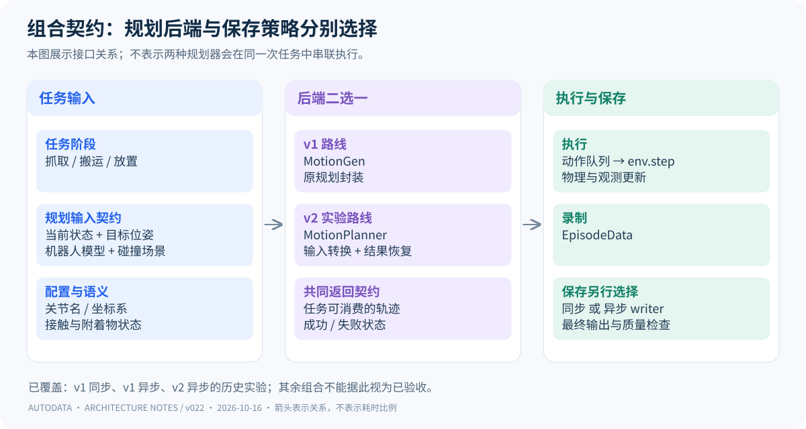

# AutoData 项目架构：从原始实现到当前组合

> 本文回答三个问题：原始实现是什么，代码优化改变了哪里，各模块如何组合成当前项目。这里的“架构”指数据生成软件架构，不是训练网络结构。实验正文见 [完整图册](charts.md)，规划库升级另见 [cuRobo v1 与 v2](curobo-v1-v2.md)。

## 01 · 先把三种实现放在同一张图上

从左到右看，项目一直要完成同一件事：读取示范与任务配置，生成机器人动作，在仿真中执行并录制，最终交付数据文件。原始实现已经使用 GPU 规划和多环境仿真；本次优化并不是把 CPU 系统改成 GPU 系统。

**第一步变化发生在保存侧。** 原始同步链路中，录制器导出数据时，生成控制流需要等压缩和 HDF5 写入返回。改进版保留任务与规划接口，在录制器后增加桥接层、共享内存和 CPU writer，使生成与保存可以重叠。保存成本依然存在，只是部分工作不再占住生成路径。

**第二步变化发生在规划侧。** v2 适配版更换规划库和输入输出转换，沿用异步保存设计。它没有取代 AutoData 的任务组织，也没有取代 Isaac Sim 的物理与渲染。因此，“保存优化有效”和“v2 更适合生产”必须分别检验。

| 对照项 | 原始 v1 路线 | 保存优化后的 v1 路线 | v2 实验适配路线 |
| --- | --- | --- | --- |
| 任务编排与示范来源 | AutoData / SkillGen | 沿用 | 沿用任务语义 |
| 规划接口 | MotionGen | MotionGen | MotionPlanner + 适配层 |
| 物理、观测与录制 | Isaac Lab / Isaac Sim | 沿用，并处理录制内存归属 | 继续接入原执行与录制链路 |
| 保存执行者 | 生成侧同步导出 | CPU writer 写分片 | 沿用异步保存机制 |
| 新增工程职责 | — | 预算、回执、排空、合并、监控 | 模型转换、目标转换、轨迹与坐标恢复 |
| 在本项目中的定位 | 对照基线 | 已有实验支持的生产优化路线 | 可运行的迁移研究路线 |

“原始”在这里指同步保存的基线路线，不表示历史实验完全没有任务兼容补丁。报告版本 v021/v022、cuRobo v1/v2、以及保存策略 sync/auto 是三个不同维度，不能混作一条版本号。

## 02 · 当前项目由哪些层组合而成

图的主线从任务输入走向数据输出，外层启动与监控负责让这条链路可配置、可观察、可收尾。各层通过配置、函数接口与数据对象连接，并不是把多个仓库复制成同一个代码目录。

**任务层决定做什么。** 示范 HDF5、SkillGen YAML、机器人资产和任务配置共同定义生成条件。AutoData 组织任务阶段，读取仿真状态，向规划器提交目标，再将动作交给执行链路。规划器只解决运动子问题，不负责定义整条数据生成任务。

**规划层决定怎么到达目标。** cuRobo 接收机器人状态、目标和碰撞场景，输出轨迹；AutoData 的规划封装把轨迹还原成任务可消费的形式。执行层推进环境，产生物理状态、相机观测与录制数据。规划成功并不等价于物体最终摆放合格。

**保存层负责可靠交付。** 录制器形成 EpisodeData；同步模式直接导出，异步模式把数据移交给 writer，最终由主流程完成核对和合并。只有输出就绪才算完成交付，提交到队列不代表已经保存成功。

| 位置 / 模块 | 具体作用 | 与其他模块的连接 |
| --- | --- | --- |
| `AutoData/` | 数据生成、任务阶段、规划接口与执行组织 | 读取任务输入，调用规划和仿真，驱动录制 |
| `AutoData/submodules/IsaacLab-Arena/` 及其 Isaac Lab | AutoData 锁定的场景与机器人环境依赖 | 按嵌套依赖关系提供运行框架 |
| 根目录 `IsaacLab-Arena/` | 另一条独立锁定的上游源码引用 | 不与 AutoData 内嵌 Arena 合并，也不能据同名认定可替换 |
| `openarm-production/prepare.py` | 从校验过的原始资源包准备独立 runtime | 提供任务资产与配置；不自动修复所有历史运行入口 |
| `run-local.sh`、`run_local.py` | 启动生成子进程、保存控制台和资源记录 | 在生成进程外监督退出与产物状态 |
| `generate.py`、`compat.py` | 接入当前上游入口与任务兼容处理 | 在运行时注入有锚点检查的适配逻辑 |
| `async_export.py` | 将录制器导出接口接到 Bridge | 把 EpisodeData 交给 ExportPool；按回执更新保存计数 |
| `export_pool.py` | 打包、共享内存预算、writer 调度与完成收尾 | 接收桥接层提交，管理分片与最终输出 |
| `export_governor.py`、`export_resources.py` | 资源准入、writer 上限与内存预算 | 约束保存侧扩容；不自动增加 GPU 或仿真环境 |
| `telemetry.py`、`monitor.py`、`validate_output.py` | 记录阶段与运行状态，检查输出与末态 | 提供证据；监控正常不等于质量检查通过 |
| 冻结的 `launchers/v2/v2_planner.py` | v2 规划接口适配 | 位于历史实验资源内，不是当前 production 的默认规划器 |
| `outputs/` | 图册、实验记录与版本证据 | 用于阅读和复核，不是运行时依赖安装目录 |

表中的 production 文件位于 `workspace-overlays/openarm-production/`。当前源码的 `--export-workers` 默认值是 `0`：保存优化已经可用，但需要显式选择正整数上限或 `auto` 才启用。不能把“推荐使用 v1 异步路线”写成“所有当前运行都默认异步”。

根仓库还保留 RLinf 的上游引用，但本次生成—保存调用链没有证据表明它参与执行，因此不将它画成必经模块。根仓库记录的 AutoData 基线为 `1c7360d…`，根 Arena 为 `9886659…`；本地工作树存在已有修改，锁定提交本身不能代表全部历史运行代码。

## 03 · 保存改造怎样嵌入原框架

沿实线看数据：录制器收集帧和状态，Bridge 接管导出入口，ExportPool 将待保存数据打包到共享内存，writer 根据描述读取数据并写入各自分片。沿虚线看回执：writer 返回 saved，主流程更新计数、释放共享内存并归还预算。生成完成后还要排空剩余任务、合并分片并关闭文件。

这里有两个释放时刻。源 CPU 帧在完成移交、后续不再需要时可以释放；共享内存必须等 writer 不再读取后才能回收。两者不能合并成“入队后全部释放”。预算不足时生成侧仍会等待，这种背压是防止内存持续增长的必要约束。

进程结构是“一个生成主进程管理多个仿真环境，多个 CPU writer 负责保存”，外面还有启动监督进程。历史 8 环境实验的三种异步配置实际均启动 4 个 writer。环境数、writer 数和 GPU 数不是同一个参数。

原有批量动作队列依然存在：动作凑齐后执行批量 `env.step`，通过队列记账唤醒等待者。保存从主流程移走后，可以减少其他环境被连带阻塞的机会；但 `queue.join` 的等待也覆盖主循环正在完成的工作，不能直接将它称为 GPU 空闲时间。

## 04 · 哪些可以组合，哪些地方存在冲突

**架构上可组合，接口上需要适配。** 规划侧输出任务可用的轨迹，保存侧接收录制后的 EpisodeData，两项改动位于不同接口。因此 v1/v2 与同步/异步在概念上是两个选择维度。但现有实验主要覆盖 v1 同步、v1 异步、v2 异步；不能据此宣称所有组合均已验收。

| 边界 | 可能的冲突 | 当前处理与仍需注意的事项 |
| --- | --- | --- |
| Python 规划库 | v1、v2 使用相同 `curobo` 包名，却有不同 API | 按运行入口和冻结版本选择依赖；直接覆盖安装不能实现透明切换 |
| 机器人模型 | 关节排列、被动臂锁定、夹爪状态不同 | 按关节名字映射，保留锁定关节；v2 适配器预建夹爪开闭模型 |
| 坐标系 | 仿真世界坐标与机器人基坐标不同 | 目标和场景转换到规划坐标，结果恢复到任务需要的坐标 |
| 接触与附着物 | 抓取接触豁免、抓起后附着碰撞体的语义不同 | 适配层负责阶段性碰撞开关、附着与解除；不能全局关闭碰撞代替 |
| 轨迹 | 插值间隔、关节身份和末端输出契约改变 | 插值、重排、FK 与路径重采样后再交给原任务；重新检查实际末态 |
| 导出接口 | 提交数可能被误当作完成数 | 按 saved 回执更新保存计数；最终排空并核对输出 |
| 上游版本 | 运行时源码替换依赖精确锚点，录制兼容逻辑依赖内部实现 | 当前检查用于尽早报错，不保证以后升级自动兼容 |
| 多份框架 | 根 Arena 与嵌套 Arena 的版本、导入路径可能不同 | 保持各自锁定，按启动入口解析依赖；不合并同名目录 |

当前没有依据宣称“全项目不存在冲突”。可以确认的是，已有实现明确划定了连接点，历史实验覆盖了部分组合；新的依赖版本、任务资产和长时间生产仍需对应验证。历史共享配置入口缺少的任务文件，也不会因为 production 的独立 `prepare.py` 存在而自动恢复。

## 05 · 如何理解当前项目状态

当前项目由“上游生成与仿真框架 + 本地任务兼容和启动层 + 可选异步保存 + 监控验证 + 独立 v2 实验适配”组成。主线优化是让现有任务更高效地完成数据交付，规划升级则用于探索新的求解能力与后续任务范围。

从现有证据出发，保留 v1 作为对照与生产优化基础，继续使用已经测过的异步保存方案；v2 保留独立迁移入口，在质量与效率得到同协议验证后再考虑替换。这里是对现有证据的工程判断，不改变后面的实验记录，也不代表本次重新运行了 GPU 实验。

### 代码与证据入口

- [生产扩展说明](../../../workspace-overlays/openarm-production/README.md)、[启动与接入](../../../workspace-overlays/openarm-production/generate.py)、[桥接层](../../../workspace-overlays/openarm-production/async_export.py)、[保存池](../../../workspace-overlays/openarm-production/export_pool.py)。
- [当前 AutoData v1 规划封装](../../../AutoData/autodata_interfaces/motion_planners/curobo/curobo_planner.py)、[v2 冻结适配器](../../../AutoData/datasets/efficiency_20261014_201834/v2/launchers/v2/v2_planner.py)。
- [版本管理与当前运行边界](../../../docs/version-management.md)、[历史 v2 来源记录](../v014/v2-provenance.json)。历史适配器的完整路径和 SHA256 同时记录于本版 `verification.json`，不将其当作当前上游代码。
