# AutoData 项目架构：从原始实现到当前组合

> 本文回答三个问题：原始实现是什么，代码优化改变了哪里，各模块如何组合成当前项目。这里的“架构”指数据生成软件架构，不是训练网络结构。实验正文见 [完整图册](charts.md)，规划库升级另见 [cuRobo v1 与 v2](curobo-v1-v2.md)。

## 01 · 先把三种实现放在同一张图上

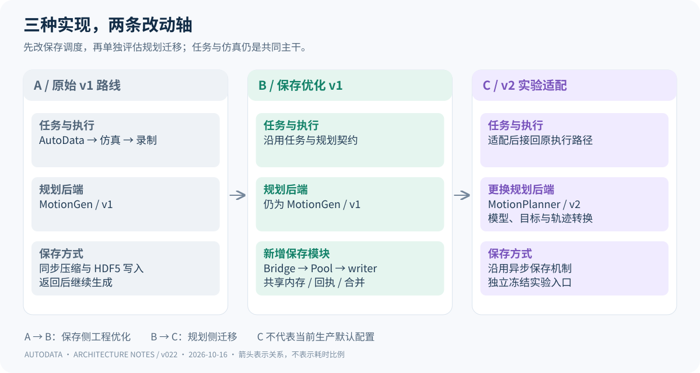

从左到右看，项目一直要完成同一件事：读取示范与任务配置，生成机器人动作，在仿真中执行并录制，最终交付数据文件。原始实现已经使用 GPU 规划和多环境仿真；本次优化并不是把 CPU 系统改成 GPU 系统。

**第一步变化发生在保存侧。** 原始同步链路中，录制器导出数据时，生成控制流需要等压缩和 HDF5 写入返回。改进版保留任务与规划接口，在录制器后增加桥接层、共享内存和 CPU writer，使生成与保存可以重叠。保存成本依然存在，只是部分工作不再占住生成路径。

**第二步变化发生在规划侧。** v2 适配版更换规划库和输入输出转换，沿用异步保存设计。它没有取代 AutoData 的任务组织，也没有取代 Isaac Sim 的物理与渲染。因此，“保存优化有效”和“v2 更适合生产”必须分别检验。

| 对照项 | 原始 v1 路线 | 保存优化后的 v1 路线 | v2 实验适配路线 |
| --- | --- | --- | --- |
| 任务编排与示范来源 | AutoData / SkillGen | 沿用 | 沿用任务语义 |
| 规划接口 | MotionGen | MotionGen | MotionPlanner + 适配层 |
| 物理、观测与录制 | Isaac Lab / Isaac Sim | 沿用，并处理录制内存归属 | 继续接入原执行与录制链路 |
| 保存执行者 | 生成侧同步导出 | CPU writer 写分片 | 沿用异步保存机制 |
| 新增工程职责 | — | 预算、回执、排空、合并、监控 | 模型转换、目标转换、轨迹与坐标恢复 |
| 在本项目中的定位 | 对照基线 | 已有实验支持的生产优化路线 | 可运行的迁移研究路线 |

“原始”在这里指同步保存的基线路线，不表示历史实验完全没有任务兼容补丁。报告版本 v021/v022、cuRobo v1/v2、以及保存策略 sync/auto 是三个不同维度，不能混作一条版本号。

## 02 · 当前项目由哪些层组合而成

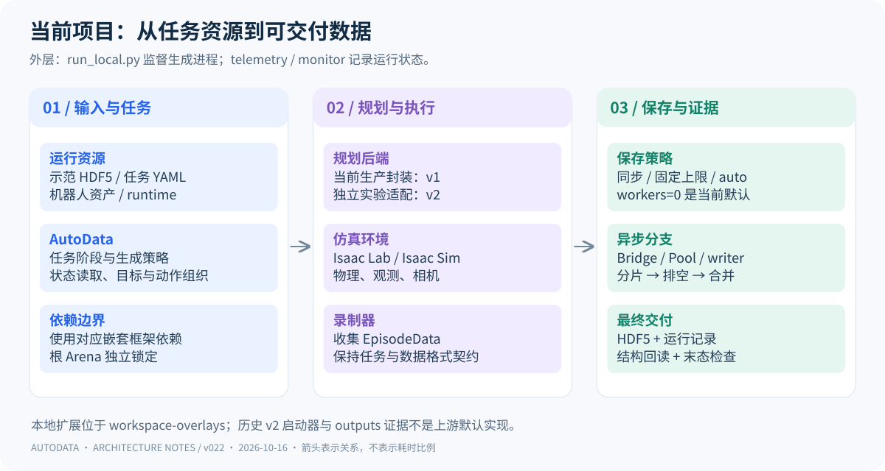

图的主线从任务输入走向数据输出，外层启动与监控负责让这条链路可配置、可观察、可收尾。各层通过配置、函数接口与数据对象连接，并不是把多个仓库复制成同一个代码目录。

**任务层决定做什么。** 示范 HDF5、SkillGen YAML、机器人资产和任务配置共同定义生成条件。AutoData 组织任务阶段，读取仿真状态，向规划器提交目标，再将动作交给执行链路。规划器只解决运动子问题，不负责定义整条数据生成任务。

**规划层决定怎么到达目标。** cuRobo 接收机器人状态、目标和碰撞场景，输出轨迹；AutoData 的规划封装把轨迹还原成任务可消费的形式。执行层推进环境，产生物理状态、相机观测与录制数据。规划成功并不等价于物体最终摆放合格。

**保存层负责可靠交付。** 录制器形成 EpisodeData；同步模式直接导出，异步模式把数据移交给 writer，最终由主流程完成核对和合并。只有输出就绪才算完成交付，提交到队列不代表已经保存成功。

| 位置 / 模块 | 具体作用 | 与其他模块的连接 |
| --- | --- | --- |
| `AutoData/` | 数据生成、任务阶段、规划接口与执行组织 | 读取任务输入，调用规划和仿真，驱动录制 |
| `AutoData/submodules/IsaacLab-Arena/` 及其 Isaac Lab | AutoData 锁定的场景与机器人环境依赖 | 按嵌套依赖关系提供运行框架 |
| 根目录 `IsaacLab-Arena/` | 另一条独立锁定的上游源码引用 | 不与 AutoData 内嵌 Arena 合并，也不能据同名认定可替换 |
| `openarm-production/prepare.py` | 从校验过的原始资源包准备独立 runtime | 提供任务资产与配置；不自动修复所有历史运行入口 |
| `run-local.sh`、`run_local.py` | 启动生成子进程、保存控制台和资源记录 | 在生成进程外监督退出与产物状态 |
| `generate.py`、`compat.py` | 接入当前上游入口与任务兼容处理 | 在运行时注入有锚点检查的适配逻辑 |
| `async_export.py` | 将录制器导出接口接到 Bridge | 把 EpisodeData 交给 ExportPool；按回执更新保存计数 |
| `export_pool.py` | 打包、共享内存预算、writer 调度与完成收尾 | 接收桥接层提交，管理分片与最终输出 |
| `export_governor.py`、`export_resources.py` | 资源准入、writer 上限与内存预算 | 约束保存侧扩容；不自动增加 GPU 或仿真环境 |
| `telemetry.py`、`monitor.py`、`validate_output.py` | 记录阶段与运行状态，检查输出与末态 | 提供证据；监控正常不等于质量检查通过 |
| 冻结的 `launchers/v2/v2_planner.py` | v2 规划接口适配 | 位于历史实验资源内，不是当前 production 的默认规划器 |
| `outputs/` | 图册、实验记录与版本证据 | 用于阅读和复核，不是运行时依赖安装目录 |

表中的 production 文件位于 `workspace-overlays/openarm-production/`。当前源码的 `--export-workers` 默认值是 `0`：保存优化已经可用，但需要显式选择正整数上限或 `auto` 才启用。不能把“推荐使用 v1 异步路线”写成“所有当前运行都默认异步”。

根仓库还保留 RLinf 的上游引用，但本次生成—保存调用链没有证据表明它参与执行，因此不将它画成必经模块。根仓库记录的 AutoData 基线为 `1c7360d…`，根 Arena 为 `9886659…`；本地工作树存在已有修改，锁定提交本身不能代表全部历史运行代码。

## 03 · 保存改造怎样嵌入原框架

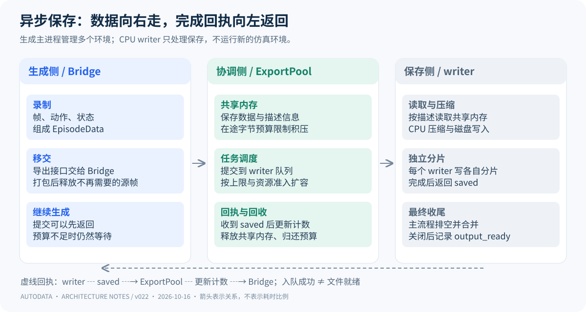

沿实线看数据：录制器收集帧和状态，Bridge 接管导出入口，ExportPool 将待保存数据打包到共享内存，writer 根据描述读取数据并写入各自分片。沿虚线看回执：writer 返回 saved，主流程更新计数、释放共享内存并归还预算。生成完成后还要排空剩余任务、合并分片并关闭文件。

这里有两个释放时刻。源 CPU 帧在完成移交、后续不再需要时可以释放；共享内存必须等 writer 不再读取后才能回收。两者不能合并成“入队后全部释放”。预算不足时生成侧仍会等待，这种背压是防止内存持续增长的必要约束。

进程结构是“一个生成主进程管理多个仿真环境，多个 CPU writer 负责保存”，外面还有启动监督进程。历史 8 环境实验的三种异步配置实际均启动 4 个 writer。环境数、writer 数和 GPU 数不是同一个参数。

原有批量动作队列依然存在：动作凑齐后执行批量 `env.step`，通过队列记账唤醒等待者。保存从主流程移走后，可以减少其他环境被连带阻塞的机会；但 `queue.join` 的等待也覆盖主循环正在完成的工作，不能直接将它称为 GPU 空闲时间。

## 04 · 哪些可以组合，哪些地方存在冲突

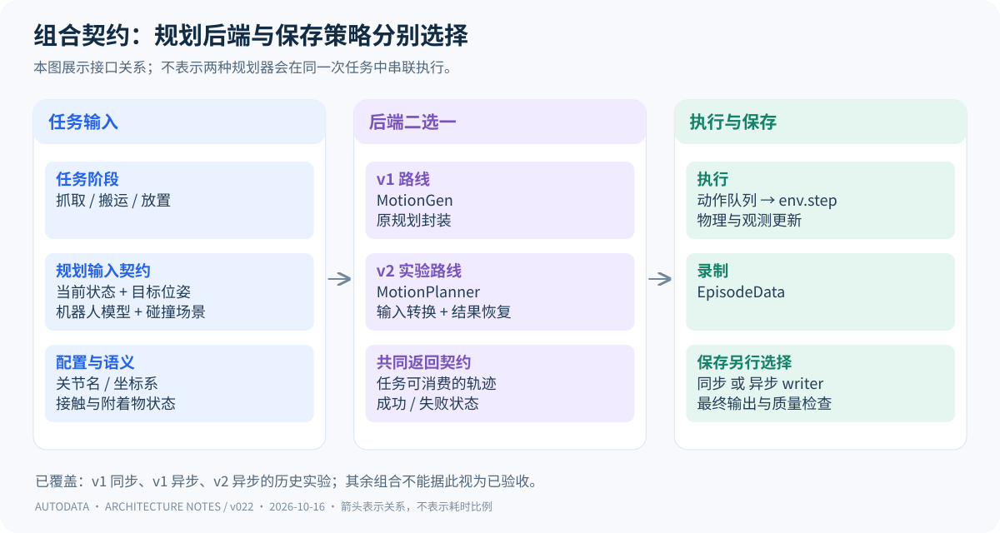

**架构上可组合，接口上需要适配。** 规划侧输出任务可用的轨迹，保存侧接收录制后的 EpisodeData，两项改动位于不同接口。因此 v1/v2 与同步/异步在概念上是两个选择维度。但现有实验主要覆盖 v1 同步、v1 异步、v2 异步；不能据此宣称所有组合均已验收。

| 边界 | 可能的冲突 | 当前处理与仍需注意的事项 |
| --- | --- | --- |
| Python 规划库 | v1、v2 使用相同 `curobo` 包名，却有不同 API | 按运行入口和冻结版本选择依赖；直接覆盖安装不能实现透明切换 |
| 机器人模型 | 关节排列、被动臂锁定、夹爪状态不同 | 按关节名字映射，保留锁定关节；v2 适配器预建夹爪开闭模型 |
| 坐标系 | 仿真世界坐标与机器人基坐标不同 | 目标和场景转换到规划坐标，结果恢复到任务需要的坐标 |
| 接触与附着物 | 抓取接触豁免、抓起后附着碰撞体的语义不同 | 适配层负责阶段性碰撞开关、附着与解除；不能全局关闭碰撞代替 |
| 轨迹 | 插值间隔、关节身份和末端输出契约改变 | 插值、重排、FK 与路径重采样后再交给原任务；重新检查实际末态 |
| 导出接口 | 提交数可能被误当作完成数 | 按 saved 回执更新保存计数；最终排空并核对输出 |
| 上游版本 | 运行时源码替换依赖精确锚点，录制兼容逻辑依赖内部实现 | 当前检查用于尽早报错，不保证以后升级自动兼容 |
| 多份框架 | 根 Arena 与嵌套 Arena 的版本、导入路径可能不同 | 保持各自锁定，按启动入口解析依赖；不合并同名目录 |

当前没有依据宣称“全项目不存在冲突”。可以确认的是，已有实现明确划定了连接点，历史实验覆盖了部分组合；新的依赖版本、任务资产和长时间生产仍需对应验证。历史共享配置入口缺少的任务文件，也不会因为 production 的独立 `prepare.py` 存在而自动恢复。

## 05 · 如何理解当前项目状态

当前项目由“上游生成与仿真框架 + 本地任务兼容和启动层 + 可选异步保存 + 监控验证 + 独立 v2 实验适配”组成。主线优化是让现有任务更高效地完成数据交付，规划升级则用于探索新的求解能力与后续任务范围。

从现有证据出发，保留 v1 作为对照与生产优化基础，继续使用已经测过的异步保存方案；v2 保留独立迁移入口，在质量与效率得到同协议验证后再考虑替换。这里是对现有证据的工程判断，不改变后面的实验记录，也不代表本次重新运行了 GPU 实验。

### 代码与证据入口

- [生产扩展说明](../../../workspace-overlays/openarm-production/README.md)、[启动与接入](../../../workspace-overlays/openarm-production/generate.py)、[桥接层](../../../workspace-overlays/openarm-production/async_export.py)、[保存池](../../../workspace-overlays/openarm-production/export_pool.py)。
- [当前 AutoData v1 规划封装](../../../AutoData/autodata_interfaces/motion_planners/curobo/curobo_planner.py)、[v2 冻结适配器](../../../AutoData/datasets/efficiency_20261014_201834/v2/launchers/v2/v2_planner.py)。
- [版本管理与当前运行边界](../../../docs/version-management.md)、[历史 v2 来源记录](../v014/v2-provenance.json)。历史适配器的完整路径和 SHA256 同时记录于本版 `verification.json`，不将其当作当前上游代码。

---

## 第 15 页 · 异步保存带来了多少最终产出收益

所属章节：三、v1 效率与耗时解释。

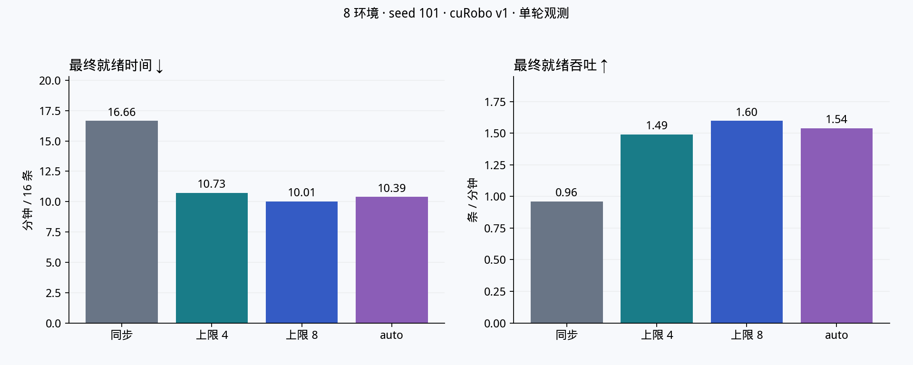

### 怎么做的

对历史 v1 四组使用相同的 16 条保存目标，读取从首条开始到最终输出就绪的时间，再换算为每分钟保存条数。同步组为基线，cap4、cap8 和 auto 均走异步保存。

### 这样做的意义

这是用户实际等待结果的指标，包含后台排空和合并，能够检验生成阶段省下的时间是否在收尾阶段又被消耗掉。

### 当前结论

这轮 8 环境实验中，异步组最终吞吐相对同步提高约 55%–66%，auto 提高约 60.2%。结果支持保存改造有效；各配置只有一轮且实际均为 4 writer，不能据此确定长期最优上限。

### 读图与术语

耗时减少比例与吞吐提高比例不同：相同产出下，吞吐与时间成反比，不要把两种百分比混用。

## 第 16 页 · 变快之后，数据仍然合格吗

所属章节：三、v1 效率与耗时解释。

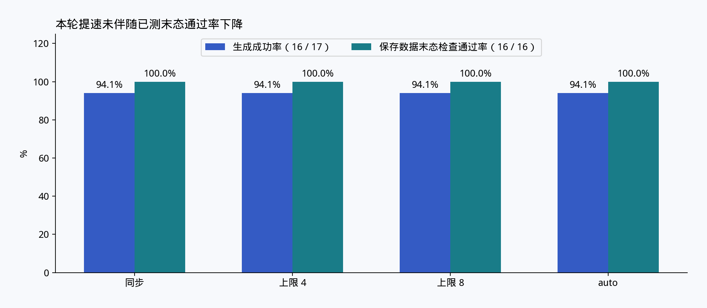

### 怎么做的

分别统计任务尝试结果、实际保存条数、HDF5 结构回读和严格末态检查。历史 v1 各组 17 个已完成 episode 中有 1 次生成失败，最终保存 16 条；16 条保存数据均通过末态检查。

### 这样做的意义

只有速度而没有质量约束，可能把提前结束或错误状态计为优化收益。将生成成功和保存后质量分开，才能判断获得的是否是可用训练数据。

### 当前结论

本轮 v1 各组保存数据均为 16/16 合格，支持观察到的效率收益没有伴随这些检查项退化。样本较小，不能推断所有场景的长期成功率；取消任务也需独立统计。

### 读图与术语

生成失败计入已完成尝试，但通常不进入成功保存集合；严格末态检查验证最终物理状态，文件结构检查验证数据格式。

## 第 17 页 · 为什么生成完成后还要继续等待

所属章节：三、v1 效率与耗时解释。

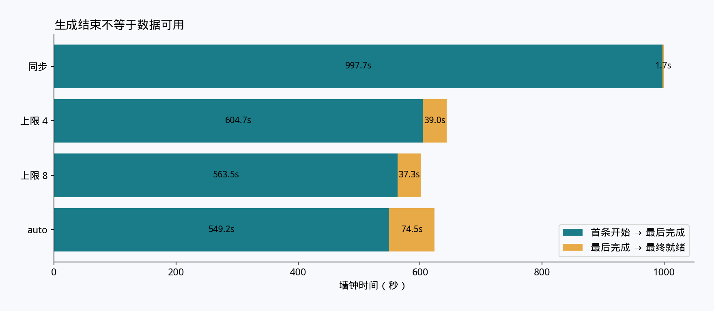

### 怎么做的

将整批时间分为最后一个已完成 episode 结束之前的生成窗口，以及其后到 output_ready 的尾段。尾段由剩余后台保存、分片合并和文件关闭等工作构成。

### 这样做的意义

异步保存将工作挪到后台，可以缩短生成阻塞，却可能留下更多收尾工作。观察尾段才能判断端到端收益，避免仅用“最后一条轨迹生成完”作为终点。

### 当前结论

历史 auto 本轮尾段约 74.48 秒，说明收尾值得继续拆分。它仍在最终吞吐上优于同步；一次较长尾段并不能证明 auto 策略必然导致较差收尾。

### 读图与术语

尾段按整批独占的墙钟区间计算；后台写入在生成窗口内已经进行的部分，不应再次全部相加。

## 第 18 页 · episode 阶段均值为什么会下降

所属章节：三、v1 效率与耗时解释。

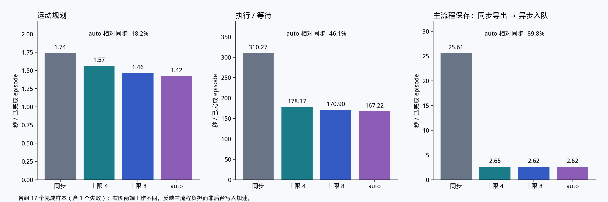

### 怎么做的

从历史已完成 episode 日志中分别取规划、execute、导出或入队等阶段，计算每组均值；v1 各组统计 17 个完成尝试，包括一次失败。异步入队与同步完整导出的工作范围在图中分别标注。

### 这样做的意义

整批收益需要用阶段变化解释。保存工作占用主控制流时，其他环境可能仍处于 execute 等待中；移走保存工作既能改变导出阶段，也可能缩短观察到的执行等待。

### 当前结论

同步导出均值约 25.6 秒，auto 入队约 2.6 秒，但后者还不包含后台写入完成。execute 均值的下降支持主循环受阻减少的解释；内部具体归因由第 29–32 页的插桩配对补充。

### 读图与术语

阶段均值用于比较同类区间；多个环境会重叠，不能将这些条形累计成整批最终时间。

## 第 19 页 · execute 计时到底覆盖什么

所属章节：三、v1 效率与耗时解释。

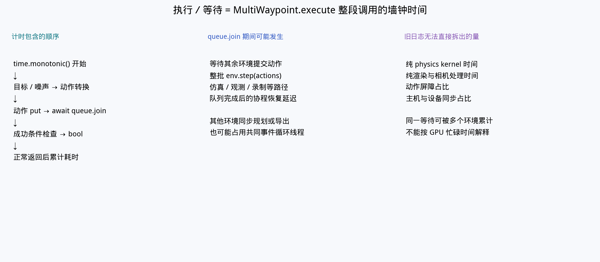

### 怎么做的

历史计时器包住整个 await execute 调用：准备或提交动作后，等待动作队列的完成条件。此时主循环可能在推进其他环境、调用物理、更新观测，甚至执行同步导出。

### 这样做的意义

先理解计时边界，才能回答“执行等待的大部分在做什么”。函数名中的 execute 不是单一物理内核，await 的经过时间也不是该协程独占 CPU 或 GPU 的时间。

### 当前结论

历史 execute 指标适合观察调用链延迟，却不能直接分解成 GPU 物理、渲染与空闲比例。新增插桩将主线程区间按实际操作归类，补上内部证据；queue.join 与内部工作不能重复相加。

### 读图与术语

await 表示当前协程可以挂起并交还调度权；等待期间其他任务可以继续工作。

## 第 20 页 · 是否通过少执行动作获得了加速

所属章节：三、v1 效率与耗时解释。

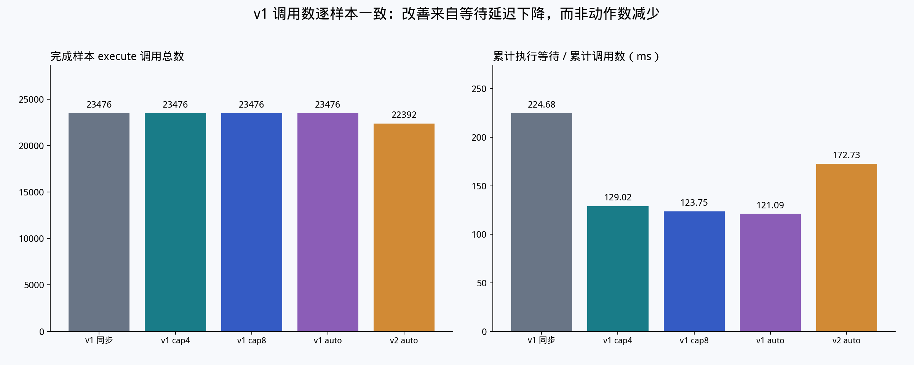

### 怎么做的

比较各组 execute 调用次数与累计耗时，再计算每次调用的平均经过时间。历史 v1 四组均有 23,476 次调用，并按各自已完成 episode 数量提供归一化对照。

### 这样做的意义

单看执行总时长下降，可能误以为机器人少走了步骤。调用次数提供工作量参照，有助于区分相同调用数量下延迟降低与执行数量减少。

### 当前结论

历史 v1 四组调用数相同，观察到的时间差主要体现为单次调用经过时间变化。相同次数仍不能证明轨迹、图像和物理末态完全一致；新增配对进一步验证了完整动作数组与末态。

### 读图与术语

v1 的 17 个完成尝试与 v2 的 16 个完成尝试统计范围不同；跨版本比较应同时读取分母和质量结果。

## 第 21 页 · 收益主要体现在典型调用还是慢窗口

所属章节：三、v1 效率与耗时解释。

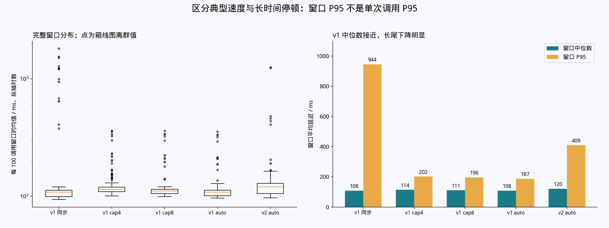

### 怎么做的

将连续 100 次 execute 调用组成窗口，计算每个完整窗口的平均延迟，再比较中位数和 P95。v1 每组有 225 个完整窗口，v2 有 216 个；不满窗口的尾部不混入同一口径。

### 这样做的意义

平均值会掩盖偶发阻塞。窗口分布可以观察生成是否经常被保存等慢操作拖住，并帮助判断优化改善的是稳定工作节奏还是极少数尖峰。

### 当前结论

历史 v1 的典型窗口均值约 108–114 毫秒；同步的慢窗口 P95 约 944 毫秒，auto 约 187 毫秒。差异提示异步保存主要缓解了较长停顿，但具体原因仍需内部计时对应。

### 读图与术语

这里 P95 是“100 次调用平均延迟”的第 95 百分位，不是单次动作延迟的 P95，也不表示整批 95% 时间。

## 第 22 页 · 未归类时间能否直接叫作渲染耗时

所属章节：三、v1 效率与耗时解释。

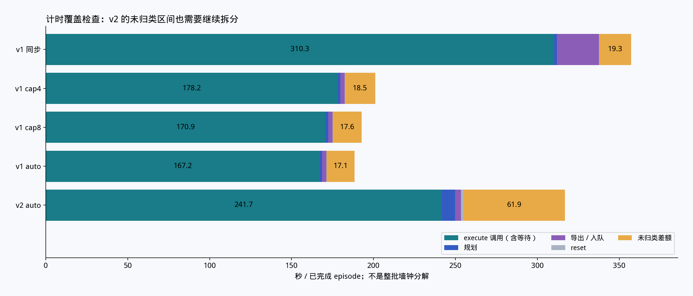

### 怎么做的

用每个 episode 总时长减去已记录阶段，核对计时覆盖范围，并将非负剩余单列为未归类差额。保持原始阶段数据不变，避免为了补齐总数而人为指定差额来源。

### 这样做的意义

计时覆盖检查可以发现遗漏环节，但只有差额大小还不能判断它属于 CPU、GPU、渲染、调度或其他等待。先把未知部分显示出来，才能决定下一轮需要加在哪里计时。

### 当前结论

历史 v2 约有 61.86 秒/episode 未归类，说明原计时不足以解释全部经过时间。新增 v1 插桩揭示了 v1 内部构成，却不能直接替历史 v2 差额命名；v2 仍需独立插桩。

### 读图与术语

图中 execute 已含等待；阶段覆盖率反映计时边界，并不是资源利用率。

## 第 23 页 · 异步保存仍然付出了哪些成本

所属章节：三、v1 效率与耗时解释。

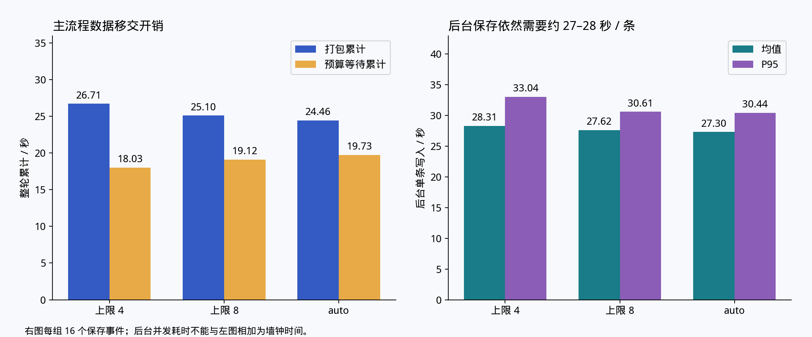

### 怎么做的

分别记录生产者打包、提交及预算等待，与 writer 后台压缩写入的耗时。前者发生在生成侧，后者可能由多个进程同时执行，也可能与后续轨迹生成重叠。

### 这样做的意义

异步不是把保存工作删掉，而是改变它发生的位置和时机。拆开这些成本，才能判断继续优化应面向主流程打包、积压控制，还是后台压缩与存储。

### 当前结论

历史后台单任务写入仍约 27–28 秒；生成侧提交变短可以与此同时成立。两侧累计时长不能直接相加成最终墙钟时间，预算等待也说明保存能力和内存容量仍会约束生成。

### 读图与术语

背压指下游处理不及时时，预算或队列限制让上游暂停；这是限制积压的机制，不等于写入失败。

## 第 24 页 · 把收尾拆成排空与合并

所属章节：三、v1 效率与耗时解释。

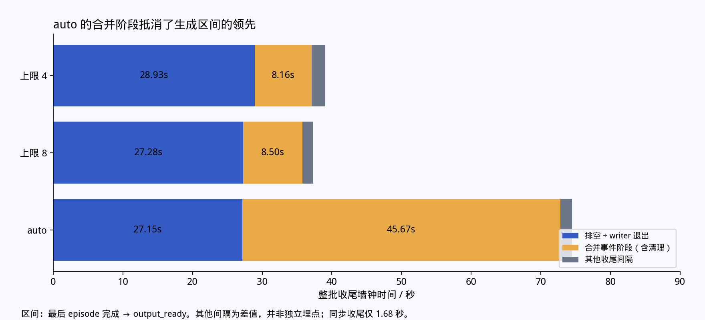

### 怎么做的

在最后一个已完成 episode 之后，继续记录剩余保存任务排空、HDF5 分片合并及关闭的时刻。通过这些整批边界区分“还在写”与“已经写完但最终文件尚未合成”。

### 这样做的意义

不同尾段原因需要不同优化：写入积压应检查保存能力和调度，合并较慢应检查数据复制与文件布局。只增加 writer 未必能缩短合并阶段。

### 当前结论

历史 auto 的较长尾段需要结合本轮积压与合并记录解释。当前能确认最终就绪必须包含这些工作，但尚未通过重复试验确认其稳定来源，不能据一次尾段给配置定性。

### 读图与术语

drain 指等待在途保存任务全部完成；merge 指将各 writer 的分片整理成最终输出。

## 第 25 页 · GPU 利用率能解释什么

所属章节：三、v1 效率与耗时解释。

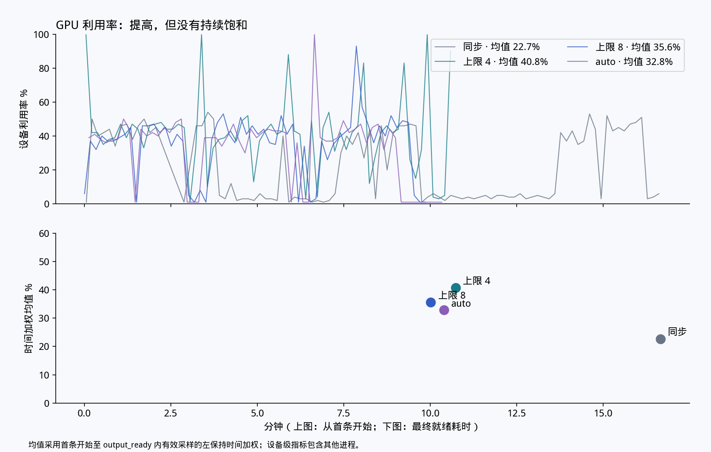

### 怎么做的

读取整轮资源采样中的设备 GPU utilization，按同一运行窗口汇总。历史 v1 同步、cap4、cap8、auto 的均值分别约为 22.7%、40.8%、35.6%、32.8%，并结合最终吞吐比较。

### 这样做的意义

GPU 利用率能提示设备获得工作的持续程度，但整轮还包含规划前处理、录制、保存和收尾。它适合发现供给不连续的线索，不能单独回答哪一个内核最慢。

### 当前结论

异步组平均 GPU 利用率高于同步，和生成受阻减少的机制一致；均值最高的配置却未必最终吞吐最高。当前指标不提供 SM 占用率、物理与渲染重叠，或纯 GPU 计算耗时。

### 读图与术语

设备利用率是采样窗口内 GPU 活动指标；SM 占用率是另一类内核执行指标，两者不能互换。

## 第 26 页 · GPU 为什么可能等主线程提供下一批工作

所属章节：三、v1 效率与耗时解释。

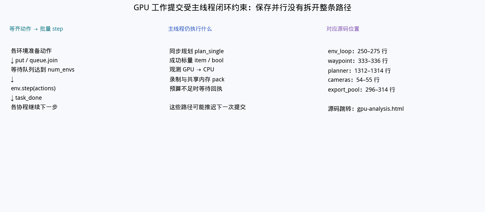

### 怎么做的

沿代码整理闭环：环境任务准备动作，主循环凑齐后批量步进，再更新观测，随后准备下一批动作。主机上的同步规划调用、状态读取、图像复制和保存打包都可能出现在闭环中。

### 这样做的意义

即使数值计算在 GPU 上并行，下一批输入仍需由主机组织。如果控制流停在 CPU 工作或同步读取上，设备可能得不到连续任务，因此加速不只取决于增加 GPU 算力。

### 当前结论

异步 writer 移走了闭环中的部分保存工作；相机位姿刷新、物理推进和渲染读取仍留在生成路径。该图说明依赖关系，实际空闲区间和引擎重叠需要 CPU/CUDA/图形时间线测量。

### 读图与术语

主线程是组织仿真与录制的 CPU 执行线程；同一线程中的同步工作会影响后续 GPU 工作的提交时刻。

## 第 27 页 · 一个控制步为什么出现多次相机操作

所属章节：三、v1 效率与耗时解释。

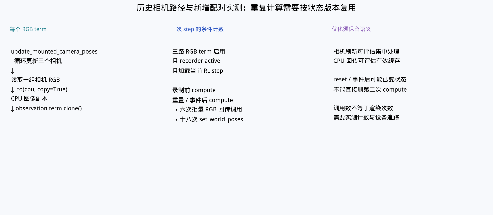

### 怎么做的

源码路径显示普通批量控制步有两次 observation.compute，每次访问三个相机观测项；每项位姿更新又遍历三台相机。新增配对计数核对到每步约 6 次整组位姿刷新、18 次 set_world_poses、6 次 RGB CPU 复制，实际渲染约 3 次。

### 这样做的意义

相机相关调用并非一一对应真正渲染。区分位姿提交、图像复制和实际渲染，可以优先查找重复主机工作，避免把所有相机调用都当作 GPU 渲染。

### 当前结论

计数支持检查同状态下的位姿与副本复用；是否能安全复用还要验证 reset、事件、相机变化及观测历史。不能直接删除第二次 observation.compute，也不能把计数减少预先当作等比例加速。

### 读图与术语

普通步的计数不含额外 reset 开销；“刷新整组相机”与“更新一台相机位姿”是不同计数单位。

## 第 28 页 · 如何把代码推测变成运行证据

所属章节：三、v1 效率与耗时解释。

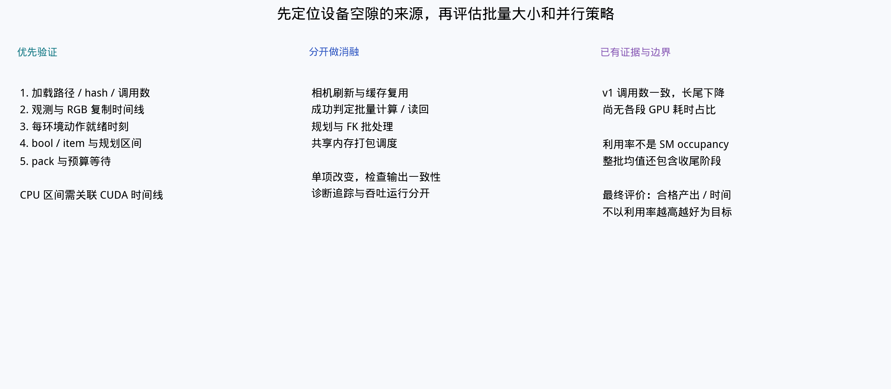

### 怎么做的

先核对实际加载文件和代码哈希，确认运行路径；再记录调用次数与主机耗时，定位重复工作；随后使用关联 CPU、CUDA 和图形事件的性能追踪，最后通过只改变一个因素的实验验证收益。

### 这样做的意义

源码说明可能执行什么，计数说明这次执行了多少，时间线说明在哪里等待，消融实验说明改动是否真正改善结果。把这几层串起来，可以减少依据函数名猜测瓶颈。

### 当前结论

目前已取得冻结代码、真实配对、调用计数及主线程内部归类；尚未取得证明 GPU 引擎实际重叠的追踪。下一步优先验证相机复用，再针对渲染与物理做设备追踪。

### 读图与术语

消融实验指每次只打开一个改动，并与相同基线比较；性能追踪本身有开销，应与正式吞吐测量分开运行。

## 第 29 页 · 新增配对如何保证比较公平

所属章节：三、v1 效率与耗时解释。

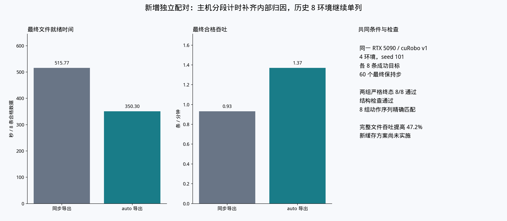

### 怎么做的

正式配对固定 v1、4 环境、seed 101、8 条保存目标和 60 步末态保持，仅对比原同步保存与改进 auto。两组冻结输入和代码来源，并回读文件，按完整动作数组匹配 8 条数据，同时检查结构及严格末态。

### 这样做的意义

内部计时需要有可解释的工作量。动作完全匹配、步数一致和质量通过，能排除少执行任务或提前结束等原因；独立保存这组结果，也避免与历史 8 环境数据混用。

### 当前结论

两组均 8/8 合格，最终就绪由 515.77 秒降至 350.30 秒，吞吐提高 47.2%。8 环境预试曾因内存不足终止，未进入正式结论；本页仅代表这组完成的 4 环境配对。

### 读图与术语

完整动作按集合匹配允许异步完成顺序变化；这不等于声明所有渲染像素逐位一致，图像复用仍需另做验证。

## 第 30 页 · 执行内部的大部分时间花在哪里

所属章节：三、v1 效率与耗时解释。

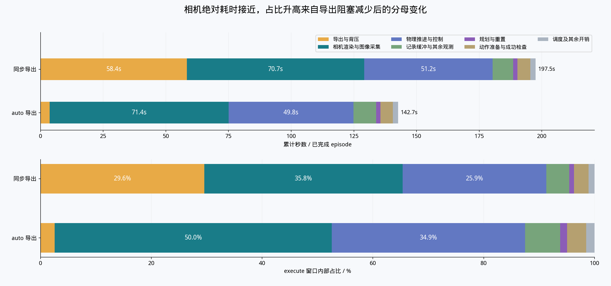

### 怎么做的

用主线程互斥计时区间归类物理、控制、相机、录制和保存工作，再按 episode 的 execute 窗口汇总。每组内部占比的分母都是该组 execute 均值；queue.join 另作为逻辑等待统计，不再次叠加。

### 这样做的意义

互斥归类避免嵌套函数重复计时，也能把“协程在等”转换成“主线程当时在做什么”。比较绝对秒数与百分比，可以区分真正加速和分母缩小造成的占比变化。

### 当前结论

execute 均值由 197.53 降至 142.71 秒；保存及背压由 58.41 降至 3.64 秒，解释了几乎全部净下降。相机由 70.72 到 71.41 秒，占比却由 35.80% 升至 50.04%，主要因为保存阻塞减少。

### 读图与术语

改进后相机约占一半，物理与控制约占 34.90%。这些是主机调用区间归类，不是 GPU 各引擎利用率。

## 第 31 页 · 物理、控制和相机分别在做什么

所属章节：三、v1 效率与耗时解释。

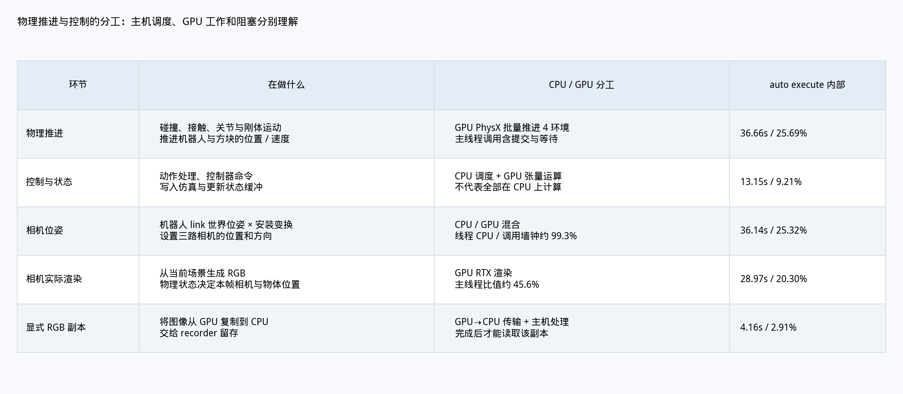

### 怎么做的

物理推进调用 GPU PhysX 更新关节与刚体运动、接触和约束；控制路径组织目标与动作、写入仿真并读取状态。相机路径刷新位姿、调用 RTX 渲染，再将 RGB 图像复制到 CPU 供录制。计时同时对照主线程 CPU 时间。

### 这样做的意义

一个 API 区间可以同时包含 CPU 提交、设备计算和同步等待。把功能与执行位置讲清，才能决定优化主机调用、重复读取，还是 GPU 内核；不能将整个物理区间都叫作纯 GPU 时间。

### 当前结论

改进后每 episode 物理 API 约 36.66 秒、控制等约 13.15 秒；位姿刷新 36.14 秒、渲染 API 28.97 秒、RGB 复制 4.16 秒。位姿区间主线程 CPU 时间约占 99.28%，应优先检查主机侧重复刷新。

### 读图与术语

物理与渲染区间 CPU 时间占比分别约 22.87%、45.58%；其余经过时间可能包含设备或其他等待，不能全部等同于 GPU 计算。

## 第 32 页 · 在 GPU 上并行，为什么仍要按步骤等待

所属章节：三、v1 效率与耗时解释。

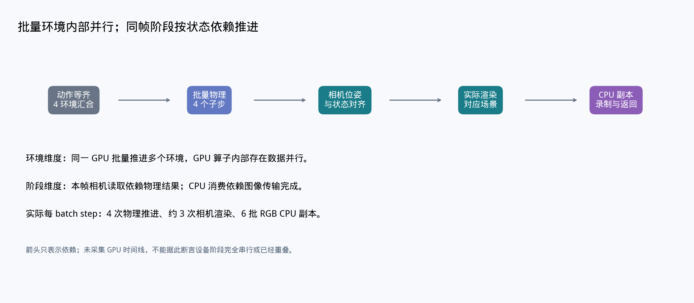

### 怎么做的

4 个环境由一次批量控制步共同推进；配置为 120 Hz 物理、4 次子步，对应 30 Hz 控制。正式运行计数为 2,778 次批量步进、11,112 次物理子步；普通步之后还有位姿、渲染和图像读取。

### 这样做的意义

环境之间可以数据并行，同一帧内部却有依赖：先得到新物理状态，才能正确更新相机并采集对应图像。GPU 并行并不取消这些因果顺序，CPU 也要组织和读取结果。

### 当前结论

当前代码和计数确认了批量物理与相机路径，但示意箭头不是设备追踪。是否能跨帧流水化、物理与渲染是否存在可利用的重叠，仍需验证数据对应关系及真实时间线。

### 读图与术语

物理子步比控制步更细；一条控制动作保持 4 个物理子步。改变子步数量会改变仿真协议，不能直接作为同条件加速。

## 第 33 页 · 优先尝试复用哪些相机工作

所属章节：三、v1 效率与耗时解释。

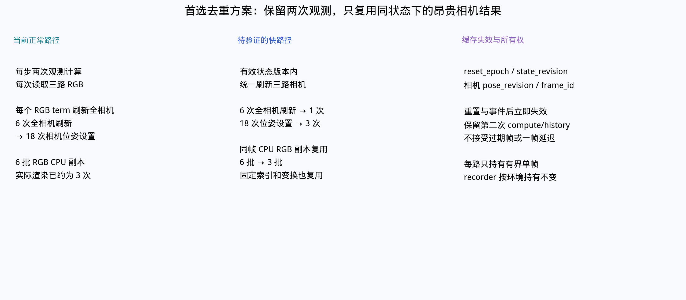

### 怎么做的

候选方案一是在同一物理状态下，将 6 次整组相机位姿刷新合并为一次；方案二让同状态 RGB 的 CPU 副本供两次观测读取复用，使普通步复制由 6 次降为 3 次。保留两次观测计算及历史更新语义。

### 这样做的意义

这两项针对已观测的重复主机工作，有机会减少开销而保持动作、帧率和分辨率。缓存必须绑定物理状态、reset、事件与相机状态，状态变化后立即失效。

### 当前结论

目前这是待实施、待消融的方案。应先做位姿去重，再单独测 RGB 复用和组合；只有逐帧对应、历史缓冲、末态与内存检查通过，才可将复用视为保持任务语义的优化。

### 读图与术语

缓存副本需保证读取期间不被后续帧覆盖，缓冲数量有界；仅按控制步编号判断相同状态可能漏掉 reset 或相机变化。

## 第 34 页 · 依据耗时和风险安排优化顺序

所属章节：三、v1 效率与耗时解释。

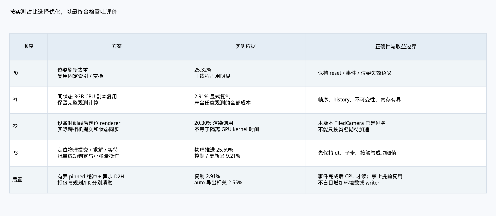

### 怎么做的

以改进后 execute 构成为基准，先检查占 25.32% 的位姿刷新与占 2.91% 的 RGB 复制；再追踪占 20.30% 的渲染 API、占 25.69% 的物理 API，以及约 9.21% 的控制与状态路径。

### 这样做的意义

优先级同时取决于占比、可消除的重复量和正确性风险。主机位姿去重有明确重复计数；渲染和物理虽大，却需要设备追踪确认真正瓶颈，不能简单按 API 名称估计收益。

### 当前结论

先进行相机复用消融，再决定是否投入渲染或物理优化。当前本地 TiledCamera 是 Camera 的弃用别名，仅换类名不会增加新的批量能力；分辨率、采样频率、物理步长和成功阈值变化应另设质量实验。

### 读图与术语

优先级不是收益承诺。异步 GPU→CPU 复制还需要完成同步与缓冲生命周期保证，当前复制占比较小，应排在位姿去重之后。

## 第 35 页 · 如何估计方案的条件收益

所属章节：三、v1 效率与耗时解释。

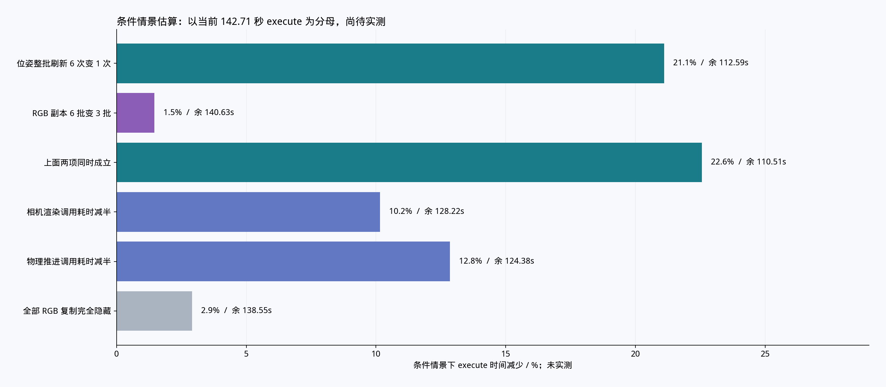

### 怎么做的

从改进后 execute 均值 142.706 秒出发，假设其余成本不变，按候选部分的可减少比例做算术扣减。例如位姿刷新耗时 36.136 秒，若 6 次降为 1 次且成本线性，则减少其中 5/6。

### 这样做的意义

条件估算用于判断实验是否值得做，也暴露收益依赖哪些假设。它不是预测器：调用合并可能存在固定开销，缓存会增加管理成本，最终排空和合并也未必同步缩短。

### 当前结论

该假设下，位姿去重使 execute 降至约 112.59 秒，减少 21.1%；再将 RGB 复制减半，降至约 110.51 秒，减少 22.6%。这些均未实测，不能换写成最终吞吐提高 21.1% 或 22.6%。

### 读图与术语

读图先看假设，再看扣减量。百分比的分母是 execute 均值，整批 output_ready 还有不同范围的工作与重叠。

## 第 36 页 · 下一轮怎样验证相机方案

所属章节：三、v1 效率与耗时解释。

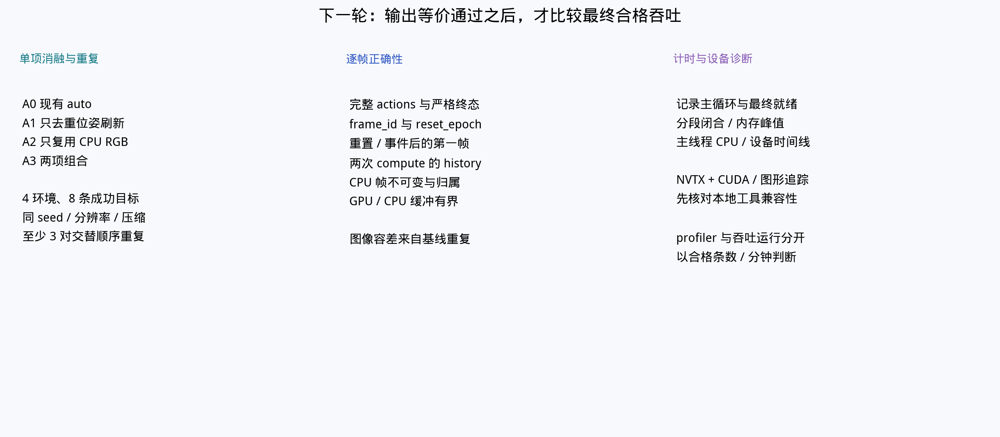

### 怎么做的

设置 A0 现有 auto、A1 仅位姿去重、A2 仅 RGB 副本复用、A3 两项组合。固定 4 环境、8 条目标、seed 101 及原任务配置，计划至少 3 组配对并交替运行顺序；正式计时与性能追踪分开。

### 这样做的意义

单独打开每个改动，可以判断收益来自哪一部分，以及组合后是否互相影响。交替和重复能减轻缓存、系统负载与运行顺序对结果的影响。

### 当前结论

这是后续实验协议，尚无 A1–A3 实测结果。验收需同时满足动作与步数匹配、严格末态和文件结构通过、逐帧图像及观测历史正确、reset 后缓存失效、内存有界，并比较最终就绪时间。

### 读图与术语

任何一项语义或质量检查失败，都需要修正方案后重跑；不能仅凭某个 API 计时下降宣布生产加速。

## 第 37 页 · 哪些是观测，哪些是机制解释

所属章节：三、v1 效率与耗时解释。

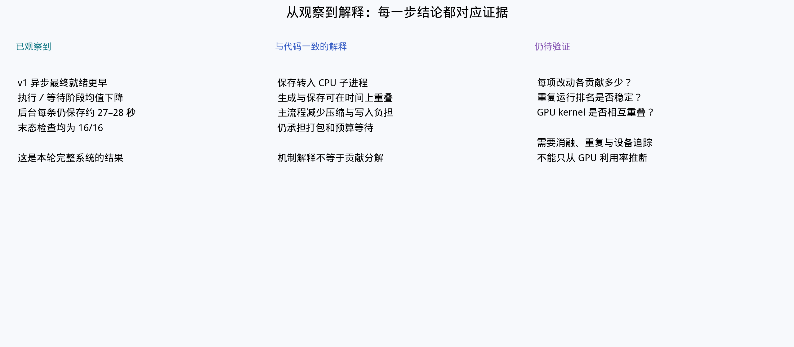

### 怎么做的

把证据分成三层：运行日志给出时间与质量结果；冻结源码和新增计数说明调用路径；独立消融用来验证单项改动的因果贡献。每项结论对应到它实际拥有的证据层。

### 这样做的意义

总时间下降能证明这次组合改造有效，却不能自动给每个代码改动分配收益。区分观测与解释，可以让后续方案直接针对尚未确认的环节设计实验。

### 当前结论

v1 异步保存收益已有历史主实验和新增配对支持；内部归类显示保存阻塞下降是主要变化。相机去重、RGB 复用以及各项内存改动的独立贡献仍待消融，GPU 引擎重叠仍待追踪。

### 读图与术语

“与某机制一致”表示现象支持该解释；“独立贡献已验证”还要求只改变该因素的对照结果。

## 第 38 页 · 库的能力与本项目启用的能力

所属章节：四、v2 迁移与实验。

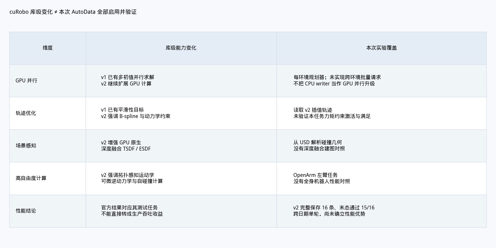

### 怎么做的

将 cuRobo v1/v2 的库级接口与能力说明，对照本项目冻结适配器实际构造的模型、目标、场景和轨迹。逐项检查 GPU 求解、动力学约束、深度建图和高自由度能力是否在这次任务中启用并验证。

### 这样做的意义

官方库能做什么，与本项目当前使用了什么，是不同范围的问题。只有调用路径和实验覆盖一致，才能把某项能力与实际生产结果联系起来。

### 当前结论

本次完成了 OpenArm 任务的 v2 规划适配，场景仍来自 USD 几何；未做深度融合建图、全身机器人或力矩约束专项对照。库级性能数字不能直接换算成本项目生产吞吐收益。

### 读图与术语

USD 是场景描述格式；FK 是正向运动学，即由关节状态计算末端位姿。v1 本身也已有 GPU 内部并行求解。

## 第 39 页 · v1 到 v2 为什么需要适配层

所属章节：四、v2 迁移与实验。

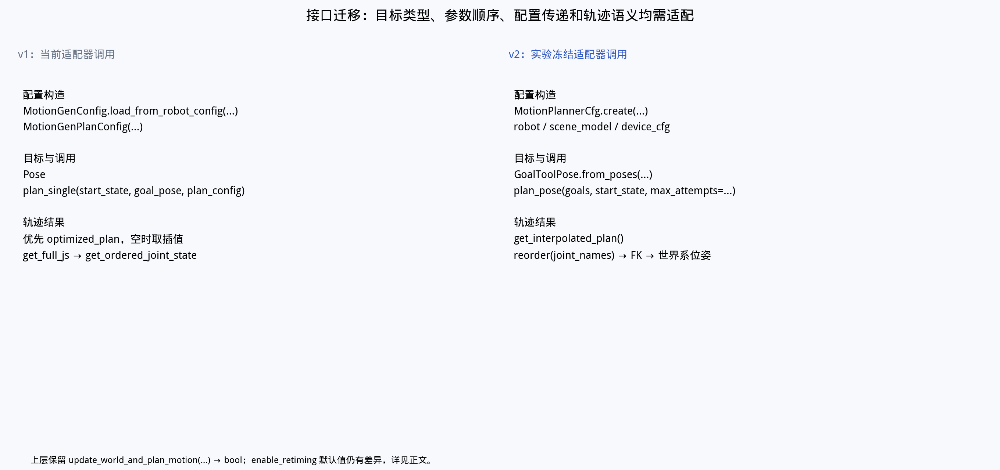

### 怎么做的

v1 用 MotionGenConfig、Pose 和 plan_single 构造并求解目标；v2 冻结适配器使用 MotionPlannerCfg、GoalToolPose 和 plan_pose。结果经插值、关节顺序转换及 FK 后，再交给原任务执行路径。

### 这样做的意义

接口迁移不只是改函数名。目标表达、参数顺序、轨迹结果和坐标系若转换错误，代码可能正常返回，却让机器人执行错误的运动；适配层用于维持上层任务约定。

### 当前结论

当前已打通两种接口与上层布尔返回约定，但部分默认值仍需核对，例如 enable_retiming。接口可运行说明集成完成，并不证明所得轨迹更快、更平滑或更可靠。

### 读图与术语

关节重排让规划结果按控制器期望的关节顺序输出；插值将规划轨迹转换为执行需要的离散序列。

## 第 40 页 · 迁移时要保持哪些语义一致

所属章节：四、v2 迁移与实验。

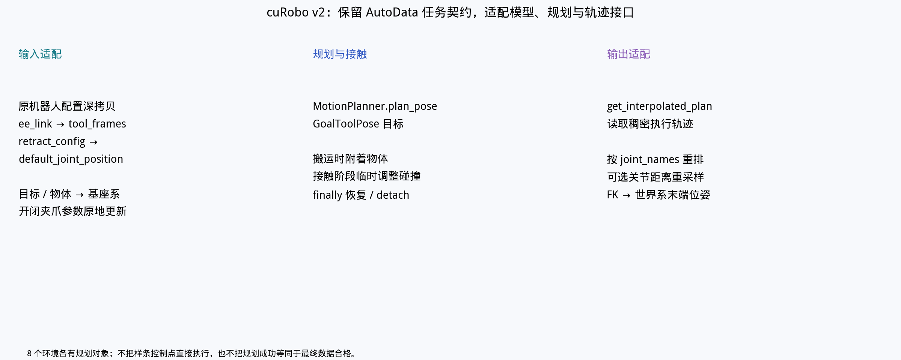

### 怎么做的

适配器将机器人配置、碰撞场景、目标工具位姿和附着物信息映射到 v2；求解后处理关节顺序、轨迹插值，并将末端位姿转换回任务使用的世界坐标系。

### 这样做的意义

机器人和场景的表示决定碰撞检查与目标约束含义。保持这些语义一致，才能把后续差异归于规划后端，而不是坐标系、关节或附着关系转换错误。

### 当前结论

已实现可运行的迁移路径并产出完整数据，仍需围绕末态失败、默认参数差异和相同任务重复对照继续验证。适配层完成是性能比较的前提，尚不是性能优势的结论。

### 读图与术语

附着物指被机器人夹持、随运动更新的物体；世界坐标系是任务、相机和场景共同参照的坐标系。

## 第 41 页 · v2 重跑采用怎样的验收流程

所属章节：四、v2 迁移与实验。

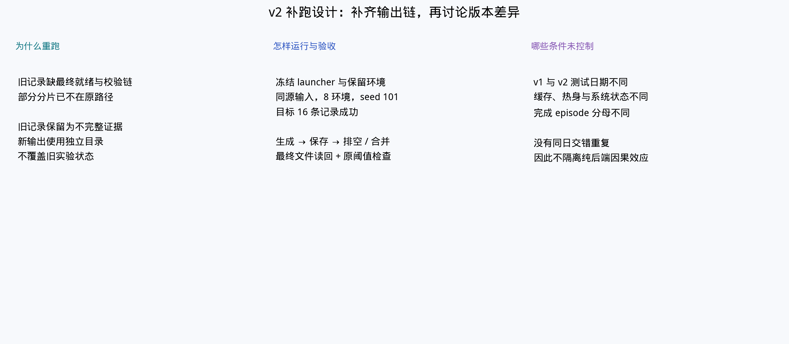

### 怎么做的

次日 v2 使用冻结启动器、8 环境、seed 101、16 条保存目标，沿用异步 auto 保存和原成功阈值。整轮结束后回读 HDF5，检查结构，并用严格物理末态验证器独立检查每条保存数据。

### 这样做的意义

运行完成只表示程序走到结束；独立回读和末态检查才能确认输出可用。保留原阈值也避免通过放宽成功条件让新后端看起来更快或更成功。

### 当前结论

该协议给出了 v2 的完整运行证据，但与历史 v1 测试不在同一天，也只有一轮。结果适合描述这次接入状态；建立稳定性能差异需要同条件、交替重复的配对实验。

### 读图与术语

文件结构检查关注字段、形状和条数；严格末态检查关注最后的物理状态，两种通过条件缺一不可。

## 第 42 页 · 16 条保存完成为何仍有质量问题

所属章节：四、v2 迁移与实验。

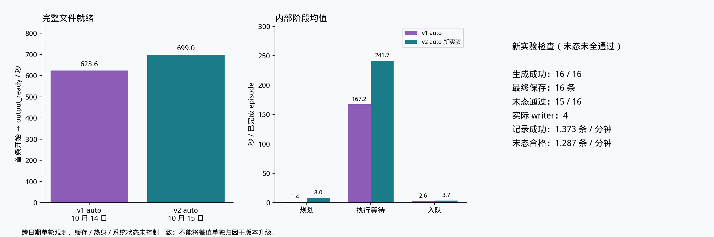

### 怎么做的

分别报告最终输出时间、保存条数和严格末态通过数。v2 整批最终就绪约 699.05 秒，16 条均保存并可回读，但其中 demo2 未通过严格末态检查，合格数为 15 条。

### 这样做的意义

任务内部成功信号与保存后的严格物理检查可能不同。把这两个结果并列，才能避免用“保存 16 条”代表“16 条全部合格”，也为失败轨迹复查提供明确对象。

### 当前结论

本次 v2 集成运行完成，严格末态为 15/16。记录成功吞吐使用 16 作分子，末态合格吞吐应使用 15；现有结果不支持宣称 v2 在该任务上优于 v1。

### 读图与术语

未通过项 demo_2 的末态角速度为 0.8538 rad/s，超过 0.5 rad/s 阈值；位置与线速度合格不能替代角速度条件。应复查保持阶段和适配参数，再重复验证。

## 第 43 页 · 把版本改动与完整结果放在一起看

所属章节：四、v2 迁移与实验。

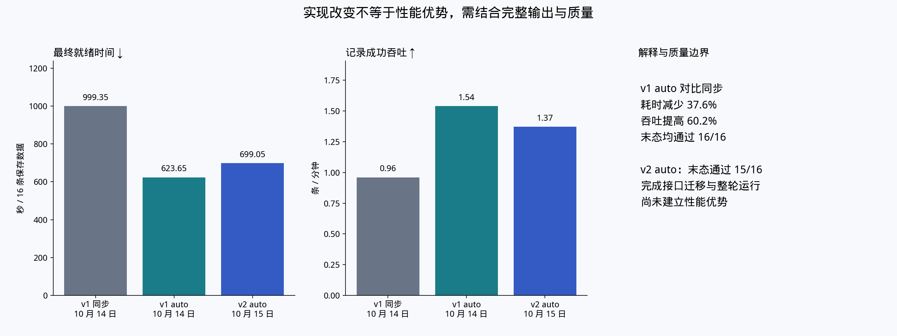

### 怎么做的

并列历史 v1 同步、v1 auto 与次日 v2 auto 的最终就绪时间、记录成功吞吐和严格末态结果。各组保存目标均为 16 条，但版本、日期和质量通过数在图中分别标注。

### 这样做的意义

实现变化需要落到结果上检验。时间、产出和质量同时展示，可以防止只选取最有利的某一个数字，也能明确哪个比较支持保存优化、哪个比较仍受实验条件限制。

### 当前结论

历史 v1 auto 相对同步耗时减少约 37.6%、吞吐提高约 60.2%，两者保存数据均 16/16 合格。v2 为 15/16 合格，且跨日期单轮，当前没有确立规划迁移的性能优势。

### 读图与术语

新增 4 环境配对的吞吐收益为 47.2%，来自另一组规模和计时条件；它补充证据，不替换本页历史数字。

## 第 44 页 · 哪些结论可以用于当前决策

所属章节：五、结论与下一轮验证。

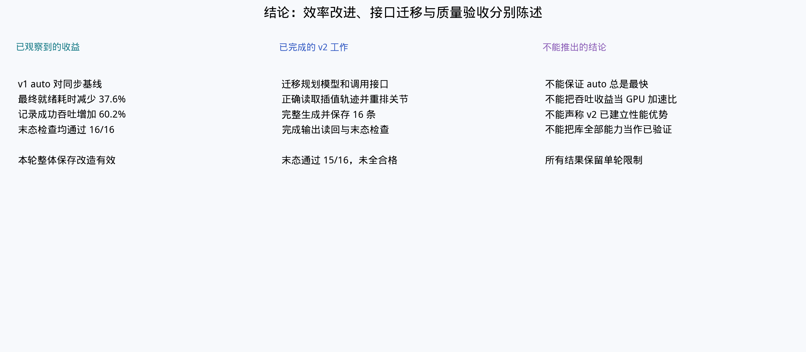

### 怎么做的

综合历史 8 环境生产对照、新增 4 环境内部计时、文件质量检查和 v2 重跑，将结果按已验证、可解释、待实验三个范围整理。对不同规模的数据分别保留其分母和条件。

### 这样做的意义

研究结论应能指导下一步投入：已经证明有效的路径可以保留，内部热点决定优化顺序，尚未验证的方案则需要明确的实验门槛。

### 当前结论

当前支持保留 v1 异步保存；其主要实测变化是减少生成路径中的保存及背压。改进后应优先验证相机位姿去重与同状态副本复用。v2 可继续用于迁移研究，暂不作为已证明更优的生产替代。

### 读图与术语

相机方案的 21.1%/22.6% 是 execute 条件估算，尚无优化实测；实际决策以完整输出、质量与内存结果为准。

## 第 45 页 · 下一轮需要回答哪些问题

所属章节：五、结论与下一轮验证。

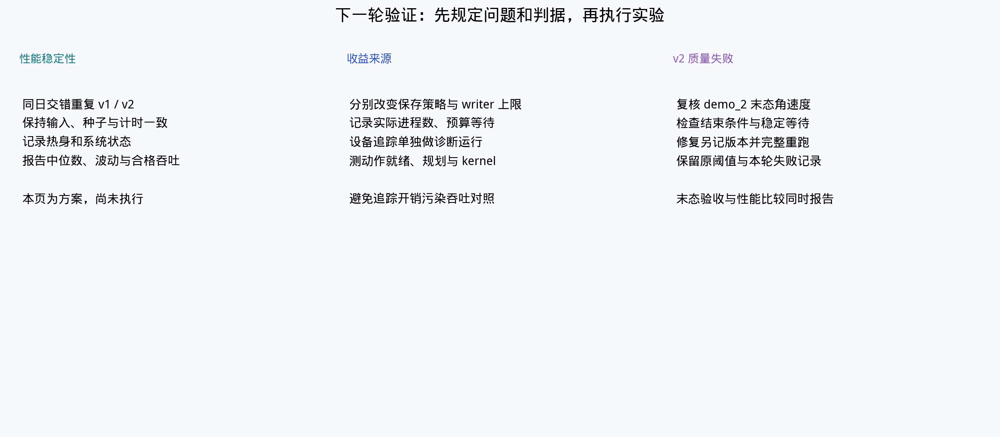

### 怎么做的

保存侧通过同日交替重复确认收益稳定性，并分开测试 writer 和内存改动；生成侧执行相机 A0–A3 消融，采集内部计时；v2 复查失败末态并安排同协议对照，设备追踪另行诊断。

### 这样做的意义

这些实验分别消除配置排名不稳定、组合改动难归因、相机复用未验证和 v2 质量边界等不确定性。按问题分开设计，比同时更换多项参数更容易得出可行动的结论。

### 当前结论

优先完成保持任务语义的相机去重，再考虑渲染与物理深度优化。每次正式比较都应报告最终就绪、合格吞吐、质量通过数及内存峰值；当前没有下一轮的新增性能结果。

### 读图与术语

同日运行也可能受系统负载影响，所以仍需交替和重复。不能将带追踪开销的运行直接与无追踪基线比较。

## 第 46 页 · 从保存流程理解异步收益

所属章节：附录、补充机制与历史实验。

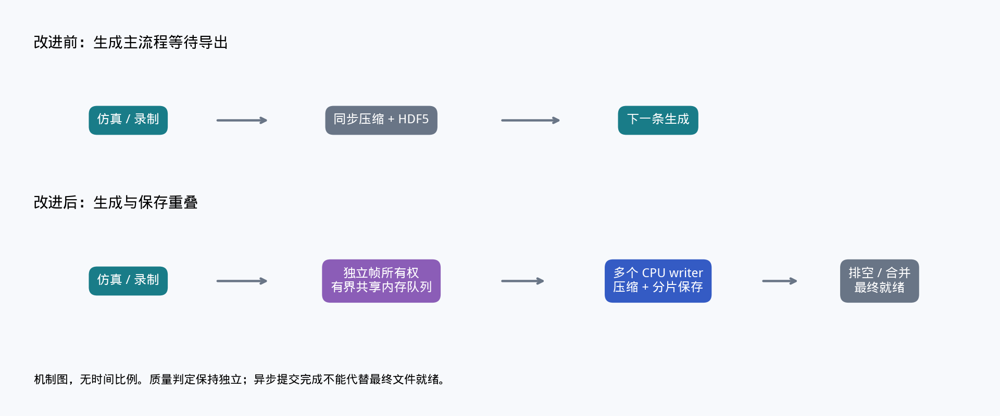

### 怎么做的

同步流程在一条轨迹结束后由生成主流程完成压缩和写入；异步流程先提交有界队列，生成下一条轨迹时后台继续保存，最后统一排空并合并。图按逻辑顺序画出两条路径。

### 这样做的意义

生成和保存需要不同资源，允许它们重叠可以减少总等待。只有保留最终收尾，才能判断重叠是否带来完整产出的收益。

### 当前结论

这张示意图解释流水线机制，实际收益以主线生产实验为准。即使只有一个 writer，也可能通过生成与保存重叠获益；多个 writer 则进一步改变保存侧处理容量。

### 读图与术语

图中框宽和箭头间距不代表测量时长；最终文件完成仍依赖后台任务与合并全部结束。

## 第 47 页 · 流水线重叠与保存并行有何区别

所属章节：附录、补充机制与历史实验。

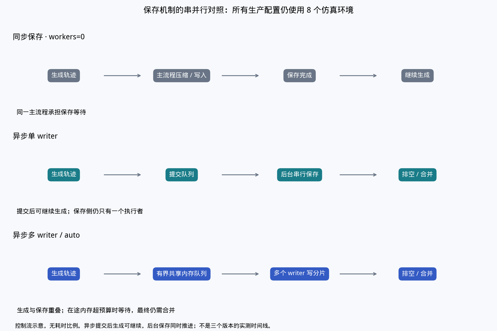

### 怎么做的

分别画出同步保存、异步单 writer 和异步多 writer：单 writer 可与生成重叠，但保存任务在该进程内顺序处理；多 writer 可同时处理不同 episode，最后仍由主流程排空和合并。

### 这样做的意义

将两种机制分开，才能设计有效对照：同步对异步单 writer 检验流水线重叠，单 writer 对多 writer 检验保存并行容量，而不是把所有变化归到“多进程”三个字。

### 当前结论

主实验验证的是保存改造组合效果，未完整覆盖这两项独立消融。因此当前不能分别报告流水线重叠与多 writer 的因果贡献；图中单 writer 是机制说明，不是新增生产测量。

### 读图与术语

本附录沿用历史 8 环境生成背景；writer 数量影响保存侧，仿真环境数量没有随之改变。

## 第 48 页 · 更多保存进程与更多 GPU 生成进程

所属章节：附录、补充机制与历史实验。

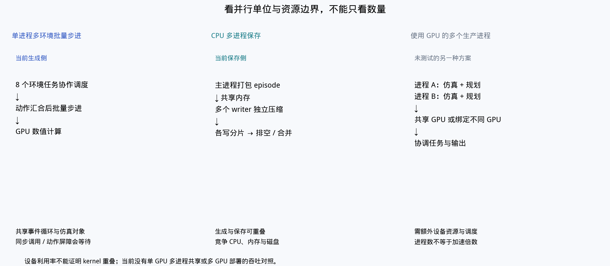

### 怎么做的

将当前部署与候选部署分列：当前为一个 GPU 生成主进程管理多环境，搭配 CPU writer 池；候选包括同卡多生成进程或多 GPU 分摊任务，但后两者未在本实验运行。

### 这样做的意义

扩展保存并行与扩展生成并行的资源约束不同。同卡增加生成进程还会争用显存和计算，多 GPU 则需要重新规划资产、任务分配和输出管理，不能沿用当前 writer 结果推算。

### 当前结论

目前可确认的是单生成主进程加 CPU 保存池的收益。是否适合单卡多进程或多卡部署，需要独立的显存、吞吐、质量和稳定性实验；未测方案在本图只用于比较机制。

### 读图与术语

同卡多进程不等于 GPU 算力增加；多个环境的批量计算也不等于多个独立生成进程。

## 第 49 页 · 阶段分解应怎样阅读

所属章节：附录、补充机制与历史实验。

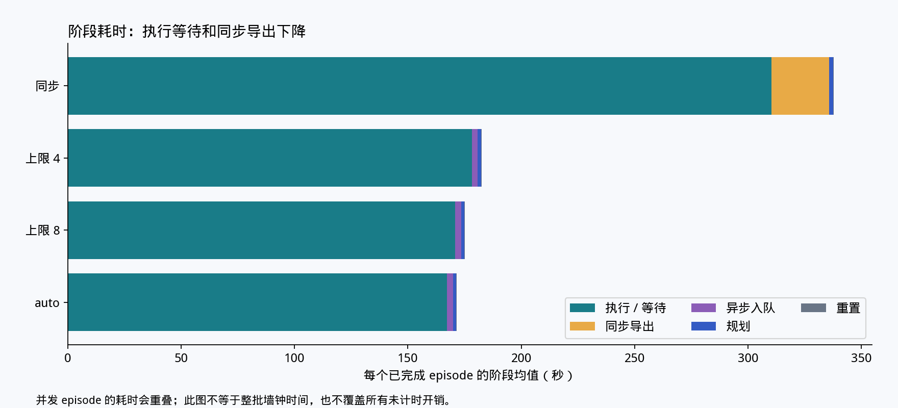

### 怎么做的

对历史 v1 各组 17 个完成 episode 的已记录阶段求均值，分别展示规划、执行等待、导出或入队等组成，其中包含一次生成失败。异步后台写入另列，不塞进提交阶段。

### 这样做的意义

阶段分解便于定位函数级变化，说明最终时间差可能从哪里产生；同时保留失败尝试，可以反映本轮实际完成任务的统计范围。

### 当前结论

这些均值显示同步与异步路径的阶段差异，但既不是 16 条成功数据的专属平均，也不是整批墙钟的可加分项。内部操作占比应看新增配对页，历史未记录的细节不能从本图倒推。

### 读图与术语

按完成 episode 计均值与按成功保存数算吞吐使用不同分母，两者回答的问题不同。

## 第 50 页 · 旧生产实验和离线实验分别回答什么

所属章节：附录、补充机制与历史实验。

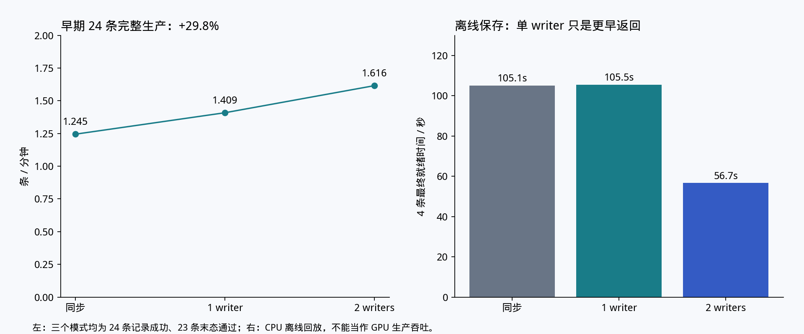

### 怎么做的

将历史 24 episode 的生产比较，与 4 episode 的离线导出测试分开列出。旧生产各组均记录成功 24 条、严格末态通过 23 条；离线测试只用已有 4 条数据测保存路径，不进行持续生成。

### 这样做的意义

离线实验便于控制输入、快速筛选存储方案，生产实验则检验生成与保存争用、重叠和收尾。两者有互补价值，但时间范围和工作量不同。

### 当前结论

旧生产实验曾观察到双 writer 最终吞吐提高约 29.8%；该数字只对应当时协议。它与当前 8 环境四配置、4 环境内部配对属于不同实验，不能合并求平均或互相替代。

### 读图与术语

离线保存变快不保证生产同比例变快：保存可能已被生成掩盖，也可能通过资源争用影响生成。

## 第 51 页 · 压缩策略如何权衡速度与存储

所属章节：附录、补充机制与历史实验。

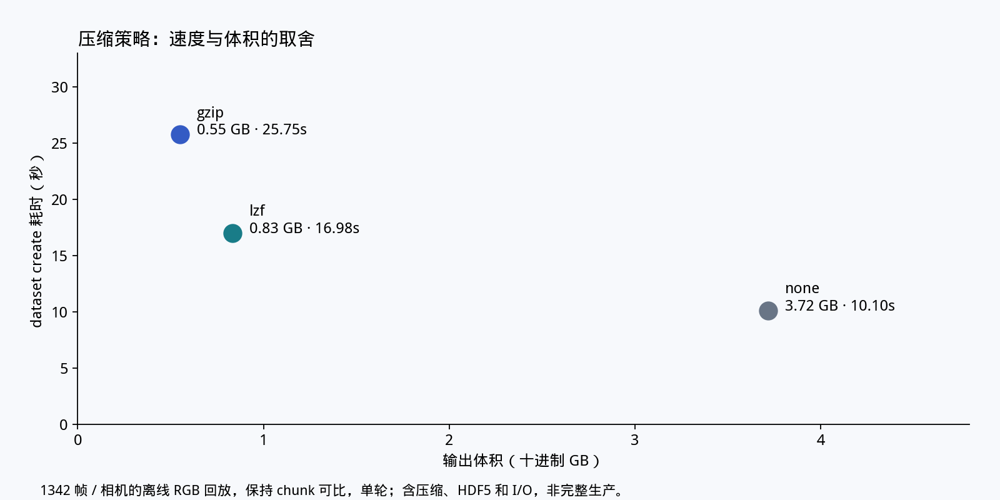

### 怎么做的

使用固定输入的离线图像数据，每台相机 1,342 帧 RGB，保持分块方式一致，对照不压缩、LZF 和 gzip level 2 的写入时间与文件大小。比较范围限于本批图像和保存配置。

### 这样做的意义

压缩用 CPU 时间换取更少磁盘空间与写入字节。存储速度、CPU 余量和数据内容会改变权衡，离线对照可帮助选出值得放入生产实验的候选配置。

### 当前结论

本批固定输入中，不压缩保存更快但文件更大，LZF 提供另一种速度与体积取舍。该结果不能直接推算生成吞吐；生产选择还需核对 CPU 与磁盘争用、收尾时间、读回正确性及存储预算。

### 读图与术语

gzip level 2 表示压缩等级；LZF 是另一种压缩算法；chunk 是 HDF5 存储分块，改变它也可能影响性能。
