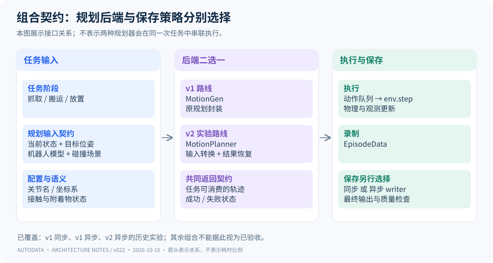
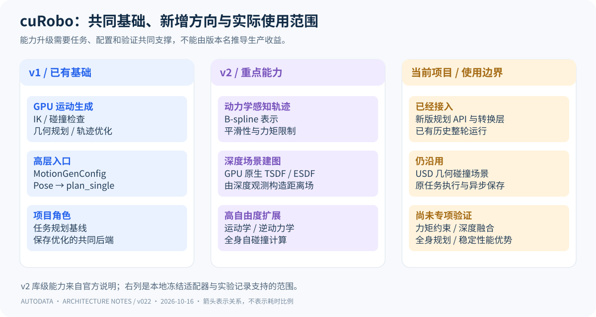
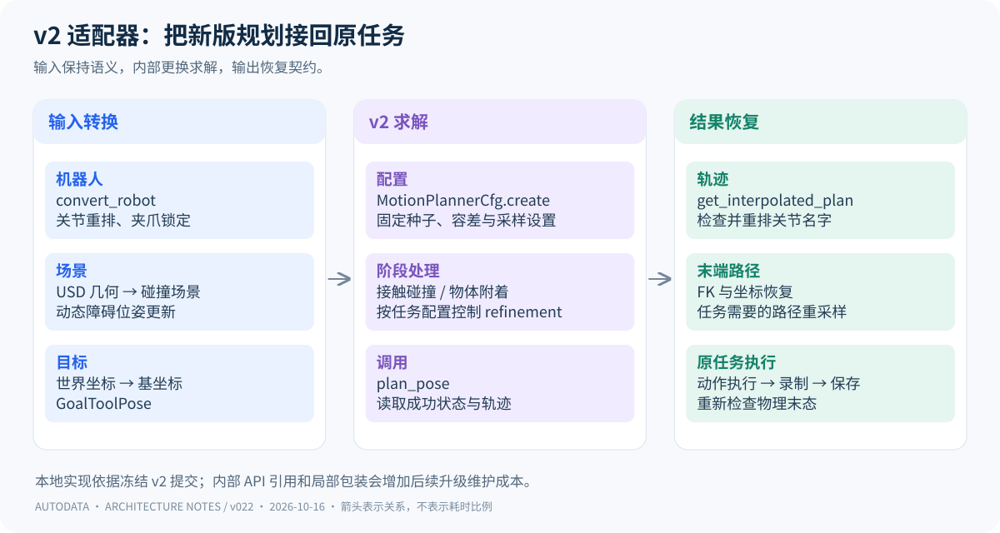

# cuRobo v1 与 v2：改变了什么，当前项目是否需要升级

> 当前判断：v2 值得保留为独立研究路线，但已有证据不足以将它替换为本项目的默认生产规划器。它的主要价值在于动力学约束、深度场景建图与高自由度扩展；本次 OpenArm 接入尚未逐项验证这些能力。[返回项目架构](architecture.md)

## 01 · cuRobo 在项目里只负责哪一层

从图的左侧开始：任务层先决定目标与阶段，规划器根据当前机器人状态和碰撞场景生成轨迹。返回后，执行与仿真继续推进任务，录制器收集数据，保存模块交付文件。这条边界决定了升级的影响范围：规划库变化会影响轨迹、成功率与规划耗时，但不会直接替代渲染、录像、压缩和磁盘写入。

v1 在本项目中承担原始规划和保存优化实验的共同基线。v2 则用来验证新版求解接口是否能够接回同一条任务链路。两者是不同运行配置下的替代后端，不是一次任务先后必须经过的两个阶段。

“cuRoboV2”是研究与新版架构的名称，不等于包标签必须写成 `2.x`。官方将 v0.8.0 列为引入 V2 研究功能的重构版本，并明确提示 API 破坏性变化；依赖 v1 API 的用户应固定到 v0.7.8。本文历史 v2 实验具体记录的提交是 `78fd485fa82d9b9a063fb4985e371814587e666a`，不能用今天的 main 分支代替它复现。[官方发布记录](https://github.com/NVlabs/curobo/releases)、[官方仓库说明](https://github.com/NVlabs/curobo)、[本地版本证据](../v014/v2-provenance.json)。

## 02 · 从求解架构看 v1 与 v2 的区别

两者都沿着“状态和目标 → 求解 → 可执行轨迹”的方向工作。v1 已经具备 GPU 并行运动生成、逆运动学、碰撞检查、几何规划与轨迹优化；v2 的意义不在于首次使用 GPU。v1 的 MotionGen 会组织不同求解环节，在直接轨迹优化不成功时可使用图规划提供种子。[v1 MotionGen 文档](https://curobo.org/_api/curobo.wrap.reacher.motion_gen.html)。

图中 v2 的三个能力方向值得分开理解。**B-spline 轨迹与动力学约束**将运动表示和力矩等约束联系起来；**深度融合距离场**将传感器观测转换为规划可用的环境距离信息；**高自由度计算**面向更复杂的机器人运动学、逆动力学与自碰撞计算。它们分别服务于“运动是否可实现”“环境如何进入规划”“机器人规模如何扩大”，并非三项必然同时启用的开关。[官方技术报告入口](https://github.com/NVlabs/curobo/blob/main/docs/technical_reports.rst?plain=true)、[官方能力说明](https://github.com/NVlabs/curobo)。

| 维度 | v1 路线 | v2 路线 | 对当前项目的意义 |
| --- | --- | --- | --- |
| 高层 API | MotionGenConfig / MotionGen | MotionPlannerCfg / MotionPlanner | 需要重写适配接口，不能只改依赖版本 |
| 目标与调用 | Pose、plan_single | GoalToolPose、plan_pose | 目标工具帧和状态类型需要对应转换 |
| 轨迹优化 | 已有平滑轨迹优化与运动限制 | B-spline 表示，强化动力学相关能力 | 需检查采样、执行与质量；不能把“新版”视为更好末态的保证 |
| 场景来源 | 已有几何和碰撞世界接口 | 增加 GPU 原生深度融合距离场路线 | 本项目仍读取 USD 几何，没有因此自动获得在线感知 |
| 机器人规模 | 已有 GPU 运动学与碰撞计算 | 扩展面向高自由度的计算结构 | 当前单臂任务不足以说明全身规划优势 |
| 实现组织 | wrap/reacher 等 v1 模块布局 | 公共接口与 `_src` 内部模块重组 | 依赖内部模块的适配代码需要固定提交 |

API 对照来自 [v1 文档](https://curobo.org/_api/curobo.wrap.reacher.motion_gen.html) 与 [v2 文档](https://nvlabs.github.io/curobo/latest/api/curobo.motion_planner.html)，实现重组见 [官方变更记录](https://github.com/NVlabs/curobo/blob/main/CHANGELOG.md)。这些是库级事实；表中项目影响是结合本地适配器作出的工程分析。官方其他机器人或场景上的加速数字，不作为本项目吞吐承诺。

## 03 · 本项目为了接入 v2 实际改了什么

沿图逐项看，适配器承担的是一组语义转换，而不只是函数改名。

**输入端：统一机器人和场景。** `convert_robot` 转换机器人配置；适配器从 USD stage 读取当前环境的障碍物，按机器人参考坐标构造场景。当前关节状态按规划器的关节名字重排；目标位姿从世界坐标转换到机器人基坐标。否则即使张量维度正确，也可能在错误关节或错误坐标系下求解。

**求解端：保持抓取阶段语义。** 适配器预先准备夹爪开闭模型，保留锁定关节信息；接触阶段控制相关碰撞开关，抓取后将物体附着到机器人碰撞模型，结束后解除。它使用 `MotionPlannerCfg.create` 构造求解器，再将工具目标封装成 `GoalToolPose` 交给 `plan_pose`。冻结版本还通过局部包装关闭额外 refinement，以匹配原任务配置，不改写库源文件。

**输出端：恢复原任务契约。** 成功结果先取插值轨迹，核对关节身份并重排，再通过正运动学（FK）获得末端位姿，恢复世界坐标和任务需要的路径形式。原任务最终执行的接口因此可以保留，但轨迹数值和接触结果仍可能改变，必须检查执行末态。

这些处理可在 [冻结 v2 适配器](../../../AutoData/datasets/efficiency_20261014_201834/v2/launchers/v2/v2_planner.py) 中逐项核对。该实现使用了冻结提交中未公开导出的 `RobotCfg` 和 `UsdSceneParser` 内部路径；这是明确的维护负担。当前官方 API 文档不能证明这些历史内部导入在未来版本继续可用。

多环境也不能直接等同于批量规划。当前官方 `MotionPlanner` 文档说明它一次处理一个规划问题，批量接口另有 `BatchMotionPlanner`；历史适配器按 `env_id` 读取环境状态。项目有 8 个仿真环境，并不能据此声称已经使用 v2 批量规划能力。[v2 MotionPlanner 文档](https://nvlabs.github.io/curobo/latest/api/curobo.motion_planner.html)。

## 04 · V2 到底有什么用途，当前用了多少

| 用途 | 什么时候值得使用 | 当前接入状态 | 尚缺什么 |
| --- | --- | --- | --- |
| 规划后端迁移 | 希望保留现有任务，评估新版轨迹求解 | 已有适配器与整轮历史运行 | 同条件质量与效率优势 |
| 动力学感知运动 | 任务对力矩、负载、快速运动可行性敏感 | 有新版求解入口；未做力矩约束专项对照 | 可信惯性与负载配置、约束启用核对、执行验证 |
| 深度感知避障 | 场景来自传感器，几何事先不完整或发生变化 | 本次仍由 USD 几何构造障碍物 | 深度接入、标定、融合更新和避障验证 |
| 高自由度 / 全身运动 | 双臂、躯干或更复杂机器人的协同任务 | 本次不是全身规划专项实验 | 对应模型、任务、碰撞与控制验收 |

表中后面三行是依据官方能力提出的潜在应用，不是当前项目已经完成的功能。尤其是“保存了相机图像”与“将深度图融合进规划场景”完全不同；当前录制 RGB 的链路不能证明已经启用 v2 感知能力。

## 05 · 当前有没有必要升级

**如果目标是提高现有 OpenArm 数据生产效率，目前没有足够理由强制升级 v2。** 已有证据支持优先保留 v1 异步保存路线。历史 v1 auto 保存数据严格末态为 16/16 合格；历史 v2 虽完成 16 条保存与结构回读，严格末态为 15/16。v2 与 v1 还存在跨日期、单轮等限制，因此既不能宣称 v2 更优，也不能把一次结果推成 v2 在所有任务上更差。[原实验记录与解释](charts.md)。

**如果目标转向深度感知、动力学约束或高自由度任务，v2 的研究价值会更明确。** 升级应由具体任务需要驱动：先选择要启用的能力，再验证该能力能否解决现有瓶颈。当前最合理的角色划分是 v1 维持基线与已验证的保存优化，v2 用独立环境和冻结启动器继续研究。

替换生产后端前，至少需要三类证据：第一，场景、关节映射、附着物和执行末态均满足原质量条件；第二，相同任务、环境数、保存策略与计时口径下，同日交替重复比较质量合格吞吐；第三，长时间运行、失败恢复和依赖复现可接受。若收益只出现在规划阶段，还要确认它在最终文件就绪时间上没有被仿真、渲染和保存成本抵消。

这组条件用于解释升级决策，不改写原实验方案或结果。本版只做源码和资料核对，没有新增 GPU 运行。

### 阅读与证据范围

官方网页于 2026-10-16 查阅；`latest` 页面用于解释当前公开接口，历史运行仍以本地冻结提交为准。本文涉及的运行数值沿用图册与 v014 来源记录，未重新统计、修正或替换原实验。本文和项目架构文章均为本地交付。
