# AutoData · 全流程可视化讲解

<p class="sub">从少量人工遥操演示，到可直接用于策略训练的大规模成功演示数据集 —— 端到端一张图讲清「录制 → 标注 → 生成 → 验证」每一步在做什么。</p>

<p class="sub" style="margin-top:8px;">内容统一整理自 AutoData 仓库文档（<code>docs/</code>）与两份既有笔记 （<code>AutoData-原理与数据流总览.md</code>、<code>AutoData-数据生成随机化可视化.html</code>）。 文中数值为便于说明的<b>示意值</b>；字段、参数、流程顺序以仓库代码与官方文档为准。</p>

<div class="card legend"><div class="li"><span class="badge fixed">固定</span> 确定性的，无随机</div><div class="li"><span class="badge">随机</span> 每次采样都不一样</div><div class="li"><span class="badge mp">MP</span> 运动规划（SkillGen / cuRobo）</div><div class="li"><span class="dot" style="background:var(--fixed)"></span>输入 / 契约 / 数据</div><div class="li"><span class="dot" style="background:var(--rand)"></span>随机化</div><div class="li"><span class="dot" style="background:var(--green)"></span>执行 / 仿真</div><div class="li"><span class="dot" style="background:var(--purple)"></span>噪声</div></div>

## <span class="num">①</span>一页看懂：端到端全流程

:::::::: card

<p class="lead" style="margin-top:0;">AutoData 接收一小批<b>已标注</b>的人工演示，用并行仿真环境把它们<b>拆段、变换、拼接、执行、录制</b>， 批量产出新的成功演示。整条流水线只有四个用户可见步骤：</p>

<div class="flow"><div class="step fixed"><div class="n">STEP 1 · 录制</div><div class="t">🧑‍🦱 遥操采集</div><div class="d"><code>record_demos.py</code><br>SpaceMouse / 键盘 / VR<br>→ 原始 HDF5（几条成功演示）</div></div><div class="arrow">→</div><div class="step fixed"><div class="n">STEP 2 · 标注</div><div class="t">🏷️ 标出子任务边界</div><div class="d"><code>annotate_demos.py</code><br>手动打标 / <code>--auto</code> 自动采样<br>→ 已标注 HDF5（含信号）</div></div><div class="arrow">→</div><div class="step green"><div class="n">STEP 3 · 生成</div><div class="t">⚙️ 并行造数据</div><div class="d"><code>generate_dataset.py</code><br>随机场景 + 变换回放<br>→ 生成数据集 + 结果 JSON</div></div><div class="arrow">→</div><div class="step fixed"><div class="n">STEP 4 · 验证</div><div class="t">✅ 结构校验 / 回放</div><div class="d"><code>validate_dataset.py</code><br><code>replay_demos.py</code> 可视回放</div></div></div>

<p class="lead" style="margin:22px 0 8px;"><b>STEP 3 内部</b>才是 AutoData 的核心：一次「生成尝试（attempt）」内部有六个阶段， 其中只有三处是真正的随机化（🎲）——其余在采样结果确定后都是确定性的。</p>

<div class="flow"><div class="step fixed"><div class="n">阶段 0</div><div class="t">环境 Reset</div><div class="d">场景随机化（物体位姿 / 关节角），并把复位后的状态快照为输出 episode 的 <code>initial_state</code></div></div><div class="arrow">→</div><div class="step rand"><div class="n">阶段 1 · 整轮一次</div><div class="t">🎲 边界抖动</div><div class="d"><code>randomize_subtask_boundaries()</code>：把录好的子任务分界点按下标范围抖动</div></div><div class="arrow">→</div><div class="step rand"><div class="n">阶段 2 · 每个子任务</div><div class="t">🎲 选源演示段</div><div class="d"><code>selection_strategy</code>：全随机 / 最近邻 top-k 内随机</div></div></div>

<div class="flow" style="margin-top:12px;"><div class="step fixed"><div class="n">阶段 3</div><div class="t">位姿变换</div><div class="d">把源段在“参考物体坐标系”下的轨迹，刚体变换到物体当前位姿下</div></div><div class="arrow">→</div><div class="step green"><div class="n">阶段 4</div><div class="t">桥接</div><div class="d">MimicGen：线性插值；SkillGen：<span class="badge mp">MP</span> 规划无碰撞 transit</div></div><div class="arrow">→</div><div class="step rand"><div class="n">阶段 5 · 每步</div><div class="t">🎲 执行 + 动作噪声</div><div class="d"><code>pose_action + σ·randn</code>，逐 tick 注入高斯噪声</div></div><div class="arrow">→</div><div class="step fixed"><div class="n">阶段 6</div><div class="t">判定 &amp; 导出</div><div class="d">每步判成功并锁存；成功则写进输出 HDF5</div></div></div>

::::::: callout

**一句话记忆：** 场景多样性来自  **Reset（环境层）** ，轨迹多样性来自  **生成层** ——  **边界抖动** 改变“时间段”， **源段选择** 改变“用哪段”， **动作噪声** 改变“怎么执行”。 三者叠加，少量演示就能长出大量彼此不同的演示。

:::::::

### 四个步骤的输入 / 输出对照

<table><thead><tr><th style="width:13%">步骤</th><th style="width:24%">命令 / 脚本</th><th style="width:31%">输入</th><th>输出</th></tr></thead><tbody><tr><td><b>1 录制</b></td><td class="mono">IsaacLab<br>record_demos.py</td><td>已注册的 Isaac Lab 环境 <code>--task</code>；遥操设备</td><td>原始演示 HDF5：每 episode 的 <code>actions</code> / <code>initial_state</code> / <code>obs</code></td></tr><tr><td><b>2 标注</b></td><td class="mono">scripts/<br>annotate_demos.py</td><td>原始 HDF5 + 任务描述 YAML + 机械臂配置 YAML</td><td>已标注 HDF5：在 <code>obs/datagen_info</code> 下写入子任务 <code>term/start</code> 信号与逐帧位姿记录</td></tr><tr><td><b>3 生成</b></td><td class="mono">scripts/<br>generate_dataset.py</td><td>已标注 HDF5 + 任务描述 + 机械臂配置（可选 env profile）</td><td>生成数据集 HDF5（成功 episode）＋ 可选 <code>--result_file</code> 统计 JSON</td></tr><tr><td><b>4 验证</b></td><td class="mono">scripts/validate_dataset.py<br>IsaacLab replay_demos.py</td><td>生成数据集 HDF5</td><td>结构校验报告 / 可视化回放</td></tr></tbody></table>

<details>
<summary>可跳过第 1–2 步：仓库自带预标注数据集</summary>

<p style="font-size:13px;margin-bottom:0;">仓库随附预标注源数据集，可直接跳到生成步骤： <code>datasets/annotated_datasets/dataset_franka_annotated.hdf5</code>（Franka 堆叠）、 <code>dataset_gr1_annotated.hdf5</code> / <code>dataset_g1_annotated.hdf5</code>（人形）、 <code>dataset_franka_skillgen_annotated.hdf5</code>（SkillGen）。 这些文件通过 Git LFS 分发，需先执行 <code>git lfs pull</code>。</p>

</details>

::::::::

## <span class="num">②</span>为什么可行：把演示拆成“相对物体”的技能段

:::::::: card

<p class="lead" style="margin-top:0;">模仿学习策略是“数据饥饿”的：需要大量、多样的成功演示，而人工遥操采集又慢又贵。 但策略真正要学的东西，往往在十条演示里就已经齐了——<b>同一个技能，在不同物体摆放下的重复</b>。 AutoData 正是利用这份冗余。</p>

### 两个关键定义

<table><thead><tr><th style="width:20%">概念</th><th>含义</th></tr></thead><tbody><tr><td><b>子任务<br>subtask</b></td><td>一段连续动作，其中末端执行器（EEF）的运动由<b>单一参考物体</b>支配，例如“伸手抓方块”“把方块放到另一个方块上”。 当支配运动的物体改变时，一个子任务结束、下一个开始。</td></tr><tr><td><b>物体相对存储</b></td><td>因为每段技能是相对参考物体记录的，所以它可以被<b>刚体变换</b>到新的场景位姿后原样回放—— 把变换后的各段拼接起来，少量演示就能变成任意规模的数据集。</td></tr></tbody></table>

### 变换公式：为什么必须用“绝对位姿”做中间表示

源演示里每步的 action 是 **相对当时状态的增量** （`delta = target − current`）， 只在录制时的那个当前位置下成立， **不能被直接变换** 。所以 AutoData 在  **绝对位姿** 空间里做刚体变换：

```text
# 把源 eef 位姿从“源物体系”搬到“当前物体系”
T_new_eef = T_current_object · inv(T_source_object) · T_source_eef
```

<p style="font-size:13.5px;">执行时再用新场景的真实状态重新计算 <code>delta</code>，action 才正确。文档把它写成硬约束： <i>“The transformation requires task-space actions … which is what the embodiment adapters guarantee.”</i></p>

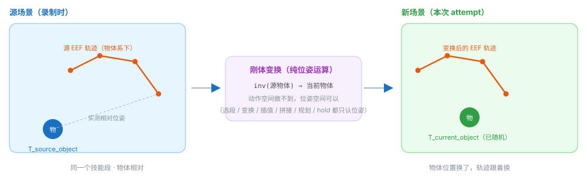

::::::: callout blue

**诊断要点：** 变换后如果所有抓取都 **整体偏移一个固定距离** ，几乎总是机械臂配置里的 `eef_offset` 与环境报告/源数据标注所用坐标系不一致（见 [⑬ 参数速查](#params)）。

:::::::

::::::::

## <span class="num">③</span>架构与四大构件：生成机不直接认识仿真器

:::::::: card

<p class="lead" style="margin-top:0;">AutoData 组织架构只围绕一个理念：<b>生成机制不应该直接认识仿真器或机器人</b>。 生成器需要的一切，都通过小的、显式的接口拿到——任务描述 YAML、机械臂配置 YAML、以及一个只读接口 <code>Datastream</code>。于是新任务、新机器人、新算法都能彼此独立地接入。</p>

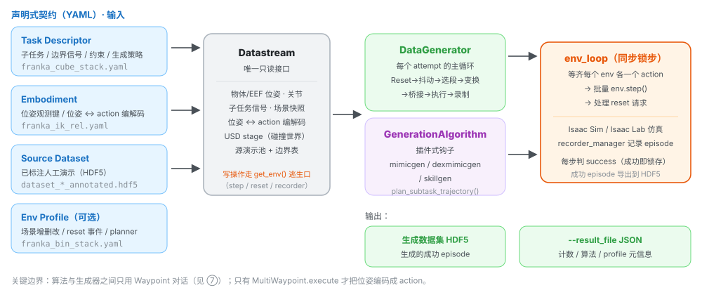

### 包职责

| 包 / 目录 | 职责 |
| --- | --- |
| autodata\_interfaces | 与仿真器/配置的边界：任务描述、机械臂适配器、Datastream、env 配置辅助、运动规划后端。 |
| autodata\_core | 生成机制本体：数据生成器、生成算法、源演示池、选择策略、Waypoint 执行。 |
| autodata\_utils | 小工具（位姿数学、张量辅助）。 |
| autodata\_examples | 示例任务描述、机械臂配置、环境 profile。 |
| scripts | 面向用户的入口：生成 `generate_dataset.py`、标注 `annotate_demos.py`、校验 `validate_dataset.py`。 |

### Datastream：唯一的只读窗口

<p style="font-size:13.5px;">Datastream 把「实时环境 + 任务描述 + 机械臂适配器 + 源演示池」组合到同一个对象后面， 作为生成器观察世界的唯一入口。它<b>刻意不做</b>写操作——不 step、不 reset、不录制； 这些控制侧操作统一通过 <code>get_env()</code> 逃生口访问，从而保证读接口诚实、变更点集中可审计。</p>

| 查询组 | 代表方法 |
| --- | --- |
| 任务语义 | get\_subtasks / get\_task\_constraints / get\_generation\_policy / get\_object\_refs / get\_term\_signal\_names / get\_start\_signal\_names / get\_eef\_names / get\_expected\_attached\_object |
| 机械臂 | get\_robot\_eef\_pose / get\_robot\_joint\_positions / target\_eef\_pose\_to\_action / action\_to\_target\_eef\_pose / actions\_to\_passthrough\_actions |
| 实时场景 | get\_object\_poses / get\_robot\_root\_pose / get\_scene\_state / get\_subtask\_term\_signals / device |
| 碰撞世界来源 | get\_usd\_stage / get\_env\_prim\_path / get\_robot\_prim\_path |
| 源演示池 | source\_pool / datagen\_infos / subtask\_boundaries / num\_source\_demos / add\_episode |

### 坐标与约定（一有“位姿看着不对”先查这里）

-    **位姿是 4×4 齐次矩阵** （`torch.Tensor`），位于环境计算设备。
-    **物体与机器人根位姿是 env 相对** ：减去每个环境自身的原点，因而可跨并行环境比较，也与数据集记录一致。
-    **四元数统一为 (x, y, z, w)** ，单位元为 `[0,0,0,1]`。顺序写错会整体翻转 180°。
-    **读接口是批量的** ：方法接收 `env_ids`，返回形状 `(len(env_ids), ...)`；传 `None` 读全部。

### 四大构件如何共同描述一个任务

::::::: grid2

#### Task Descriptor（YAML）

<p style="font-size:13px;margin-top:4px;">「任务是什么」的唯一事实来源：按 <code>eef_name</code> 分组的子任务序列、每个子任务的边界信号、 参考物体、选择策略与生成旋钮；多臂任务的跨臂约束；以及全局 <code>generation_policy</code>。 标注工具和生成器<b>读同一份文件</b>，因此标注与生成对“子任务是什么”不可能产生分歧。</p>

#### Embodiment（YAML + adapter）

<p style="font-size:13px;margin-top:4px;">从生成器视角描述机器人：去哪读末端位姿、如何在“目标位姿 ↔ action 向量”之间转换。 生成器本身从不接触关节名、控制器或运动学，只会“给我 EEF 位姿”和“把这个目标位姿变成 action”。</p>

:::::::

::::::::

## <span class="num">④</span>STEP 1 · 录制：采一小批人工演示

:::::::: card

<p class="lead" style="margin-top:0;">AutoData 消费的源演示是 Isaac Lab HDF5 数据集的格式（每个 episode 含 actions、initial_state、observations）。 这一步只需采集<b>少量（示例为 10 条）</b>成功演示。</p>

<div class="flow" style="margin-bottom:14px;"><div class="step fixed"><div class="n">设备</div><div class="t">SpaceMouse / 键盘 / VR</div><div class="d">推荐 SpaceMouse：平滑的离轴 6-DoF 输入比键盘更干净</div></div><div class="arrow">→</div><div class="step fixed"><div class="n">脚本</div><div class="t">record_demos.py</div><div class="d">Isaac Lab 自带录制工具（位于 submodules/IsaacLab-Arena）</div></div><div class="arrow">→</div><div class="step fixed"><div class="n">输出</div><div class="t">原始 HDF5</div><div class="d"><code>datasets/dataset_franka.hdf5</code></div></div></div>

```bash
# Franka 堆叠任务：用 SpaceMouse 采集 10 条成功演示
python submodules/IsaacLab-Arena/submodules/IsaacLab/scripts/tools/record_demos.py \
  --viz kit \
  --task Isaac-Stack-Cube-Franka-IK-Rel-v0 \
  --teleop_device spacemouse \
  --dataset_file ./datasets/dataset_franka.hdf5 \
  --num_demos 10
```

### Franka 任务与操作

<p style="font-size:13.5px;">环境 <code>Isaac-Stack-Cube-Franka-IK-Rel-v0</code>：Franka 机械臂在桌面上叠三个方块—— <b>红叠蓝，再绿叠红</b>。一条演示在满足成功条件（按正确顺序叠好）时自动判定为成功并收尾； 中途出错按右键丢弃并重来。</p>

| 设备 | 输入 → 动作 |
| --- | --- |
| SpaceMouse | 倾斜 → 沿 x / y 移动 |
| 推 / 拉 → 沿 z 移动 |
| 扭转 → 旋转 |
| 左键 → 切换夹爪开 / 合 |
| 右键 → 丢弃当前演示并复位 |
| 键盘 | `W/S` `A/D` `Q/E` → 沿 x / y / z 移动 |
| `Z/X` `T/G` `C/V` → 绕 x / y / z 旋转；`K` 切夹爪 |
| `R` → 丢弃并复位 |

::::::: callout green

**让演示“既好生成、又好训练”的三条建议：** 

-    **尽量短** ——下游策略决策更少，生成器要变换的段也更短。
-    **走直线** ——朝目标直接移动，而不是逐轴移动。
-    **不要长时间停顿** ——平滑连续的运动比莫名的停顿更易学习。

:::::::

<p class="note">采集完成后可用 <code>python scripts/validate_dataset.py datasets/dataset_franka.hdf5</code> 先做一次结构检查。 若采集人形演示（GR-1 / G1），需 Apple Vision Pro + CloudXR；没有 VR 设备可直接使用仓库预标注数据集跳到生成。</p>

::::::::

## <span class="num">⑤</span>STEP 2 · 标注：给演示打上子任务边界信号

:::::::: card

<p class="lead" style="margin-top:0;">生成前，每条源演示都必须标注<b>子任务终止信号</b>：即一个子任务结束、下一个开始的 action 下标。 子任务及其信号名由任务描述 YAML 声明。标注工具会回放每条 episode，并把结果写到输出 HDF5 的 <code>obs/datagen_info</code> 下。</p>

### 两种标注模式

::::::: grid2

:::::: card

#### 手动标注（Manual）

<p style="font-size:13px;">在 Kit 窗口中回放每条 episode，用键盘标出边界。<br><code>N</code> 播放 / <code>B</code> 暂停 / <code>S</code> 打标 / <code>Q</code> 跳过。</p>

<p style="font-size:12.5px;color:var(--muted);">SkillGen 数据集<b>只能</b>手动标注， 因为需要同时打“起点”和“终点”标记。</p>

::::::

:::::: card

#### 自动标注（`--auto`）

<p style="font-size:13px;">回放时采样环境发布的布尔子任务观测项；<b>每个信号的第一个上升沿</b>即为边界。可无头运行（<code>--viz none</code>）。</p>

<p style="font-size:12.5px;color:var(--muted);">需要环境本身发布了 per-subtask 布尔观测。Franka 堆叠任务支持，因此推荐自动标注。</p>

::::::

:::::::

### 标注在做什么：把连续轨迹切成段

<p style="font-size:13.5px;">标注只标记<b>时间点</b>；代码不会“观察轨迹后自己判断这段是抓取”。以“抓取 / 抬高 / 放置”的 12 步小例说明：</p>

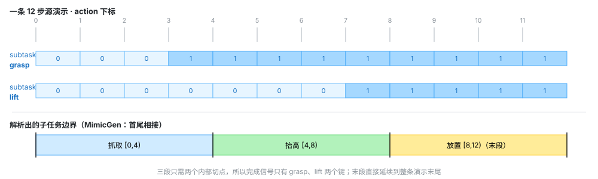

### 标注命令

```bash
# 自动标注（Franka 堆叠推荐）
python scripts/annotate_demos.py \
    --env_name Isaac-Stack-Cube-Franka-IK-Rel-v0 \
    --viz none \
    --task_descriptor autodata_examples/tasks/franka_cube_stack.yaml \
    --embodiment autodata_examples/embodiments/franka_ik_rel.yaml \
    --input_file ./datasets/dataset_franka.hdf5 \
    --output_file ./datasets/dataset_franka_annotated.hdf5 \
    --auto
```

<p style="font-size:13.5px;"><code>--auto</code> 模式下，回放每一步都按任务描述里 <code>subtask_term_signal</code> 指定的名字采样观测项， 信号的第一个上升沿成为子任务边界。若信号从未触发、触发顺序不符、或违反描述的 <code>subtask_term_offset_range</code> 间距要求，该 episode 会被跳过并打印原因。</p>

### SkillGen 的标注不同：每个子任务还要有“起点”

<p style="font-size:13.5px;">SkillGen 用运动规划补齐段间过渡，规划器必须知道每个技能段<b>从哪里开始</b>。因此 SkillGen 数据集的标记是 <b>起点、终点交替</b>，以最终子任务的起点收尾。四段堆叠任务共需 <b>7 个标记</b>：</p>

| 序 | 标记 | 含义 |
| --- | --- | --- |
| 1 | `grasp_1` 起点 | 夹爪开始朝红块的最终接近 |
| 2 | `grasp_1` 终点 | 红块被稳稳抓牢 |
| 3 | `stack_1` 起点 | 开始往蓝块上放置 |
| 4 | `stack_1` 终点 | 红块落在蓝块上、夹爪松开 |
| 5 | `grasp_2` 起点 | 开始朝绿块最终接近 |
| 6 | `grasp_2` 终点 | 绿块被稳稳抓牢 |
| 7 | `stack_2` 起点 | 开始往红块上放置（末段，随轨迹结束） |

<p class="note">SkillGen 数据集用 <code>franka_ik_rel_skillgen.yaml</code>（与 MimicGen 版只差 <code>eef_offset</code>， 因为其源数据在 <code>panda_hand</code> 帧标注）。自动标注只产出终止信号，因此<b>不能</b>用于 SkillGen。</p>

### 标注产物：`obs/datagen_info` 的字段

<table><thead><tr><th style="width:24%">字段</th><th style="width:22%">形状（每条演示）</th><th>含义</th></tr></thead><tbody><tr><td class="mono">eef_pose</td><td class="mono">{eef_name: [T,4,4]}</td><td>逐步记录的末端执行器位姿（实际观测）。</td></tr><tr><td class="mono">target_eef_pose</td><td class="mono">{eef_name: [T,4,4]}</td><td>从记录 action 反解出的控制器<b>目标</b>位姿；变换用的是它。</td></tr><tr><td class="mono">object_poses</td><td class="mono">{object_name: [T,4,4]}</td><td>记录到的物体位姿；子任务段据此表示成“相对参考物体”。</td></tr><tr><td class="mono">subtask_term_signals</td><td class="mono">{subtask_name: [T]}</td><td>逐步布尔完成标志，由标注写入。</td></tr><tr><td class="mono">subtask_start_signals</td><td class="mono">{subtask_name: [T]}</td><td>逐步布尔起点标志；<b>仅 SkillGen 数据集</b>存在。</td></tr><tr><td class="mono">passthrough_action</td><td class="mono">{channel: [T,D]}</td><td>非位姿 action 通道（夹爪、手关节、底盘等），回放时逐字复制。</td></tr></tbody></table>

::::::: callout blue

**两条应答要点：** 

-   `eef_pose` 与 `target_eef_pose` 分开：前者是“现在在哪”，后者是“这步想去哪”；变换用目标，实际位姿用于选择/锚定插值。
-   读到池里后 HDF5 键 `object_pose`（单数）对应属性 `object_poses`（复数）。

:::::::

::::::::

## <span class="num">⑥</span>STEP 3 · 生成：一次 attempt 的完整生命周期

:::::::: card

<p class="lead" style="margin-top:0;">有了已标注的源演示，MimicGen / DexMimicGen / SkillGen 就能合成新演示。每次尝试中，场景被随机化、 每个子任务选一段源演示、其末端轨迹被刚体变换到新物体位姿后回放。<code>DataGenerator.generate()</code> 就是一次「生成尝试」的完整生命周期。</p>

### 6.1 最小命令与关键参数

```bash
# 小规模：Kit 窗口里先跑通
python scripts/generate_dataset.py \
    --env_name Isaac-Stack-Cube-Franka-IK-Rel-v0 \
    --viz kit --num_envs 20 --alg mimicgen \
    --generation_num_trials 10 \
    --task_descriptor autodata_examples/tasks/franka_cube_stack.yaml \
    --embodiment autodata_examples/embodiments/franka_ik_rel.yaml \
    --input_file ./datasets/annotated_datasets/dataset_franka_annotated.hdf5 \
    --output_file ./datasets/generated_dataset_mimicgen_franka_small.hdf5
```

| 参数 | 说明 |
| --- | --- |
| \--alg | 生成算法：`mimicgen` / `dexmimicgen` / `skillgen`。 |
| \--env\_name | 环境 id；省略时从源数据集元数据读取。 |
| \--task\_descriptor | 任务描述 YAML（子任务 / 约束 / 生成策略）。 |
| \--embodiment | 机械臂配置 YAML（位姿 ↔ action 变换）。 |
| \--env\_profile | 可选环境 profile：在创建环境前叠加场景增删改 / reset 随机化 / planner。 |
| \--input\_file | 已标注源数据集 HDF5。 |
| \--output\_file | 生成 episode 的目标 HDF5（默认 `./datasets/output_dataset.hdf5`）。 |
| \--result\_file | 可选 JSON：整次运行的统计与元信息（原子写）。 |
| \--generation\_num\_trials | 覆盖任务描述里的 `generation_policy.num_trials`。 |
| \--num\_envs | 并行环境数，各自独立生成。数据规模靠它放大。 |
| \--viz | `kit` 开窗 / `none` 无头。数据集级生成一定用 `none`（渲染显著拖慢）。 |
| \--pause\_subtask | 每个子任务后暂停，便于交互调试。 |
| \--visualize\_plan | 把 SkillGen 规划轨迹流到 Rerun 查看器（仅 env 0）。 |

::::::: callout

**规模与预期（官方示例基准，RTX PRO 6000 Blackwell）：**  MimicGen 全量命令 `--num_envs 500 --generation_num_trials 1000`，成功率约  **~40%** 、耗时约  **15 分钟** ； DexMimicGen 人形约  **~70%**  /  **~40 分钟** 。失败尝试是正常的，不会被导出。

:::::::

### 6.2 主循环：六步顺序

<p style="font-size:13.5px;">下面是 <code>generate()</code> 一次调用的执行顺序（<code>autodata_core/data_generator.py</code>）。 左侧是阶段，右侧是它真正做的事与关键函数。</p>

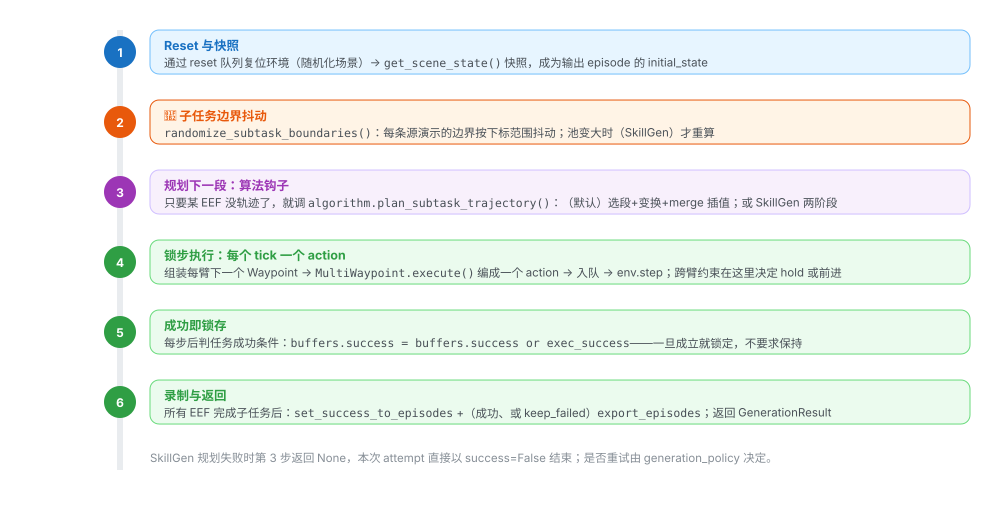

### 6.3 阶段细节与容易忽略的点

#### 阶段 2 · 边界随机化

<p style="font-size:13.5px;">对每条源演示的边界做抖动，使不同生成演示不会在完全相同的步数切换子任务。非 SkillGen 时， 后一段起点直接取前一段<b>随机化后</b>的终点（首尾相接）；SkillGen 因读“起点信号”，起点也随机。 末尾会做断言保证：每段非空、段间递增、扁平化后单调不减。</p>

```text
# 示意：End 偏移范围 [10,20]，末段强制 [0,0]
子任务     原始 [start,end)   本次 [start,end)   片段长度
0 抓红块    [0,40)            [0,55)            55
1 红叠蓝    [40,90)           [55,102)          47
2 抓绿块    [90,140)          [102,154)         52
3 绿叠红    [140,200)         [154,200)         46   # 末段终点固定为 T
```

#### 阶段 3a · 选源演示段（select）

<p style="font-size:13.5px;">把每条源演示在该子任务窗口内的片段切出来，交给选择策略。策略： <code>random</code>（均匀随机）、<code>nearest_neighbor_object</code>（按源物体位姿与当前物体位姿的位姿距离排序，前 <code>nn_k</code> 内随机取一）、 <code>nearest_neighbor_robot_distance</code>（把源 EEF 位姿先变到“源物体系”再映射到“当前物体系”，与当前 EEF 比距离）。 约束：<code>object_ref</code> 为空时只允许 <code>random</code>。 距离只用于<b>相对排序</b>（不做阈值判断），且只比源片段的<b>第 0 帧</b>；在算哪两者的距离、为什么这么算，见 9.3。</p>

::::::: callout red

**实现注意：** 官方示例同时设了 `select_src_per_subtask: true` 与 `select_src_per_arm: false`。 在当前代码里，第一次选择后该臂的已选索引不再是 `None`，后续子任务的 `need_selection` 会被压成 false， 因而 **整次尝试只选一次** 。不要只按参数名字面理解为“逐段重选”。

:::::::

#### 阶段 3b · 变换（transform）

<p style="font-size:13.5px;">核心公式：<code>T_new_eef(t) = T_current_object · inv(T_source_object_at_segment_start) · T_source_eef(t)</code>。 另有两条分支：协调约束（<code>use_delta_transform</code> / <code>coord_transform_scheme</code>）直接套用 delta； 无参考物体时原样使用。首段（或 <code>transform_first_robot_pose</code>）会把<b>记录的 EEF 实际位姿</b>拼在目标序列最前，让插值从机器人真实位姿出发。 passthrough 通道只保留「本 EEF 自己的 + 非 EEF 的（如 body）」，避免串入另一条臂的夹爪动作。 最后包成 <code>WaypointTrajectory</code> 返回。</p>

#### 阶段 3c · 合并桥接段（merge）

<p style="font-size:13.5px;">基类默认路径即“生成段 + 合并插值”。<code>merge()</code> 先插值到目标段首位姿，再可选固定 hold <code>num_fixed_steps</code> 步，然后接上目标段；末了 <code>pop_first()</code> 丢掉仅用于锚定插值的种子 waypoint。 非首段默认从<b>上一段最后目标位姿</b>接入（<code>interpolate_from_last_target_pose: true</code>）； SkillGen 用 <code>force_use_prev_traj=True</code>，让真实技能段从「MP 终点位姿」而非实时机器人位姿开始插值。</p>

#### 阶段 4 · 跨臂约束与执行

<p style="font-size:13.5px;">每个 tick 前逐个 EEF 决定“往前走”还是“原地 hold”，这两个跨臂约束定义在 <code>autodata_interfaces/tasks/subtask_constraint_spec.py</code>：</p>

<table><thead><tr><th style="width:20%">约束</th><th>行为</th></tr></thead><tbody><tr><td><code>sequential</code></td><td>后者执行到只剩 <code>sequential_min_time_diff</code> 步时停下等前者； <code>-1</code> 表示前者完成前完全不启动前者。<span class="tag f">DexMimicGen</span></td></tr><tr><td><code>coordination</code></td><td>两臂共享同一条源演示与共享位姿变换；<code>coordination_synchronize_start</code> 让并发臂同步起步， <code>synchronous_steps</code> 让两边在尾段窗口内锁步。额外的前缀可先行执行。</td></tr></tbody></table>

<p style="font-size:13px;color:var(--muted);">MP transit 期间直接跳过约束（transit 不受约束）。SkillGen 因用 <code>pending_subtask_trajectory</code> + <code>is_in_motion_plan</code> 传递状态，生成器完全不需要知道 cuRobo 的存在。</p>

#### 阶段 6 · 停止条件与统计

<p style="font-size:13.5px;"><code>env_loop</code> 每次统计变化时读取 <code>stats</code>：若 <code>guarantee_success=true</code>，攒够 <code>num_trials</code> 个<b>成功</b>即停； 否则跑够 <code>num_trials</code> 次<b>尝试</b>即停。最终可选写入 JSON sidecar（临时文件 + fsync + 原子替换）。</p>

```text
{
  "algorithm": "skillgen",
  "requested_trials": 1000,
  "num_success": 1000,
  "num_failures": 412,
  "num_attempts": 1412,
  "env_profile": {            // 仅当应用了环境 profile 时出现
    "name": "franka_bin_stack",
    "path": "autodata_examples/env_profiles/franka_bin_stack.yaml",
    "planner": "franka_stack_cube_bin"
  }
}
```

<p class="note">生成结果 JSON 是唯一记录“应用了哪个 profile”的地方——生成数据集本身只保存基础 env id。</p>

::::::::

## <span class="num">⑦</span>Waypoint 层：算法与生成器之间的“指令 IR”

:::::::: card

<p class="lead" style="margin-top:0;"><i>“Algorithms and the generator talk to each other in waypoints, not actions.”</i> 算法插件不直接产出 action，而是产出「目标位姿 + 透传动作 + 噪声」；只有到执行那一刻 （<code>MultiWaypoint.execute</code>），才编码成仿真器能用的 action。</p>

### 为什么需要这一层

<p style="font-size:13.5px;">源演示录下来的 action 是<b>相对录制那一刻状态的增量</b>（<code>delta_pos = target_pos − curr_pos</code>）， 只在原来的当前位置下成立，无法被整体搬移。算法要做的运算几乎全在<b>位姿</b>上：</p>

<table><thead><tr><th style="width:46%">运算</th><th style="width:30%">作用对象</th><th>能在 action 空间做吗</th></tr></thead><tbody><tr><td>选源（比距离）<code>selection_strategy</code></td><td>EEF / 物体<b>位姿</b>距离</td><td>✗</td></tr><tr><td>变换到新物体位姿 <code>transforms.py</code></td><td><b>位姿</b>矩阵乘</td><td>✗</td></tr><tr><td>段间插值 <code>interpolate_poses</code></td><td>两个<b>位姿</b>之间</td><td>✗</td></tr><tr><td>拼接 merge</td><td>两段<b>位姿</b>轨迹首尾相接</td><td>✗</td></tr><tr><td>运动规划（cuRobo）</td><td>输出<b>位姿</b>序列</td><td>✗</td></tr><tr><td>跨臂约束“原地 hold”</td><td>冻结某个<b>位姿</b></td><td>✗</td></tr><tr><td>加噪做多样性</td><td>位姿<b>动作</b>（编码时）</td><td><span class="tag g">✓ 只此一项</span></td></tr></tbody></table>

<p style="font-size:13px;color:var(--muted);">七项里六项只认位姿，因此统一用位姿作为工作表示，即 Waypoint。</p>

### 四个数据类型

<table><thead><tr><th style="width:20%"></th><th style="width:12%">粒度</th><th style="width:26%">装什么</th><th style="width:22%">一个实例代表</th><th>生命周期</th></tr></thead><tbody><tr><td class="mono">Waypoint</td><td>1 步 × 1 臂</td><td>目标位姿 + 夹爪 + 噪声</td><td>某一刻“手要去哪”</td><td><b>执行期</b>逐 tick 取用</td></tr><tr><td class="mono">WaypointSequence</td><td>1 段 × 1 臂</td><td><code>list[Waypoint]</code></td><td>变换后的一整段技能</td><td><b>构造期</b></td></tr><tr><td class="mono">WaypointTrajectory</td><td>1 臂 × 多条段</td><td><code>list[WaypointSequence]</code></td><td>一臂待执行的完整行程</td><td><b>构造期</b>（merge 在此）</td></tr><tr><td class="mono">MultiWaypoint</td><td>1 tick × 多臂</td><td><code>{eef: Waypoint}</code></td><td>这一刻所有臂一起动</td><td><b>执行期</b>，每 tick 一次</td></tr></tbody></table>

<p style="font-size:13px;color:var(--muted);">一句话区分：<b>Sequence 是“段”，Trajectory 是“段拼成的行程”，Waypoint 是“行程里的一步”，MultiWaypoint 是“这一刻多臂捆绑”</b>。 注意 <code>MultiWaypoint</code> 不是“更多 waypoint”，单臂任务里它也只装一个 Waypoint。</p>

### 装配流程与生命周期分界

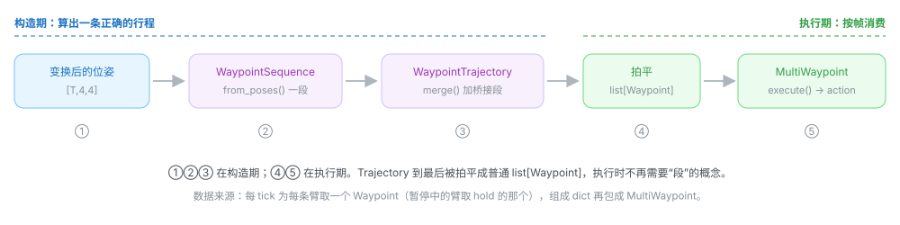

### Waypoint 里有什么

```text
Waypoint(
    pose=[4,4],                            # 绝对目标位姿（世界系），[m, rad]
    passthrough_action={"franka": [-1]},   # 这一步的非位姿通道（夹爪等）
    noise=0.03,                            # 只打位姿、不打透传
    joint_seed=None,                       # 可选关节种子（IK / 离线调度）
)
# Waypoint 存的是“目标”，action 是“目标 − 当前”。
```

### noise 到底加在哪

<p style="font-size:13.5px;"><code>Waypoint.noise</code> 是<b>编码 action 时给这一步「6 维位姿动作」叠加的高斯噪声幅度（标准差 σ）</b>， 不是加到目标位姿上的偏移；只在执行那一刻起作用，不改变 <code>Waypoint.pose</code>。</p>

```text
# single_arm_embodiment_adapter：加噪在 clip 之前
if scale > 0.0:
    pose_action = pose_action + scale * torch.randn_like(pose_action)   # 6 维
if self.clip_pose_action_to_unit:
    pose_action = torch.clamp(pose_action, -1.0, 1.0)
```

-   作用对象是 **相对位姿增量** （3 维平移 + 3 维轴角），每维独立 `N(0, σ²)`。
-   `noise=0.03` ≈ 每平移轴 ±3 cm、每旋转轴 ±3°（1σ）。
-    **只作用于位姿，不作用于透传通道** ——夹爪值逐字复制，永不加噪。
-   加噪在 clip 之前，噪声不会把 action 顶出 `[-1,1]`。

::::::: callout red

**别和其他“噪声”混淆：**  `coordination_scheme_pos/rot_noise_scale` 作用于 **物体位姿变换的 delta** ，且是 **均匀分布** ； 双臂 `bimanual_embodiment_adapter` 的 `_add_noise` 给 **绝对**  pos/quat 每标量加高斯噪声； 文档里的 “startup noise” 指日志噪声，无关。

:::::::

::::::::

## <span class="num">⑧</span>三大生成算法：同一骨架，三种“桥接”

:::::::: card

<p class="lead" style="margin-top:0;">三个算法共享同一副骨架——拆段、选段、变换到当前场景、执行、保留成功演示——差别只在 <b>段与段之间怎么桥接</b>、以及<b>多臂怎么协调</b>。用 <code>--alg</code> 选择； 任务描述里的 <code>algo</code> 字段独立决定按哪套 <code>algo_params</code> 解析描述，二者要保持一致。</p>

<table><thead><tr><th style="width:16%">算法</th><th style="width:10%">臂数</th><th style="width:20%">桥接方式</th><th>要点</th></tr></thead><tbody><tr><td><code>mimicgen</code></td><td>1</td><td>插值</td><td>单臂 MimicGen 基础款：每段相对参考物体存储，换物体位姿回放就是末端轨迹的刚体变换。</td></tr><tr><td><code>dexmimicgen</code></td><td>2</td><td>插值</td><td>把配方扩到双臂：每臂各自声明子任务序列，段按臂独立选/变换/执行；用 <code>sequential</code> / <code>coordination</code> 约束同步特定子任务对。</td></tr><tr><td><code>skillgen</code></td><td>1</td><td>运动规划</td><td>cuRobo 规划的<b>无碰撞 transit</b>，替代插值；需要子任务<b>起点信号</b>；每个环境一个 planner。</td></tr></tbody></table>

### MimicGen（单臂，参考实现）

<p style="font-size:13.5px;">每个子任务段相对其参考物体存储，因此在新物体位姿下回放该段 = 对记录的末端轨迹做刚体变换。 段与段之间，末端从当前位置<b>线性插值</b>到变换后段的起点（<code>num_interpolation_steps</code>，可再固定 hold <code>num_fixed_steps</code>）， 逐步 <code>action_noise</code> 增加多样性。若某步任务成功条件成立即视为成功；只有成功演示才被导出。</p>

::::::: callout blue

该变换要求  **task-space action** ：机械臂的 action 必须编码末端位姿目标（相对或绝对）——这正是机械臂适配器保证的。

:::::::

### DexMimicGen（双臂）

<p style="font-size:13.5px;">两套机制保持两臂一致：</p>

-    **选源范围** ——默认所有臂复用 **同一条源演示** 的段（`select_src_per_arm: false`），保留人类演示里隐含的协调关系。
-    **约束** ——描述里的 `sequential` / `coordination` 条目在运行期同步特定子任务对。

<p style="font-size:13px;color:var(--muted);">人形示例用绝对位姿的 <code>absolute_pose_whole_body_bimanual</code> 适配器：每臂一个位姿切片 + 一组手关节索引， action 由每臂目标逐步重组而成。</p>

### SkillGen（运动规划 transit）

<p style="font-size:13.5px;">SkillGen 把每个子任务拆成<b>两阶段</b>：先用 cuRobo 规划一段无碰撞 <b>transit</b> 到技能段起点，再回放变换后的<b>技能段</b>。 相比 MimicGen 的直线插值，它换来三件事——<b>运动质量</b>（可行、平滑的机器人运动）、 <b>碰撞意识</b>（同时避让场景与手中握持物）、<b>适应性</b>（物体摆得离源演示很远、或场景拥挤时仍可用）。 代价是每个环境都需要一个 cuRobo planner，显存与运行成本更高。</p>

::::::: callout green

因为过渡是 **现场规划** 而非回放， **一份标注数据集可以驱动多个任务变体** —— 例如“桌面堆叠”和“料箱内堆叠”都由同一份标注好的堆叠数据集生成。

:::::::

<p style="font-size:13.5px;">SkillGen 是三者里最“重”的一个，下面 <a href="#skillgen">⑨ SkillGen 深潜</a> 单独展开： 两阶段如何衔接、代码里怎么 stash/resume、标注为何需要 7 个标记、planner 如何解析配置、 运行前 preflight 清单，以及各类规划失败怎么解读。</p>

### 异步多环境：一个生成器，N 个环境，锁步仿真

<p style="font-size:13.5px;">只创建一个 <code>DataGenerator</code>，但为每个 <code>env_id</code> 创建一个 asyncio task； 同步侧 <code>env_loop</code> 负责“等齐每个环境各一个 action → 批量 step 一次 → 顺手处理 reset 请求”。 每个环境的尝试逻辑（含失败重试）在各自 task 里独立跑。</p>

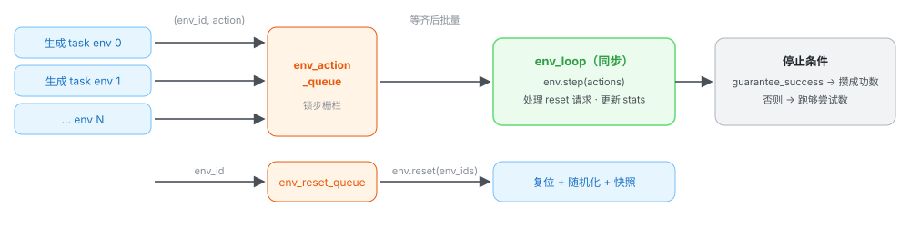

<p style="font-size:13px;color:var(--muted);">多个 task 共享源池，且 SkillGen 可能在生成中往池里加 episode，因此池带一个 asyncio 锁； 默认静态池不加锁，零开销。加锁范围只覆盖“刷新边界表 + 调算法规划”这一致性窗口。</p>

### 环境 Profile：不改环境 id，造任务变体

<p style="font-size:13.5px;">环境 profile 是一个 YAML 叠加层，用 <code>--env_profile</code> 传入，在创建环境前<b>原地</b>叠加到已解析的 env 配置上， 把基础任务变成变体——而不需要注册新的环境 id。</p>

| 区块 | 作用 |
| --- | --- |
| scene.rigid\_objects.add | 从 USD 生成新刚体（含初始位姿、缩放、物理属性）。 |
| scene.rigid\_objects.override | 修补基础任务已有刚体的属性（如更硬的接触求解）。 |
| events.remove | 按名禁用基础任务的 event term（如去掉默认方块随机化）。 |
| events.override | 把新参数合并进已有 event term。 |
| events.add | 新增 event term——通常是为新增/重新钉死的物体配置 reset 随机化。 |
| planner | 指定为该修改场景调好的运动规划 profile 名（SkillGen 用）。 |

<p style="font-size:13px;">应用顺序为：scene 增 → scene 改 → events（remove → override → add），因此新增的 event 可以引用新增的资产。 校验很严格：<code>base_env</code> 必须等于当前环境 id；<code>add</code> 不允许遮蔽基础任务已有的资产/事件； <code>override</code> / <code>remove</code> 不允许操作不存在的项。</p>

::::::: callout

**料箱变体示例（`franka_bin_stack.yaml`）：** 把蓝方块钉在桌心、放进一个窄料箱，红/绿方块在箱外随机化； 因为它比纯堆叠更难（间隙窄、更多尝试被拒），成功率更低、耗时更长。注意添加物体的  **spawn 位姿会被烘焙进 USD stage** ，规划器碰撞世界读的是该位姿而非 reset 事件产生的位姿，所以钉死物体时两边要一致。

:::::::

::::::::

## <span class="num">⑨</span>SkillGen 深潜：用运动规划替代插值

:::::::: card

<p class="lead" style="margin-top:0;">前面 ⑧ 只给了 SkillGen 的轮廓。这一节把它彻底展开：为什么必须换掉插值、两阶段如何在代码里衔接、 标注与配置差在哪、planner 怎么解析、跑之前要过哪些检查、以及哪些失败是正常的。</p>

### 9.1 它解决什么问题：插值是“盲”的

<p style="font-size:13.5px;">MimicGen 用<b>末端位姿直线插值</b>桥接两个子任务——快，但盲目： 插值出来的路径可能<b>扫过障碍物</b>，而且当新的物体摆放离源演示越远，插值路径的质量越差 （甚至机械臂根本够不到、姿态畸变）。SkillGen 于是把每个子任务拆成两个阶段：</p>

<table><thead><tr><th style="width:16%">阶段</th><th>做什么</th></tr></thead><tbody><tr><td><b>① Transit</b><br>（规划）</td><td>用 cuRobo 从机器人<b>当前</b>末端位姿，规划一段<b>无碰撞</b>的运动到该子任务技能段的（变换后的）起点。 <b>手中握持的物体会附着到运动链上</b>一起做碰撞检查。</td></tr><tr><td><b>② Skill</b><br>（回放）</td><td>人类演示的那一段技能，按 MimicGen 的方式变换后逐步回放，逐步 <code>action_noise</code> 提供多样性。</td></tr></tbody></table>

::::::: grid2

:::::: callout blue

**相比 MimicGen 的三点收益** 

-    **运动质量** ——平滑、运动学可行的机器人运动，而非直线姿态插值。
-    **碰撞意识** ——规划 transit 同时避让场景与夹爪握持物；插值对二者都无知。
-    **适应性** ——过渡每次现场规划，因此物体摆得远、或进入拥挤场景（料箱）也仍能工作。

::::::

:::::: callout red

**代价** 

-   每个环境一个 cuRobo planner（`--num_envs` 个），显存与启动成本更高。
-   需要 cuRobo 专用镜像（`./docker/run_docker.sh -c`）并匹配 GPU 算力。
-   标注更麻烦：每段都要“起点 + 终点”，且只能手动标注。
-   规划可能失败，attempt 会被丢弃重建。

::::::

:::::::

### 9.2 两阶段流水线与一次 attempt 的五步

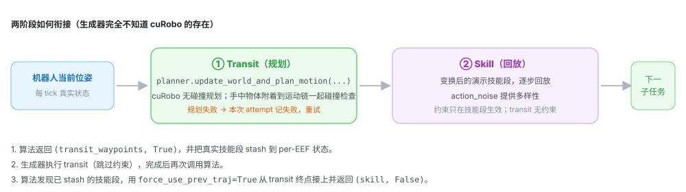

<p style="font-size:13.5px;">SkillGen 的一次生成尝试随后按这条流水线跑：</p>

<table><thead><tr><th style="width:22%">步骤</th><th>内容</th></tr></thead><tbody><tr><td><b>1. Reset</b></td><td>环境复位并随机化方块摆放；快照初始状态供输出 episode 使用。</td></tr><tr><td><b>2. 选段与变换</b></td><td>为当前子任务选一段源技能（默认按参考物体位姿最近邻），刚体变换到参考物体当前位姿；技能段<b>入口点</b>按描述的偏移范围随机化。</td></tr><tr><td><b>3. Plan</b></td><td>planner 把碰撞世界同步到实时场景（若该子任务预期握持物体则附着它），从当前末端位姿规划无碰撞 transit 到技能段起点。<b>规划失败 → 本次 attempt 放弃并计失败。</b></td></tr><tr><td><b>4. Execute</b></td><td>先执行 transit waypoints，再回放技能段并逐步加噪。</td></tr><tr><td><b>5. Record</b></td><td>每步检查成功条件；成功 attempt 导出为演示。</td></tr></tbody></table>

### 9.3 代码视角：一个钩子、三种返回、stash/resume

<p style="font-size:13.5px;">SkillGen 是 <code>GenerationAlgorithm</code> 的子类，只覆写 <code>plan_subtask_trajectory()</code>； 差别全部由类属性声明（自注册进 <code>REGISTERED_ALGORITHMS</code>）：</p>

<table><thead><tr><th style="width:34%">类属性</th><th>SkillGen 的值 / 含义</th></tr></thead><tbody><tr><td class="mono">name</td><td><code>"skillgen"</code> —— 即 <code>--alg</code> 的取值。</td></tr><tr><td class="mono">expected_eef_count</td><td><code>1</code> —— 单臂。</td></tr><tr><td class="mono">requires_motion_planner</td><td><code>True</code> —— 构造时要 <code>motion_planners=</code>（每环境一个）。</td></tr><tr><td class="mono">uses_subtask_start_signals</td><td><code>True</code> —— 源演示必须带子任务<b>起点</b>信号，池据此解析边界。</td></tr><tr><td class="mono">supports_coordination</td><td><code>False</code> —— 不支持跨臂协调约束。</td></tr></tbody></table>

#### 钩子的返回契约（生成器据此分支）

<table><thead><tr><th style="width:30%">返回</th><th>生成器的处理</th></tr></thead><tbody><tr><td class="mono">(waypoints, False)</td><td>当作真实子任务执行，<b>约束生效</b>。</td></tr><tr><td class="mono">(waypoints, True)</td><td>当作 MP transit 执行，<b>期间跳过约束</b>；算法自己把真实子任务 stash 到 per-EEF 状态。</td></tr><tr><td class="mono">None</td><td>规划失败；当前 <code>generate()</code> attempt 以 <code>success=False</code> 中止。</td></tr></tbody></table>

#### 新子任务分支（stash 技能段，返回 transit）

```text
# autodata_core/algorithms.py · SkillGen.plan_subtask_trajectory()
subtask_traj = data_generator.generate_eef_subtask_trajectory(...)   # 真实技能段
target_pose  = subtask_traj[0].pose

# 该子任务手里（预期）握持的物体，供 planner 附着到碰撞模型
expected_attached_object = datastream.get_expected_attached_object(eef_name, subtask_index)

planner = self.motion_planners[env_id]
planning_success = planner.update_world_and_plan_motion(
    target_pose=target_pose,
    expected_attached_object=expected_attached_object,
    env_id=env_id, step_size=..., enable_retiming=...)
if not planning_success:
    return None                                   # 整个 attempt 失败

mp_waypoints = self._convert_planned_trajectory_to_waypoints(planner, subtask_traj[0].passthrough_action)

eef_state.pending_subtask_trajectory = subtask_traj   # stash
eef_state.is_in_motion_plan = True
return mp_waypoints, True                            # 这是 transit
```

#### Resume 分支（执行完 transit，接上技能段）

```text
if eef_state.pending_subtask_trajectory is not None:
    merged = data_generator.merge_eef_subtask_trajectory(
        ..., subtask_trajectory=eef_state.pending_subtask_trajectory,
        force_use_prev_traj=True)          # 从 MP 终点位姿接入，而非实时机器人位姿
    eef_state.pending_subtask_trajectory = None
    eef_state.is_in_motion_plan = False
    return merged, False                       # 这才是真实技能段
```

::::::: callout blue

**为什么父类里也留着这段 resume 逻辑？** ——父类被所有算法复用，`SkillGen` 只覆写了 `plan_subtask_trajectory`， 两处分支内容一致，因此 resume 路径在基类与子类里都能命中，stash/resume 的状态机保持一致。

:::::::

#### 两阶段期间生成器的配套行为

<table><thead><tr><th style="width:34%">行为</th><th>细节</th></tr></thead><tbody><tr><td>约束在 transit 期间跳过</td><td><code>_apply_constraint_progression_rules()</code> 在 MP transit 期间直接返回 <code>False</code>——<b>transit 不受约束</b>。</td></tr><tr><td>MP 完成只“重置”不“推进”</td><td>MP 段执行完时 <code>_handle_subtask_completion()</code> 只把 <code>step_index=None</code> 触发 resume，<b>不推进子任务</b>。</td></tr><tr><td>transit 噪声</td><td><code>_convert_planned_trajectory_to_waypoints()</code> 读 <code>config.motion_noise_scale</code> 给每个 waypoint 加噪（缺省 <code>0.0</code>；Franka preset 为 <code>0.02</code>）。</td></tr><tr><td>规划轨迹放哪</td><td>规划结果从 <code>get_planned_poses()</code> 读出转成 Waypoint 执行；待执行技能段暂存 <code>pending_subtask_trajectory</code>。<b>两者都不写回源 DatagenInfo。</b></td></tr></tbody></table>

```text
源 DatagenInfo ──切片、变换──→ 技能片段（stash）
当前机器人状态 ──cuRobo 规划并执行──→ 技能起点 ──执行技能片段──→ 技能结束
```

::::::::

:::::::: card

### 9.4 标注：SkillGen 独有的 7 个标记

<p style="font-size:13.5px;">规划器必须知道每个技能段<b>从哪开始</b>，所以 SkillGen 除终止信号外还需要<b>起点信号</b>。 对四段堆叠任务，一条演示要打 <b>7 个标记</b>，且顺序固定为“起点、终点、起点、终点…以末段起点收尾”：</p>

| 序 | 标记 | 含义（技能段应覆盖接触丰富的那部分动作） |
| --- | --- | --- |
| 1 | `grasp_1` 起点 | 夹爪开始朝红块的最终接近 |
| 2 | `grasp_1` 终点 | 红块被稳稳抓牢 |
| 3 | `stack_1` 起点 | 开始往蓝块上放置 |
| 4 | `stack_1` 终点 | 红块落在蓝块上、夹爪松开 |
| 5 | `grasp_2` 起点 | 开始朝绿块最终接近 |
| 6 | `grasp_2` 终点 | 绿块被稳稳抓牢 |
| 7 | `stack_2` 起点 | 开始往红块上放置（末段，随轨迹结束，无需终点） |

<p style="font-size:13px;"><b>一个终止信号与下一个起点信号之间的那部分，就是留给 transit 规划的空隙</b>——所以技能段应只覆盖接触密集的动作 （最终接近、抓取、放置），其余交给规划。标记数量与预期不符时，episode 会直接重放以便重新标注。</p>

::::::: callout red

**两个硬限制：**  ① SkillGen  **只能手动标注** （`--viz kit`），自动标注只产出终止信号，不足以驱动规划； ② SkillGen 版任务描述的 **每个** 子任务都要写 `subtask_term_signal`， **包括最后一个** —— 该名字同时充当该子任务 **起点信号的键** ；末段本身仍随轨迹结束，不读取自己的完成信号。

:::::::

::::::::

:::::::: card

### 9.5 任务描述与 embodiment 的差异

<table><thead><tr><th style="width:32%">字段</th><th>SkillGen 版</th></tr></thead><tbody><tr><td class="mono">algo / use_skillgen</td><td><code>skillgen</code> / <code>true</code></td></tr><tr><td class="mono">subtask_term_signal</td><td><b>每个</b>子任务都要写（含末段 <code>stack_2</code>），兼作起点信号键</td></tr><tr><td class="mono">num_interpolation_steps</td><td><code>0</code>（transit 取代插值）</td></tr><tr><td class="mono">algo_params.subtask_start_offset_range</td><td>可用：随机化技能段<b>从哪进入</b>（负值提前、正值推后）；首段该偏移与 <code>first_subtask_start_offset_range</code> 相加</td></tr><tr><td class="mono">subtask_term_offset_range</td><td>官方两例均为 <code>[0,0]</code>——技能段边界通常不做抖动</td></tr></tbody></table>

#### 裁剪自 `franka_cube_stack_skillgen.yaml`

```yaml
algo: skillgen
generation_policy:
  use_skillgen: true
subtasks:
  franka:
    - object_ref: cube_2
      subtask_term_signal: grasp_1        # 兼作 grasp_1 的起点信号键
      subtask_term_offset_range: [0, 0]
      action_noise: 0.03
      num_interpolation_steps: 0          # transit 取代插值
    ...
    - object_ref: cube_2
      subtask_term_signal: stack_2        # 末段也要写（MimicGen 版此处留空）
      subtask_term_offset_range: [0, 0]
      num_interpolation_steps: 0
```

#### embodiment：只差一个 `eef_offset`

<p style="font-size:13.5px;"><code>franka_ik_rel_skillgen.yaml</code> 与 MimicGen 版形状相同（同为 <code>delta_pose_ik_single_arm</code>、7 维 action）， <b>唯一区别</b>是坐标系：SkillGen 的源数据标注在 Franka <code>panda_hand</code> 帧（cuRobo 的规划 link）， 而通用 IK-Rel 任务报告的是<b>指间</b> <code>end_effector</code> 帧，因此用偏移把报告位姿移回 <code>panda_hand</code>：</p>

```yaml
eef_offset: [0.0, 0.0, 0.1034]   # (环境报告的 EEF 帧) − (源数据标注帧)
```

::::::: callout red

这个偏移弄错，规划出来的 transit 与记录的技能段就 **对不齐** ，表现为“每次抓取都整体偏移一个固定距离”。 它是排查“变换后动作偏移”类问题的第一站。

:::::::

::::::::

:::::::: card

### 9.6 环境 profile：同一份数据，造出“料箱堆叠”变体

<p style="font-size:13.5px;">没有专门的料箱环境。一个<b>环境 profile</b>（<code>--env_profile</code> 叠加的 YAML）在创建环境时 把普通堆叠任务变成“料箱内堆叠”：蓝方块钉在桌心、放进一个窄料箱，红/绿方块在箱外随机化。 变体与基础任务共用<b>同一份</b>已标注堆叠数据集——这正是前面说的“一份数据驱动多个变体”。</p>

```yaml
# 裁剪自 autodata_examples/env_profiles/franka_bin_stack.yaml
name: franka_bin_stack
base_env: Isaac-Stack-Cube-Franka-IK-Rel-v0
planner: franka_stack_cube_bin          # ← 为该场景调好的 planner profile
scene:
  rigid_objects:
    add:
      blue_sorting_bin:
        usd_path: "{ISAACLAB_NUCLEUS_DIR}/Mimic/nut_pour_task/nut_pour_assets/sorting_bin_blue.usd"
        position: [0.4, 0.0, 0.0203]
        scale: [1.1, 1.6, 3.3]
    override:
      cube_1: {rigid_props: {solver_position_iteration_count: 40}}   # 更硬的接触求解
events:
  remove: [randomize_cube_positions]
  add:
    reset_blue_bin_pose: ...   # 钉死料箱
    reset_cube_pose: ...       # 红/绿方块在箱外随机化
```

<p style="font-size:13.5px;">对应的任务描述 <code>franka_bin_stack_skillgen.yaml</code> 与普通堆叠<b>子任务相同</b>， 但把 <code>action_noise</code> 设为 <code>0.0</code>——料箱壁留给扰动技能段的间隙很小。 生成命令只改<b>描述</b>与 <code>--env_profile</code>，<code>--input_file</code> 复用同一数据集：</p>

```bash
python scripts/generate_dataset.py \
    --env_name Isaac-Stack-Cube-Franka-IK-Rel-v0 \
    --alg skillgen \
    --task_descriptor autodata_examples/tasks/franka_bin_stack_skillgen.yaml \
    --env_profile autodata_examples/env_profiles/franka_bin_stack.yaml \
    --embodiment autodata_examples/embodiments/franka_ik_rel_skillgen.yaml \
    --input_file ./datasets/annotated_datasets/dataset_franka_skillgen_annotated.hdf5 \
    --output_file ./datasets/generated_dataset_skillgen_franka_bin.hdf5 \
    --generation_num_trials 10 --num_envs 1 --viz none
```

::::::: callout

**预期更差、更慢：** 料箱变体比纯堆叠成功率更低、耗时更长——规划问题更难（间隙窄），更多 attempt 被拒。 生成结果 JSON 会记录所用 profile，因为输出数据集本身只保存基础 env id。

:::::::

::::::::

:::::::: card

### 9.7 Planner：cuRobo 后端与配置解析

<p style="font-size:13.5px;">运动规划后端可插拔，官方后端是 <b>cuRobo</b>（GPU 加速的无碰撞轨迹优化），位于 <code>autodata_interfaces/motion_planners/</code>。planner 通过共享的 <b>Datastream</b> 读取所有世界状态 （碰撞几何、物体位姿、机器人关节），从不直接触碰 env / robot 句柄。</p>

#### 接口（`MotionPlannerBase`）

| 方法 | 用途 |
| --- | --- |
| update\_world\_and\_plan\_motion(target\_pose, ...) | 把碰撞世界同步到当前场景并规划到目标末端位姿（含预期附着物体），返回是否成功。 |
| has\_next\_waypoint() / get\_next\_waypoint\_ee\_pose() | 把规划轨迹按末端位姿迭代。 |
| get\_planned\_poses() | 完整规划位姿序列。 |
| reset\_plan() | 丢弃当前规划。 |
| get\_planner\_info() | 日志用诊断信息。 |

<p style="font-size:13px;color:var(--muted);">多环境生成时<b>每环境一个 planner</b>（共 <code>--num_envs</code> 个）；<code>generate_dataset.py</code> 在 <code>--alg skillgen</code> 时自动构建（<code>_build_motion_planners</code>），无需额外 CLI 标志。</p>

#### 配置怎么解析：两条路径

<table><thead><tr><th style="width:30%">入口</th><th>时机与行为</th></tr></thead><tbody><tr><td class="mono">CuroboPlannerCfg.from_profile(name)</td><td><b>环境 profile 指定了 <code>planner</code> 字段时</b>用它——把 planner 调参与 env id 解耦，直接按键取注册表里的工厂；未知名字直接断言失败。</td></tr><tr><td class="mono">CuroboPlannerCfg.from_task_name(task)</td><td>否则按任务 id <b>子串匹配</b>预设：含 <code>stack-cube-bin</code> → 料箱预设；含 <code>stack-cube</code> → 普通堆叠预设；其余回退 <b>Franka 预设</b>并打印警告。</td></tr></tbody></table>

<p style="font-size:13px;"><code>PLANNER_PROFILES</code> 目前注册三个：<code>franka</code>、<code>franka_stack_cube</code>、<code>franka_stack_cube_bin</code>。 三者都从 <code>franka_config()</code> 派生（Nucleus 上的 Franka URDF、碰撞球、夹爪开合位置等）， 再按场景覆盖：<code>static_objects</code>（如 <code>["bin","table"]</code>）、<code>approach_distance</code> / <code>retreat_distance</code>、 <code>collision_activation_distance</code>、<code>gripper_closed_positions</code>、<code>motion_noise_scale</code> 等。</p>

#### 关键配置字段

| 字段 | 含义 |
| --- | --- |
| robot\_config\_file / robot\_name | cuRobo 机器人模型（运动学、碰撞球）。 |
| ee\_link\_name | 规划到目标位姿的那个 link。 |
| gripper\_joint\_names + gripper\_open/closed\_positions | 规划时施加的夹爪状态。 |
| attached\_object\_link\_name / hand\_link\_names | 握持物体附着在运动链的哪里，以及附着物碰撞检查时要忽略哪些 link。 |
| world\_config\_file / static\_objects / world\_ignore\_substrings | 碰撞世界：基础描述、按静态处理的场景物体、要排除的 prim。 |
| collision\_checker\_type | 碰撞表示（默认 mesh）。 |
| num\_trajopt\_seeds / num\_graph\_seeds / trajopt\_tsteps | 规划力度：种子越多越慢，但更能跳出局部极小。 |
| interpolation\_dt | 返回轨迹的时间步长。 |
| collision\_activation\_distance | 碰撞代价开始生效的缓冲距离。 |
| approach\_distance | 目标前那段直线接近的长度。 |
| motion\_noise\_scale | transit waypoint 的噪声尺度（Franka preset `0.02`）。 |

#### 附着物体（Attached Objects）

<p style="font-size:13.5px;">当一个子任务的技能段结束时夹爪握着物体，则下一段 transit 必须把该物体<b>当作机器人的一部分</b>。 生成器依据任务描述的参考物体告诉 planner“预期附着哪个物体”；planner 快照它相对附着 link 的位姿， 并在整段规划里对合成体做碰撞检查。物体被放下后，附着解除、物体回到世界模型。</p>

#### 可视化与调试

<p style="font-size:13.5px;">cuRobo 后端可通过 <b>Rerun</b> 可视化碰撞球场模型与规划轨迹（<code>visualize_spheres</code> / <code>visualize_plan</code>）。 生成时传 <code>--visualize_plan</code> 即可开启，用于诊断规划失败、意外绕行、碰撞世界不一致等问题； 多环境时<b>只可视化 env 0</b>（保持仿真响应），且它独立于 Kit 窗口，故可与 <code>--viz none</code> 同用。 planner 诊断（成功率、耗时）可从 <code>get_planner_info()</code> 获取。</p>

::::::::

:::::::: card

### 9.8 Preflight：开跑前必须过的检查

<p style="font-size:13.5px;">在标注演示或开始一次长时间 SkillGen 生成前，先完成 preflight：校验 cuRobo 镜像、GPU 构建、源数据集、 Nucleus 资产下载，以及一次完整的端到端生成。<b>更换 GPU 或重建开发镜像后要重做。</b></p>

<table><thead><tr><th style="width:24%">要求</th><th>需要什么</th></tr></thead><tbody><tr><td>容器</td><td>cuRobo 开发镜像，用 <code>./docker/run_docker.sh -c</code> 启动。</td></tr><tr><td>显存</td><td>1–2 个环境建议<b>至少 24 GB</b>；约 5 个环境建议 <b>48 GB</b> 显卡。</td></tr><tr><td>GPU 构建</td><td>cuRobo 内核需按运行生成那块 GPU 的<b>算力</b>编译。</td></tr><tr><td>网络</td><td>初始化 planner 时需能出网访问 Nucleus 资产服务器，以获取 Franka URDF。</td></tr><tr><td>源数据</td><td>Git LFS 已拉取，且 SkillGen 标注的 HDF5 结构有效。</td></tr><tr><td>显示</td><td>可选。无头生成用 <code>--viz none</code>；手动标注、Kit 可视化、Rerun 查看器需要显示。</td></tr></tbody></table>

```bash
# 宿主机：确认 GPU 算力与显存，拉取 LFS，启动 cuRobo 容器
nvidia-smi --query-gpu=name,compute_cap,memory.total --format=csv
git lfs pull
./docker/run_docker.sh -c            # 镜像若是为别的 GPU 构建的，用 -c -r 重建

# 容器内：验证 cuRobo 与源数据集
python -c "import curobo, torch; print(curobo.__file__); print(torch.cuda.get_device_name(0))"
python scripts/validate_dataset.py ./datasets/annotated_datasets/dataset_franka_skillgen_annotated.hdf5

# 端到端规划冒烟测试：先生成 1 条成功演示
python scripts/generate_dataset.py \
    --env_name Isaac-Stack-Cube-Franka-IK-Rel-v0 --alg skillgen \
    --task_descriptor autodata_examples/tasks/franka_cube_stack_skillgen.yaml \
    --embodiment autodata_examples/embodiments/franka_ik_rel_skillgen.yaml \
    --input_file ./datasets/annotated_datasets/dataset_franka_skillgen_annotated.hdf5 \
    --output_file ./datasets/generated_dataset_skillgen_preflight.hdf5 \
    --result_file ./datasets/generated_dataset_skillgen_preflight.json \
    --generation_num_trials 1 --num_envs 1 --viz none
```

<p style="font-size:13px;color:var(--muted);">这次冒烟测试覆盖了 Nucleus URDF 下载、cuRobo 初始化、碰撞世界更新、运动规划、执行与 HDF5 录制。 当它记录下 1 条成功演示、且校验器报告输出为 <code>VALID</code> 时，preflight 通过。</p>

::::::::

:::::::: card

### 9.9 规划失败怎么读：哪些正常、哪些是配置问题

<p style="font-size:13.5px;">SkillGen 每次都在<b>新随机化的场景</b>上规划。有些配置在规划器的搜索预算内确实无解， 因此<b>单次规划失败是预期的</b>。两个官方 SkillGen 描述都设 <code>guarantee_success: true</code>： AutoData 记下这次失败、复位场景、继续重试，直到记录到所需数量的成功演示。</p>

<table><thead><tr><th style="width:40%">观察到的现象</th><th style="width:14%">预期？</th><th>应对</th></tr></thead><tbody><tr><td>偶发某次 attempt 报无碰撞路径，随后生成继续</td><td><span class="tag g">是</span></td><td>无需处理，关注整体成功率。</td></tr><tr><td>料箱堆叠比普通堆叠拒得更多、跑得更久</td><td><span class="tag g">是</span></td><td>窄间隙让规划更难，属预期。</td></tr><tr><td>每次都从<b>同一个子任务</b>开始就规划失败</td><td><span class="tag r">否</span></td><td>查该子任务的<b>起点标注</b>、末端坐标系与 <code>eef_offset</code>、planner profile、碰撞世界。</td></tr><tr><td>planner 初始化/运行时报 CUDA 显存不足</td><td><span class="tag r">否</span></td><td>减小 <code>--num_envs</code>；先用单环境验证再扩容。</td></tr><tr><td>规划开始前 cuRobo 导入 / CUDA 内核 / Nucleus 下载就失败</td><td><span class="tag r">否</span></td><td>按 preflight 失败处理，查对应排障章节（先修 setup，再查 planner 配置）。</td></tr></tbody></table>

::::::: callout blue

**排障顺序建议：** 先排除 setup 类问题（cuRobo 导入、CUDA 内核、Nucleus 下载、LFS 未拉取）， 再查标注/坐标系（起点标注、`eef_offset`、参考物体），最后才调 planner 参数（碰撞世界、种子数、approach 距离）。

:::::::

::::::::

## <span class="num">⑩</span>随机化专题：真正的“随机”只有几处

:::::::: card

<p class="lead" style="margin-top:0;">一条生成演示的多样性来自两层：<b>场景多样性</b>来自环境 Reset（环境层），<b>轨迹多样性</b>来自生成层。 下面把每个随机源单独讲清，并标注它属于“随机”还是“给定采样后确定”。</p>

### 10.1 STEP 0：环境 Reset 的随机化（输入 → 重抽 → 落盘）

<p style="font-size:13.5px;">环境层的随机化<b>不是 AutoData 写的</b>，是基任务（<code>isaaclab_tasks</code>）自带的 Isaac Lab <code>EventManager</code> 事件项；AutoData 只在开跑前用 env profile 做增删改， 然后<b>每个 attempt 的 <code>env.reset()</code> 里重新抽一次</b>。</p>

<div class="chain"><div class="col in"><h4>输入 · 开跑前只发生一次</h4><div class="when">规则从哪来</div><ul><li><b>基任务 events</b>（Isaac Lab 代码）：<code>randomize_cube_positions</code>、<code>randomize_franka_joint_state</code></li><li><b>env profile YAML</b>（<code>--env_profile</code>）：<code>events.remove</code> / <code>add</code> / <code>override</code></li><li><code>apply_env_profile()</code> 把它们写进 <code>env_cfg.events</code></li><li>此时<b>还没有任何随机数</b>，只是把“规则”装好</li></ul></div><div class="sep">→</div><div class="col run"><h4>执行 · 每个 attempt 重抽</h4><div class="when">规则怎么跑</div><ul><li><code>_reset_environment_for_generation()</code></li><li><code>env_loop</code> 里 <code>env.reset(env_ids)</code></li><li>→ EventManager 执行 <code>mode="reset"</code> 事件，<b>逐条抽签</b></li><li>→ 再进入生成层的边界抖动 / 选源段 / 动作噪声</li></ul></div><div class="sep">→</div><div class="col out"><h4>输出 · 落盘的是“结果”</h4><div class="when">抽到的状态怎么存</div><ul><li><code>get_scene_state()</code> → <code>GenerationResult.initial_state</code></li><li>每个 demo 的 <code>initial_state</code> 写进输出 HDF5</li><li><code>--result_file</code> JSON：记录算法、统计、profile name/path/planner</li><li><b>规则本身不落盘</b>；<code>seed</code> 让重抽过程可复现</li></ul></div></div>

<p style="font-size:13.5px;margin:6px 0 8px;">以 <code>franka_bin_stack</code> 为例，overlay 之后真正生效的随机化<b>清单</b> （“钉死”和“随机”用同一套机制，区别只在区间是否退化）：</p>

<table><thead><tr><th style="width:26%">event term</th><th style="width:9%">mode</th><th style="width:14%">作用对象</th><th>怎么随</th><th style="width:12%">类型</th></tr></thead><tbody><tr><td class="mono">randomize_franka_joint_state</td><td>reset</td><td>机器人</td><td>关节角随机（基任务自带，未被动）</td><td><span class="tag r">随机</span></td></tr><tr><td class="mono">reset_blue_bin_pose</td><td>reset</td><td>bin</td><td class="mono">x[0.4,0.4] y[0,0] z[0.0203,0.0203] yaw[0,0]</td><td><span class="tag f">钉死</span></td></tr><tr><td class="mono">reset_cube_1_pose</td><td>reset</td><td>cube_1</td><td class="mono">x[0.4,0.4] y[0,0] z[0.0203,0.0203] yaw[0,0]</td><td><span class="tag f">钉死</span></td></tr><tr><td class="mono">reset_cube_pose</td><td>reset</td><td>cube_2, cube_3</td><td class="mono">x[0.65,0.70] y[-0.18,0.18] yaw[-1,1]，z 固定，min_separation 0.1</td><td><span class="tag r">随机</span></td></tr><tr style="opacity:.55"><td><s>randomize_cube_positions</s></td><td>—</td><td>—</td><td>被 <code>events.remove</code> 设为 None，不生效</td><td>已移除</td></tr></tbody></table>

<p style="font-size:13.5px;margin:18px 0 8px;">同一个 profile，<b>两次 attempt 抽到的东西不同</b>（数值为示意）：</p>

<table><thead><tr><th style="width:16%">对象</th><th style="width:14%">类型</th><th style="width:29%">attempt #1（抽到的）</th><th style="width:29%">attempt #2（重抽）</th><th style="width:12%">变化</th></tr></thead><tbody><tr><td>机器人关节角</td><td><span class="tag r">随机</span></td><td class="mono">[-0.02, -0.28, 0.05, -2.10, 0.01, 2.03, 0.55]</td><td class="mono">[ 0.03, -0.51, -0.12, -2.35, 0.07, 2.41, 0.68]</td><td class="dice">🎲 变</td></tr><tr><td>bin</td><td><span class="tag f">钉死</span></td><td class="mono">(0.40, 0.00, 0.0203)</td><td class="mono">(0.40, 0.00, 0.0203)</td><td class="lock">🔒 同</td></tr><tr><td>cube_1</td><td><span class="tag f">钉死</span></td><td class="mono">(0.40, 0.00, 0.0203)</td><td class="mono">(0.40, 0.00, 0.0203)</td><td class="lock">🔒 同</td></tr><tr><td>cube_2</td><td><span class="tag r">随机</span></td><td class="mono">(0.67, 0.11, 0.0203) yaw 0.4</td><td class="mono">(0.70, -0.05, 0.0203) yaw -0.9</td><td class="dice">🎲 变</td></tr><tr><td>cube_3</td><td><span class="tag r">随机</span></td><td class="mono">(0.66, -0.13, 0.0203) yaw -0.7</td><td class="mono">(0.65, 0.16, 0.0203) yaw 0.6</td><td class="dice">🎲 变</td></tr></tbody></table>

::::::: callout

**一句话：** 规则是 **输入** （基任务 events + profile delta，在代码和 YAML 里）；随机化在每个 attempt 的 `env.reset()` 里按规则 **重抽一次** ；AutoData 只保存 **抽到的状态** （每个 demo 的 initial\_state） 和 **复现元信息** （result\_file + seed）。profile  **不是**  AutoData 固化的随机化配置。

:::::::

### 10.2 子任务边界抖动（`randomize_subtask_boundaries`）

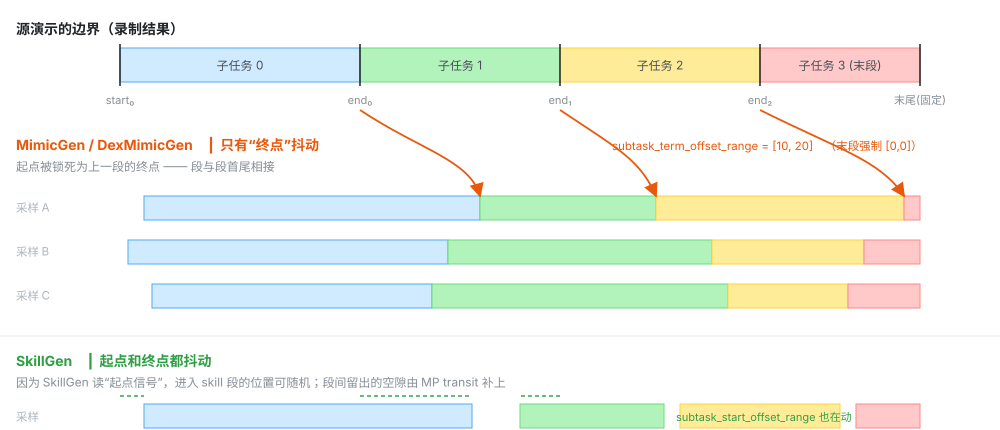

<p class="note">加载数据集时，<code>DataGenInfoPool</code> 会用<b>最坏情况</b>（所有偏移取极值）预演一遍，断言“子任务非空且不重叠”， 标注错的源数据会立刻报错并给出具名原因。</p>

### 10.3 源演示段选择（`selection_strategy`）

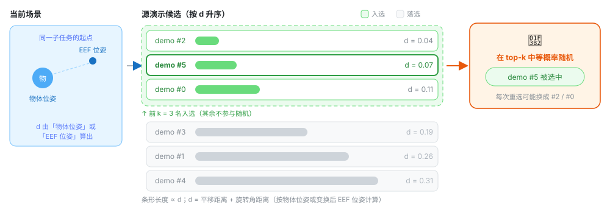

#### d 在算哪两者的距离

<p style="font-size:13.5px;">当前场景只有一个锚点，候选段有 N 条，所以 <code>d</code> 是「<b>一个当前位姿</b>」对「<b>N 个候选段起点位姿</b>」的 <b>一对多</b>比较结果（<code>dists</code> 是长度 N 的向量）。这里的“起点”不是标注时的原始起点，而是 <b>边界抖动之后</b>该子任务切片的第 0 帧（见 9.2）——因此同一条源演示在不同 attempt 里算出的 <code>d</code> 也会变。</p>

<table><thead><tr><th style="width:23%">策略</th><th style="width:18%">左端：当前场景</th><th style="width:36%">右端：候选段起点</th><th>是否先做坐标变换</th></tr></thead><tbody><tr><td class="mono">nearest_neighbor_object</td><td>当前<b>物体</b>位姿</td><td>源演示该子任务第 0 帧的<b>物体</b>位姿</td><td>否。两端都是物体位姿，直接比</td></tr><tr><td class="mono">nearest_neighbor_robot_distance</td><td>当前 <b>EEF</b> 位姿</td><td>源演示第 0 帧的 <b>EEF</b> 位姿，先经 <code>T_obj_cur · inv(T_obj_src) · T_eef_src</code> 搬到“当前物体系”</td><td>是。传入的 <code>object_pose</code> 在这里是<b>变换算子</b>，不是比较对象</td></tr></tbody></table>

<p style="font-size:13px;color:var(--muted);">位姿统一是 4×4 齐次变换 <code>[R | p]</code>：<code>R</code> 是 3×3 旋转矩阵，<code>p</code> 是位置向量[m]。 <b>EEF 位姿</b>是末端执行器（夹爪）那一点的位姿；<b>物体位姿</b>是 <code>subtask.object_ref</code> 所指物体的位姿。两者都在同一坐标系下比较。</p>

#### d 怎么算、为什么只用来排序

```text
d_i       = pos_weight · pos_dists + rot_weight · rot_dists
pos_dists = ‖p_i − p_cur‖                       # 位置距离（L2 范数）[m]
rot_dists = acos((tr(R_i · R_curᵀ) − 1) / 2)   # 旋转角距离 [rad]，0~π
```

<p style="font-size:13.5px;">两项量纲不同（m vs rad），所以用 <code>pos_weight</code> / <code>rot_weight</code> 调“位置更重要还是姿态更重要”。 因此 <code>d</code> 的数值本身没有物理含义，<b>只在同一批候选之间做比较才有意义</b>；代码里也从不判断 <code>d &lt; 某阈值</code>，永远只是升序排一遍、取前 <code>nn_k</code> 条。</p>

::::::: callout blue

**真正的目的：让紧接着的变换改动最小。**  选完源段，源片段会按 `T_obj_cur · inv(T_obj_src) · T_src_eef` 整体刚体变换到当前物体位姿下再回放（阶段 3b）。 起点位姿越接近当前场景 → 需要的变换越小 → 重放出来的手部动作越可能仍然“够得着、抓得住”。 因为没法对每条候选都真跑一遍仿真去验证，就用起点位姿差这个 **廉价代理** 来排序。所以“近”是手段，不是目的。

:::::::

<p class="note">三点注意：① <code>d</code> 只看源片段的<b>第 0 帧</b>，不评估整段动作质量——起点很像但后面很糙的两段它区分不了； ② 取 top-k 之后还要<b>等概率随机</b>（<code>nn_k = min(nn_k, 可用源演示数)</code>，<code>nn_k: 1</code> 才是“总选最近那条”）， 用一点可靠性换多样性，避免输出塌缩到同一条源演示； ③ <code>object_ref</code> 为空时只允许 <code>random</code>，双臂 <code>coordination</code> 下另一臂已选过则直接沿用同一条， 这两种情况根本不算距离。</p>

### 10.4 动作噪声（`action_noise`）

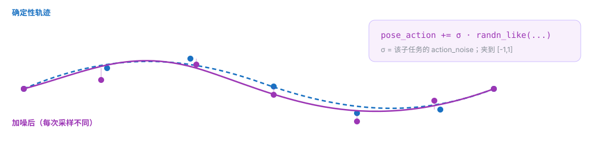

<p class="note"><code>apply_noise_during_interpolation</code> 决定桥接插值阶段是否也加噪。<b>被回放的源片段永远加噪</b>， 插值 / hold 段是否加噪由该开关决定。单臂与双臂适配器都只作用于 pose 部分，夹爪等 passthrough 通道不加噪。 噪声值来源：源片段子任务 <code>action_noise</code>；插值段 <code>apply_noise_during_interpolation × action_noise</code>（默认 false → 0）； SkillGen 的 MP transit 用 <code>motion_planner.config.motion_noise_scale</code>（缺省 0）。</p>

### 10.5 协调噪声（仅双臂）

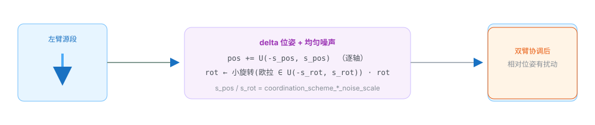

### 10.6 一图看清：所有随机化参数在哪配置

<table><thead><tr><th style="width:26%">参数</th><th style="width:16%">位置</th><th style="width:14%">类型</th><th>含义</th></tr></thead><tbody><tr><td class="mono">first_subtask_start_offset_range</td><td>Subtask</td><td><span class="tag r">边界抖动</span></td><td>第一个子任务起点的偏移范围</td></tr><tr><td class="mono">subtask_term_offset_range</td><td>Subtask</td><td><span class="tag r">边界抖动</span></td><td>每个子任务终点边界的偏移范围（末段必须 <code>[0,0]</code>）</td></tr><tr><td class="mono">algo_params.subtask_start_offset_range</td><td>SkillGen 专有</td><td><span class="tag r">边界抖动</span></td><td>SkillGen 子任务起点的偏移范围（仅当算法读起点信号时生效）</td></tr><tr><td class="mono">selection_strategy + selection_strategy_kwargs.nn_k</td><td>Subtask</td><td><span class="tag r">源段选择</span></td><td>random / 最近邻物体 / 最近邻 EEF；top-k 内再随机</td></tr><tr><td class="mono">select_src_per_subtask / select_src_per_arm</td><td>generation_policy</td><td><span class="tag r">源段选择</span></td><td>重选粒度（每段重选 / 每条臂各自选）</td></tr><tr><td class="mono">action_noise</td><td>Subtask</td><td><span class="tag r">动作噪声</span></td><td>该子任务每步 pose 动作的高斯噪声幅度</td></tr><tr><td class="mono">apply_noise_during_interpolation</td><td>Subtask</td><td><span class="tag r">动作噪声</span></td><td>插值桥接阶段是否也加噪</td></tr><tr><td class="mono">coordination_scheme_pos/rot_noise_scale</td><td>SubtaskConstraint</td><td><span class="tag r">协调噪声</span></td><td>双臂协调 delta 位姿的均匀噪声尺度</td></tr><tr><td class="mono">seed</td><td>generation_policy</td><td><span class="tag f">复现</span></td><td>统一给 random / numpy / torch 播种</td></tr><tr><td class="mono">num_interpolation_steps / num_fixed_steps</td><td>Subtask</td><td><span class="tag f">确定</span></td><td>桥接段长度（改变时序，但不含随机）</td></tr><tr><td class="mono">transform_first_robot_pose / interpolate_from_last_target_pose</td><td>generation_policy</td><td><span class="tag f">确定</span></td><td>插值锚点选择（影响拼接口感，不含随机）</td></tr></tbody></table>

::::::: callout

**一句话：** 场景多样性来自 Reset（环境层），轨迹多样性来自生成层——  **边界抖动** 改变“时间段”， **源段选择** 改变“用哪段”， **动作噪声** 改变“怎么执行”。三者叠加，就得到大量彼此不同的演示。

:::::::

::::::::

## <span class="num">⑪</span>数据集结构：HDF5 里到底存了什么

:::::::: card

<p class="lead" style="margin-top:0;">从原始采集 → 标注 → 生成，数据始终装在 Isaac Lab HDF5 数据集里。三者结构相同， 标注只是在 episode 内多写了一份 <code>obs/datagen_info</code>。</p>

### 每条 episode 的必备内容

| 键 | 含义 |
| --- | --- |
| actions | 逐步记录的 action 序列，形状 `[T, D]`。Franka 单臂为 7 维（delta pose 6 + 夹爪 1）。 |
| initial\_state | episode 开始时的场景快照——回放时先把场景复位到这个状态，再逐步执行 actions。 |
| obs | 观测组：包含策略观测，以及（标注后）`obs/datagen_info` 下的逐帧位姿/信号记录。 |

<p style="font-size:13px;color:var(--muted);">校验器正好检查这三项是否存在，见 ⑫。episode 名、数量、长度与成功比例以真实文件为准。</p>

### 标注写入的 `obs/datagen_info`

<table><thead><tr><th style="width:28%">字段</th><th style="width:24%">形状（每条演示）</th><th>含义</th></tr></thead><tbody><tr><td class="mono">eef_pose</td><td class="mono">{eef_name: [T,4,4]}</td><td>逐步记录的 EEF <b>实际</b>位姿。</td></tr><tr><td class="mono">target_eef_pose</td><td class="mono">{eef_name: [T,4,4]}</td><td>由记录 action 反解出的控制器<b>目标</b>位姿（变换用）。</td></tr><tr><td class="mono">object_poses</td><td class="mono">{object_name: [T,4,4]}</td><td>记录到的物体位姿，作为子任务的参考系。<br><span class="path">HDF5 键为 object_pose（单数），入池后属性为 object_poses（复数）</span></td></tr><tr><td class="mono">subtask_term_signals</td><td class="mono">{subtask_name: [T]}</td><td>逐步布尔完成标志。</td></tr><tr><td class="mono">subtask_start_signals</td><td class="mono">{subtask_name: [T]}</td><td>逐步布尔起点标志，仅 SkillGen。</td></tr><tr><td class="mono">passthrough_action</td><td class="mono">{channel: [T,D]}</td><td>非位姿通道（夹爪、手关节、底盘），回放逐字复制。</td></tr></tbody></table>

### 池里的形态与边界表

<p style="font-size:13.5px;">源池（<code>DataGenInfoPool</code>）把每个 episode 变成上述<b>逐帧记录</b>，并额外为每条 episode 存 <b>子任务边界</b>：按 EEF 给出每个子任务的 <code>(start, end)</code> 下标对。 边界由信号导出——终止信号的上升沿结束其子任务（最后一段随轨迹结束）；启用起点信号时（SkillGen）， 每个子任务的起点改由其<b>自己的</b>起点信号沿决定，而非上一段的终点。</p>

```text
# 边界解析要点（pool.py）
非 SkillGen：start_index = prev_end        # 首尾相接
SkillGen   ：start_index = 起点信号上升沿   # 技能段间可留空隙，由 MP 补上
终点       ：终止信号上升沿 + 2；末段用整条轨迹长度
解析后     ：_validate_subtask_offsets() 用最坏情况偏移量静态校验，保证随机化后子任务仍非空、不重叠
```

### 命名与顺序完全来自任务配置

<p style="font-size:13.5px;">代码依次处理描述里的子任务项，并按配置中的信号名读取示范标注。<code>DatagenInfo</code> 里的信号 <b>只标记时间点</b>；代码不会观察轨迹后自行判断“这段是抓取”。最后一段没有完成信号，因为它直接延续到整条示范末尾。 SkillGen 的任务配置需为<b>每一段</b>提供信号名，最后一项还需写 <code>subtask_term_signal</code>，用作开始信号的键。</p>

::::::::

## <span class="num">⑫</span>STEP 4 · 验证与回放

:::::::: card

### 结构校验

```bash
python scripts/validate_dataset.py ./datasets/generated_dataset_mimicgen_franka.hdf5
```

<p style="font-size:13.5px;">校验器为每个文件打印一行摘要——episode 数量、文件元数据里记录的环境 id、仿真参数—— 随后打印逐文件的问题列表。每条 episode 都会被检查必备字段（<code>actions</code>、<code>initial_state</code>、<code>obs</code>）。 它同时适用于原始、标注、生成的任意数据集。</p>

### 可视回放

```bash
python submodules/IsaacLab-Arena/submodules/IsaacLab/scripts/tools/replay_demos.py \
    --task Isaac-Stack-Cube-Franka-IK-Rel-v0 \
    --viz kit \
    --num_envs 20 \
    --dataset_file ./datasets/generated_dataset_mimicgen_franka.hdf5
```

<p style="font-size:13.5px;">每条 episode 先把场景复位到它记录的 <code>initial_state</code>，再逐步执行记录的 actions—— 应当看到每次物体摆放都不同。好的生成演示看起来像一条可信的人类演示（干净、稳固的抓取与放置）。</p>

### 回放/质量观察清单

| 现象 | 可能原因与调整 |
| --- | --- |
| 子任务边界处动作抖动 / 突兀 | 插值太短——调大 `num_interpolation_steps`。 |
| 抓取“勉强成功” | 收紧 `subtask_term_offset_range`，或调小 `action_noise`。 |
| 变换后抓取整体固定偏移 | `eef_offset` 与环境/源数据坐标系不一致（见 ⑬）。 |
| 大动作执行缓慢或够不到、快速动作回放被截断 | 6 维 pose action 撞到 `[-1,1]` 截断（`clip_pose_action_to_unit`）。 |

::::::: callout

**注意：Isaac Lab 的 PhysX 不是确定性的。** 回放时从保存的 initial\_state 重放记录 action， 可能与原始生成过程发生偏离，因此 **少数**  episode 回放时可能不再成功——但数据集里 **每一条** 在生成时都确实满足过成功条件。 结构校验通过 ≠ 物理回放必然成功。

:::::::

::::::::

## <span class="num">⑬</span>参数速查 · 常见坑 · 文件索引

:::::::: card

### 任务描述 YAML：Subtask 字段

<table><thead><tr><th style="width:30%">字段</th><th style="width:12%">默认</th><th>含义</th></tr></thead><tbody><tr><td class="mono">&lt;eef_name&gt;</td><td>必填</td><td>EEF 名，必须与机械臂描述一致。MimicGen/SkillGen 期望 1 个；DexMimicGen 期望 ≥2 个。声明顺序 = 执行顺序 = 约束里的下标。</td></tr><tr><td class="mono">object_ref</td><td><code>""</code></td><td>定义该子任务参考系的物体名，须匹配 Datastream 的物体位姿键。</td></tr><tr><td class="mono">subtask_term_signal</td><td><code>""</code></td><td>子任务终止信号名；除末段外必填（SkillGen 每段都要）。</td></tr><tr><td class="mono">subtask_start_signal</td><td><code>""</code></td><td>子任务起点信号名，仅 SkillGen。</td></tr><tr><td class="mono">first_subtask_start_offset_range</td><td><code>[0,0]</code></td><td>某 EEF 第一个子任务起点的偏移范围。</td></tr><tr><td class="mono">subtask_term_offset_range</td><td><code>[0,0]</code></td><td>终止边界偏移；负值提前、正值推后。末段必须 <code>[0,0]</code>。</td></tr><tr><td class="mono">selection_strategy</td><td><code>random</code></td><td>选源策略；<code>random</code> 是 <code>object_ref</code> 为空时唯一允许的值。</td></tr><tr><td class="mono">selection_strategy_kwargs</td><td><code>{}</code></td><td>直接传给策略；未知/不支持的值会在生成期失败。<br>支持 <code>pos_weight</code>（默认 1.0）、<code>rot_weight</code>（默认 1.0）、<code>nn_k</code>（默认 3）。</td></tr><tr><td class="mono">action_noise</td><td><code>0.0</code></td><td>pose-action 独立高斯噪声的尺度。</td></tr><tr><td class="mono">num_interpolation_steps</td><td><code>0</code></td><td>从当前起始位姿到变换后段首位姿的桥接步数。</td></tr><tr><td class="mono">num_fixed_steps</td><td><code>0</code></td><td>回放前额外保持段首目标位姿的步数。</td></tr><tr><td class="mono">apply_noise_during_interpolation</td><td><code>false</code></td><td>噪声是否也用于插值/固定保持步；被回放的源片段无论如何都加噪。</td></tr><tr><td class="mono">algo_params</td><td><code>{}</code></td><td>算法专有字段；MimicGen/DexMimicGen 不接受额外字段，SkillGen 支持 <code>subtask_start_offset_range</code>。</td></tr></tbody></table>

### 任务描述 YAML：generation\_policy

<table><thead><tr><th style="width:30%">字段</th><th style="width:14%">默认</th><th>含义</th></tr></thead><tbody><tr><td class="mono">seed</td><td><code>1</code></td><td>生成开始前给 Python <code>random</code>、NumPy、PyTorch 播种。</td></tr><tr><td class="mono">num_trials</td><td><code>10</code></td><td>生成目标；<code>guarantee_success</code> 为真时计成功数，否则计总尝试数。<code>--generation_num_trials</code> 覆盖它。</td></tr><tr><td class="mono">guarantee_success</td><td><code>true</code></td><td>为真则一直尝试到攒够 <code>num_trials</code> 个成功；为假则跑够 <code>num_trials</code> 次尝试即停。</td></tr><tr><td class="mono">keep_failed</td><td><code>false</code></td><td>失败尝试是否导出到单独的 HDF5；成功演示始终写入主输出文件。</td></tr><tr><td class="mono">use_skillgen</td><td><code>false</code></td><td>标注是否需采集 SkillGen 起点信号；生成时会被 <code>--alg</code> 覆盖。</td></tr><tr><td class="mono">select_src_per_subtask</td><td><code>false</code></td><td>每个子任务是否可重选源演示；为假则该 EEF 全程复用首次选择。</td></tr><tr><td class="mono">select_src_per_arm</td><td><code>false</code></td><td>每条臂是否独立选源；为假则首次选择被所有臂共享并缓存整轮。</td></tr><tr><td class="mono">transform_first_robot_pose</td><td><code>false</code></td><td>是否为<b>每个</b>子任务的目标序列前拼源 EEF 位姿（为假时只对首个）。</td></tr><tr><td class="mono">interpolate_from_last_target_pose</td><td><code>true</code></td><td>非首段的插值桥接是否从上一段最后目标位姿出发；为假则从实时 EEF 位姿出发。SkillGen 总是从 MP 终点接入。</td></tr></tbody></table>

### 约束（多 EEF，DexMimicGen）

| 字段 | 默认 | 含义 |
| --- | --- | --- |
| constraint\_type | 必填 | `sequential` 或 `coordination`（大小写不敏感）。 |
| eef\_subtask\_constraint\_tuple | 必填 | 恰好两个 `[eef_name, subtask_index]`；顺序对 sequential 有意义。 |
| sequential\_min\_time\_diff | `-1` | `-1`：前者完成前后者不启动；正值：后者执行到只剩这些步时停下等。 |
| coordination\_scheme | `replay` | `replay`（单位变换）/ `transform`（完整刚体）/ `translate`（仅平移）。 |
| coordination\_scheme\_pos/rot\_noise\_scale | `0.0` | 共享变换上的均匀噪声半宽（m / rad）。 |
| coordination\_synchronize\_start | `false` | 为真则子任务保持首位姿直到配对 EEF 抵达其协调子任务。 |

### 机械臂描述 YAML

| 类型 / 字段 | 要点 |
| --- | --- |
| delta\_pose\_ik\_single\_arm | 单臂相对位姿 IK。action = `[delta_pos(3), delta_rot(3), gripper]`。字段：`eef_name`、`pose_obs_keys.pos/quat`、`action_layout.gripper_dim`、`clip_pose_action_to_unit`、`eef_offset`。 |
| absolute\_pose\_whole\_body\_bimanual | 人形绝对位姿全身 IK。action = `[left_pos, left_quat, right_pos, right_quat, hand_joints, ...]`。字段：`eefs.<arm>.pose_obs_keys`、`gripper_action_indices`、`action_layout.*_pose_slice` / `hand_joints_slice` / `canonicalize_quat` / `passthrough_channels`。 |
| eef\_offset | 从机器人运动学控制 link 到位姿观测所报坐标系的平移 \[m\]；两帧不一致时抓取会整体偏移。 |

### 常见坑

| 症状 | 根因 | 处理 |
| --- | --- | --- |
| 每次抓取都整体偏移一个固定距离 | `eef_offset` 与环境 EEF 观测帧 / 源数据标注帧不一致 | 量出两帧差并据此设置 `eef_offset`；SkillGen 版设为 `[0,0,0.1034]`（指尖↔panda\_hand） |
| 资产/动作翻转约 180°，或旋转乱漂 | 四元数顺序写反（w,x,y,z ↔ x,y,z,w） | 全框架统一 (x,y,z,w)，单位元 `[0,0,0,1]`；检查观测项与手写位姿 |
| 首次读位姿就 `KeyError` | `pose_obs_keys` / `obs_group` 与环境观测项不匹配 | 列出环境观测项，照抄键名与组名 |
| 手指不动，或（双臂）动错手 | `gripper_action_indices` 在双臂间错配，或按整条 action 索引（应相对 hand-joints 块） | 索引是 `hand_joints_slice` 内 0 基；对照环境 URDF 关节顺序 |
| 直接构造 `Waypoint(noise=None)` 执行报 `TypeError` | `noise` 默认 `None`，而单臂适配器写的是 `if scale > 0.0` | 手工构造时显式给 `0.0`；正常路径都会置浮点值 |
| 以为“每个子任务都重选源” | `select_src_per_subtask: true` 与 `select_src_per_arm: false` 同时存在 | 当前实现是整轮只选一次；不要只按参数名字面理解 |
| 添加物体后规划器与物理不一致 | 添加物体的 spawn 位姿烘焙进 USD stage，规划器碰撞世界读它而非 reset 事件结果 | 钉死物体时让其 spawn 位姿与 reset 事件一致 |

### 涉及文件速查

<table><thead><tr><th style="width:34%">主题</th><th>文件</th></tr></thead><tbody><tr><td>主编排器 / 生成循环</td><td class="mono">autodata_core/data_generator.py</td></tr><tr><td>算法注册表 / MimicGen / DexMimicGen / SkillGen</td><td class="mono">autodata_core/algorithms.py</td></tr><tr><td>源片段池 / 边界解析</td><td class="mono">autodata_core/pool.py</td></tr><tr><td>Waypoint / 轨迹 / 执行</td><td class="mono">autodata_core/waypoint.py</td></tr><tr><td>源数据 schema</td><td class="mono">autodata_core/datagen_info.py</td></tr><tr><td>位姿变换</td><td class="mono">autodata_core/transforms.py</td></tr><tr><td>源演示选择策略</td><td class="mono">autodata_core/selection_strategy.py</td></tr><tr><td>Datastream 读接口 / action 编解码</td><td class="mono">autodata_interfaces/datastream/datastream.py</td></tr><tr><td>env 配置与锁步循环</td><td class="mono">autodata_interfaces/env/isaaclab_env_interface.py</td></tr><tr><td>action 编解码适配器</td><td class="mono">autodata_interfaces/embodiments/single_arm_embodiment_adapter.py<br>bimanual_embodiment_adapter.py</td></tr><tr><td>约束定义</td><td class="mono">autodata_interfaces/tasks/subtask_constraint_spec.py</td></tr><tr><td>生成策略 / 子任务规格</td><td class="mono">autodata_interfaces/tasks/generation_policy_spec.py · subtask_spec.py</td></tr><tr><td>运动规划后端</td><td class="mono">autodata_interfaces/motion_planners/（cuRobo）</td></tr><tr><td>CLI 入口</td><td class="mono">scripts/generate_dataset.py · annotate_demos.py · validate_dataset.py</td></tr><tr><td>结果文件</td><td class="mono">autodata_utils/generation_result.py</td></tr><tr><td>示例配置</td><td class="mono">autodata_examples/{tasks,embodiments,env_profiles}/</td></tr></tbody></table>

### 四份文档的合并关系

| 来源 | 并入本文的位置 |
| --- | --- |
| docs/（概念 + 三条 workflow + quickstart + advanced） | 全文骨架：①③④⑤⑥⑦⑧⑨⑪⑫⑬ |
| docs/pages/workflows/skillgen/（index + preflight）+ advanced/motion\_planners | ⑨ SkillGen 深潜（两阶段、标注、planner、preflight、失败模式） |
| AutoData-原理与数据流总览.md | ⑥ 生成生命周期、⑦ Waypoint 层、⑩ 随机化细节、⑬ 文件索引 |
| AutoData-数据生成随机化可视化.html | ⑩ 随机化专题（STEP0 因果链、边界抖动、源段选择、动作噪声、协调噪声、参数总表） |
| 仓库 README.md | ① 全流程概览、总体定位与四大构件 |

::::::::

<footer>

内容整理自 AutoData 官方文档与仓库代码；正文数值为示意值，字段与参数以仓库当前代码为准。

运行脚本需在 `./docker/run_docker.sh` 启动的开发容器内执行（SkillGen 需 `-c` 以包含 cuRobo）。

</footer>

