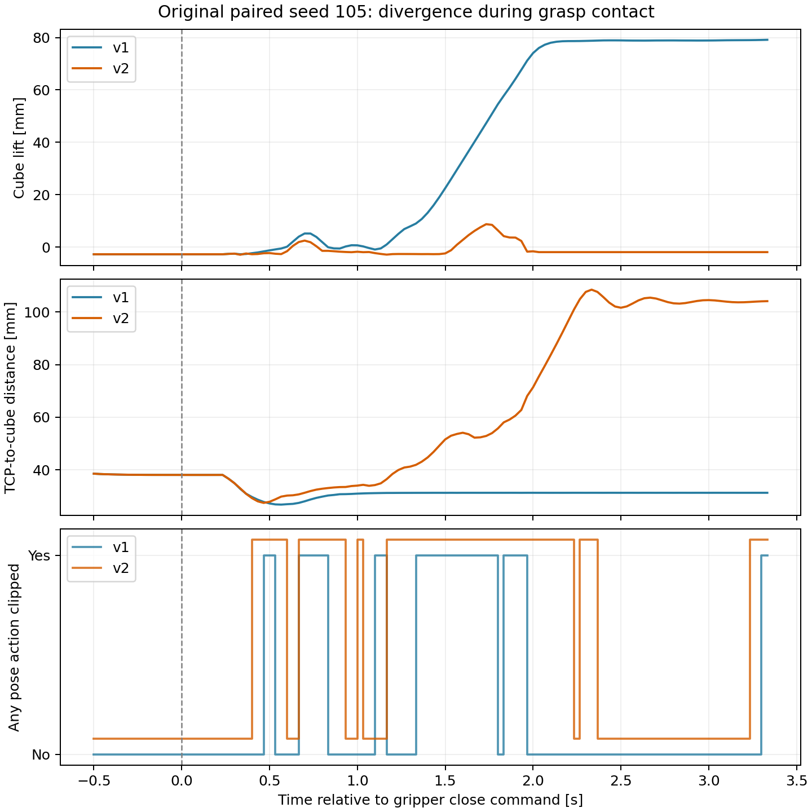

# cuRobo v2 成功率变化：种子 105 抓取诊断

版本 v001；日期 2026-10-14；仅本地交付。保持原 v1 环境和原始 benchmark 不变。

## 结论

**原批次的 5/5 → 4/5 来自一次抓取接触阶段失败，不能直接解释为 v2 总体能力下降。新增两次单独复现中，未修改 v2 后端的种子 105 均成功。**

现有证据最支持这一机制：规划器历史状态影响进入抓取的关节路径；已有技能在夹爪闭合、手部运动和接触之间比较敏感，实际跟踪与动作裁剪会放大微小差异；漏抓后，基于夹爪闭合的“抓取确认”仍可能通过，进而产生规划成功、真实任务失败。

其中，接触阶段分叉、动作裁剪和抓取检查缺口已由代码及记录验证；独立采样状态也已验证。**尚未通过单变量实验隔离采样器、优化器缓存及其他历史状态各自对原失败的贡献**，因此不把这条机制写成唯一已证实的底层根因。

## 1. 原失败具体发生在哪里

原批次两版场景初始状态相同；以第一条关闭夹爪命令对齐，而不是直接对齐视频/录制帧号。v1 在第 576 帧发出关闭命令，v2 在第 577 帧发出，差别主要来自前面的 transit 长度。

| 相对关闭命令的控制步 | 实际 TCP 位置差 | TCP 姿态差 | 观察 |
| --- | ---: | ---: | --- |
| 0 | 0.0043 mm | 0.00063° | 方块位置差约 0.00006 mm，几乎相同 |
| 10（0.33 s） | 0.107 mm | 0.042° | 两版应用的平移目标仍相同，夹爪仍在关闭 |
| 15（0.50 s） | 1.72 mm | 0.56° | 方块位移开始分叉 |
| 40（1.33 s） | 7.38 mm | 2.23° | v2 TCP 与方块的相对位置已明显偏离 |

这削弱了“v2 没到达抓取起点”或明显坐标系错误的解释。分叉出现在随后闭合与接触运动中；两个规划请求都成功，并不能保证手指真的夹住方块。

原失败最终最大抬升 8.8 mm，v1 同种子最大抬升 104.5 mm；v2 最终未满足放置 pad 的 XY 范围。详细末状态已经保存在先前 MVP 报告，本次不更改原始标签。

图只展示关闭命令前后约 −0.5 至 3.3 秒；不是完整轨迹的最大抬升图。虚线时刻是开始发出关闭命令，不能解释为夹爪已经完全闭合。

## 2. 同一 TCP 目标并不代表同一机器人执行状态

闭合瞬间，原 v1/v2 的机器人关节向量差范数为 0.0163 rad，最大单关节差约 0.66°，同时 TCP 位姿几乎一致。这符合 7 自由度冗余手臂在相同末端位姿下存在不同关节配置的情况；不是两版完整关节轨迹等价。

当前 SkillGen 将 planner 的关节轨迹做 FK，随后只把末端位姿传给 `Waypoint`。运动规划 waypoint 没有传下 planner 的关节 seed；实际执行仍由相对位姿 DLS IK 控制器计算关节指令。规划出的关节路径、实际 IK 跟踪路径和真实接触过程之间没有闭环等价保证。

原输入限制每个平移轴每步最多 4 mm、旋转轴角分量每步最多 0.02 rad。原失败关闭后前 60 步中，v1 有 27 步至少一个位姿动作分量被裁剪，v2 有 40 步；首次裁剪分别在第 14 和第 12 步。裁剪意味着控制器应用的增量目标与原始 waypoint 误差之间出现截断。

记录还显示，在夹爪仍关闭的阶段手部已经运动：关闭后第 10 步，两版夹爪位置仍约 0.46 rad，尚未到闭合目标 0 rad。接触、IK 跟踪和关闭时序相互作用，可把微小差异放大为一次漏抓。这一敏感性在 v1 流程中同样存在；不能靠升级规划库自动消除。

不是所有动作裁剪都造成失败，v1 成功样本也有裁剪。关节姿态差与漏抓的因果贡献尚未隔离，不能仅凭相关性认定某个关节偏差就是唯一原因。

## 3. 同样的种子，为什么单独复现又成功

新增两次真实 GPU 复现均采用同一份任务、源示范、实际初始物体/机器人状态和原 v2 后端。唯一重要实验组织差别是：种子 105 从原来的连续批次第五次，变为新进程第一次。

| v2 运行条件 | 完整任务 | 方块最大抬升 |
| --- | --- | ---: |
| 原五次批次的第五次，seed 105 | 失败 | 8.8 mm |
| 新进程第一次，seed 105，带诊断记录 | 成功 | 102.6 mm |
| 新进程第一次，seed 105，不带额外记录 | 成功 | 102.6 mm |

两个新运行的动作、机器人关节、TCP 位置和方块观测数组逐元素完全相同。v2 后端代码哈希与原 benchmark 相同。因此这次成功不依赖后端修复，也没有证据显示诊断记录改变了这两个运行的行为。

但重置种子只重置了场景与全局随机数。代码检查发现，v2 `SampleBuffer` 创建单独的 `torch.Generator`，并显式用它抽取 seed 索引。现有 reset hook 调用 `torch.manual_seed(seed)`，不会重置这个私有生成器，也没有调用 `MotionPlanner.reset_seed()`。

对固定 v2 实现的 CPU 执行验证了三件事：

1. 调用全局 `torch.manual_seed(105)` 后，私有生成器状态不变。
2. 连续两次取样得到不同 seed 集合。
3. 显式 `SampleBuffer.reset()` 后，可重放第一次样本。

因此，场景同种子与规划器内部同状态是两回事。原 benchmark 确实控制了实际场景，但没有把不同版本和不同批次位置的完整规划器历史状态对齐。这是已确认的复现性限制；“采样器状态单独导致漏抓”仍需进一步控制实验。

新增复现是针对性诊断，不并入原来的 5 次 benchmark，不将原 v2 成功率改写成 6/7，也不用于比较规划耗时或显存。

## 4. 为什么漏抓后仍有 100% 规划成功

当前抓取检查主要使用夹爪关节阈值：左夹爪位置小于 0.3 rad 就视为已闭合/已抓住。空夹爪完全闭合到接近 0 rad 也会通过。

随后，根据任务的 `expected_attached_object=cube`，规划器将方块附着到碰撞模型中。这个附着操作改变的是规划的几何模型，不会在物理模拟器里把方块真正固定到手上。即便漏抓，仍可能获得一条“假设已抓住方块”的成功规划。

v1 和 v2 都有这类夹爪阈值检查。这是整个执行/反馈链的弱点，而不是 v2 新能力会自动修复的事情。真实抓取至少还应核对方块与手的距离、稳定相对位姿或随手抬升，以及可用的接触/夹持证据。

## 5. 已检查但不支持的解释

- **场景随机种子不同：**原配对场景及新增复现场景逐元素相同。
- **明显坐标系或关节顺序错误：**原抓取起点 TCP 几乎一致，已有 GPU FK 预检通过；目前不支持这种大幅错误，但单姿态预检不代表全路径审计。
- **闭合姿态的 v2 Jacobian 明显更差：**用 URDF CPU 有限差分，在相同米/弧度单位约定下，两版 6×7 Jacobian 的条件数分别为 39.453 和 39.450，几乎相同。这仅检查闭合姿态，不排除路径其他位置的问题。
- **v2 对 seed 105 必然失败：**两次新进程复现都成功。
- **已经证明 v2 的总体成功率更低：**原差别来自 5 次中的 1 次；新增复现又说明结果对规划历史状态敏感，样本量不足以支持总体判断。

## 6. 建议优先顺序

1. **先补真实抓取确认。**没有证据证明方块被夹持时，应记录失败/重试，而不是只凭夹爪闭合就附着几何模型并继续带物体规划。
2. **使实验状态可重放。**分别记录场景 seed、规划器内部 seed/采样状态、请求序号和 episode 序号；对诊断实验显式 reset 或保存/恢复 planner 状态，再测顺序效应。不要把全局 seed 误当作完整重置。
3. **诊断执行契约。**保存完整 planner 关节轨迹、waypoint 目标和实际状态，比较带 joint seed 的 IK 或关节轨迹执行；处理跟踪误差和动作裁剪后，再评估 v2 的收益。
4. **验证技能接触时序。**用真实抓取反馈评估关闭、下探和抬升的顺序；不要未经验证就统一插入固定等待，因为原技能可能依赖关闭期间的手部运动。
5. 在上述问题可解释/可复现后，扩大独立种子和重复批次的测试。当前仍保留 v1 默认环境。

本次未改变后端行为、源标注、成功条件或 v1 环境。新增内容是可选诊断记录、离线分析脚本和独立复现实验；原报告保持封存。两条新增 HDF5 已读回验证，原环境 535 个保护文件及已安装发行包集合未变化。
