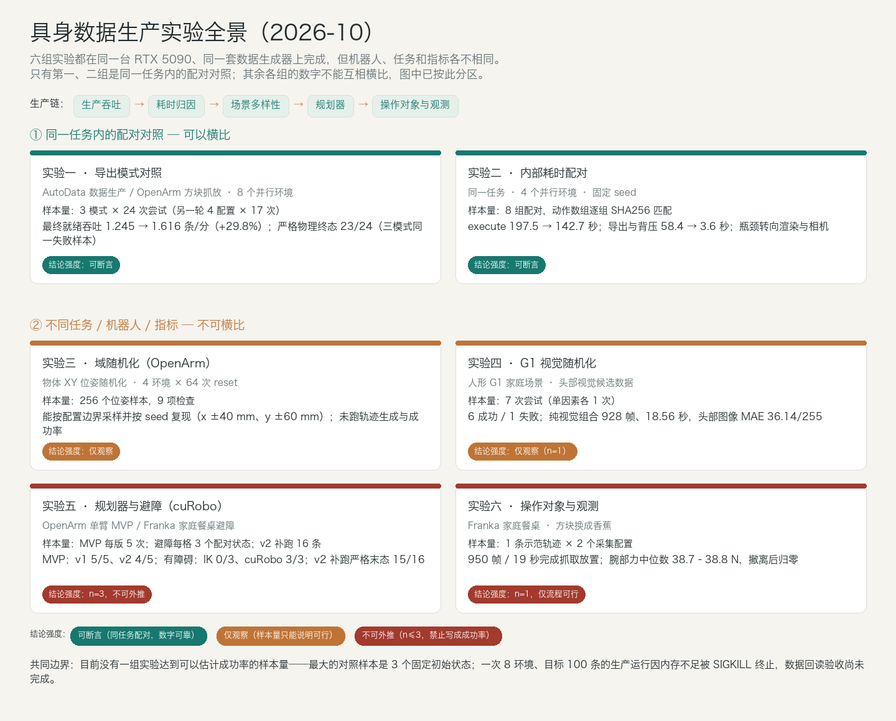
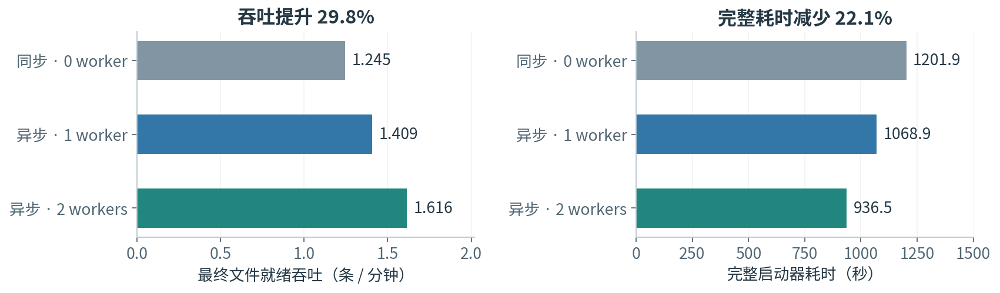
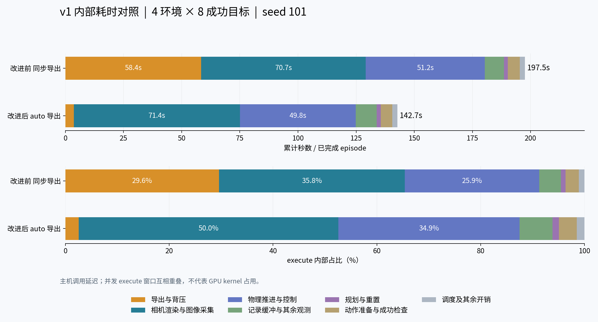
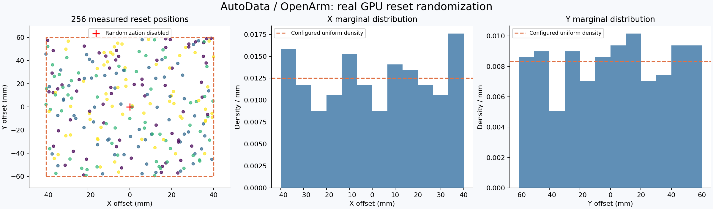
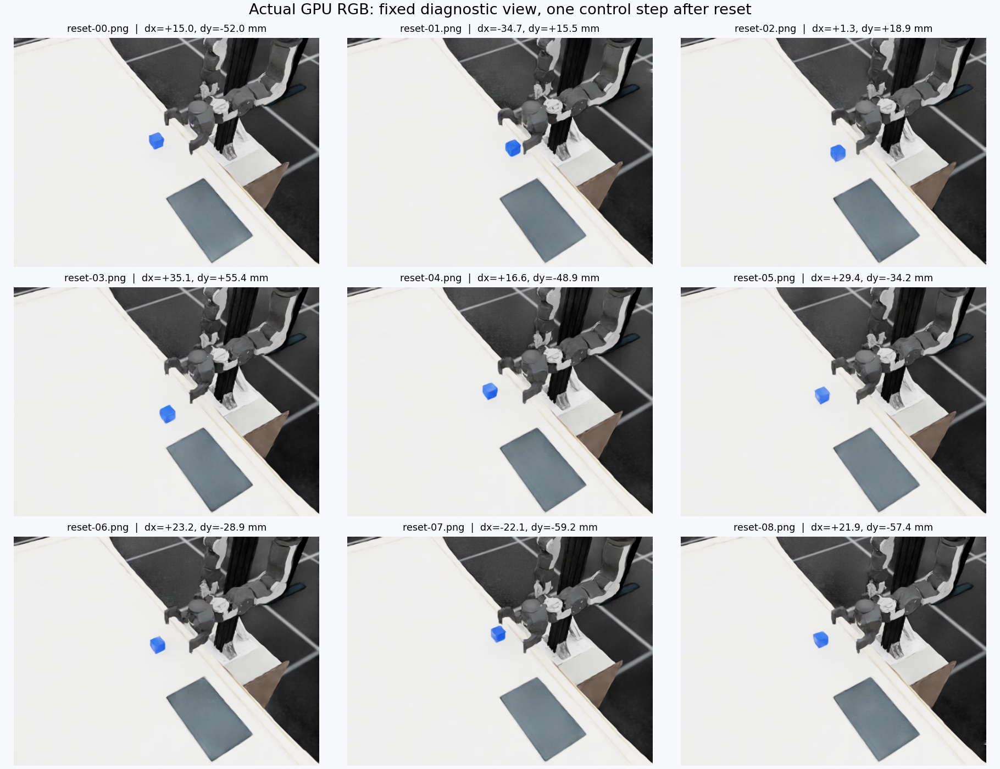

# 具身数据生产实验：做到了什么，还没做到什么

2026 年 10 月完成的六组仿真实验。本版（v002）替代 v001：修正一处 10 倍数量级错误，补入两组此前漏掉的新批次，改为对外阅读结构。无新增仿真或训练。

| 元信息 | 值 |
|---|---|
| 汇总版本 | v002（替代 v001） |
| 材料截止 | 2026-10-19（Asia/Shanghai） |
| 状态 | 重写与勘误，无新增仿真或训练 |
| 覆盖范围 | 2026-10-13 – 2026-10-17 的生产吞吐、耗时归因、域随机化、规划器与操作对象实验 |
| 一句话结论 | 瓶颈已从「能不能生成」转到「生成多快、记录可不可信、换场景还能不能跑」；六组实验的样本量都还不足以估计成功率。 |

## 术语速查

| 术语 | 一句话解释 |
|---|---|
| AutoData | 本项目的仿真数据生成流水线：少量人工遥操作示范 → 在并行仿真环境里变换、重放、判定成功，产出大规模示范数据集。 |
| OpenArm | 双臂机械臂平台；这里用的是它的左臂拾放任务（方块）。 |
| Franka（Panda） | 常用单臂机械臂；这里用它做家庭餐桌上的抓取与放置。 |
| G1 | 人形机器人；这里用它准备家庭场景的头部视觉候选数据。 |
| cuRobo | GPU 运动规划库。v1 是当前生产默认后端，v2 是候选后端。 |
| IK（DLS） | 逆运动学控制，实现为阻尼最小二乘，逐关节求控制量。 |
| reset 位姿 | 每个仿真回合开始时把物体或机器人摆到的初始位姿。 |
| 严格物理终态 | 保存前对最后若干步物理状态的检查（位置、速度、是否已松爪）。文件能读不等于物理上做对了。 |
| 合格吞吐 | 同时通过物理终态与数据完整性检查的轨迹数 ÷ 最终文件就绪时间。 |

## 1. 我们在解决什么问题

具身操作策略需要大量成功演示，人工遥操作采集太慢，所以走仿真批量生成：少量人工示范进流水线，在并行环境里变换、重放、判定成功，产出数据集。

问题因此变成三件事：**生成多快**、**记录可不可信**、**换场景还行不行**。

六组实验按这个顺序排开，全部在同一台 RTX 5090、同一套生成器上完成。

## 2. 方法全景与边界

图里上半区是同一任务内的配对对照，数字可横比；下半区换了机器人、任务或指标，各自成立。

| 实验 | 机器人 / 任务 | 样本量 | 一句话结论 | 结论强度 |
|---|---|---|---|---|
| 一 · 导出模式对照 | AutoData 生产 / OpenArm 方块抓放 | 3 模式 × 24 次尝试；另一轮 4 配置 × 17 次 | 就绪吞吐 +29.8%，三模式严格物理终态都是 23/24 | 可断言 |
| 二 · 内部耗时配对 | 同一任务，4 环境固定 seed | 8 组配对，动作逐组 SHA256 匹配 | 导出与背压 58.4 → 3.6 秒，瓶颈转到渲染与相机 | 可断言 |
| 三 · 域随机化 | OpenArm 左臂，物体 XY 位姿 | 4 环境 × 64 次 reset = 256 样本 | 能按边界采样并按 seed 复现；成功率未验证 | 仅观察 |
| 四 · 视觉随机化 | G1 家庭场景，头部视觉候选 | 7 次尝试（单因素各 1 次） | 6 成功 / 1 失败；纯视觉组合动作与基线逐值相同 | 仅观察（n=1） |
| 五 · 规划器与避障 | OpenArm MVP、Franka 家庭餐桌 | MVP 每版 5 次；避障每格 3 个配对状态；v2 补跑 16 条 | 有障碍时 IK 0/3、cuRobo 3/3；v2 补跑严格末态 15/16 | n=3，不可外推 |
| 六 · 操作对象与观测 | Franka 家庭餐桌，方块换成香蕉 | 1 条示范轨迹 × 2 个采集配置 | 950 帧 / 19 秒完成抓放；腕部力中位数 38.7–38.8 N | n=1，仅流程可行 |

结论强度按「能否在同一任务内横比」标注。

## 3. 实验一：导出改成异步，吞吐上去三成，物理合格率没动

第一轮：8 个并行环境，每种导出模式 24 次尝试。

| 导出方式 | 最终就绪速度（条/分钟） | 文件格式检查 | 严格物理终态 |
|---|---:|---|---:|
| 同步（0 worker） | 1.245 | 通过 | 23/24 |
| 异步（1 worker） | 1.409 | 通过 | 23/24 |
| 异步（2 worker） | 1.616 | 通过 | 23/24 |

- 双 worker 相对同步，最终文件就绪吞吐 **+29.8%**。
- 三种模式的严格物理终态都是 **23/24**，失败的是同一条样本（保存时仍在运动）。**导出快了三成，物理合格率没变。**
- 三个模式的非 RGB 数据集逐值一致（两次比较各 672 项）；固定轨迹 CPU 回放的文件结构、数值、属性、形状与压缩一致。

第二轮（10-15，8 环境固定 seed）：

- 同步保存 999.35 秒 → 异步 auto 623.65 秒；就绪吞吐 **0.961 → 1.539 条/分钟（+60.2%）**。
- 四个配置各 17 次尝试，16 次生成成功（94.12%）；保存的 16 条全部通过末态物理检查。
- 末态通过不等于训练可用：部分右腕相机图像首尾均值接近零，训练前需单独检查相机有效性。

存储格式（1,342 帧、三路 RGB 的单条轨迹）：

| 格式 | 文件体积 | 建数据集耗时 | 该次实验观察 |
|---|---:|---:|---|
| gzip level 2 | 524.9 MiB | 约 25.75 秒 | 体积较小，写入较慢 |
| LZF | 796.1 MiB | 约 16.98 秒 | 速度与体积居中 |
| 无压缩 | 3,544.9 MiB | 约 10.10 秒 | 写入最快，体积最大 |

> **勘误：** v001 把无压缩体积写成「约 354 MiB」，实际 **3,544.9 MiB（约 3.46 GiB）**，漏掉一位数字；该错误还使 v001 同表的「文件不最小」自相矛盾。

最小文件、最快生成、最适合训练是三个目标。降低训练用的分辨率或帧率会改变观测内容，要另起配置版本并与基线配对；只对审阅视频降采样不影响物理验收。

## 4. 实验二：时间花在哪

4 个并行环境、固定 seed，同步与 auto 各 8 条全部成功，**8 组动作数组 SHA256 精确匹配**——导出方式的改动没有改变动作记录本身。

| 指标 | 改进前 | 改进后 | 变化 |
|---|---:|---:|---|
| 最终文件吞吐（条/分钟） | 0.931 | 1.370 | 1.472× |
| execute 平均累计（秒） | 197.53 | 142.71 | −27.8% |
| 导出与背压（秒） | 58.41 | 3.64 | −93.8% |

- 相机渲染与图像采集占 execute 计时约一半，物理推进与控制约三分之一。
- 导出不再是瓶颈，**下一个是渲染、相机位姿更新与重复的 RGB 读取**。
- 口径：一组 seed 对、一种硬件、一次固定顺序；主机调用墙钟，不是隔离的 GPU kernel 时间。

## 5. 实验三、四：场景多样性与规划器

这两组换了机器人或任务，与前三组不能横比，各自回答一个独立问题。

### 5.1 域随机化：采样与复现正确，成功率未验证

OpenArm 左臂拾放任务，只开物体 XY 初始位置随机化：相对默认中心 x ±40 mm、y ±60 mm，高度与朝向固定。

- 4 环境 × 64 次 reset，共 **256 个位姿样本**。
- 9 项检查通过：数值有限、落在配置范围、XY 变化、高度固定、朝向固定、同种子可复现、不同种子产生不同样本、关闭随机化后位置固定、短程物理步数值有限。
- 样本量口径：同种子复现与固定位置对照各 32 个样本，物理检查是 12 步零动作，不是 256 个样本都做了全部检查。
- 未跑轨迹生成，因此没有抓取成功率。
- v001 复位后未同步取图，视觉结论作废，以 v002 为准。

### 5.2 G1 视觉随机化：纯视觉组合可用，成功率未定

G1 家庭场景，7 段正式尝试、6 段成功：

| 配置 | 成功/尝试 | 帧数 | 时长 | 同步头部图像 MAE / 255 |
|---|---:|---:|---:|---:|
| 基线 | 1/1 | 928 | 18.56 s | 0.00 |
| 仅光照 | 1/1 | 928 | 18.56 s | 12.64 |
| 仅相机 | 1/1 | 928 | 18.56 s | 9.36 |
| 仅材质（物理绑定修复后） | 1/1 | 928 | 18.56 s | 2.69 |
| 纯视觉组合 | 1/1 | 928 | 18.56 s | 36.14 |
| 视觉 + 小位姿扰动 | 0/1 | 843 | 16.86 s | 38.27 |
| 视觉 + 小位姿扰动（另一采样） | 1/1 | 904 | 18.08 s | 54.25 |

- 唯一失败的样本在加大小位姿范围的组合里（箱子倒伏未入筐），数据保留。
- 纯视觉组合的动作与基线**逐值相同**（最大绝对差 0），说明这批视觉变化没混入动作变化；头部图像 MAE 36.14/255，是本批最大的纯外观差异。
- 下一批生产起点选纯视觉组合；含位姿的两组同时存在运动差异，不与纯外观组排名。
- 工程教训：初版视觉材质覆盖丢掉原物理材质绑定，摩擦与恢复系数回落到引擎默认值；只查碰撞体数量和画面变色发现不了，必须回归接触参数。

### 5.3 cuRobo：升级评估与家庭场景避障

第一步，最小可行性对照（OpenArm 单臂，每版 5 次尝试）：

| 指标 | cuRobo v1 | cuRobo v2 | 备注 |
|---|---|---|---|
| 完整抓取放置任务 | 5/5 | 4/5 | v2 在 seed 105 漏抓 |
| 任务成功率 Wilson 95% 区间 | 56.6%–100% | 37.6%–96.4% | 每版仅 5 次 |
| 完整 transit 请求成功率 | 10/10 | 10/10 | 规划成功不等于任务成功 |
| 规划请求中位数 | — | +74% | |
| PyTorch 分配峰值 | — | −60% | 整个进程显存峰值只降约 1.2% |

第二步，补跑一整批（8 环境、16 条目标）：生成 16/16、保存 16 条均可回读，**严格末态 15/16**（一条保存时仍在运动）；合格吞吐 **1.287 条/分钟**，整批就绪 699.05 秒。同口径下 v1 是 1.539 条/分钟。

第三步，家庭场景避障（Franka + 餐桌 + 4 cm 方块，每格 3 个固定配对初始状态）：

| 方法 | 无障碍：完成且无新障碍接触 | 有障碍：完成且无新障碍接触 | 单次规划请求均值 |
|---|---:|---:|---:|
| IK | 3/3 | 0/3 | 不适用 |
| cuRobo + IK | 3/3 | 3/3 | 约 108–114 ms |

- 规划器只建模桌面、地面与新增障碍物的近场代理几何，不是整屋家具避障。
- 模型构建与预热约 2.7 秒，不计入单次规划计时。
- v2 补跑后仍未通过质量验收，v1 继续作为生产默认后端。避障结果是这 3 个布局里的可行性观察。

## 6. 还没做到什么

### 6.1 失败分布

| 实验 | 规划/控制失败 | 生产失败 | 校验失败 | 处理方式 |
|---|---:|---:|---:|---|
| 一 · 导出模式 | — | 另一轮 4 配置共 1 次 | 第一轮 1 条严格终态未通过（三模式同一条） | 保留在分母，不删样重测 |
| 二 · 内部计时 | — | 8 环境试跑 1 次内存不足退出 | 0 | 排除在配对对照之外 |
| 三 · 域随机化 | — | — | 0 | 未跑轨迹生成 |
| 四 · 视觉随机化 | — | 1 段因位姿扰动倒伏；另 1 次并发初始化未产生数据 | 0 | 失败段保留；初始化问题不计为任务失败 |
| 五 · 规划器与避障 | v2 seed 105 漏抓 1 次；有障碍 IK 3 次未通过 | — | v2 补跑 1 条末态未通过 | 失败轨迹保留，不调参重测 |
| 六 · 操作对象 | 3 次物理调试失败（修正根变换、初始关节、控制跟踪） | — | 0 | 未混入成功分母 |

### 6.2 一次没有完成的生产运行

2026-10-13 23:43:58 开始、10-14 00:50:30 结束的一次 8 环境、目标 100 条成功轨迹的生产运行，子进程被 `SIGKILL` 终止（returncode −9），没有完整结果报告。

- 遥测累计 63 次开始、55 次完成（成功 49、失败 6），8 个回合未完成；这不是数据回读结果。
- 运行期间 cgroup 的 `oom_kill` 增量为 1，进程峰值 RSS 约 66.6 GiB；cgroup 内还有其他进程，具体 OOM 受害进程未确定。
- 先查 HDF5 完整性、成功标记和最终状态，再结合系统日志定位中断原因；重试换新输出路径。

### 6.3 可以引用的结论

**可断言（同任务内配对对照）**

- 异步导出把最终文件就绪吞吐提高三到六成，取决于批次与配置（24 次/模式那轮 +29.8%；8 环境 16 条那轮 +60.2%）。
- 导出与背压时间从 58.4 秒降到 3.6 秒，瓶颈转到渲染与相机。
- 域随机化能按配置边界采样并按种子复现。

**观察**

- cuRobo 在这 3 个固定障碍布局中绕开了新增障碍。
- G1 的纯视觉随机化组合可以作为下一批生产起点。

**不能说**

- 总体成功率、训练后的泛化收益、sim-to-real 结论。
- 「异步导出提高了数据质量」——两轮对照里物理合格率都没改善。
- 真实香蕉的安全夹持力或软体损伤（仿真是刚体，腕部读数是关节反力）。
- 整屋家具避障能力（规划器只覆盖近场代理几何）。

### 6.4 下一步

1. **质量回归**：复核历史样本的终态与成功标签，能回读的 RGB 再比对时序与内容。不需要新增仿真。
2. **同配置低存储效率配对**：同步与异步用相同分辨率、相机调用与样本设置，分别报告总吞吐、合格吞吐、峰值内存和每条存储量，别把视频降采样的收益算给导出改造。
3. **修终态判定，再扩香蕉位姿随机化**：小样本先查接口和失败分类，通过后扩大生产量。
4. **再比扩增方法与训练泛化**：同状态配对，报告失败原因、规划成本、每小时合格数据量，用未见状态测试策略。

## 来源与维护

证据都在本仓库 `outputs/` 内，可逐条核对：

- [AutoData 效率优化报告 v001](../../autodata-efficiency-report/v001/index.html)（含[结构化证据](../../autodata-efficiency-report/v001/evidence.json)与[校验记录](../../autodata-efficiency-report/v001/verification.json)）
- [AutoData v1 内部耗时对照 v001](../../autodata-v1-internal-timing/v001/report.md)
- [AutoData 域随机化实测 v002](../../autodata-domain-randomization/v002/report.md)
- [AutoData 生产效率复盘 v003](../../autodata-efficiency-review/v003/report.md)：承载 10-15 批次与 cuRobo v2 补跑
- [cuRobo v2 升级评估 v001](../../curobo-v2-upgrade-assessment/v001/report.md) · [OpenArm 最小可行性验证 v001](../../curobo-v2-openarm-mvp/v001/report.md) · [抓取诊断 v001](../../curobo-v2-grasp-diagnosis/v001/report.md)
- [成果索引](../../README.md)

G1、Franka 与香蕉实验的原始运行记录和视频保留在各自独立任务工作树，未复制进本报告包。

新增版本请建立 `v003/`，在顶部写清材料截止与新增来源，在版本表补一行，并更新[成果索引](../../README.md)。图表编号沿用 `figures/NN-slug.png`，图注写明样本量与来源。
