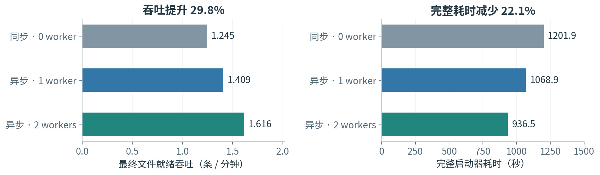
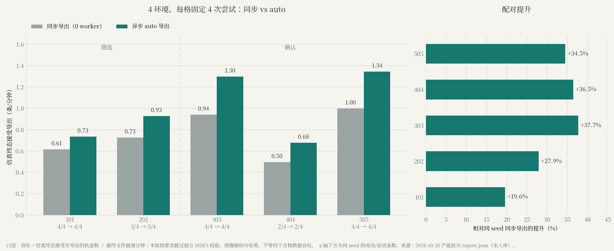
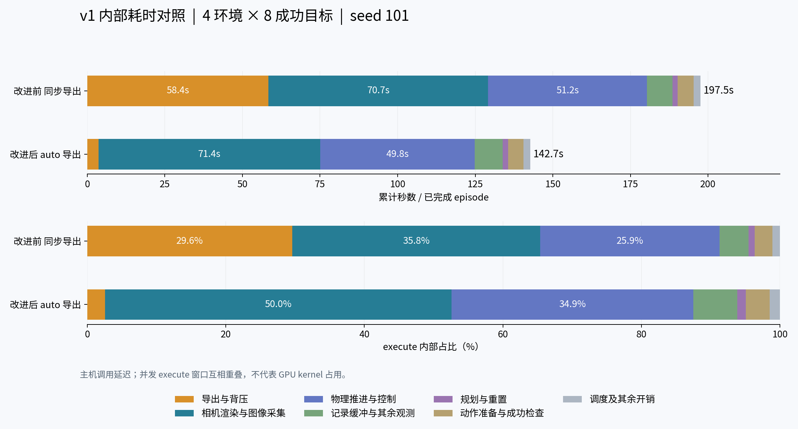

# 具身数据生产实验：2026-10-13 至 10-20 结果汇总

| 元信息 | 值 |
|---|---|
| 汇总版本 | v003（替代 v002） |
| 材料截止 | 2026-10-20（Asia/Shanghai） |
| 状态 | 汇总、核验与勘误；无新增仿真、训练或 GPU 运行 |
| 覆盖范围 | 2026-10-13 – 2026-10-20；13 组实验/运行（12 组对照或验证 + 1 次未完成生产） |
| 一句话结论 | 异步导出把吞吐提高约两到六成（四组口径不同），但没有一组证明物理合格率提高；瓶颈已转到渲染与相机，所有实验的样本量仍不足以估计成功率。 |

> 本版在 v002 的六组结构上新增三组批次（固定尝试预算产能、HDR 生产、GPU 并发），补齐“三个成功”与“三个吞吐”的口径，并把“同一套生成器”更正为两套技术栈。旧版本保留，不覆盖。

## 0. 术语与口径

### 0.1 术语

| 术语 | 一句话解释 |
|---|---|
| AutoData | 仿真数据生成流水线：少量人工示范 → 并行环境变换、重放、判定 → 大规模示范数据集。 |
| OpenArm | 双臂机械臂平台；本报告用它的左臂方块拾放任务。 |
| Franka（Panda） | 常用单臂机械臂；用于家庭餐桌上的抓取与放置。 |
| G1 | 人形机器人；用于家庭场景的头部视觉候选数据。 |
| cuRobo | GPU 运动规划库；v1 是当前生产默认后端，v2 是候选后端。 |
| IK（DLS） | 阻尼最小二乘逆运动学，逐关节求控制量。 |
| reset 位姿 | 每个仿真回合开始时，物体或机器人被摆到的初始位姿。 |
| 严格物理终态 | 保存前对末态位置、速度、释放状态的检查；文件能读不等于物理上做对了。 |
| 最终文件就绪吞吐 | 成功条数 ÷ 从首 episode 开始到最后一个文件写完的时间。 |
| 仿真终态接受吞吐 | 仿真终态接受并导出的条数 ÷ 最终文件就绪分钟；不包含独立文件校验。 |
| 合格吞吐 | 同时通过物理终态与数据完整性检查的条数 ÷ 时间；只有做过独立校验的批次才有。 |

### 0.2 三种“成功”

| 口径 | 定义 | 本报告中的例子 |
|---|---|---|
| 成功标签 | 生成器记录 `success=True` | 24 条对照三模式均 24/24 |
| 文件结构/回读 | HDF5 可读，字段、形状、有限值、压缩通过 | 三模式均通过；两组异步输出各 672 项非 RGB 逐值一致 |
| 严格物理终态 | 末态位置、速度、释放状态检查 | 24 条对照 23/24；v2 补跑 15/16 |

**这三个数不能互相替代。** 同一批 24 条数据可以同时是“24/24 成功标签、24/24 文件结构通过、23/24 严格终态通过”。

### 0.3 三种“吞吐”

| 口径 | 分子 | 本报告中的例子 |
|---|---|---|
| 最终文件就绪 | 成功条数 | 1.245 / 1.409 / 1.616 条每分钟 |
| 仿真终态接受 | 仿真终态接受且已导出的条数 | 产能轮 4 环境 0.94 → 1.30 条每分钟 |
| 独立校验合格 | 通过独立 HDF5/物理/哈希校验的条数 | 产能轮未做，不可得 |

## 1. 我们在解决什么

具身操作策略需要大量成功演示，人工遥操作采集太慢，所以走仿真批量生成：少量人工示范进流水线，在并行环境里变换、重放、判定成功，产出数据集。

问题因此变成三件事：**生成多快**、**记录可不可信**、**换场景还行不行**。下面 13 组实验按这个顺序排开，但它们的机器人、任务、指标和样本量各不相同；只有同一任务内的配对对照可以横比。

## 2. 实验全景与可比性

| # | 实验（日期） | 机器人 / 任务 | 样本量 | 结论强度 | 可横比范围 |
|---|---|---|---|---|---|
| 1 | 共享配置 GPU 验证（10-13） | AutoData vs Arena | 2 次探针 + 6 组判据 | 可断言（接口一致） | 仅接口，不与吞吐横比 |
| 2 | 导出模式 24 条对照（10-14） | OpenArm 方块拾放 | 8 环境 × 3 模式 × 24 次 | 可断言 | 本任务 3 个模式之间 |
| 3 | 内部耗时配对（10-15） | 同上，固定 seed | 4 环境 × 2 × 8 条 | 可断言 | 与 #2 环境数不同，不直接横比 |
| 4 | 固定尝试预算产能（10-19/20） | 同上，固定 4 次/格 | 74 次尝试、5 个 seed | 可断言（仅接受吞吐） | 本任务同 seed 配对 |
| 5 | 域随机化实测（10-16） | OpenArm 左臂，物体 XY | 4 环境 × 64 reset = 256 | 仅观察 | 不与吞吐实验横比 |
| 6 | G1 视觉随机化（10-17） | G1 家庭场景 | 7 段，单因素各 1 | 仅观察（n=1） | 不横比 |
| 7 | cuRobo v2 最小对照（10-14） | OpenArm 单臂 SkillGen | 每版 5 次 | 不可外推 | 仅同 seed 配对 |
| 8 | cuRobo v2 补跑（10-15） | 同上 | 8 环境、16 条目标 | 该批可断言 | 与 #7 分开 |
| 9 | Franka 避障对照（10-17） | Franka 家庭餐桌 | 每格 3 个配对状态 | 仅观察 | 这 3 个布局内 |
| 10 | 香蕉与多传感（10-17） | Franka，香蕉 | 1 条示范 | 仅观察 | 不横比 |
| 11 | HDR 生产对照（10-16） | OpenArm | 5 批、各 1 条 | 仅观察 | 不横比 |
| 12 | GPU 并发容量（10-17） | G1/混合 | 3 轮、4–5 进程 | 仅观察 | 不横比 |
| 13 | 100 条生产运行（10-13/14） | OpenArm | 目标 100 条 | 失败记录 | 不横比 |

**未计入的探针。** 另有若干场景准备与小批次可视化探针（Arena 域随机化可视化、G1 数据可视化、Lightwheel 厨房场景、家庭场景准备），只用于打通资产或检查画面，没有形成对照结论，也未进入 13 组统计；原始记录留在各自任务目录。

**两套技术栈，不是“同一套生成器”。** #1–#5、#7–#8、#11、#13 走 AutoData/OpenArm 生成链；#6、#9、#10 走 Arena/IsaacLab 的脚本示范；#12 混合两者。它们共享同一台 RTX 5090（32,607 MiB，驱动 595.91.07）和部分资产，但生成器、成功判据和数据格式不同。共享 GPU 不等于共享生成器，也不等于数字可以合并。

**哪些数字不能并排。** 1.245/1.409/1.616（8 环境、24 次/模式）、0.931/1.370（4 环境、8 对）、0.961/1.539（8 环境、16 条）与 0.94/1.30（4 环境、固定 4 次）是四种不同工作量设置。它们都说明异步导出更快，但不能把百分比直接相加或取平均。

## 3. 导出方式：更快，但没有更干净

### 3.1 24 条对照（10-14）

8 个并行环境，每种导出模式 24 次尝试。

| 导出方式 | 最终就绪秒数 | 吞吐（条/分钟） | 成功标签 | 严格物理终态 | 进程峰值 RSS |
|---|---:|---:|---:|---:|---:|
| 同步（0 worker） | 1156.737 | 1.245 | 24/24 | 23/24 | 56.17 GiB |
| 异步（1 worker） | 1022.194 | 1.409 | 24/24 | 23/24 | 40.54 GiB |
| 异步（2 worker） | 891.225 | 1.616 | 24/24 | 23/24 | 40.68 GiB |

- 双 worker 相对同步的最终文件就绪吞吐 **+29.8%**（1.616 / 1.245）。
- 三种模式的严格物理终态都是 **23/24**，失败的是同一条样本（保存时仍在运动）。**导出快了三成，物理合格率没变。**
- 两组异步输出各有 672 项非 RGB 数据集与同步逐值一致；固定轨迹 CPU 回放的文件结构、值、属性、形状与压缩一致。
- 同一对照里，进程峰值 RSS 从 56.17 GiB 降到 40.54 / 40.68 GiB（约 −28%）。这是 24 条对照本身的数字，与 10-13 那次失败运行的 66.6 GiB 不是同一口径。

### 3.2 16 条批次（10-15）

8 环境、固定 seed、每配置 17 次尝试：

- 同步保存 999.35 秒 → 异步 auto 623.65 秒；就绪吞吐 **0.961 → 1.539 条/分钟（+60.2%）**。
- 四个配置（同步、上限 4、上限 8、auto）各 17 次尝试，共 68 次、64 次生成成功（94.12%）；每个配置保存的 16 条（共 64 条）均通过末态物理检查。
- 末态通过不等于训练可用：历史校验记录中部分右腕相机图像首尾均值接近零，训练前需单独检查相机有效性。

### 3.3 固定尝试预算产能（10-19/20，本版新增）

这一轮把“每格固定 4 次尝试”作为预算，比较 1/4 环境 × 同步/固定 2 进程/auto，主指标改为**仿真终态接受导出 ÷ 最终文件就绪分钟**。总预算最多 74 次：试运行 2 次、筛选 12 格 × 4 次、确认 6 格 × 4 次；禁止失败补成功、自动重试或自动扩大配置。

| seed | 阶段 | 同步（条/分钟） | auto（条/分钟） | 提升 | 成功/尝试（同步 → auto） |
|---:|---|---:|---:|---:|---|
| 101 | 筛选 | 0.614 | 0.735 | +19.6% | 4/4 → 4/4 |
| 202 | 筛选 | 0.725 | 0.928 | +27.9% | 3/4 → 3/4 |
| 303 | 确认 | 0.942 | 1.297 | +37.7% | 4/4 → 4/4 |
| 404 | 确认 | 0.496 | 0.677 | +36.5% | 2/4 → 2/4 |
| 505 | 确认 | 0.999 | 1.344 | +34.5% | 4/4 → 4/4 |

- 预注册的三个确认 seed 提升 **+34.5%–37.7%**；两个筛选 seed 提升 **+19.6%–27.9%**。方向一致，幅度随 seed 波动。
- 每个 seed 内，同步与 auto 的成功条数完全相同（4/4、3/4、4/4、2/4、4/4）。**吞吐提高没有以成功数下降为代价，但也没有提高成功数。**
- 本批按用户要求运行在“仅生产”模式：跳过 HDF5 回读、图像解码、逐数组哈希、全文件 SHA256 和审阅视频。因此它只能叫**仿真终态接受吞吐**，不能叫合格数据吞吐，也不能证明文件内容正确。
- 它的工作量设置与 3.1/3.2 不同：`guarantee_success=false`、`keep_failed=true`、固定尝试预算。百分比不能与 3.1/3.2 直接比较。

### 3.4 存储格式

同一条 1,342 帧、三路 RGB 轨迹：

| 格式 | 文件体积 | 建数据集耗时 | 观察 |
|---|---:|---:|---|
| gzip level 2 | 524.9 MiB | 25.75 秒 | 体积最小，写入最慢 |
| LZF | 796.1 MiB | 16.98 秒 | 速度与体积居中 |
| 无压缩 | 3,544.9 MiB | 10.10 秒 | 写入最快，体积最大 |

> **勘误：** v001 曾把无压缩体积写成“约 354 MiB”，实际是 3,717,111,624 B = 3,544.9 MiB（约 3.46 GiB），漏掉一位数字；该错误还使 v001 同表的“文件不最小”自相矛盾。v002 已修正，本版沿用修正值。

最小文件、最快生成、最适合训练是三个目标。降低训练用的分辨率或帧率会改变观测内容，要另起配置版本并与基线配对；只对审阅视频降采样不影响物理验收。

## 4. 时间花在哪（10-15）

4 个并行环境、固定 seed，同步与 auto 各 8 条全部成功，**8 组动作数组 SHA256 精确匹配**——导出方式的改动没有改变动作记录本身。

| 指标 | 同步 | auto | 变化 |
|---|---:|---:|---|
| 最终文件就绪（秒） | 515.768 | 350.297 | 1.472× |
| 最终文件吞吐（条/分钟） | 0.931 | 1.370 | +47.2% |
| execute 平均累计（秒） | 197.526 | 142.706 | −27.8% |
| 导出与背压（秒） | 58.412 | 3.638 | −93.8% |
| 生产主进程峰值 RSS（GiB） | 33.48 | 25.22 | −24.7% |

- 平均 execute 减少 54.82 秒，其中导出与背压归因减少 54.77 秒；加速主要来自同步导出对其他环境阻塞的减少。
- 优化后相机渲染与图像采集占 execute 的 50.0%，物理推进与控制占 34.9%，记录缓冲与其余观测占 6.3%，规划与重置占 1.2%。**导出不再是瓶颈，下一个是渲染、相机位姿更新与重复的 RGB 读取。**
- 相机占比升高主要是总时间缩短所致，不是相机变慢：相机绝对耗时 70.72 → 71.41 秒。
- 口径：一组 seed 对、一种硬件、一次固定顺序；主机调用墙钟，没有新增 CUDA 同步，不是隔离的 GPU kernel 时间。

## 5. 场景多样性

### 5.1 域随机化（10-16）

OpenArm 左臂拾放任务，只开物体 XY 初始位置随机化：相对默认中心 x ±40 mm、y ±60 mm；高度、朝向、光照、相机、纹理、材质、质量和摩擦系数未配置随机化。

- 4 环境 × 64 次 reset，共 **256 个位姿样本**。
- 9 项检查通过：数值有限、落在配置范围、XY 变化、高度固定、朝向固定、同种子可复现、不同种子产生不同样本、关闭随机化后位置固定、12 步零动作物理数值有限。
- 样本量口径：同种子复现与固定位置对照各 32 个样本，物理检查是 12 步零动作；不是 256 个样本都做了全部 9 项检查。
- 未跑轨迹生成，因此没有抓取成功率。v001 复位后未同步取图，视觉结论作废，以 v002 为准。

### 5.2 G1 视觉随机化（10-17）

G1 家庭场景，7 段正式尝试、6 段成功：

| 配置 | 成功/尝试 | 帧数 | 时长 | 同步头部图像 MAE / 255 |
|---|---:|---:|---:|---:|
| 基线 | 1/1 | 928 | 18.56 秒 | 0.00 |
| 仅光照 | 1/1 | 928 | 18.56 秒 | 12.64 |
| 仅相机 | 1/1 | 928 | 18.56 秒 | 9.36 |
| 仅材质（物理绑定修复后） | 1/1 | 928 | 18.56 秒 | 2.69 |
| 纯视觉组合 | 1/1 | 928 | 18.56 秒 | 36.14 |
| 视觉 + 小位姿扰动 A | 0/1 | 843 | 16.86 秒 | 38.27 |
| 视觉 + 小位姿扰动 B | 1/1 | 904 | 18.08 秒 | 54.25 |

- 唯一失败的样本在加大小位姿范围的组合里（箱子倒伏未入筐），数据保留。
- 纯视觉组合的动作与基线**逐值相同**（最大绝对差 0），说明这批视觉变化没混入动作变化；头部图像 MAE 36.14/255，是本批最大的纯外观差异。
- 下一批生产起点选纯视觉组合；含位姿的两组同时存在运动差异，不与纯外观组排名。
- 工程教训：初版视觉材质覆盖丢掉原物理材质绑定，摩擦与恢复系数回落到引擎默认值；只查碰撞体数量和画面变色发现不了，必须回归接触参数。修复前的批次保留为诊断数据，不用于推荐。

## 6. 规划器与操作对象

### 6.1 cuRobo v2 最小对照（10-14）

OpenArm 单臂 SkillGen，每版 5 次尝试，固定 reset seed 101–105。

| 指标 | cuRobo v1 | cuRobo v2 |
|---|---:|---:|
| 完整抓取放置任务 | 5/5 | 4/5（seed 105 漏抓） |
| 任务成功率 Wilson 95% 区间 | 56.6%–100% | 37.6%–96.4% |
| 完整 transit 请求成功率 | 10/10 | 10/10 |
| 后续请求耗时 p50 | 0.753 秒 | 1.312 秒（+74.2%） |
| 后续请求耗时 p95 | 2.217 秒 | 1.764 秒（−20.5%） |
| 进程显存采样峰值 | 7,284 MiB | 7,194 MiB（−1.2%） |
| PyTorch allocated 峰值 | 140.44 MiB | 56.01 MiB（−60.1%） |

- 5 组实际物体位姿与机器人关节值在 v1/v2 记录中逐元素完全一致，不是只对 seed 标签。
- **不能把 PyTorch 分配峰值的 −60% 当作整个进程显存 −60%**：NVIDIA 进程采样只降了 90 MiB（−1.2%），且不含全部 Warp、驱动和渲染分配。
- seed 105 在原批次第五次失败，改为新进程第一次后两次复现均成功（抬升 102.6 mm）。代码检查发现 v2 `SampleBuffer` 使用独立 `torch.Generator`，现有 reset hook 只调用 `torch.manual_seed()`，不会重置它。**场景同 seed 与规划器内部同状态是两回事**，这是已确认的复现性限制；不能据此断言 v2 核心求解器有缺陷。

### 6.2 v2 补跑（10-15）

8 环境、目标 16 条、seed 101：

- 生成成功 16/16，保存 16 条均可回读；**严格末态 15/16**。
- 失败样本 `demo_2` 的角速度 0.8538 rad/s 超过未修改的阈值 0.5 rad/s。
- 按末态合格条数计算，吞吐 **1.287 条/分钟**（15 × 60 / 699.046 秒）；按生成器记录的成功条数计算为 1.373 条/分钟。同口径下 v1 是 1.539 条/分钟。
- 该批仍未通过质量验收，v1 继续作为生产默认后端，v2 保留为实验后端。

### 6.3 Franka 避障（10-17）

Franka + 餐桌 + 4 cm 方块；每格 3 个固定配对初始状态，共 12 次仿真。

| 方法 | 无障碍：完成且无新障碍接触 | 有障碍：完成且无新障碍接触 | 单次规划均值 | 模型构建/预热 |
|---|---:|---:|---:|---:|
| IK | 3/3 | 0/3 | 不适用 | 不适用 |
| cuRobo + IK | 3/3 | 3/3 | 107.8 / 113.6 ms | 2.69 / 2.67 秒 |

- 有障碍时 IK 的峰值障碍物接触力为 381.8 N；cuRobo 为 0 N。
- 规划器只建模桌面、地面与新增障碍物的近场代理几何，不是整屋家具避障；抓取、最后下降与释放仍由共用 IK 接触控制执行。
- 3 个固定状态不足以推断总体成功率或统计显著性。

### 6.4 香蕉与多传感（10-17）

- 1 条示范：950 个控制步、50 Hz、19 秒；实测抬高 0.227031 m，持续悬空搬运 125 步。
- 双指法向力中位数 **38.7077 / 38.8348 N**（200 Hz，每个 RGB 帧对应 4 个采样点）；撤离后归零；峰值 40.277 / 45.428 N。
- 腕部相机安装位置逐帧最大重建误差 7.49e-8 m；三路视频均解码 950 帧。
- 香蕉在仿真里是刚体，腕部读数是关节反力，包含运动动力学，不等于真实香蕉的安全夹持力或软体损伤阈值。

## 7. 辅助验证与资源边界

### 7.1 共享配置（10-13）

AutoData 与 Arena 两侧加载同一份 OpenArm 配置：动作空间 `[1, 7]`（左臂相对 TCP IK + 夹爪），物理/控制 120/30 Hz，reset 范围 x ±0.04 m、y ±0.06 m，观测键/形状/dtype 与三路 RGB `[1, 480, 640, 3]` uint8 匹配，成功函数与四个显式阈值一致。两端 16 项检查全部通过；6 种状态的成功判据正反例各 6/6。

这是物理环境中的接口与判据一致性验证，**不是**完整动作轨迹逐帧等价，也不是策略成功率。

### 7.2 HDR 生产（10-16）

| 批次 | 结果 | 墙钟秒数 |
|---|---|---:|
| baseline | 1/1，验证通过 | 202.1 |
| studio（第一次） | 1/1，验证通过 | 184.1 |
| beach（第一次） | 1/1，验证通过 | 204.1 |
| studio（第二次） | 1/1，验证通过 | 180.0 |
| beach（第二次） | 1/1，验证通过 | 156.4 |

每批只有 1 条样本，只能说明“换 HDR 后流程仍能产出并验收”，不能比较光照对图像多样性或训练效果的影响。

### 7.3 GPU 并发（10-17）

| 轮次 | 有效并发 | GPU 均值 | GPU 峰值 | 显存峰值 |
|---|---:|---:|---:|---:|
| r01 | 4 | 9.4% | 37% | 10,832 MiB |
| r02 | 4 | 32.4% | 70% | 23,517 MiB |
| r04 | 5 | 23.7% | 70% | 24,777 MiB |

- r01 有 3 个任务被 SIGTERM 终止，其均值不代表稳定并发，只作排障记录。
- 即使 4–5 个进程并发，GPU 峰值也只有 70%，显存峰值约 24.8 GiB（卡总显存 32.6 GiB）。**这说明还有并发空间，但不等于生产吞吐可以线性放大**：初始化重叠、相机与 CPU 线程仍会互相争用。
- 该实验是资源观测，不是数据质量对照。

## 8. 还没做到什么

### 8.1 失败分类

| 实验 | 规划/控制失败 | 生产/运行失败 | 校验失败 | 处理 |
|---|---:|---:|---:|---|
| 24 条对照 | — | — | 1 条 × 3 模式（同一条 `demo_2`） | 保留在 24 分母 |
| 16 条批次 | — | — | 0 | — |
| 产能 74 次 | 202 有 1 次、404 有 2 次（4 环境组） | 0 | 未做独立校验 | 保留在每格 4 次分母 |
| 内部耗时 | — | 1 次 8 环境试跑 OOM | 0 | 排除在配对之外 |
| 域随机化 | — | — | 0 | 未跑轨迹生成 |
| G1 视觉 | 1 段倒伏 | 1 次并发初始化未产生数据 | 0 | 失败段保留，初始化不计任务失败 |
| cuRobo MVP | seed 105 漏抓 1 次 | — | — | 保留，不调参重测 |
| cuRobo 补跑 | — | — | 1 条末态未通过 | 保留在分母 |
| Franka 避障 | 有障碍 IK 3 次未通过 | — | — | 保留在 3/格 |
| 香蕉 | 3 次物理调试失败 | — | 0 | 不计入成功分母 |
| 100 条生产 | 6 次失败 | `SIGKILL` | 未回读 | 未完成 |

### 8.2 一次没有完成的生产运行

| 时间（Asia/Shanghai） | 事件 |
|---|---|
| 10-13 23:43:58 | 启动 8 环境、目标 100 条成功轨迹 |
| 运行中 | 遥测累计 63 次开始、55 次完成（成功 49、失败 6），8 个回合未完成 |
| 10-14 00:50:30 | 子进程被 `SIGKILL` 终止（returncode −9），无完整结果报告 |
| 事后 | cgroup `oom_kill` 增量 +1；进程峰值 RSS 约 66.6 GiB；未做 HDF5 回读验收 |

- 这些数字来自运行遥测，不是数据回读结果；cgroup 内还有其他进程，具体 OOM 受害进程未确定。
- 后续应先检查 HDF5 完整性、成功标记和最终状态，再结合系统日志判断中断原因；重试使用新的输出路径。

### 8.3 可以断言、只能观察、不能外推

**可断言（同任务、同配置、有原始记录）**

1. 24 条对照：双 worker 相对同步的最终文件就绪吞吐 +29.8%；三模式严格终态均 23/24。
2. 4 环境 8 对：+47.2%；导出与背压 58.41 → 3.64 秒；8 组动作 SHA256 匹配。
3. 16 条批次：+60.2%；16/16 通过末态检查。
4. 产能 5 个 seed：4 环境 auto 相对同步 +19.6%–37.7%（确认组 +34.5%–37.7%），同 seed 成功数相同；仅限仿真终态接受吞吐。
5. 域随机化：256 个位姿样本，9 项检查通过。
6. cuRobo v2 补跑：16/16 生成、15/16 末态、1.287 条/分钟。
7. 共享配置：16 项接口检查通过。

**只能观察**

- G1 纯视觉组合可作为下一批生产起点（7 段 6 成功，单因素 n=1）。
- cuRobo 在这 3 个固定障碍布局中绕开新增障碍（IK 0/3 vs cuRobo 3/3）。
- HDR 更换后流程仍可产出（5 批各 1/1）。
- 4–5 个并发进程时 GPU 峰值 70%、显存约 24.8 GiB。
- 香蕉单条示范的抓放与力记录（n=1）。

**不能外推**

- 总体成功率、训练后的泛化收益、sim-to-real 结论。
- “异步导出提高了数据质量”——四组对照里物理合格率都没有改善。
- 产能轮的数据是“合格数据”——该轮未做独立校验。
- 真实香蕉的安全夹持力或软体损伤。
- 整屋家具避障能力——规划器只覆盖近场代理几何。

## 9. 下一步

1. **给产能批次补独立校验**：对 10-20 的 4 环境导出做 HDF5 回读、末态物理检查、逐数组哈希和图像解码；通过后才能把“仿真终态接受吞吐”升级为“合格吞吐”。
2. **质量回归**：复核历史样本的终态与成功标签，能回读的 RGB 再比对时序与内容。不需要新增仿真。
3. **同配置低存储效率配对**：同步与异步用相同分辨率、相机调用与样本设置，分别报告总吞吐、合格吞吐、峰值内存和每条存储量；不要把视频降采样的收益算给导出改造。
4. **修终态判定，再扩香蕉位姿随机化**：小样本先查接口和失败分类，通过后扩大生产量。
5. **最后比扩增方法与训练泛化**：同状态配对，报告失败原因、规划成本、每小时合格数据量，并用未见状态测试策略。

## 10. 来源与维护

本版引用的核心可移植证据（均在本仓库 `outputs/` 内）：

- 效率报告 v001：`outputs/autodata-efficiency-report/v001/evidence.json`（24 条对照、压缩、非 RGB 一致性、RSS）
- 内部耗时 v001：`outputs/autodata-v1-internal-timing/v001/report.json`（1.472×、8 对动作匹配）
- 效率复盘 v003：`outputs/autodata-efficiency-review/v003/report.md` 与 `v2-result.json`（16 条批次、v2 补跑 15/16）
- 域随机化 v002：`outputs/autodata-domain-randomization/v002/result.json`（9 项检查）
- 共享配置 v003：`outputs/autodata-arena-shared-config/v003/comparison.json`（16 项检查）
- cuRobo：`outputs/curobo-v2-openarm-mvp/v001/data.json`、`outputs/curobo-v2-grasp-diagnosis/v001/report.md`、`outputs/curobo-v2-upgrade-assessment/v001/report.md`

G1、Franka、香蕉、HDR、GPU 并发与 10-20 产能批次的原始记录保存在各自任务目录；精确文件、哈希与路径映射见 `manifest.json`。本报告正文不嵌入机器绝对路径。

| 版本 | 主要变化 | 边界 |
|---|---|---|
| v001（10-19） | 首版，六组实验 | 无压缩体积 354 MiB 错误；站点状态记录有误；仅六组 |
| v002（10-19） | 改为六节对外结构；修正 3544.9 MiB；补 10-15 批次与 v2 补跑 | 仍未含 10-19/20 产能、HDR、并发；未提交到主分支 |
| v003（10-20，本版） | 扩到 13 组；新增产能、HDR、并发；三种成功/三种吞吐；更正“同一生成器” | 仅汇总与核验，无新增实验；产能批次无独立校验 |

**维护规则：** 新增版本请建立 `v004/`，在顶部写清材料截止与新增来源，在版本表补一行，并更新 `outputs/README.md`。图表文件放在 `figures/` 下，按两位序号命名；图注写明样本量与来源。不覆盖旧版本，不复制原始 HDF5 或完整运行目录。
