# 具身数据生产实验报告

**2026-10-13 – 10-20 · 18 组实验与检查 · RTX 5090**

异步导出把数据生产吞吐提高 20%–60%，把导出等待从 58.4 秒压到 3.6 秒。瓶颈从保存转向渲染与相机。域随机化、规划器与家庭场景实验把生成能力扩展到新机器人、新物体和多模态观测。10-20 完成了 LeRobot v3 转换（4 条 / 5,453 帧）和 8 环境隔离导出回归；24 环境准入被内存阻断。

| 主线 | 结果 |
|---|---|
| 吞吐 | 24 条 +29.8%；16 条 +60.2%；固定预算 +19.6%–37.7% |
| 时间 | 就绪 1.472×；导出等待 −93.8%；相机占 execute 50.0% |
| 质量 | 24 条严格终态 23/24；v2 补跑 15/16；8 环境回归 7/8 |
| 交付 | LeRobot v3：4 条 / 5,453 帧 / 27 MB，数值 exact |
| 规模 | 24 环境准入 93.44 GiB < 144 GiB；100 条生产 63 起 / 55 完 / 8 未完成 |

## 实验地图

| # | 实验 | 机器人 / 任务 | 样本 | 主结果 | 图 |
|---|---|---|---|---|---|
| 1 | 共享配置 | AutoData vs Arena | 16 项检查 | 16/16 通过 | 01 |
| 2 | 导出 24 条 | OpenArm 方块拾放 | 3 模式 × 24 | +29.8%，终态 23/24 | 02 |
| 3 | 导出 16 条 | 同上 | 4 配置 × 17 | +60.2% | 03 |
| 4 | 固定预算产能 | 同上 | 74 次、5 seed | +19.6%–37.7% | 04 |
| 5 | 时间归因 | 同上 | 4 环境 × 8 对 | 1.472×，导出 −93.8% | 05 |
| 6 | 域随机化 | OpenArm 左臂 | 256 reset | 9/9 通过 | 06 |
| 7 | G1 视觉随机化 | G1 家庭场景 | 7 段 | 6/7，MAE 36.1 | 07 |
| 8 | cuRobo v2 最小对照 | OpenArm 单臂 | 5/版 | 5/5 vs 4/5 | 08 |
| 9 | cuRobo v2 补跑 | 同上 | 16 条 | 15/16，1.287 条/分 | 09 |
| 10 | Franka 避障 | Franka 餐桌 | 3/格 | IK 0/3 vs cuRobo 3/3 | 10 |
| 11 | 香蕉多传感 | Franka | 1 条 | 950 帧，38.7/38.8 N | 11 |
| 12 | HDR 生产 | OpenArm | 5 批 × 1 | 5/5，156–204 秒 | 12 |
| 13 | GPU 并发 | G1 / 混合 | 4–5 进程 | GPU 70%，24.2 GiB | 13 |
| 14 | 100 条生产 | OpenArm | 目标 100 | 63 起 / 55 完 / 8 未完成 | 14 |
| 15 | LeRobot v3 转换 | OpenArm 4 条源轨迹 | 4 条 / 5,453 帧 | 数值 exact，27 MB | 15 |
| 16 | 相机审计 | 4 条源轨迹的三路 RGB | 5,453 帧/路 | 右腕 100% 近黑 | 16 |
| 17 | 8 环境隔离导出 | OpenArm 8 环境 | 8 次尝试 | 7/8，1.682 条/分 | 17 |
| 18 | 24 环境内存准入 | 资源快照 | 1 次 | 93.44 / 144 GiB | 18 |

## 1. 共享配置：16/16 项接口通过

AutoData 与 Arena 加载同一份 OpenArm 配置。动作空间、控制频率、reset 范围、观测键与成功判据逐项一致，6 组判据正反例全部符合预期。

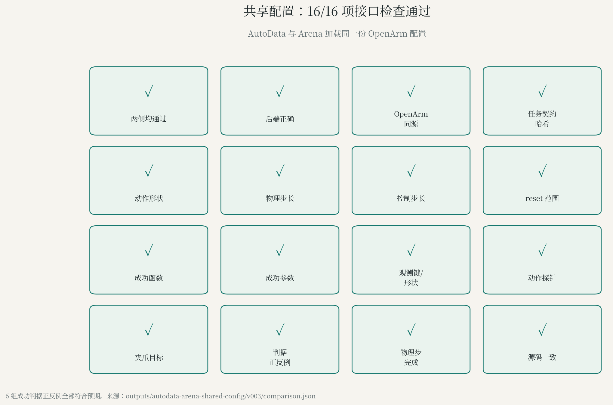

## 2. 导出 24 条：双 worker +29.8%

最终文件就绪吞吐从 1.245 提高到 1.616 条/分钟。三种模式的成功标签都是 24/24，严格物理终态都是 23/24。异步 1/2 worker 的进程峰值 RSS 从 56.17 GiB 降到 40.54 / 40.68 GiB。

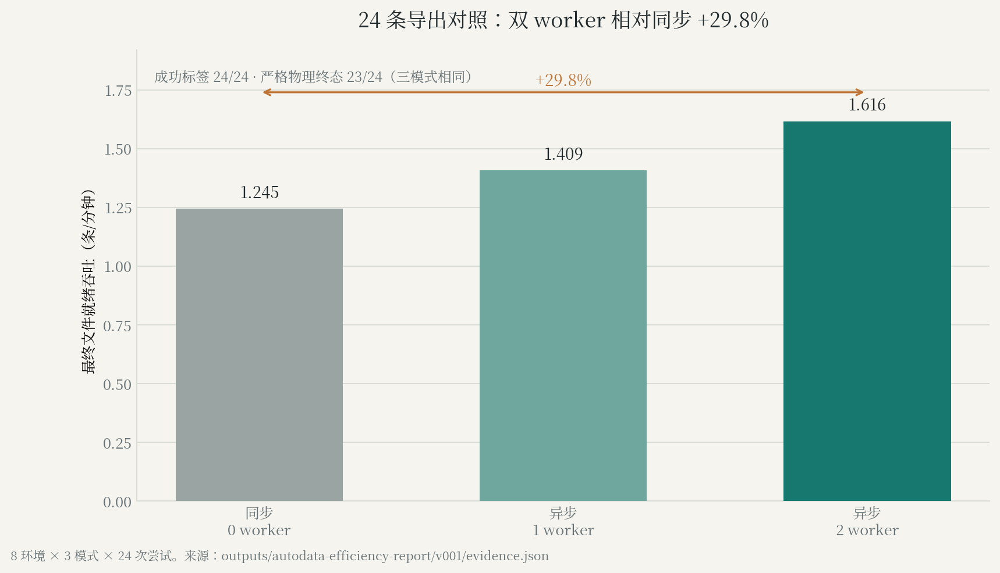

## 3. 导出 16 条：auto +60.2%

最终文件就绪时间从 999.35 秒降到 623.65 秒，吞吐 0.961 → 1.539 条/分钟。四个配置共 68 次尝试、64 次生成成功；每个配置保存的 16 条都通过末态检查。

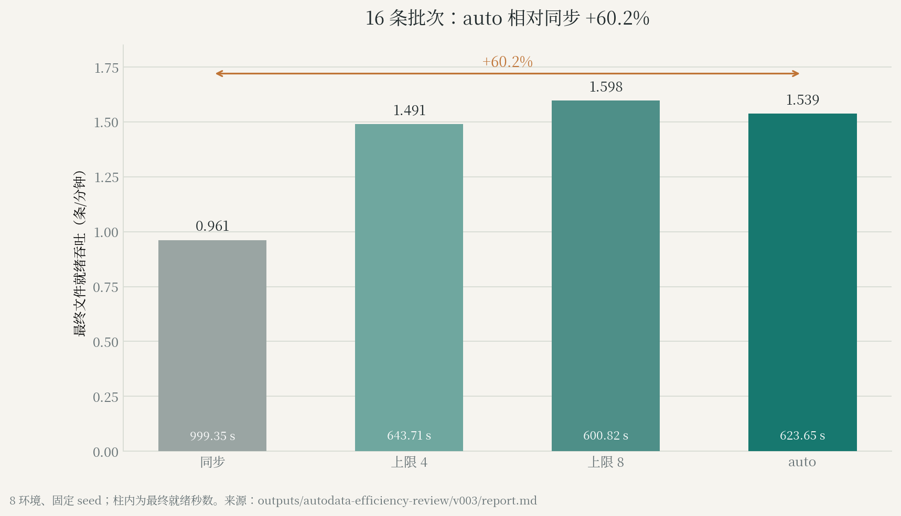

## 4. 固定预算产能：4 环境 +34.5%–37.7%

每格固定 4 次尝试，auto 在 5 个 seed 上提高 19.6%–37.7%；三个确认 seed 为 +34.5% / +36.5% / +37.7%。每个 seed 内，同步与 auto 的成功条数相同。该批按仅生产模式运行，指标为仿真终态接受吞吐，独立文件校验未执行。

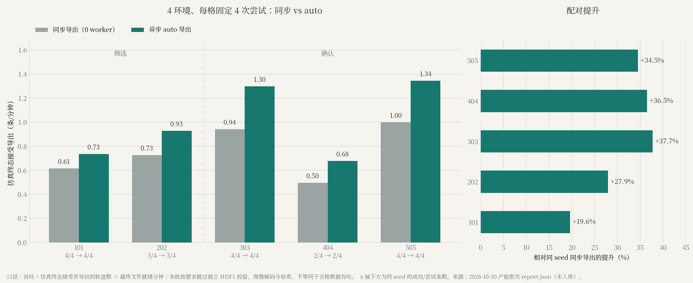

## 5. 时间归因：导出等待 −93.8%

8 对固定 seed 中，就绪时间 515.77 → 350.30 秒（1.472×），execute 197.53 → 142.71 秒。8 组动作数组 SHA256 精确匹配。

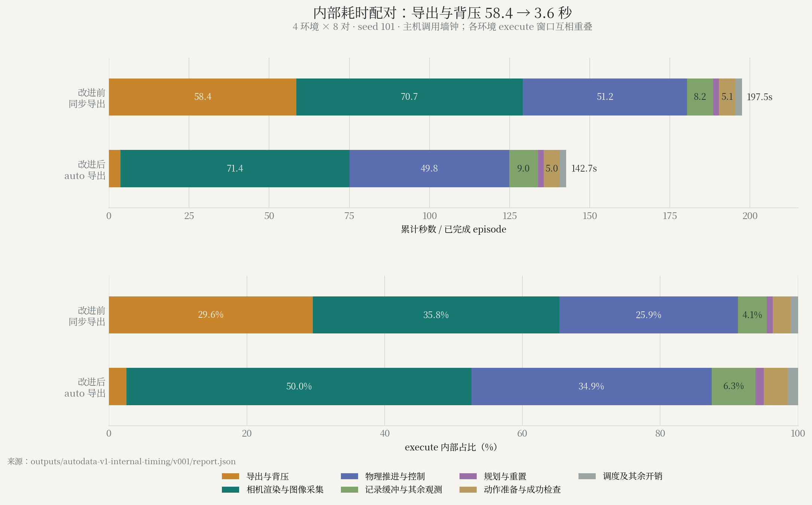

| 阶段 | 改进前 → 改进后（秒/ep） | 改进后占比 | 这一步在做什么 |
|---|---:|---:|---|
| 导出与背压 | 58.41 → 3.64 | 2.6% | 把动作、观测和 RGB 打包、压缩、写入 HDF5。同步模式在主循环里完成，其他环境停等；异步模式交给 CPU writer，队列满时产生背压。 |
| 相机渲染与图像采集 | 70.72 → 71.41 | 50.0% | 更新相机位姿、渲染三路 RGB、GPU→CPU 拷贝。每个 step 计算两次观测，因此每步约 6 次 RGB 拷贝、3 次渲染。 |
| 物理推进与控制 | 51.20 → 49.80 | 34.9% | 物理积分、施加关节目标、写场景状态；控制 30 Hz，物理 120 Hz。 |
| 记录缓冲与其余观测 | 8.19 → 9.04 | 6.3% | 把逐步数据追加到内存记录缓冲，计算相机之外的观测。 |
| 规划与重置 | 1.73 → 1.73 | 1.2% | cuRobo 运动规划与环境 reset。 |
| 动作准备与成功检查 | 5.13 → 4.96 | 3.5% | 目标位姿转成动作、判断成功条件。 |
| 调度及其余开销 | 2.14 → 2.12 | 1.5% | 协程调度与未细分的生成逻辑。 |

导出阶段减少 54.77 秒，占总减少 54.82 秒的 99.9%。相机阶段基本持平（70.72 → 71.41 秒），占比从 35.8% 升到 50.0% 是因为总时间缩短。物理与控制从 51.20 降到 49.80 秒。下一个瓶颈是相机位姿更新与重复 RGB 读取。

## 6. 域随机化：256 个位姿，9/9 通过

物体在 x ±40 mm、y ±60 mm 内采样，高度与朝向固定。同 seed 复现误差为 0，关闭随机化后位置固定，12 步零动作物理数值有限。

## 7. G1 视觉随机化：7 段 6 成功

纯视觉组合的头部图像 MAE 为 36.1/255，动作与基线逐值相同；仅光照 12.6、仅相机 9.4、仅材质 2.7。视觉 + 小位姿扰动 A 倒伏失败，B 成功。纯视觉组合进入下一批生产候选。

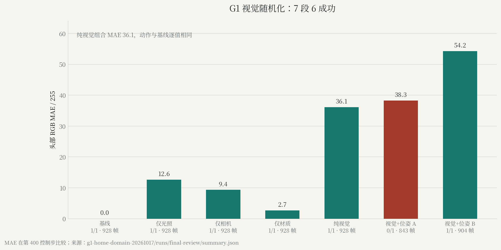

## 8. cuRobo v2 最小对照：5/5 vs 4/5

v2 在 seed 105 漏抓，两版 transit 请求都是 10/10。v2 的后续请求 p50 从 0.753 升到 1.312 秒（+74.2%），p95 从 2.217 降到 1.764 秒。进程显存峰值 7,284 → 7,194 MiB（−1.2%），PyTorch 分配峰值 140.4 → 56.0 MiB（−60.1%）。seed 105 在新进程首次复现时两次成功；v2 的 `SampleBuffer` 使用独立随机流，场景 seed 不等于规划器状态。

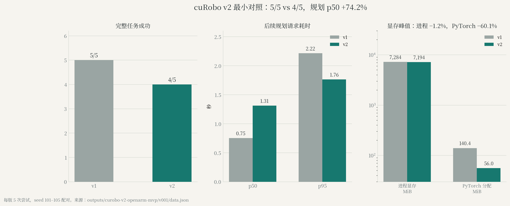

## 9. cuRobo v2 补跑：16/16 生成，15/16 终态

8 环境、目标 16 条：生成 16/16，保存 16 条，严格末态 15/16。失败样本 `demo_2` 角速度 0.854 rad/s，超过 0.5。按末态合格计算 1.287 条/分钟，同口径 v1 为 1.539。v1 继续作为生产默认后端，v2 保留为实验后端。

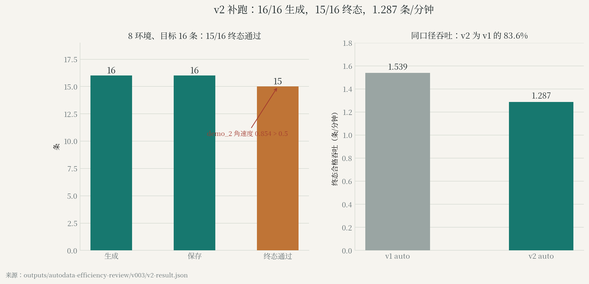

## 10. Franka 避障：有障碍 IK 0/3，cuRobo 3/3

12 次仿真、每格 3 个配对状态。无障碍时两种方法都是 3/3；有障碍时 IK 0/3、cuRobo 3/3。cuRobo 单次规划 107.8 / 113.6 ms，模型构建与预热 2.69 / 2.67 秒。IK 有障碍时峰值接触力 381.8 N，cuRobo 为 0。

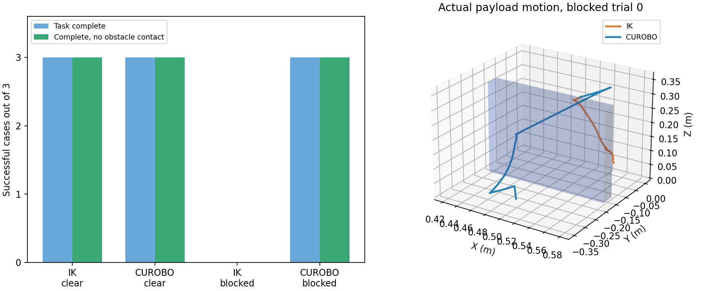

## 11. 香蕉多传感：950 帧，双指 38.7/38.8 N

1 条示范 950 帧 / 50 Hz / 19 秒，抬高 0.227 m，悬空搬运 125 步。双指法向力中位数 38.7077 / 38.8348 N，撤离后归零。腕部相机安装误差 7.49e-8 m，三路视频均解码 950 帧。香蕉按刚体处理，腕部读数为关节反力。

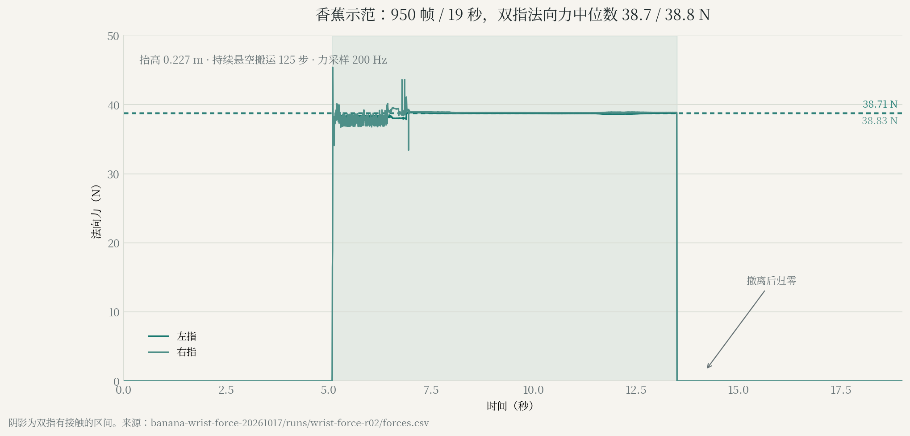

## 12. HDR 生产：5 批全部 1/1

墙钟 156.4–204.1 秒：baseline 202.1，studio 184.1 / 180.0，beach 204.1 / 156.4。换 HDR 后生产流程与验收保持通过。

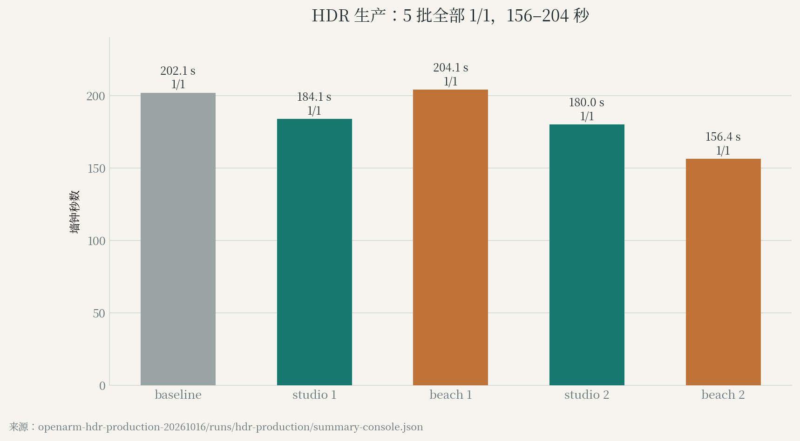

## 13. GPU 并发：4–5 进程，峰值 70%

GPU 峰值 70%，均值 9.4%–32.4%，显存峰值 24.2 GiB（卡 31.8 GiB）。r02 全部初始化重叠阶段 GPU 均值 53.5%。r01 有 3 个任务被终止，均值只作排障记录。

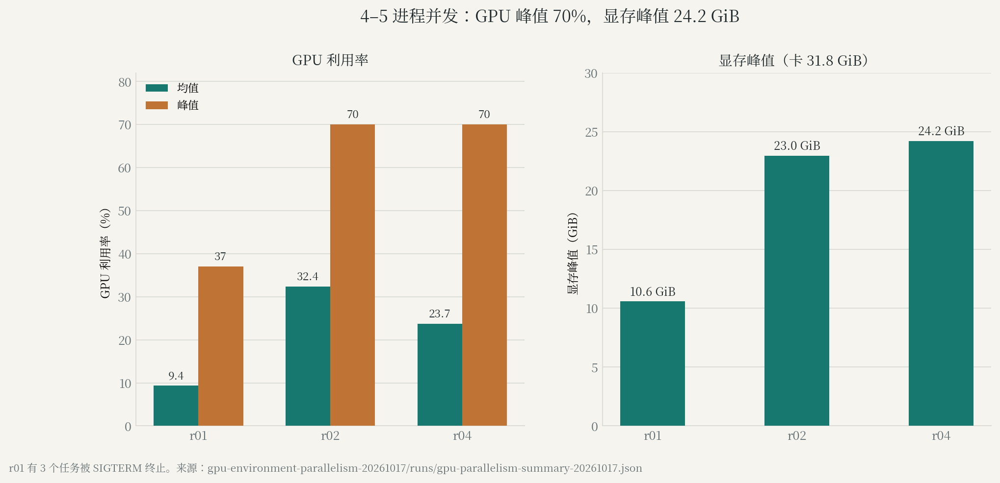

## 14. 100 条生产：63 起 / 55 完 / 8 未完成

10-13 23:43:58 启动，10-14 00:50:30 子进程被 `SIGKILL`（−9）；峰值 RSS 66.6 GiB，cgroup `oom_kill` +1。输出 HDF5 在终止前未写盘。下一步用新路径重跑，再做回读与终态检查。

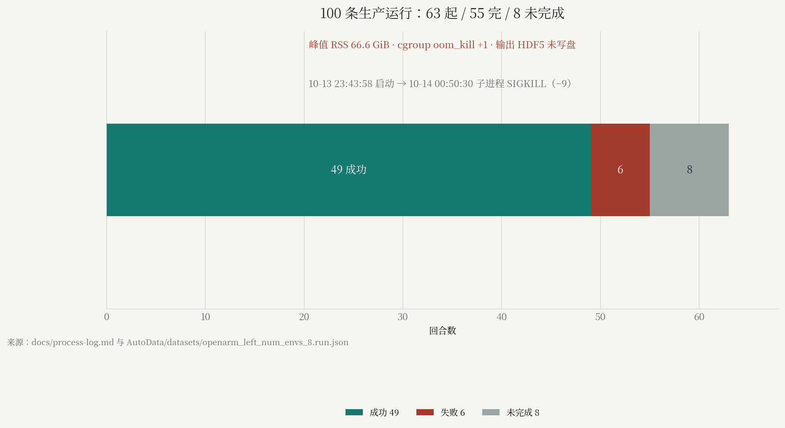

## 15. LeRobot v3 转换：4 条 / 5,453 帧，数值 exact

4 条源轨迹转成 LeRobot v3：5,453 帧、30 Hz、三路 640×480。全量数值 exact，官方 loader 12 个首/中/尾采样点通过，三路视频各 5,453 帧完整解码。归档 27 MB，视频占 86%。

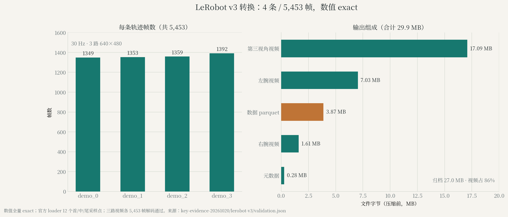

## 16. 相机审计：右腕 5,453/5,453 帧近黑

4 条轨迹共 5,453 帧/路。右腕 100% 近黑，左腕 4 个首帧，第三视角 0。检测规则：平均亮度 < 1/255 且 >99% 像素 ≤2/255。右腕流训练前需替换或剔除。

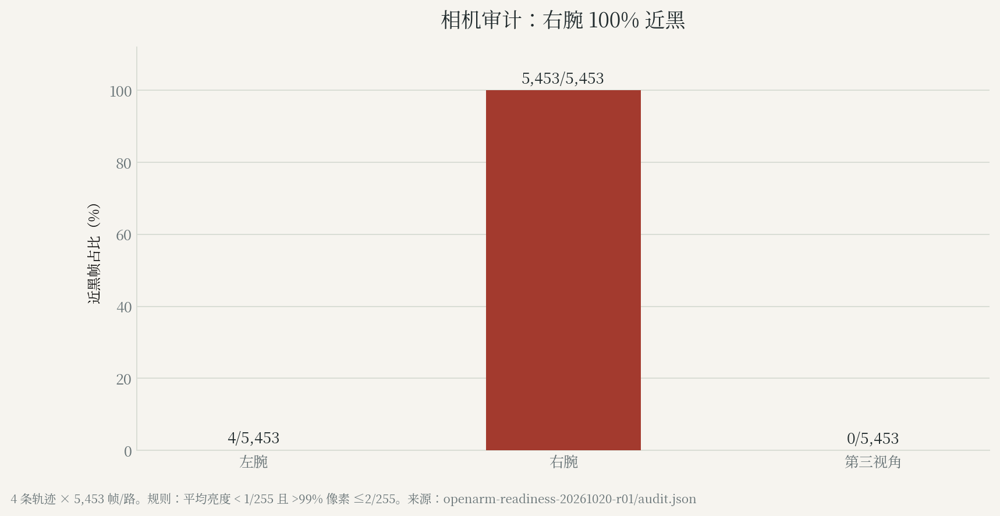

## 17. 8 环境隔离导出：7/8 成功，1.682 条/分钟

8 次尝试：7 成功、1 失败；4 个 writer，最终就绪 249.65 秒，终态接受 1.682 条/分钟。写出 3.85 GB，失败文件 0.58 GB；8 条记录全部回读，7 条通过终态门。失败样本末态线速度 0.193 m/s、角速度 6.19 rad/s，超过 0.03 / 0.5 限值。

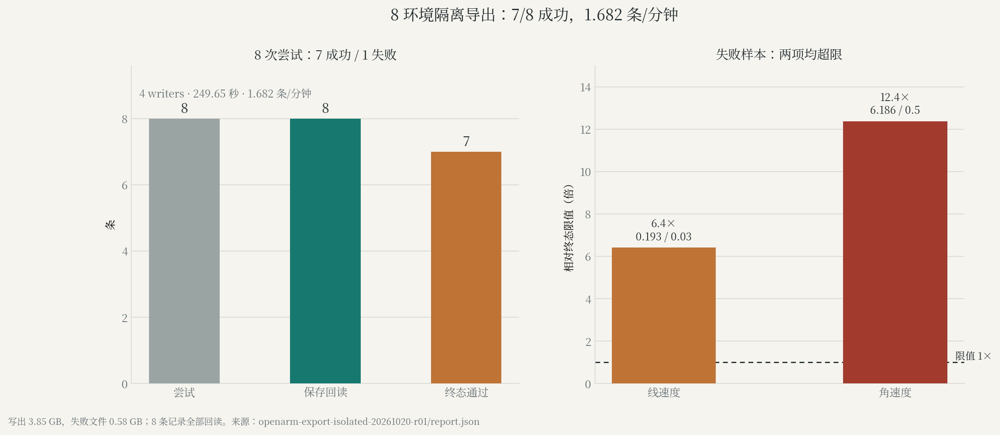

## 18. 24 环境内存准入：93.44 GiB，低于 144 GiB

24 环境保守准入需要 144 GiB 可用内存；机器总内存 94.08 GiB，可用 93.44 GiB，缺口 50.56 GiB。准入判定 blocked，未启动仿真。规模上限由内存决定。

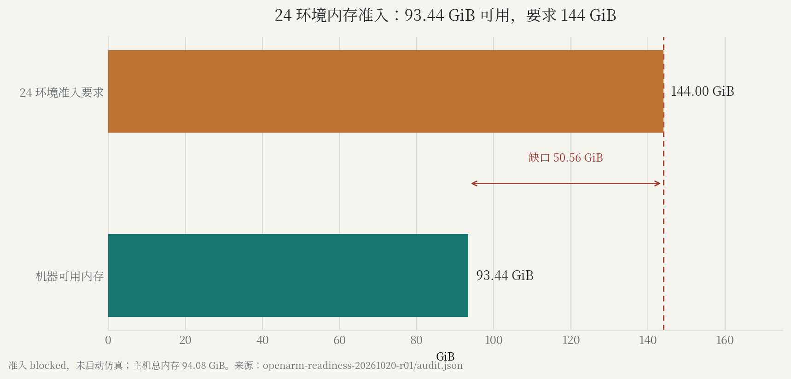

## 结论

1. 异步导出是当前最确定的收益：四组对照 +19.6%–60.2%，导出等待 −93.8%，严格终态 23/24 不降。
2. 下一个瓶颈是渲染与相机：占 execute 50.0%，物理与控制占 34.9%。
3. 质量门槛保持：24 条终态 23/24，v2 补跑 15/16，8 环境回归 7/8。
4. LeRobot v3 交付：4 条 / 5,453 帧 / 27 MB，数值 exact；右腕 100% 黑帧，训练前替换。
5. 规模由内存决定：24 环境需 144 GiB，机器 93.44 GiB 可用；100 条生产以 OOM 终止。
6. 生产默认继续用 v1；v2 作为实验后端。

## 口径与范围

- 成功分三种口径：成功标签、文件结构 / 回读、严格物理终态，分别记录。
- 吞吐分三种口径：最终文件就绪、仿真终态接受、独立校验合格。第 4 节为第二种。
- 计时为主机墙钟，CUDA 同步未加入；GPU 工作可能在后续读取时才阻塞。
- 样本量见图注；数字描述已测批次。
- 共享配置验证接口与判据；内部计时的 8 对动作数组 SHA256 精确匹配。
- LeRobot 结论覆盖转换与回读；训练兼容性与策略效果另行验证。
- 相机黑帧规则：平均亮度 < 1/255 且 >99% 像素 ≤2/255。
- 8 环境为隔离回归；24 环境只做资源准入，未启动仿真。

## 来源

- `outputs/autodata-efficiency-report/v001/evidence.json`
- `outputs/autodata-v1-internal-timing/v001/report.json`
- `outputs/autodata-efficiency-review/v003/report.md`、`v2-result.json`
- `outputs/autodata-domain-randomization/v002/result.json`
- `outputs/autodata-arena-shared-config/v003/comparison.json`
- `outputs/curobo-v2-openarm-mvp/v001/data.json`
- `key-evidence-20261020/lerobot-v3/validation.json`
- `openarm-export-isolated-20261020-r01/report.json`、`validation.json`
- `openarm-readiness-20261020-r01/audit.json`
- G1、Franka、香蕉、HDR、并发与 10-20 产能：任务目录原始记录，映射见 `manifest.json`

版本：v005 在 v004 基础上新增 LeRobot v3 转换、相机审计、8 环境隔离导出与 24 环境内存准入；前 14 组保持不变。
