# 具身数据生产实验图册

材料截至 2026-10-20。整理已有记录，没有新增仿真、训练或大型 HDF5 扫描。

共 19 张图、20 页 PDF；14 张历史 PNG 按原字节复用，5 张新图由保存的 JSON/末态向量绘制。

入口：[本地图册](index.html) · [PDF](experiment-chartbook.pdf) · [图表索引](chart-index.csv) · [主要指标及阶段数据](metrics.csv)

口径：24 条数据与 24 并行环境不同；成功标签、文件回读和严格终态分别报告。不同机器人、任务和重复观测不合并样本量或成功率。

已明确 cuRobo 最小对照：v1=5/5、v2=4/5。历史混合并发的 70% 是峰值；历史 100 条目标中断不作为完成数据量。

当前缺口：右腕持续近黑；24 环境内存准入受阻；正式扩增方法比较与学习策略训练/泛化仍未完成。

## 02-export-24 · 24 条导出对照

三模式严格终态均为 23/24；最终文件吞吐最高提高 29.8%

样本：3 模式，各 24 条。口径：最终文件就绪；24 条不是 24 并行环境。

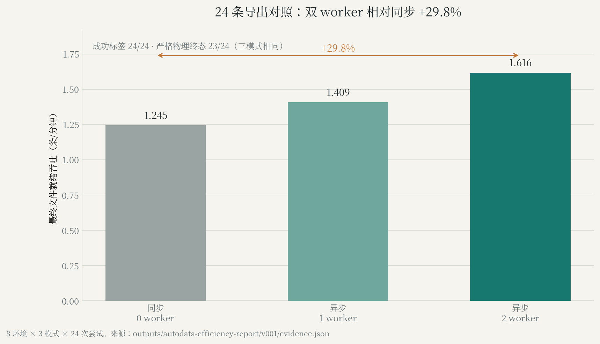

来源：[export24](evidence/export24.json)。

## 03-export-16 · 16 条成功目标的导出对照

四配置各 17 次尝试、16 次生成成功；auto 提高约 60.2%

样本：4 配置 × 17 次尝试。口径：最终文件就绪；各保存 16 条终态通过。

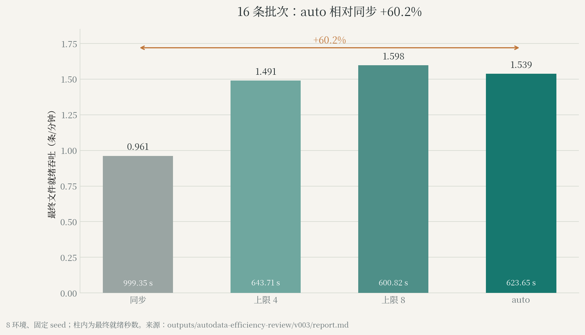

来源：[export16](evidence/export16.json)。

## 04-capacity · 固定尝试预算产能

20 个单元、74 次尝试；确认 seed 的提高为 34.5%–37.7%

样本：5 seed；74 次尝试。口径：仿真终态接受吞吐；正式批次未独立文件验收。

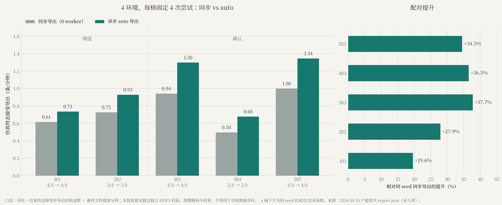

来源：[capacity](evidence/capacity.json)。

## 05-timing · 内部耗时归因

8 对动作哈希匹配；导出等待下降 93.8%

样本：4 环境 × 8 对。口径：主机墙钟归因；不是隔离 GPU kernel 时间。

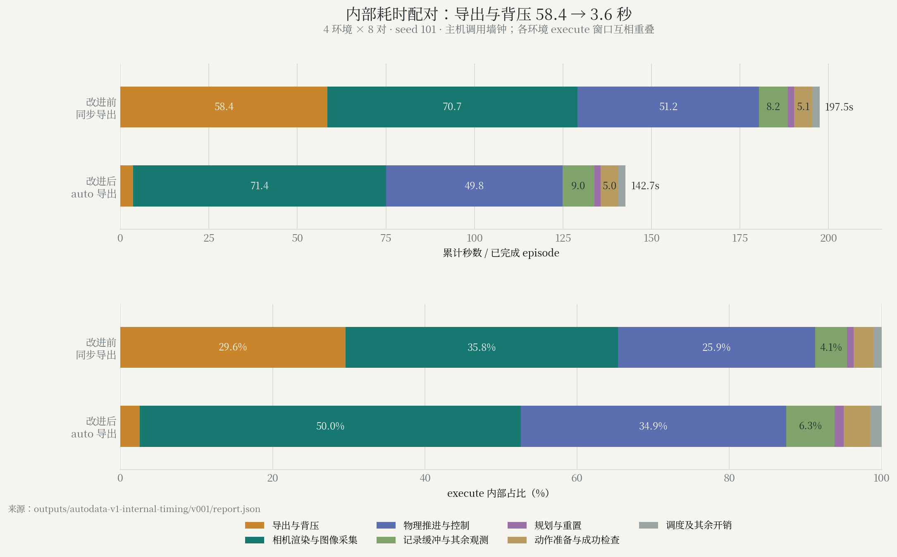

来源：[timing](evidence/timing.json)。

## 01-shared-config · 共享配置接口

16/16 项接口与判据检查通过

样本：16 项检查。口径：接口一致性；不是学习策略等价性。

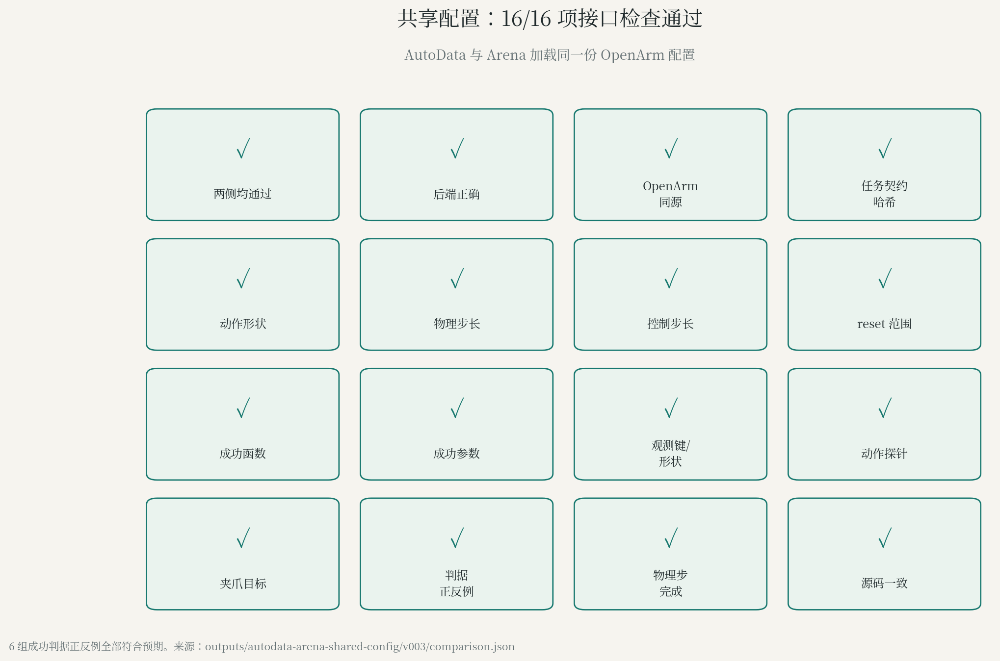

来源：[shared](evidence/shared.json)。

## 06-domain-randomization · OpenArm 位姿随机化检查

256 个 reset 位姿，9/9 项检查通过

样本：256 reset；9 项检查。口径：随机化生效检查；不是完整任务或策略成功率。

来源：[randomization](evidence/randomization.json)。

## 07-g1 · G1 视觉随机化

7 段尝试中 6 段成功；纯视觉组合动作与基线一致

样本：7 段。口径：G1 家庭搬运；尚未验证训练泛化收益。

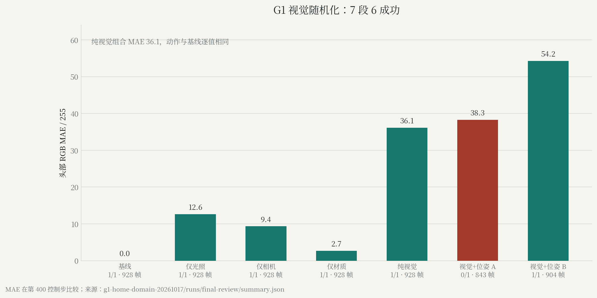

来源：[g1](evidence/g1.json)。

## 12-hdr · OpenArm HDR 小批生产

5 批各 1 次，均通过已有验收

样本：5 批 × 1 次。口径：生产可行性；不同墙钟不构成 HDR 加速证据。

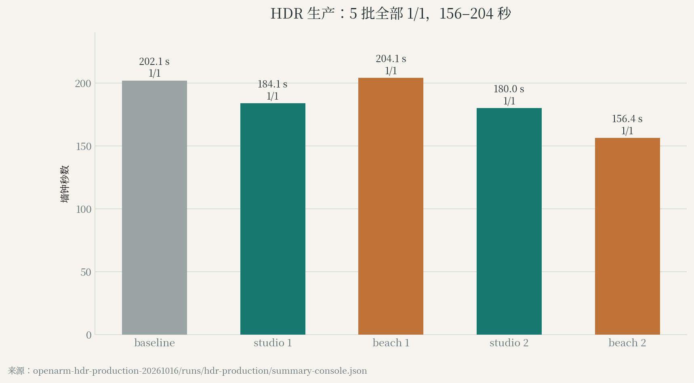

来源：[hdr](evidence/hdr.json)。

## 08-curobo-mvp · cuRobo v1/v2 最小对照

完整任务 v1=5/5，v2=4/5；两版规划请求均 10/10

样本：每版 5 任务；9 个后续请求。口径：集成方案对照；请求非独立任务；内部配置不完全等价。

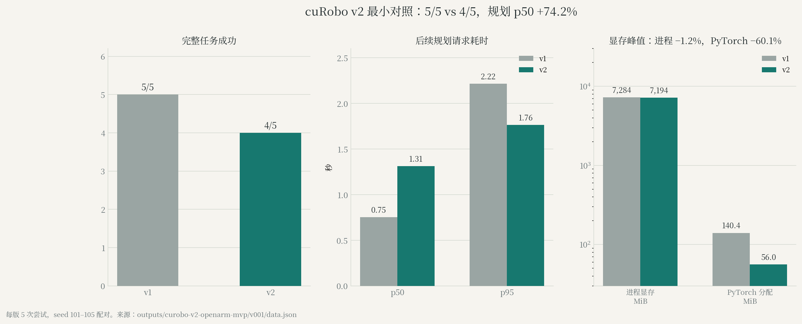

来源：[mvp](evidence/mvp.json)。

## 09-curobo-rerun · cuRobo v2 补跑

v2 生成并保存 16 条，严格终态通过 15 条

样本：v2 保存 16 条。口径：生成、保存与严格终态分别报告；v1 仍为默认。

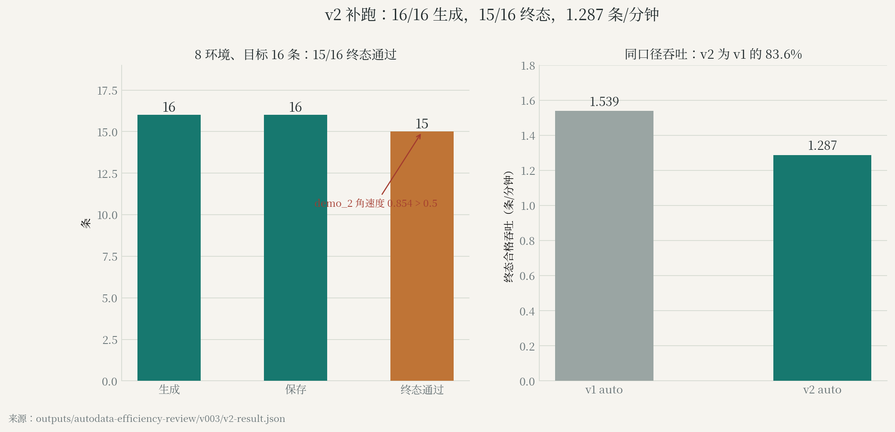

来源：[v2](evidence/v2.json)。

## 10-franka · Franka 配对避障

有障碍时 IK 0/3，cuRobo＋IK 3/3；无障碍均 3/3

样本：4 条件 × 3 配对状态。口径：局部桌面避障；不代表 OpenArm 或整屋避障。

来源：[franka](evidence/franka.json)。

## 11-banana · 香蕉多传感示范

950 帧；双指搬运法向力中位数约 38.7/38.8 N

样本：1 条，19 秒。口径：刚体香蕉；腕部为关节反力；不是压伤或力控验证。

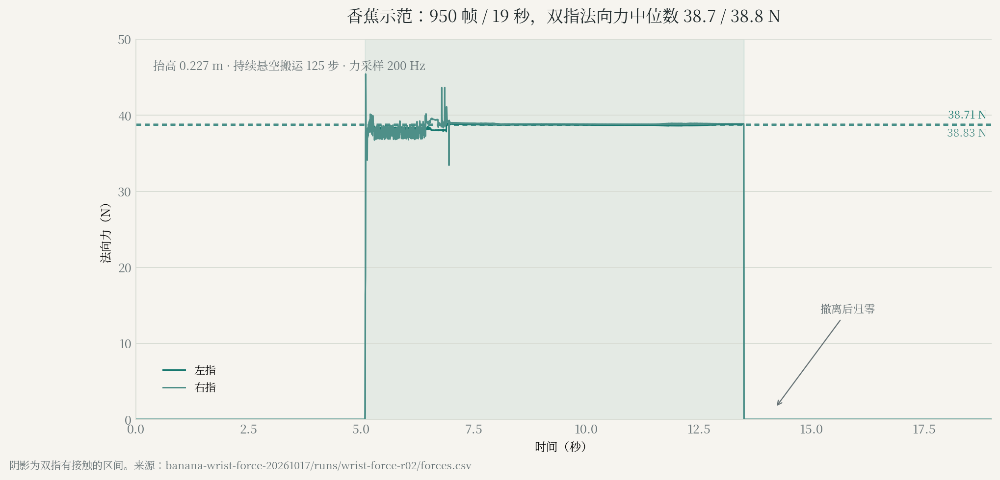

来源：[banana](evidence/banana.json)。

## 13-concurrency · 历史 GPU 并发观测

4–5 进程峰值 70%；均值约 9.4%–32.4%

样本：历史混合工作负载。口径：峰值不是持续高利用率；部分轮次含被终止任务。

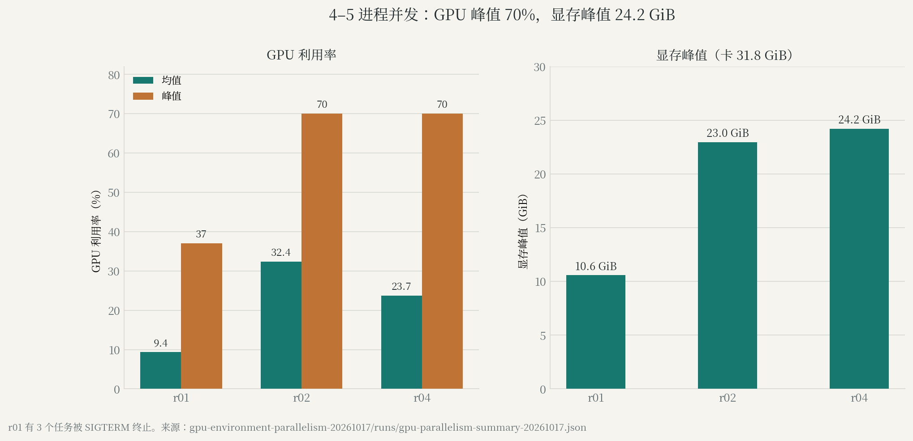

来源：[concurrency](evidence/concurrency.json)。

## 14-production-100 · 历史 100 条成功目标运行

63 次开始、55 次完成、8 次未完成；最终运行中断

样本：目标 100 条成功；不是固定 100 次尝试。口径：SIGKILL 并伴 cgroup OOM 事件；不能据此确定 OOM 受害进程。

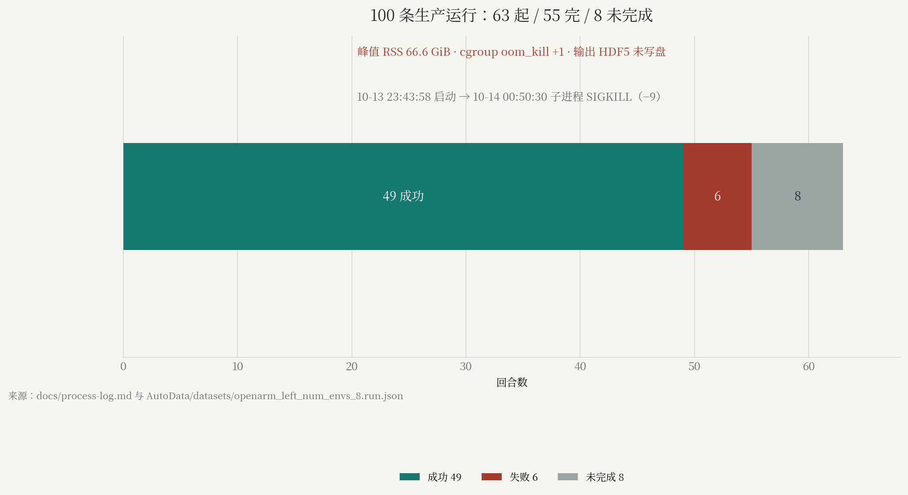

来源：[history](evidence/history.md)。

## 17-memory-admission · 24 环境内存准入

有效可用 93.44 GiB，低于保守准入要求 144 GiB

样本：1 次资源快照。口径：资源准入受阻；无 24 环境运行结果。

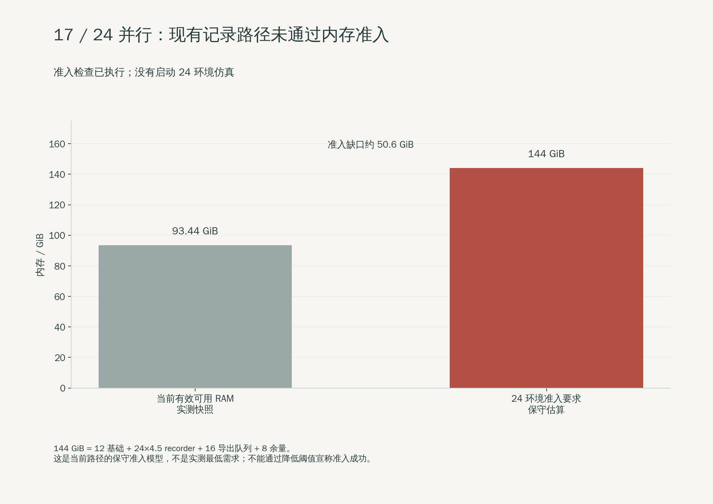

来源：[audit](evidence/audit.json)。

## 15-camera-quality · 三路相机黑帧检查

右腕 5453/5453 帧近黑；左腕仅 4 个首帧，第三视角为 0

样本：4 条；各相机 5453 帧。口径：全像素扫描；不是多视角训练通过。

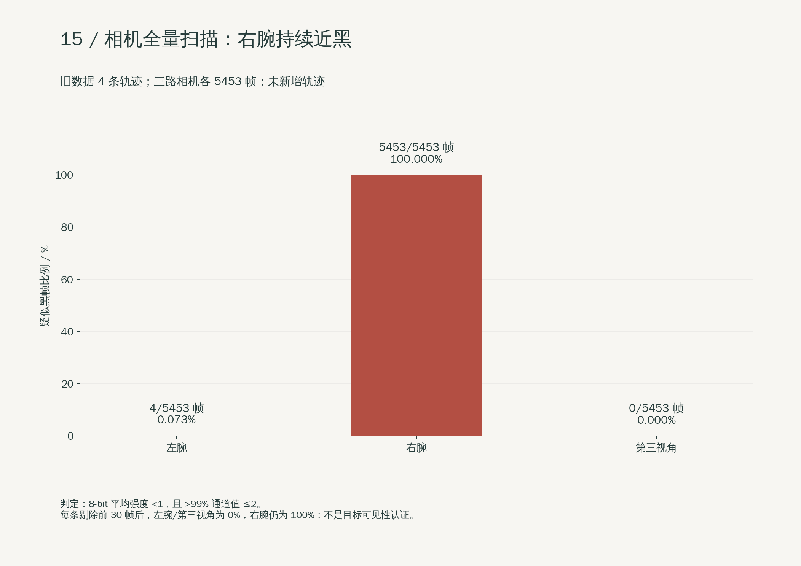

来源：[audit](evidence/audit.json)。

## 16-export-closure · 8 环境隔离导出回归

8 次完成、8 条保存、8 条完整回读；7 条严格终态成功

样本：8 次尝试。口径：真实 GPU 回归；不是 24 并行或长期稳定性验证。

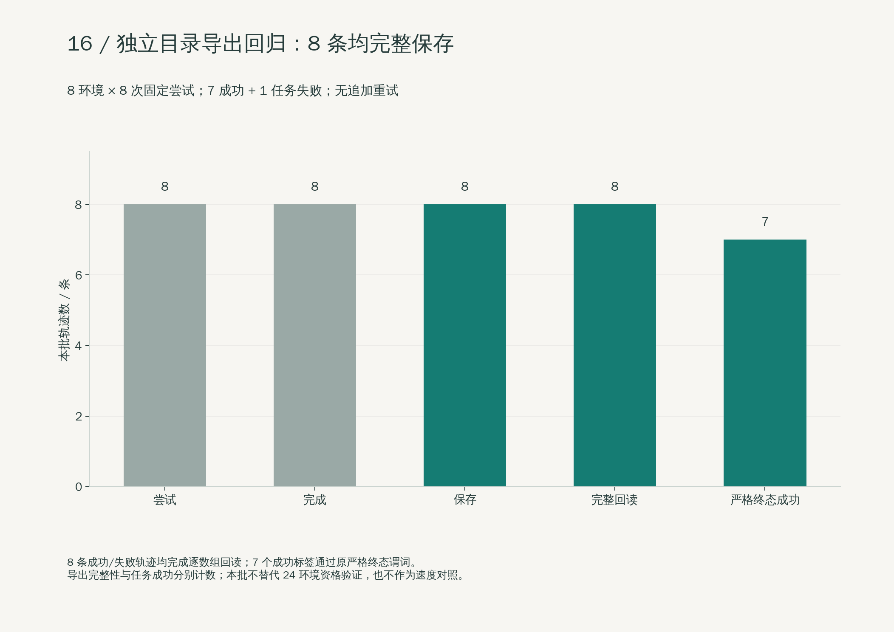

来源：[regression](evidence/regression.json)。

## 18-failure-terminal · 失败样本终态诊断

线速度约 0.193 m/s、角速度约 6.19 rad/s，均超过原阈值

样本：1 个失败样本。口径：物理终态检查；不等于接口或导出失败。

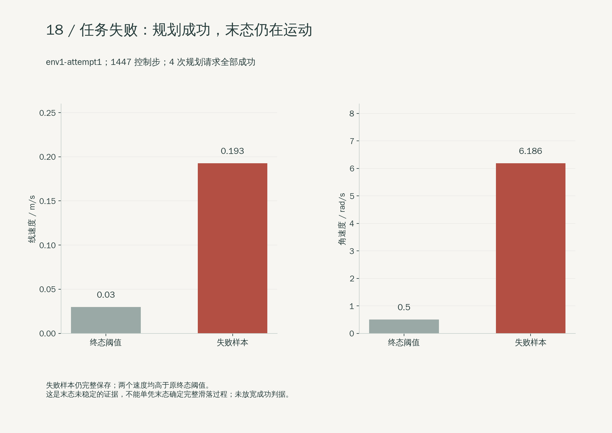

来源：[failure](evidence/failure.json)。

## 19-lerobot-conversion · LeRobot v3 转换与回读

4 条、5453 帧；数值精确匹配，三路视频完整解码

样本：4 条；12 个 loader 采样。口径：CPU 转换与回读；尚未训练或评测学习策略。

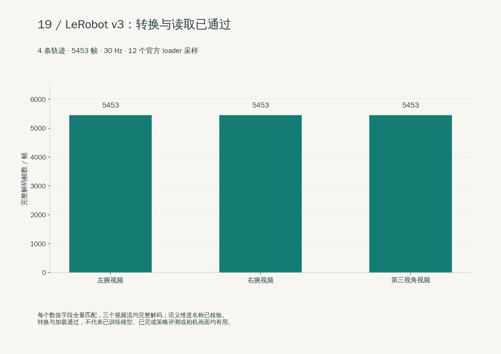

来源：[conversion](evidence/conversion.json)。
