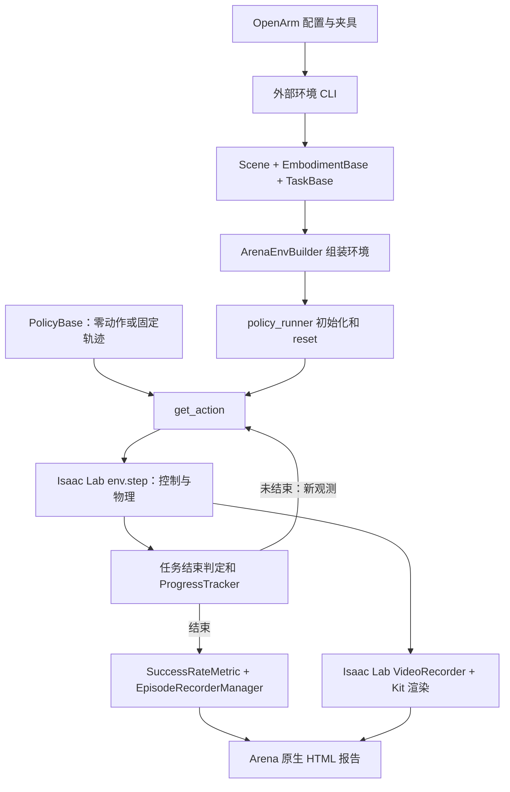

# OpenArm Arena 评测示例：模块、实测报告与完整录像

本例已在配置好的 RTX 5090 GPU 环境中通过真实 Arena 评测：零动作负例 0/2 成功，固定轨迹回归 1/1 成功。固定轨迹在第 1,191 个控制步触发原 OpenArm 放置成功判据，录像完整覆盖这次回合，长 39.70 秒。

[打开结果和视频](index.html)。[固定轨迹 Arena 原生回合报告](fixture_regression_seed11/2026-10-15_17-16-28/report/job_unnamed.html)。[直接播放完整录像](fixture_regression_seed11/2026-10-15_17-16-28/arena-native-env0-viewport-episode-0.mp4)。

## Arena 在本例中的调用链

| Arena 模块／接口 | 本例怎样使用 | 具体责任 |
| --- | --- | --- |
| `isaaclab_arena_environments.cli`、`ExampleEnvironmentBase` | 从 `--external_environment_class_path` 加载 `OpenArmBenchmarkEnvironment` | 接入外部 OpenArm 任务，接收回合预算和夹具路径 |
| `IsaacLabArenaEnvironment` | 声明场景、机器人、任务与配置回调 | 汇集环境组成，不在这里运行策略 |
| `Scene`、`EmbodimentBase` | `OpenArmLeftEmbodiment` 复制机器人、TCP、相机、动作和观测 | 给 builder 提供机器人侧配置；本例 `Scene(assets=[])`，桌子、方块等由 task 的 scene 配置提供 |
| `TaskBase` | `OpenArmPickPlaceTask` 提供物体、灯光、reset、任务文字、视角、指标 | 保留生产场景定义；负例随机 reset，回归恢复夹具初态 |
| `ArenaEnvBuilder`、`IsaacLabArenaManagerBasedRLEnv` | 合成配置、设置物理后端、注册并创建 Gym 环境 | 连接动作、观测、结束管理器，提供评测环境生命周期 |
| `PolicyBase`、`PolicyCfg`、`PolicyRegistry` | 内置 `zero_action`；动态导入 `OpenArmFixtureReplayPolicy` | 统一 `get_action`／`reset`，在回归中逐步读夹具动作；没有训练模型 |
| `evaluation/policy_runner.py`、`rollout_policy` | reset → 取动作 → env.step → 处理结束 → 下一步 | 真正执行评测循环；按结束环境清理策略状态，达到回合目标后收尾 |
| `TaskTerminationCfg`、`ProgressObjective`、`TaskSuccessTerm`、`ProgressTracker` | 单个 `place_on_pad` 目标包装原 `cube_placed_on_pad`；保留掉落失败和超时 | 根据仿真状态判断是否结束、记录任务进度。本例没有抓取／移动／释放的多阶段标注 |
| `MetricsManager`、`SuccessRateMetric` | 统计结束回合的成功情况 | 产生任务成功率；0/2 为 0%，1/1 为 100% |
| `EpisodeRecorderManager`、core/progress recorder terms | 写 `episode_results_rank0.jsonl` | 保存 env ID、回合编号、种子、成功、步数、任务文字和进度事件 |
| `video.video_recording` | 复用 Arena 录像选项、时间戳输出目录 | 接入评测录像；当前版本的实际帧采集由下层 Isaac Lab 原生录像器执行 |
| `visualization.report.build_report` | 读取回合记录并关联回合 MP4 | 生成原生总览、任务和回合页面，展示结果、进度和录像 |
| `SimulationAppContext` | 每项检查启动独立仿真子进程 | 管理 Isaac Sim 应用启动与退出 |

## 三层边界

OpenArm 生产配置提供机器人资产、关节与相机、左臂 IK 动作、观测、物体、reset 和放置成功谓词。Arena 负责环境组装、策略接口、执行流程、结束与进度管理、统计、回合落盘和报告。Isaac Lab／Isaac Sim 负责具体控制、物理仿真和渲染。

本仓库的 `code/run.py` 是协议编排器：校验 181 个输入文件、选择检查、启动 Arena 子进程、读取实际完成回合并验证预期。它生成的 `index.html` 是示例汇总页；子目录中的报告才是 Arena 原生报告。

`code/openarm_benchmark/environment.py` 转换新版任务接口并保留 Arena 已解析的 PhysX 后端；`actions.py` 适配新版 Warp 关节索引，保留原夹爪动作与限速；`recording.py` 将 Arena 录像请求接到当前 Isaac Lab `VideoRecorderCfg`／Kit。当前 Lab 的旧 `render(rgb_array)` 路径返回空值，原 Gym 录像包装不能产出视频。

录制源是 `visualizer:kit`，视口跟随 env 0；没有给并行 env 1 伪造视频。只有恰好一个 env 0 完成回合和一个视频文件时才建立单回合关联。多回合长视频不会被标为某一回合。

本例未调用 Arena 的 Experiment YAML／批量实验调度、OSMO、训练流程、Mimic 数据生成或场景关系求解。随机 reset 沿用 OpenArm 的事件配置，未设计新的 Arena variations 参数扫描。

## 两项实测如何走完模块链

| 检查 | 策略和 reset | 结束结果 | 原生记录 | 示例验收 |
| --- | --- | --- | --- | --- |
| `smoke_timeout_seed11` | `zero_action`，2 个环境随机 reset，0.5 秒预算 | 两个回合各 15 步，成功标记均为 false | 成功率 0%，进度 0；视口视频 0.50 秒 | 符合全失败负例预期，检查通过 |
| `fixture_regression_seed11` | 固定夹具初态 + 逐步回放 7 维动作，90 秒预算 | 第 1,191 步放置成功 | 成功率 100%，`place_on_pad` 进度 1.0；录像 39.70 秒 | 符合成功回归预期，检查通过 |

第二项 JSONL 中的成功事件为 `step=1191, objective=place_on_pad, predicate_name=cube_placed_on_pad`。这些数值来自本次真实仿真记录，不是可视化界面的模拟数据。

报告中的单目标进度只说明放置谓词是否完成，不能解释为完整抓取技能分解或物理轨迹标注。视频可以观看过程；JSONL 提供最终结果及谓词事件。

## 版本、验证和复现

- Arena：`98866596fd024d96c874fe6fb95ae916d1133629`。
- Isaac Lab：`bb0c8e1b9af381bf13064ec3303e17db79e4b6ef`。
- GPU：NVIDIA GeForce RTX 5090；运行时 Torch 2.11.0+cu128。
- 协议、输入哈希及结果见 `results.json`；旧交付与生产配置的比对证据见 `source-evidence.json`，其中历史结果不混作本次结果。
- 固定轨迹和负例完成后，对视频只做字节不变的文件改名关联，再用实际 Arena `build_report` 重建原生报告。
- 最终自动关联包装器另做一次真实 GPU smoke 复验，产物见 [收尾复验报告](recording-followup/index.html) 和 `recording-followup.json`。该收尾改动未再次运行固定轨迹；正例来自上述同一套控制、任务和采集代码。
- 17 项主机测试通过；所选 MP4 完整解码与报告相对链接检查见 `validation.json`。主机测试不代替 GPU 运行。
- 复现需另外取得原完整 OpenArm 交付包和配置好的仿真环境。运行命令见 `code/README.md`，录像加 `--record-viewport-video`。不要更新上游或原交付包。

负夹爪动作闭合，零／正动作张开，遵循实际继承的 `BinaryJointPositionAction` 实现；原交付说明符号写反，本例不翻转轨迹动作。

## 解释范围与交付

该示例验证评测基础设施和已知轨迹回归。没有训练策略，固定初态的一次成功不能作为策略泛化能力或统计稳定性的 benchmark 成绩。可选 90 秒多种子随机初态 baseline 未运行。没有修改生产代码、上游源码、资产或子模块版本。

按用户“先完成本地交付”的指示，v002 在本地封装，飞书和 ChatGPT 上传分别保留 pending；不把本地文件链接当成上传成功。v001 保持原样，记录首次交付时尚未完成 GPU 验证的状态。
