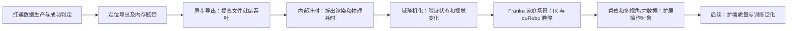
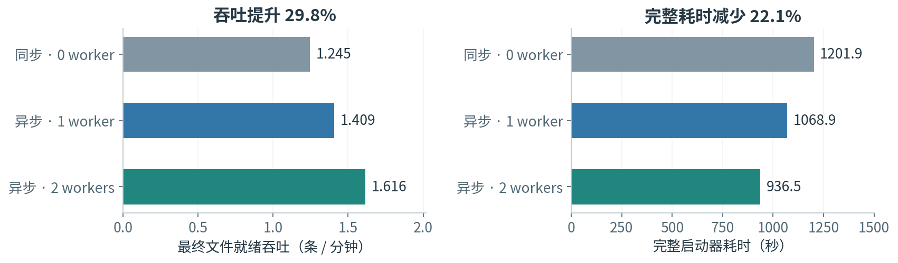
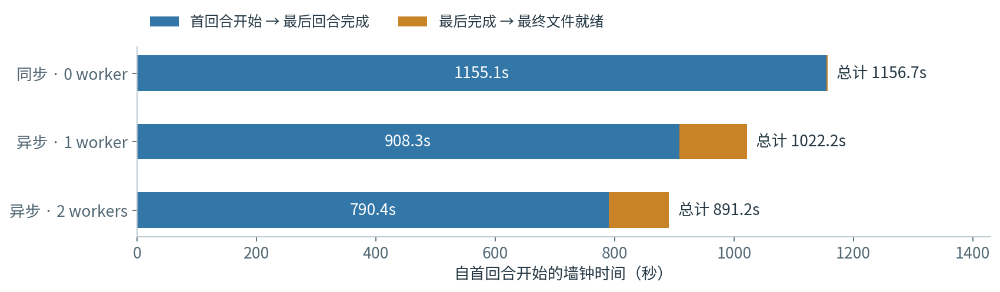
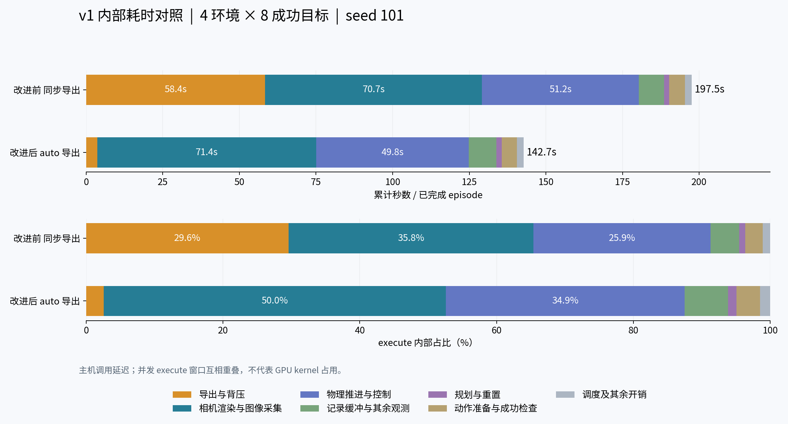
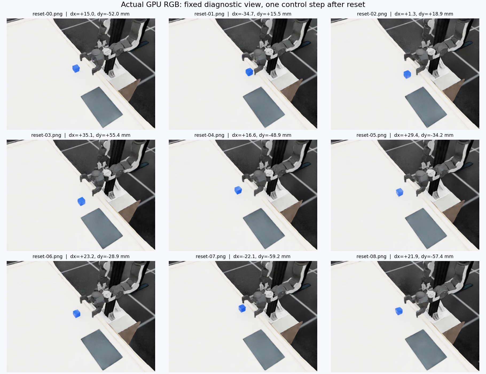

# 具身数据生产与效率实验：版本化结果总览

> **阅读方法：沿着图和实验问题往下读。** 本报告汇总目前可追溯的 AutoData 数据生产、效率、域随机化、规划器和家庭场景操作实验。每张图先给读图结论，再说明实验条件和证据边界。图中数值是各自实验的结果，不跨任务合并计算。

- 汇总版本：v001
- 材料截止：2026-10-19（Asia/Shanghai）
- 范围：已保存报告、验证记录及本项目相关聊天中已完成的仿真实验；没有在本报告整理过程中新增 GPU 实验。
- 推荐入口：[本报告](report.md) · [成果索引](../../outputs/README.md) · [12 图效率优化报告](../../outputs/autodata-efficiency-report/v001/index.html) · 效率复盘图册 v021（归档，未随 main 复制） · [架构与 cuRobo 图册 v022](../../outputs/autodata-efficiency-review/v022/charts.md)

## 先看实验如何递进

这条路线从“能不能生成”逐步转向“生成多快、记录是否可靠、场景变化能否处理”。后段的 Franka、香蕉和 G1 域随机化结果来自不同任务、机器人和验证口径；它们用于说明研究方向的推进，不能拿来当作同一个算法的前后 A/B。

### 模板怎么选

我对照了项目现有三种写法：单实验的“问题—配置—结果—限制—复现”报告、12 图效率报告的图文叙事，以及 `outputs/` 的版本索引与 `manifest.json` 溯源记录。这里采用它们的组合：先给路线图，每个实测图紧跟读法、条件和边界，最后汇总版本差异与来源。单纯复制某一份旧报告会漏掉跨任务版本关系；另造一个大而全的论文模板则会重复维护既有细节。该结构可通过追加版本和图表继续扩展。

## 1. 生产效率：异步导出减少等待，但终态验收暴露质量缺口

**读图：** 8 环境、每模式 24 次尝试中，双 worker 的最终文件就绪速度高于同步导出；单 worker 居中。但三个模式的严格物理终态都是 **23/24**，所以吞吐提高没有消除相同的终态失败样本。

| 导出方式 | 最终就绪速度（条/分钟） | 文件格式检查 | 严格终态通过 |
|---|---:|---|---:|
| 同步（0 worker） | 1.245 | 通过 | 23/24 |
| 异步（1 worker） | 1.409 | 通过 | 23/24 |
| 异步（2 worker） | 1.616 | 通过 | 23/24 |

双 worker 相对同步的最终就绪加速约 **1.30×**。三组均记录 24 次成功标签，但相同的 `demo_2` 最终仍在运动，严格物理检查失败；因此不能用 24/24 描述物理合格率。三个模式非 RGB 数据集共 672 项逐值一致；固定轨迹 CPU 回放的文件结构、值、属性、形状和压缩也通过一致性核对。GPU 运行当时报告的全局峰值内存较高，应按原报告中的 RSS、cgroup 与显存各自口径理解。

**这一版推进了什么：** 异步导出、worker 数量与最终文件就绪时间形成端到端 GPU 对照，并检查数据传输和读取。**尚未回答什么：** 是否能改善真实任务成功率、超时与失败样本如何处置，以及相机图像是否逐像素等价。详情见[效率报告 v001](../../outputs/autodata-efficiency-report/v001/index.html)及其[结构化证据](../../outputs/autodata-efficiency-report/v001/evidence.json)。

## 2. 内部计时：再把总耗时拆开，找到下一个瓶颈

**读图：** 在另一组 4 环境固定 seed 配对实验中，8 条目标示范都完成且物理、文件结构校验通过；异步 auto 导出平均最终文件吞吐从 **0.931** 提高到 **1.370 条/分钟**，约 **1.472×**。这次不是上节 24 条实验的复算。

改进前后动作数组 SHA256 精确匹配 8 组，说明导出方式变化没有改变该组动作记录。execute 平均累计时间由 **197.53 秒**降至 **142.71 秒**；互斥计时归因中，导出与背压由 **58.41 秒**降至 **3.64 秒**。优化后相机渲染和图像采集占 execute 计时约一半，物理推进与控制约三分之一，因此后续优化重点从导出逐渐移到渲染、相机位姿更新及重复 RGB 读取。

**版本连续性：** 这组实验保持任务 YAML、输入哈希、4 环境与 8 个成功目标不变，补充了前一轮没有的内部计时解释。它仅有一个 seed 对、一种硬件和一次固定顺序；报告的是主机调用墙钟，不是隔离 GPU kernel 时间。完整方法和逐环节计时见[内部耗时报告 v001](../../outputs/autodata-v1-internal-timing/v001/report.md)。

## 3. 存储与压缩：速度、体积、训练输入要一起看

早期压缩试验使用同一条 1,342 帧、三路 RGB 轨迹；它展示的是格式取舍，不是大样本结论：

| 格式 | 文件体积 | 建数据集耗时 | 该次实验观察 |
|---|---:|---:|---|
| gzip level 2 | 约 525 MiB | 约 25.75 秒 | 体积较小，写入耗时较长 |
| LZF | 约 796 MiB | 约 16.98 秒 | 速度与体积居中 |
| 无压缩 | 约 354 MiB | 约 10.10 秒 | 该样本写入最快，但文件不最小 |

**读图要点：** “最小文件”“最快生成”“最适合训练”是三个不同目标。当前新实验计划将审阅视频降至 320×240、15 fps；这只适用于审阅视频。若降低训练用相机分辨率或采样率，观测内容与生产成本都会改变，必须建立新的配置版本，并与相同配置的基线配对比较。压缩试验的详细解释在[效率报告 v001 图 04](../../outputs/autodata-efficiency-report/v001/index.html#s4)。

## 4. 域随机化：先验证生成器真的改变了什么

2026-10-16 的 AutoData 实测使用 OpenArm 左臂和 4 个并行环境，共检查 **256 个 reset 位姿**。只随机化物体 XY：相对默认中心 x ±40 mm、y ±60 mm；高度与朝向固定。数值边界、随机种子复现、不同种子差异、关闭随机化对照和短程物理步等 9 项检查通过。

**这证明了什么：** 位姿采样配置能按边界生成，并能按记录的种子复现。**这没有证明什么：** 它没有运行 cuRobo 轨迹生成，没有统计抓取成功率，也没有训练策略验证泛化。初版 v001 的图像未在 reset 后同步更新；v002 修正了取图流程并替代其视觉结论，旧版保留作为版本历史。

这里的诊断视角专为看清场景而固定，不是训练用原相机；像素差包含渲染噪声，不能单独作为随机化正确的证据。详见[域随机化报告 v002](../../outputs/autodata-domain-randomization/v002/report.md)。

同一项目还完成了另一条 **G1 家庭场景视觉随机化**小批次，目标是给头部视觉模仿学习准备候选数据。7 次正式尝试中 6 次成功：单因素基线/光照/相机/材质 4/4，视觉组合 1/1，加入箱体位姿扰动的组合 1/2。纯视觉组合为 928 帧、18.56 秒，动作与基线逐值相同，头部图像平均绝对差约 36.14/255。该结果支持把纯视觉组合选作下一批候选，不证明训练后泛化提升；单因素样本极少，不能估计成功率。此为 G1 任务，与 OpenArm 左臂 reset 位姿实验不是同一个域随机化版本。G1 随机化实验记录（保存在独立任务工作树 g1-home-domain-20261017，未随仓库复制）

## 5. cuRobo：从升级评估走到家庭场景避障对照

cuRobo v2 的初期评估是源码与接口分析，随后在 OpenArm MVP 中做了 5 次尝试；结果支持保留 v1 作为生产基线、v2 作为独立实验后端，尚不足以替换默认。后续 Franka 家庭场景实验则直接比较现有 IK 与 cuRobo＋IK 的搬运路径，并加入物理障碍物：

| 方法 | 无新增障碍：无障碍接触完成 | 有障碍：无障碍接触完成 | 单次规划请求均值 |
|---|---:|---:|---:|
| IK | 3/3 | 0/3 | 不适用 |
| cuRobo＋IK | 3/3 | 3/3 | 约 108–114 ms |

每格仅有 **3 个固定配对初始状态**。该结果支持“在这些布局中，cuRobo 路径绕开新增障碍”的观察，不支持总体成功率保证。cuRobo 模型构建与预热约 2.7 秒，单次规划计时不包含这笔一次性成本；其规划器只覆盖桌面、地面和局部障碍代理几何，未覆盖完整住宅家具。抓取、最后下降与释放仍由共用 IK 接触控制执行。

实验使用 World-SimReady-Home-mini 的派生静态住宅场景，Franka Panda 与 4 cm 方块。结果及四组同步视频见Franka 对照报告 v001（报告保存在独立任务工作树 franka-curobo-comparison-20261017，未随仓库复制）（报告保存在独立任务工作树）。

## 6. 操作对象与观测记录：从方块到香蕉

后续家庭场景试验将方块替换成香蕉，并扩展腕部相机、外部近景与接触力记录。既有单条示范约 **19 秒、950 帧**，完成抓起、搬运和放置；一条轨迹只证明流程在该固定状态下可执行，不提供成功率估计。

腕部 RGB 记录为 640×480、50 Hz；外部近景为 960×720、50 Hz；接触与腕部反力以 200 Hz 记录。双指搬运期法向力中位数约 38.7–38.8 N，撤离后归零。香蕉在仿真里按刚体处理，腕部读数包含运动动力学影响，所以这些信号可帮助诊断接触和释放，不能解释为真实香蕉的安全夹持力或软体损伤结果。

这些轨迹来自项目后续独立 worktree 的已完成任务；其视频与验证文件路径保留在相应运行目录，未复制进本报告包，以免重复占用存储。单条任务成功不表示位置随机化成功率，也不表示策略泛化。实验设计与复用边界见香蕉任务说明（保存在独立任务工作树 banana-wrist-force-20261017，未随仓库复制）。

## 7. 已完成实验的版本演进

| 主题 / 版本 | 版本特点 | 相对前版的推进 | 证据边界 |
|---|---|---|---|
| 效率优化 v001 | 12 张图，汇总 GPU 吞吐、内存、异步导出和格式取舍 | 从工程改动转为端到端实测与质量复核 | 24 条/模式；每组严格终态 23/24 |
| 内部耗时 v001 | 4 环境、固定 seed、8 组动作精确配对 | 从“快多少”走到“时间花在哪里” | 一组 seed 对；不是统计总体 |
| 效率图册 v014–v015、v021 | 复盘与图表说明逐版丰富；v015 提供 51 页图册，v021 保存 Markdown 图表源 | 提高历史数据可解释性，不代表重复 GPU 实验 | 后续版本侧重说明、审阅和图表维护 |
| 效率架构 v022 | 单列项目架构与 cuRobo v1/v2，新增可编辑 SVG | 从耗时结果扩到代码结构和迁移决策 | 静态分析与报告整合，没有新 GPU A/B |
| 域随机化 v001 → v002 | v001 渲染时序有缺陷；v002 修正同步并重新形成图像证据 | 视觉报告版本替换；采样实验按 v002 边界解释 | reset/短程物理，不是轨迹生产或策略训练 |
| cuRobo 升级评估 v001 → 家庭避障 v001 | 由静态迁移风险评估转为 Franka 小样本实际避障比较 | 开始验证方法在具体障碍布局中的行为 | 不同任务版本，v2 评估不等于家庭场景实验 |
| cuRobo v2 OpenArm MVP v001 | 5 次尝试，保留为试验后端 | 用固定小样本检验基本规划与集成路径 | 不是 v1/v2 总体性能结论 |
| 香蕉固定示范 → 多传感记录 | 从可抓取性演示扩展到多视角、接触与力记录 | 支持后续抓持稳定和接触质量分析 | 单轨迹、刚体香蕉，不能据此报告总体成功率 |

AutoData 效率图册 v001–v022 中有多次内容版本；**图册版本递增并不意味着每版都增加了新实验**。例如 v021 的图表源和 v022 的架构整理主要改善解释与结构分析；v001→v002 域随机化则包含验证流程修正和新的图像证据。各主题仍以其 `manifest.json` 和报告明确写出的实验版本、来源和验证范围为准。

## 8. 统一阅读指标：吞吐要和合格质量同时报告

后续新实验沿用已有“最终文件就绪”计时窗口，并额外报告严格质量通过的样本数：

> **严格合格吞吐 = 同时通过物理终态验收与数据完整性检查的轨迹数 ÷ 最终文件就绪时间。**

每个实验版本都应保留：问题与假设、机器人/任务/场景、固定条件、随机变量及范围、seed、环境数与尝试数、成功判据、失败数、生产与排空计时、数据体积与资源、图表、证据路径、限制、变更记录。规划失败、生产失败和数据校验失败分别计数；不得只报告成功文件数。

对于低分辨率或低帧率视频，报告应注明它是审阅代理。物理验收依赖原采样率状态、动作、接触和力数据；若视频转为训练输入，则另起配置与对照版本。

## 9. 下一阶段如何接着做

1. **先对已有数据做质量回归**：复核历史 `demo_2` 的终态与成功标签，能回读的 RGB 再比较时序和内容；这一步不需新增仿真。
2. **再做同配置低存储效率配对**：同步和异步两组使用相同分辨率、相机调用与样本设置；分别报告总吞吐、严格合格吞吐、峰值内存、每条存储量。不能把视频降采样的收益归因给导出改造。
3. **修复终态判定后再扩到香蕉位姿随机化**：小样本先查接口和失败分类；通过后才扩大数据生产量。
4. **最后比较 cuRobo/SkillMimicGen 和训练泛化**：同状态配对，报告失败原因、规划成本、每小时合格数据量，并用未见状态测试训练策略。

## 来源与维护方式

本版引用的核心可移植证据：

- [AutoData 效率报告 v001](../../outputs/autodata-efficiency-report/v001/index.html)、[结构化证据](../../outputs/autodata-efficiency-report/v001/evidence.json)
- [AutoData v1 内部耗时报告 v001](../../outputs/autodata-v1-internal-timing/v001/report.md)
- [AutoData 域随机化报告 v002](../../outputs/autodata-domain-randomization/v002/report.md)
- [cuRobo v2 升级评估 v001](../../outputs/curobo-v2-upgrade-assessment/v001/report.md)
- [cuRobo v2 OpenArm MVP v001](../../outputs/curobo-v2-openarm-mvp/v001/report.md)
- [版本化成果索引](../../outputs/README.md)

图像为本汇总版本为便于离线阅读而选取的现有图表副本；源版本保持封存。后续更新请新增 `v002/`，在顶部写清材料截止和新增来源，在版本表补一行，并更新 `outputs/README.md`。每张新增图给出来源、条件、样本数、坐标含义和不可推断的结论；无新增实验的图册/排版版本明确标注“报告更新，无新实验”。不覆盖旧报告，也不复制原始 HDF5、逐帧 RGB 或完整运行目录。

本报告仅在本地整理，未执行新仿真、策略训练或外部上传。香蕉、Franka 和 G1 结果的部分原始视频与运行记录位于独立工作树；在任务工作树被归档或清理前应保留其路径映射，若要形成完全自包含的外发包，应另行挑选少量低分辨率代表视频。
